# MILLIY SERTIFIKAT. KIMYO

**Nazariy va hisoblash topshiriqlari — 20 ta namunaviy variant**

Har variant 43 topshiriqdan iborat. Barcha topshiriqlar 7–11-sinf darsliklari va rasmiy test spetsifikatsiyasi asosida tuzilgan.

## Mundarija
- Kirish
- 1–20-variantlar (savollar)
- Javoblar va yechimlar

# KIRISH

## Milliy sertifikat imtihoni haqida

Milliy sertifikat — umumta'lim fanlaridan bilimingizni baholovchi davlat namunasidagi imtihon. Kimyo bo'yicha test 43 ta topshiriqdan iborat bo'lib, **7–11-sinf** kimyo kursini qamrab oladi.

**Imtihon tuzilmasi**

| Topshiriqlar | Soni | Turi | Mavzu |
|---|---|---|---|
| 1–13 | 13 | to'rt variantli test | umumiy kimyo |
| 14–19 | 6 | to'rt variantli test | anorganik kimyo |
| 20–29 | 10 | to'rt variantli test | organik kimyo |
| 30–32 | 3 | to'rt variantli test | kimyoviy tahlil (laboratoriya) |
| 33–35 | 3 | moslashtirish (A–F) | umumiy, anorganik, organik |
| 36–40 | 5 | qisqa javob (son) | umumiy 2, anorganik 1, organik 2 |
| 41–43 | 3 | yozma ish | umumiy, organik, anorganik yoki tahlil |

**Vaqt:** 1–40-topshiriqlar uchun 100 daqiqa, yozma ish uchun 80 daqiqa, jami 180 daqiqa.

**Baholash.** 1–40-topshiriqlar Rash modeli bo'yicha baholanadi: ball faqat to'g'ri javob soniga emas, topshiriqning qiyinligiga ham bog'liq. Yozma ishning har bir topshirig'i 25 ball, jami 75 ball. Yozma ish **yechish usuli (M)** va **hisoblash (A)** bo'yicha baholanadi, 42-topshiriqda hisob yo'q, faqat usul. Yechimsiz yozilgan javob yoki butunlay xato yechim 0 ball oladi.

## Bu kitob qanday tuzilgan

- Barcha topshiriqlar **7–11-sinf darsliklari** doirasida tuzilgan. Darslikda bo'lmagan reaksiya yoki qoida ishlatilmaydi.
- Har variant rasmiy spetsifikatsiya tuzilmasini takrorlaydi: 43 topshiriq, bo'limlar va turlar bir xil.
- Topshiriqlarning yarmi **nazariy** (nomlash, tuzilish, to'g'ri fikrlarni topish, jadval va grafik o'qish), yarmi **hisoblash**. Imtihonda ham shunday: hisoblashni bilmaslik ham, nazariyani bilmaslik ham yo'qotish.
- Har variantda **bitta rasmli** (laboratoriya asbobi, tuzilish), **bitta grafikli** va bir nechta **jadvalli** topshiriq bor, imtihondagi kabi.
- Yozma ishlar to'liq yechim va ball taqsimoti bilan berilgan, shunda yechimni qanday yozishni o'rganasiz.

## Variantlar bilan qanday ishlash kerak

1. **Vaqtni belgilab ishlang.** 1–40-topshiriqlar uchun 100 daqiqa: o'rtacha 2,5 daqiqa. Qiyin topshiriqni tashlab keyin qayting.
2. **Avval oson topshiriqlar.** Nazariy topshiriqlar tez yechiladi, vaqtni hisoblashlarga qoldiring.
3. **Yozma ishda har bosqichni yozing.** Reaksiya tenglamasi, formulalar, hisob. Faqat javob yozsangiz, ball olmaysiz.
4. **Xatolar daftarini yuriting.** Har variantdan keyin noto'g'ri javoblarni mavzusi bilan yozing va nazariy yo'riqnomaga qayting.
5. **Davriy jadval, eruvchanlik jadvali va kuchlanish qatoridan** foydalaning (ilovalarda).

## Tayyorgarlik rejasi (8 hafta)

| Hafta | Ish |
|---|---|
| 1–2 | umumiy kimyo nazariyasi (1–10-mavzular), mavzuga oid topshiriqlar |
| 3 | anorganik kimyo (metallar, metalmaslar), genetik bog'lanish |
| 4–5 | organik kimyo: uglevodorodlar → kislorodli → azotli → polimerlar |
| 6 | kimyoviy tahlil, laboratoriya savollari, rasm va grafiklar |
| 7 | 1–10-variantlar (har kuni bitta, vaqt bilan) |
| 8 | 11–20-variantlar, xatolar ustida ishlash |

Omad tilaymiz!

# VARIANT 1

## I QISM. YOPIQ TESTLAR (1–32, har biri bitta to'g'ri javob)

### UMUMIY KIMYO (1–13)

**1.** Jadvalda nuklidlarning proton soni (Z) va massa soni (A) berilgan:

| Nuklid | Z | A |
|---|---|---|
| X | 6 | 12 |
| Y | 6 | 14 |
| T | 7 | 12 |
| U | 7 | 13 |
| V | 6 | 13 |

X nuklidning nechta izotopi jadvalda keltirilgan?
A) 2  B) 3  C) 4  D) 1

**2.** 300 g 20 % li va 200 g 30 % li tuz eritmalari aralashtirildi. Hosil bo'lgan eritmaning massa ulushini (%) aniqlang.
A) 25  B) 50  C) 24  D) 21,6

**3.** KMnO4 tarkibida Mn ning oksidlanish darajasini aniqlang.
A) +3 va +5  B) −2  C) +7  D) +4

**4.** Quruq havo tarkibi diagrammada keltirilgan.

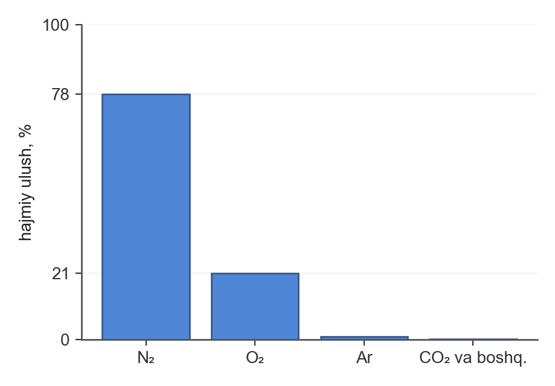

100 l (n.sh.) havo tarkibidagi kislorod hajmini (l) toping.
A) 78  B) 42  C) 10,5  D) 21

**5.** CO + H2O ⇌ CO2 + H2 reaksiyasi 1 l hajmli idishda o'tkazildi. Ma'lumotlar jadvalda berilgan:

| Modda | CO | H2O | CO2 |
|---|---|---|---|
| Boshlang'ich, mol | 4 | 3 | 0 |
| Muvozanatda, mol | — | — | 1,5 |

Muvozanat konstantasini (K) hisoblang.
A) 1,2  B) 0,3  C) 1,667  D) 0,6

**6.** 1 M sirka kislota eritmasida dissotsilanish darajasi 1 % bo'lsa, vodorod ionlari konsentratsiyasini (mol/l) aniqlang.
A) 0,1  B) 0,001  C) 0,01  D) 1

**7.** 1,5 mol CH4 tarkibida necha mol atom bor?
A) 7,5  B) 6  C) 9  D) 1,5

**8.** 2SO2 + O2 ⇌ 2SO3 + Q muvozanatni o'ngga siljitadigan o'zgarishlarni toping: 1) haroratni oshirish; 2) bosimni oshirish; 3) bosimni pasaytirish; 4) katalizator qo'shish.
A) 2  B) 3, 4  C) 2, 4  D) 2, 3

**9.** Noma'lum X tuzining eruvchanligi (g/100 g suv) haroratga bog'liq jadvalda keltirilgan:

| t, °C | 0 | 20 | 40 | 60 |
|---|---|---|---|---|
| S, g/100 g suv | 13 | 32 | 64 | 110 |

40 °C da tayyorlangan to'yingan 164 g eritma 0 °C gacha sovitildi. Cho'kmaga tushgan tuz massasini (g) aniqlang.
A) 64  B) 51  C) 13  D) 102

**10.** Quyidagi moddalarning qaysilarida ion bog' mavjud? 1) CO2; 2) NaOH; 3) Cl2; 4) KNO3
A) 2, 3  B) 1, 2, 3  C) 2, 4  D) 2, 3, 4

**11.** Selen (Z = 34) atomining tashqi energetik pog'onasidagi elektronlar sonini aniqlang.
A) 7  B) 6  C) 5  D) 8

**12.** Quyidagi zarrachalardan qaysilari neon atomi bilan izoelektron? 1) Al³⁺; 2) O²⁻; 3) F⁻; 4) Cl⁻
A) 1, 3  B) 1, 2, 3  C) 1, 2  D) 2, 4

**13.** NaCrO2 + Br2 + NaOH → Na2CrO4 + NaBr + H2O reaksiya tenglamasini tenglang va barcha koeffitsiyentlar yig'indisini aniqlang.
A) 26  B) 25  C) 24  D) 27

### ANORGANIK KIMYO (14–19)

**14.** Reaksiya tenglamasi: 2CO + O2 → 2CO2. Reaksiyaga 5,6 g CO kirishdi. CO2 hajmini (l, n.sh.) hisoblang.
A) 8,96  B) 2,24  C) 4,48  D) 6,72

**15.** NaI va NaCl dan iborat 40 g aralashma orqali mo'l xlor o'tkazilganda aralashma massasi 18,3 g ga kamaydi. Aralashmadagi NaI ning massa ulushini (%) aniqlang.
A) 25  B) 30  C) 75  D) 45,8

**16.** 2Na2O2 + 2CO2 → 2Na2CO3 + O2 jarayoni uchun 5,6 l (n.sh.) CO2 olingan. Na2CO3 miqdorini (mol) aniqlang.
A) 0,5  B) 0,12  C) 0,38  D) 0,25

**17.** Rasmda metallarning kuchlanish qatori ko'rsatilgan (X, Y, Z — noma'lum metallar).

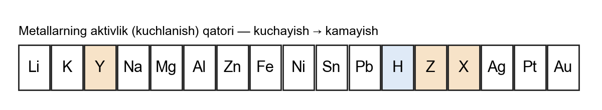

Z metali tuzining eritmasiga X metall plastinka tushirilsa, reaksiya boradimi?
A) Boradi, X faolroq
B) Faqat qizdirilganda boradi
C) Faqat konsentrlangan eritmada boradi
D) Bormaydi, X kamroq faol

**18.** D-metallar va ularning birikmalari haqida qaysi fikrlar to'g'ri? 1) Temir sovuq konsentrlangan HNO3 da passivlanadi; 2) Rux eritmada Fe²⁺ ni siqib chiqara olmaydi; 3) Xrom (VI) oksidi (CrO3) kislotali oksid; 4) Fe(OH)2 havoda qo'ng'ir rangga o'tadi
A) 2, 3, 4  B) 1, 3, 4  C) 1, 2  D) 1, 3

**19.** 1 l suvda 0,01 mol Ca(HCO3)2, 0,01 mol CaSO4 va 0,03 mol MgCl2 erigan. Suv qaynatilgandan keyin qolgan qattiqlikni yo'qotish uchun necha gramm soda (Na2CO3) kerak?
A) 5,3  B) 1,06  C) 3,18  D) 4,24

### ORGANIK KIMYO (20–29)

**20.** CH3–C(CH3)2–OH birikmaning sistematik nomi qaysi qatorda to'g'ri keltirilgan?
A) 2-metilpropanol-2  B) butanol-2  C) 2-metilpropanol-1  D) butanol-1

**21.** 46 g etil spirtidan Lebedev usuli bilan (90 % unum) butadiyen-1,3 olindi (2C2H5OH → C4H6 + H2 + 2H2O). Butadiyen massasini (g) aniqlang.
A) 48,6  B) 27  C) 46  D) 24,3

**22.** Arenlar, neft va tabiiy gaz haqida qaysi fikrlar to'g'ri? 1) Benzolda 6 ta sp² gibridlangan uglerod bor; 2) Neft fraksiyalaridan gazolin 150 °C gacha haydaladi; 3) Naftalin – bir halqali aren; 4) Benzol bromli suvni rangsizlantirmaydi
A) 1, 3, 4  B) 1, 4  C) 2, 4  D) 1, 2, 4

**23.** 2C2H5OH + 2Na → 2C2H5ONa + H2 reaksiyasida 4,6 g Na ishtirok etdi (unum 90 %). C2H5ONa massasini (g) toping.
A) 13,6  B) 12,24  C) 24,48  D) 6,12

**24.** 2CH3CHO + 5O2 → 4CO2 + 4H2O jarayoni uchun 88 g CH3CHO olingan. CO2 massasini (g) aniqlang.
A) 44  B) 176  C) 352  D) 88

**25.** Karbon kislotalar haqida qaysi fikrlar to'g'ri? 1) Benzoy kislota Na2CO3 bilan reaksiyaga kirishmaydi; 2) Sirka kislota karbonatlar bilan CO2 ajratadi; 3) Karboksil guruh karbonil va gidroksil guruhlardan iborat; 4) Stearin kislota to'yinmagan kislota
A) 2, 3  B) 1, 4  C) 1, 3, 4  D) 2, 3, 4

**26.** 17,6 g CH3COOC2H5 mo'l NaOH bilan to'liq gidrolizlandi. Hosil bo'lgan spirt massasini (g) aniqlang.
A) 17,6  B) 18,4  C) 9,2  D) 16,4

**27.** Uglevodlar haqida qaysi fikrlar to'g'ri? 1) Fruktoza ketospirt; 2) Glyukoza gidrolizlanadi; 3) Saxaroza Feling suyuqligini qaytaradi; 4) Kraxmal yod bilan ko'k rang beradi
A) 1, 4  B) 1, 2  C) 2, 4  D) 2

**28.** 18,6 g anilin mo'l xlorid kislota bilan reaksiyaga kirishganda hosil bo'lgan tuz massasini (g) aniqlang.
A) 18,6  B) 51,8  C) 25,9  D) 7,3

**29.** C2H5Cl + KOH (spirt) reaksiyasi natijasida qaysi organik modda hosil bo'ladi?
A) etilatsetat  B) etilen  C) etanol  D) anilin

### KIMYOVIY TAHLIL (30–32)

**30.** Rasmda HCl ning suvda erishi ko'rsatilgan. 22,4 l (n.sh.) HCl 1000 g suvda eritilsa, hosil bo'lgan eritmadagi HCl ning massa ulushi necha foiz?

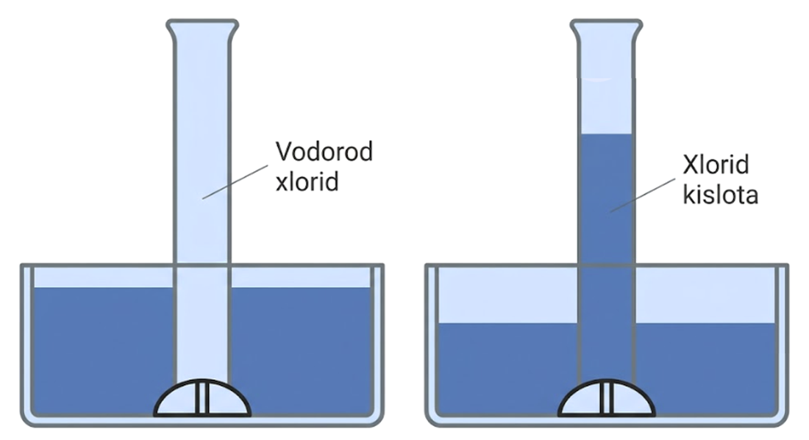
A) 3,52  B) 3,65  C) 1,76  D) 7,04

**31.** Fenolftalein indikatori ishqoriy muhitda qanday rang beradi?
A) malina rangga kiradi (pushti)  B) sariq  C) binafsha  D) rangsiz

**32.** Laboratoriyada asetilen olish uchun qaysi moddalar ishlatiladi?
A) KMnO4 (qizdirish)  B) C2H5OH + H2SO4 (kons.), 170 °C  C) CaCO3 + HCl  D) CaC2 + H2O

## II QISM. MOSLASHTIRISH (33–35)

**33–35.** Topshiriqlarga mos javoblarni A–F variantlaridan tanlang.
CaC2 (12,8 g) va Al4C3 (7,2 g) dan iborat aralashma mo'l suv bilan to'liq reaksiyaga kirishdi.

**33.** Hosil bo'lgan gazlar aralashmasining vodorodga nisbatan zichligini aniqlang.
**34.** Hosil bo'lgan gazlar aralashmasini to'liq yoqish uchun zarur havo hajmini (l, n.sh.; havoda 21 % kislorod bor) aniqlang.
**35.** Aralashmadagi to'yinmagan uglevodorod Kucherov reaksiyasi bo'yicha 80 % unum bilan reaksiyaga kirishsa, hosil bo'lgan aldegid massasini (g) aniqlang.

A) 7,04  B) 85,33  C) 5,43  D) 5,63  E) 10,86  F) 42,67

## III QISM. QISQA JAVOBLI (36–40) — javobni son bilan yozing

**36.** Fe + H2SO4 → Fe2(SO4)3 + SO2 + H2O reaksiya tenglamasini tenglang va barcha koeffitsiyentlar yig'indisini aniqlang.

**37.** pH = 1 bo'lgan kuchli kislota eritmasi 100 marta suyultirildi. Yangi eritmaning pH qiymatini aniqlang.

**38.** Cu va CuO dan iborat 16,8 g aralashma mo'l suyultirilgan H2SO4 da ishlandi, 12,8 g qattiq qoldiq qoldi. Hosil bo'lgan tuz massasini (g) aniqlang.

**39.** C3H7OH va C2H5OH dan iborat 10,6 g aralashma natriy bilan to'liq reaksiyaga kirishganda 2,24 l (n.sh.) vodorod ajraldi. Aralashmadagi C3H7OH massasini (g) toping.

**40.** 17,8 g tristearin mo'l NaOH eritmasi bilan to'liq gidrolizlandi (sovun unumi 80 %). Hosil bo'lgan natriy stearat (M = 306 g/mol) massasini (g) toping.

## IV QISM. YOZMA ISH (41–43) — to'liq yechim ko'rsatiladi

### 41-topshiriq (umumiy kimyo; 5 band, 25 ball)
Sulfat kislotaning massa ulushi 40 % bo'lgan eritmasining zichligi 1,3 g/ml.
1) Eritmaning molyar konsentratsiyasini (mol/l) hisoblang.
2) Eritmaning normal konsentratsiyasini (ekv/l) toping. Sulfat kislotaning ekvivalent massasini (g/ekv) ham aniqlang.
3) Eritmaning molyal konsentratsiyasini (mol/kg) aniqlang.
4) Shu eritmadan 100 ml 0,5 mol/l li eritma tayyorlash uchun necha ml olish kerak? 100 ml eritmadagi suvning massasini (g) ham hisoblang.
5) 100 ml shu eritmani to'liq neytrallash uchun necha gramm NaOH kerak? 250 ml shu eritmadagi H2SO4 massasini (g) ham hisoblang.

### 42-topshiriq (organik kimyo; 4 band, 25 ball; hisob-kitob yo'q)
Quyidagi o'zgarishlar zanjirida X, Y, Z noma'lum organik moddalar:
CH3CHO —Ag2O, NH3→ X —C2H5OH, H2SO4→ Y —NaOH→ Z —NaOH (suyuqlanma), t°→ CH4
1) CH3CHO → X : reaksiya tenglamasini yozing; hosil bo'lgan moddani nomlang.
2) X → Y : reaksiya tenglamasini yozing; hosil bo'lgan moddani nomlang.
3) Y → Z : reaksiya tenglamasini yozing; hosil bo'lgan moddani nomlang.
4) Z → CH4 : reaksiya tenglamasini yozing; hosil bo'lgan moddani nomlang.

### 43-topshiriq (anorganik kimyo yoki kimyoviy tahlil; 5 band, 25 ball)
SO2 va CO2 dan iborat 6,72 l (n.sh.) gazlar aralashmasi avval mo'l bromli suvdan, so'ngra mo'l Ba(OH)2 eritmasidan o'tkazildi. Bromli suvdan o'tgandan keyin SO2 to'liq yutildi.
1) Bromli suv bilan SO2 reaksiyasi tenglamasini yozing (SO2 + Br2 + 2H2O → H2SO4 + 2HBr). Hosil bo'lgan H2SO4 massasini (g) toping. SO2 hajmini (l, n.sh.) ham hisoblang.
2) Mo'l BaCl2 qo'shilganda bromli suvli eritmada hosil bo'lgan cho'kma massasini (g) aniqlang.
3) Ba(OH)2 eritmasida hosil bo'lgan cho'kma massasini (g) hisoblang.
4) Dastlabki aralashmaning o'rtacha molyar massasini (g/mol) va havoga nisbatan zichligini toping.
5) Bromli suvli eritmada hosil bo'lgan HBr massasini (g) hisoblang.

# VARIANT 2

## I QISM. YOPIQ TESTLAR (1–32, har biri bitta to'g'ri javob)

### UMUMIY KIMYO (1–13)

**1.** Jadvalda ikki tuz eritmasi haqida ma'lumot berilgan:

| Eritma | Massasi, g | Massa ulushi, % |
|---|---|---|
| 1 | 100 | 20 |
| 2 | 200 | 30 |

Eritmalar aralashtirilganda hosil bo'lgan eritmaning massa ulushini (%) aniqlang.
A) 26,67  B) 25  C) 50  D) 23,33

**2.** CuSO4·5H2O kristallogidratida kristallizatsion suvning massa ulushini (%) aniqlang.
A) 64  B) 36  C) 18  D) 56,2

**3.** 2-davr elementlari atom radiuslarining o'zgarishi diagrammada ko'rsatilgan.

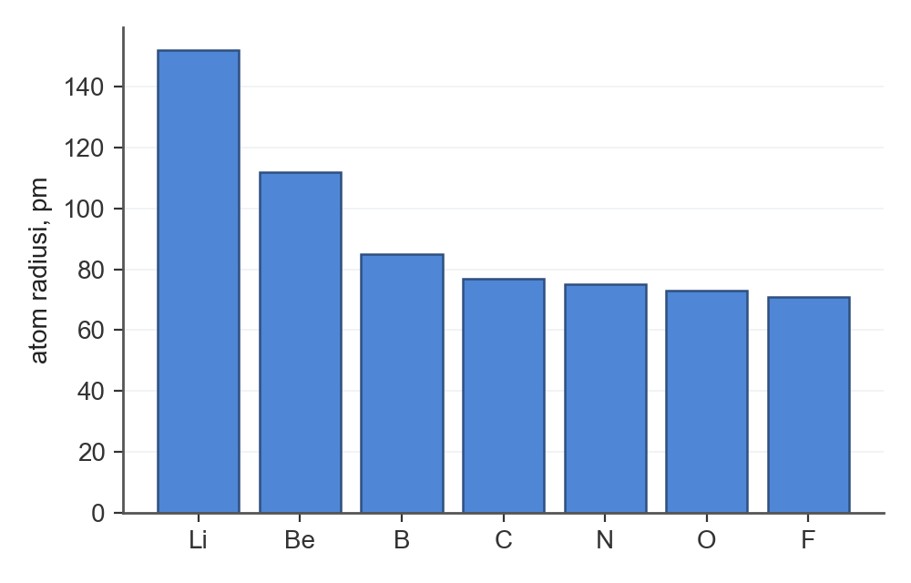

Davr bo'yicha chapdan o'ngga atom radiusi qanday o'zgaradi va sababi nima?
A) Ortadi, qavatlar soni ko'payishi tufayli
B) Kamayadi, qavatlar soni kamayishi tufayli
C) O'zgarmaydi
D) Kamayadi, yadro zaryadi ortishi tufayli

**4.** Rasmda radioaktiv yemirilish zanjiri berilgan (massa soni/zaryad; «?» – oraliq yadrolar).

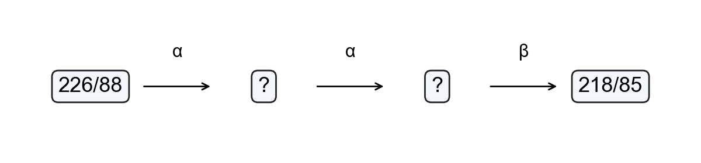

Oxirgi yadroning massa sonini aniqlang.
A) 222  B) 214  C) 219  D) 218

**5.** Tarkibida 30 % SO3 bo'lgan 100 g oleum 300 g suvga qo'shildi. Hosil bo'lgan eritmadagi H2SO4 ning massa ulushini (%) aniqlang.
A) 17,5  B) 26,69  C) 35,58  D) 40,03

**6.** N2 + 3H2 ⇌ 2NH3 reaksiyada muvozanat holatida [N2] = 1, [H2] = 0,5, [NH3] = 2 mol/l. Muvozanat konstantasini (K) hisoblang.
A) 64  B) 16  C) 32  D) 4

**7.** 3 mol Al2(SO4)3 va 3 mol AlCl3 suvda eritilib, eritma hajmi 2 l ga yetkazildi. Eritmadagi barcha ionlarning umumiy molyar konsentratsiyasini (mol/l) aniqlang (kuchli elektrolitlar to'liq dissotsilanadi).
A) 3  B) 27  C) 13,5  D) 6,75

**8.** Jadvalda metall plastinkalarning tuz eritmalariga tushirilishidagi kuzatuvlar berilgan («+» – metall ajraladi, reaksiya boradi; «−» – reaksiya bormaydi):

| Metall | ZnSO4 eritmasi | AgNO3 eritmasi | CuSO4 eritmasi |
|---|---|---|---|
| Mg | + | + | + |
| Cu | − | + | − |
| Zn | − | + | + |

Ushbu metallardan qaysi biri eng faol?
A) Cu  B) Mg  C) Zn  D) Fe

**9.** 10 l H2S va 45 l O2 aralashmasi 2H2S + 3O2 → 2SO2 + 2H2O tenglama bo'yicha to'liq reaksiyaga kirishdi (reaksiyadan so'ng suv suyuq holatda; gazlar bir xil sharoitda o'lchandi). Aralashma hajmi necha litrga o'zgargan (modul bo'yicha)?
A) 55  B) 40  C) 10  D) 15

**10.** 8 g metall kislotada eritilganda 4,48 l (n.sh.) vodorod ajraldi. Metallning ekvivalent massasini (g/mol) aniqlang (V_E(H2) = 11,2 l/mol).
A) 40  B) 10  C) 89,6  D) 20

**11.** Azot (Z = 7) atomida nechta juftlashmagan elektron bor?
A) 4  B) 2  C) 5  D) 3

**12.** Zichligi 1,4 g/ml bo'lgan 40 % li KOH eritmasining molyar konsentratsiyasini (mol/l) aniqlang.
A) 1  B) 20  C) 10  D) 7,14

**13.** 61,25 g KClO3 reaksiyaga kirishdi (2KClO3 → 2KCl + 3O2). Ajralgan O2 hajmini (l, n.sh.) hisoblang (unum 80 %).
A) 13,44  B) 16,8  C) 26,88  D) 6,72

### ANORGANIK KIMYO (14–19)

**14.** Ishqoriy metallar haqida qaysi fikrlar to'g'ri? 1) Ishqoriy metallar tabiatda erkin holda uchraydi; 2) Natriy yonganda Na2O2 hosil bo'ladi; 3) Natriy kerosin ostida saqlanadi; 4) Litiy eng yengil metall
A) 1, 2, 3  B) 1, 4  C) 2, 3, 4  D) 1, 3

**15.** Ca + 2H2O → Ca(OH)2 + H2 reaksiyasida 20 g Ca ishtirok etdi. H2 massasini (g) toping.
A) 1  B) 2  C) 0,5  D) 1,5

**16.** 11,2 g temir bir qismi xlor bilan, xuddi shuncha qismi xlorid kislota bilan reaksiyaga kirishdi. Hosil bo'lgan tuzlar massalari farqini (g) aniqlang.
A) 32,5  B) 25,4  C) 14,2  D) 7,1

**17.** Reaksiya tenglamasi: Mg(HCO3)2 → MgCO3 + CO2 + H2O. Reaksiyaga 58,4 g Mg(HCO3)2 kirishdi (unum 50 %). CO2 miqdorini (mol) hisoblang.
A) 0,2  B) 0,4  C) 0,1  D) 0,3

**18.** Qaysi juftliklar o'zaro reaksiyaga kirishmaydi? 1) Fe2O3 va H2O; 2) SiO2 va H2O; 3) CO2 va CaO; 4) ZnO va HCl
A) 4  B) 1, 2  C) 1  D) 2, 3, 4

**19.** Reaksiya tenglamasi: 2Al + 3CuCl2 → 2AlCl3 + 3Cu. Reaksiyaga 27 g CuCl2 kirishdi. Al massasini (g) hisoblang.
A) 8,1  B) 3,6  C) 7,2  D) 1,8

### ORGANIK KIMYO (20–29)

**20.** C4H9OH tarkibli spirtlarning izomerlari soni nechta?
A) 5  B) 4  C) 3  D) 6

**21.** 23 g etil spirtidan 90 % unum bilan etilen olindi. Etilen hajmini (l, n.sh.) aniqlang.
A) 10,08  B) 11,2  C) 20,16  D) 20,7

**22.** Arenlar, neft va tabiiy gaz haqida qaysi fikrlar to'g'ri? 1) Benzolda 6 ta sp² gibridlangan uglerod bor; 2) Benzol uchun birikish reaksiyalari mutlaqo xos emas; 3) Benzoldan nitrobenzol nitrolash bilan olinadi; 4) Naftalin – bir halqali aren
A) 1, 3, 4  B) 1, 3  C) 1, 4  D) 1

**23.** Spirt va fenollar haqida qaysi fikrlar to'g'ri? 1) Fenol Cu(OH)2 ni eritib ko'k kompleks hosil qiladi; 2) Etanol natriy bilan reaksiyaga kirishadi; 3) Etilenglikol zaharsiz; 4) Birlamchi spirt oksidlanganda aldegid hosil bo'ladi
A) 1, 2, 3  B) 1, 2, 4  C) 2, 4  D) 1, 4

**24.** Reaksiya tenglamasi: HCHO + Ag2O → HCOOH + 2Ag. Reaksiyaga 2,24 l (n.sh.) HCHO kirishdi. Ag2O massasini (g) hisoblang.
A) 46,4  B) 23,2  C) 11,6  D) 34,8

**25.** 60 g CH3COOH dan quyidagi ikki bosqichda CH4 olinadi:
1) CH3COOH + NaOH → CH3COONa + H2O (unum 50 %);
2) CH3COONa + NaOH → CH4 + Na2CO3 (unum 75 %).
Oxirgi mahsulot CH4 ning hajmini (l, n.sh.) toping.
A) 16,8  B) 11,2  C) 8,4  D) 22,4

**26.** 445 g tristearin natriy ishqori bilan to'liq gidrolizlanganda necha gramm sovun hosil bo'ladi?
A) 153  B) 306  C) 459  D) 445

**27.** 22 g CO2 dan quyidagi ikki bosqichda C2H5OH olinadi:
1) 6CO2 + 6H2O → C6H12O6 + 6O2 (unum 60 %);
2) C6H12O6 → 2C2H5OH + 2CO2 (unum 90 %).
Oxirgi mahsulot C2H5OH ning massasini (g) toping.
A) 4,14  B) 6,9  C) 4,6  D) 7,67

**28.** 24,6 g C6H5NO2 dan quyidagi ikki bosqichda C6H5NH3Cl olinadi:
1) C6H5NO2 + 3H2 → C6H5NH2 + 2H2O (unum 80 %);
2) C6H5NH2 + HCl → C6H5NH3Cl (unum 75 %).
Oxirgi mahsulot C6H5NH3Cl ning massasini (g) toping.
A) 15,54  B) 19,42  C) 20,72  D) 25,9

**29.** 3C2H2 (C, t) reaksiyasi natijasida qaysi organik modda hosil bo'ladi?
A) benzoy kislota  B) etilatsetat  C) benzol  D) sirka aldegid

### KIMYOVIY TAHLIL (30–32)

**30.** Uch probirkada (X, Y, Z) Na2SO4, K2CO3, NH4Cl eritmalari bor (tartibsiz). Ularga HCl va NaOH ta'sir ettirildi. Kuzatuvlar jadvalda:

| Probirka | HCl qo'shilganda | NaOH qo'shib qizdirilganda |
|---|---|---|
| X | o'zgarish yo'q | o'tkir hidli gaz ajraladi |
| Y | o'zgarish yo'q | o'zgarish yo'q |
| Z | gaz ajraladi | o'zgarish yo'q |

X, Y, Z probirkalardagi moddalarni aniqlang.
A) X – K2CO3, Y – NH4Cl, Z – Na2SO4  B) X – NH4Cl, Y – K2CO3, Z – Na2SO4  C) X – Na2SO4, Y – NH4Cl, Z – K2CO3  D) X – NH4Cl, Y – Na2SO4, Z – K2CO3

**31.** Rasmda spirt lampasining tuzilishi ko'rsatilgan. 1 raqami bilan belgilangan qism nima deb ataladi?

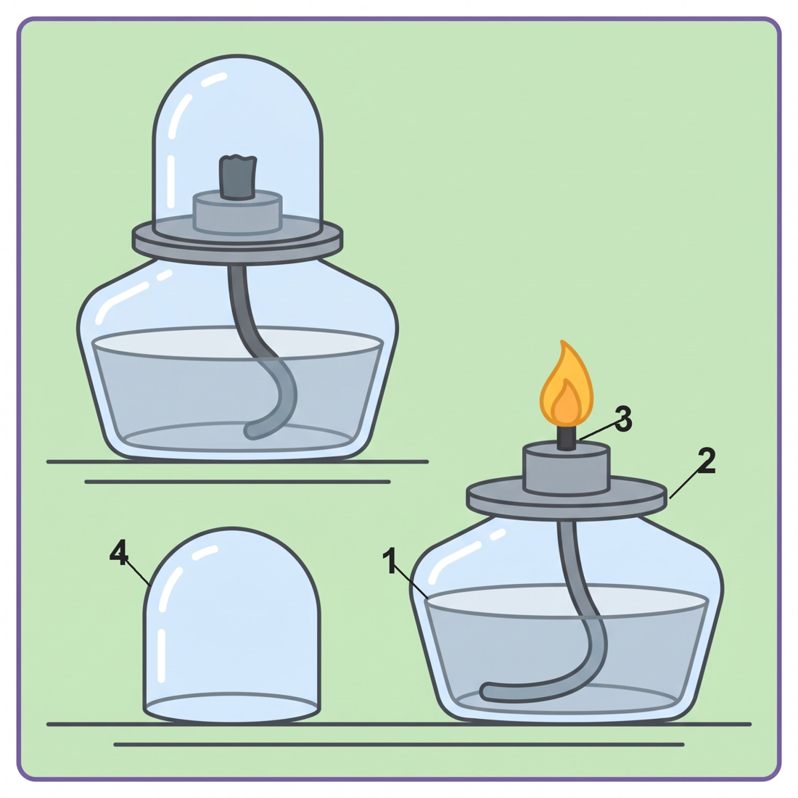
A) idish  B) tutqich  C) pilik  D) shtativ

**32.** 300 g 10 % li va 100 g 40 % li KCl eritmalari aralashtirildi. Yangi eritmaning massa ulushini (%) toping.
A) 25  B) 50  C) 15,75  D) 17,5

## II QISM. MOSLASHTIRISH (33–35)

**33–35.** Topshiriqlarga mos javoblarni A–F variantlaridan tanlang.
KI va NaBr dan iborat 18,6 g aralashma suvda eritilib, mo'l AgNO3 eritmasi qo'shildi; hosil bo'lgan cho'kmalarning umumiy massasi 30,55 g.

**33.** Aralashmadagi KI massasini (g) aniqlang.
**34.** Sarflangan 10 % li AgNO3 eritmasining massasini (g) aniqlang (M(AgNO3) = 170 g/mol).
**35.** Eritmada hosil bo'lgan nitratlarning umumiy massasini (g) aniqlang.

A) 8,3  B) 204  C) 13,55  D) 510  E) 6,64  F) 255

## III QISM. QISQA JAVOBLI (36–40) — javobni son bilan yozing

**36.** KMnO4 + FeSO4 + H2SO4 → MnSO4 + Fe2(SO4)3 + K2SO4 + H2O reaksiya tenglamasini tenglang va barcha koeffitsiyentlar yig'indisini aniqlang.

**37.** Ketma-ket ulangan ikkita elektrolizyordan (CuSO4 va AgNO3 eritmalari, inert elektrodlar) tok o'tkazildi. Birinchi elektrolizyor katodida 12,8 g mis ajraldi. Ikkala elektrolizyor anodlarida ajralgan kislorodning umumiy hajmini (l, n.sh.) toping (anodda ikkalasida ham O2 ajraladi).

**38.** Alyuminiy (0,1 mol) va rux (0,1 mol) aralashmasi mo'l xlorid kislotada eritildi. Ajralgan vodorodning hajmini (l, n.sh.) aniqlang.

**39.** 90 g glyukoza spirtli bijg'ish natijasida etanolga (unum 80 %), hosil bo'lgan etanol esa sirka kislotagacha (unum 80 %) aylantirildi. Olingan kislotani to'liq neytrallash uchun NaOH ning massasini (g) toping.

**40.** 162 g kraxmal to'liq gidrolizlanib (unum 100 %), hosil bo'lgan glyukoza massasini (g) aniqlang.

## IV QISM. YOZMA ISH (41–43) — to'liq yechim ko'rsatiladi

### 41-topshiriq (umumiy kimyo; 5 band, 25 ball)
CuSO4·5H2O va Na2SO4·10H2O dan iborat 114,4 g aralashma 300 g suvda eritildi. Eritma inert elektrodlar yordamida 5 A tok kuchi bilan 7720 s elektroliz qilindi; shu vaqt tugaganda eritmadagi Cu²⁺ ionlari to'liq tugagan edi.
1) Aralashmadagi kristallogidratlarning massalarini (g) aniqlang.
2) Dastlabki eritmada CuSO4 va Na2SO4 ning massa ulushlarini (%) toping. Elektroliz davomida o'tgan zaryadni (C) ham hisoblang.
3) Anodda ajralgan gazning hajmini (l, n.sh.) va elektroliz tugagandan keyingi eritma massasini (g) aniqlang.
4) Elektroliz tugagach eritmadagi H2SO4 va Na2SO4 ning massa ulushlarini (%) hisoblang. Dastlabki CuSO4 ning massasini (g) ham hisoblang.
5) Shu eritmani to'liq neytrallash uchun zichligi 1,22 g/ml bo'lgan 20 % li NaOH eritmasidan necha ml kerak? Agar tok kuchi 2 marta oshirilsa, xuddi shu miqdor Cu ajralishi uchun necha sekund kerak bo'ladi?

### 42-topshiriq (organik kimyo; 3 band, 25 ball; hisob-kitob yo'q)
Quyidagi o'zgarishlar zanjirida X, Y, Z noma'lum organik moddalar:
CH3Cl —Na→ X —Cl2, yorug'lik→ Y —KOH (suvli)→ C2H5OH
1) CH3Cl → X : reaksiya tenglamasini yozing; hosil bo'lgan moddani nomlang.
2) X → Y : reaksiya tenglamasini yozing; hosil bo'lgan moddani nomlang.
3) Y → C2H5OH : reaksiya tenglamasini yozing; hosil bo'lgan moddani nomlang.

### 43-topshiriq (anorganik kimyo yoki kimyoviy tahlil; 5 band, 25 ball)
50 m³ qattiq suvda Ca(HCO3)2 ning konsentratsiyasi 40 mol/m³, Mg(HCO3)2 niki 10 mol/m³ ga teng (1 m³ = 1000 l).
1) Suv qaynatilganda qanday reaksiyalar sodir bo'lishini yozing.
2) Qaynatish natijasida hosil bo'ladigan CaCO3 cho'kmasi massasini (kg) hisoblang. Qaynatish bilan ajralgan CO2 hajmini (m³, n.sh.) ham hisoblang.
3) Mg(HCO3)2 dan hosil bo'ladigan MgCO3 massasini (kg) toping.
4) Suvni yumshatish uchun sodadan (Na2CO3) necha kilogramm kerakligini hisoblang (Ca²⁺ va Mg²⁺ ni to'liq cho'ktirish uchun).
5) Suvni ohak sutini (Ca(OH)2) bilan yumshatishda zarur Ca(OH)2 massasini (kg) hisoblang (Ca(HCO3)2 + Ca(OH)2 → 2CaCO3 + 2H2O; Mg(HCO3)2 + 2Ca(OH)2 → Mg(OH)2 + 2CaCO3 + 2H2O).

# VARIANT 3

## I QISM. YOPIQ TESTLAR (1–32, har biri bitta to'g'ri javob)

### UMUMIY KIMYO (1–13)

**1.** Kislorod (Z = 8) atomi elektron konfiguratsiyasida jami nechta juftlashgan elektron bor?
A) 7  B) 6  C) 5  D) 8

**2.** N2 + 3H2 ⇌ 2NH3 reaksiyasi 4 l hajmli idishda o'tkazildi. Ma'lumotlar jadvalda berilgan:

| Modda | N2 | H2 | NH3 |
|---|---|---|---|
| Boshlang'ich, mol | 6 | 6 | 0 |
| Muvozanatda, mol | — | — | 2 |

Muvozanat konstantasini (K) hisoblang.
A) 0,948  B) 0,237  C) 1,896  D) 0,474

**3.** 400 g 15 % li tuz eritmasidan suv bug'latilib, massa ulushi 37 % ga yetkazildi. Bug'latilgan suv massasini (g) aniqlang.
A) 160  B) 240  C) 480  D) 600

**4.** 2SO2 + O2 ⇌ 2SO3 + Q muvozanatni o'ngga siljitadigan o'zgarishlarni toping: 1) haroratni oshirish; 2) katalizator qo'shish; 3) bosimni oshirish; 4) haroratni pasaytirish.
A) 1, 2, 3  B) 2, 4  C) 4  D) 3, 4

**5.** Cu + HNO3 → Cu(NO3)2 + NO2 + H2O reaksiyasida 2 mol Cu erisa, HNO3 ning necha moli oksidlovchi vazifasini bajaradi?
A) 4  B) 8  C) 2  D) 6

**6.** 3 mol NaCl va 3 mol AlCl3 suvda eritilib, eritma hajmi 2 l ga yetkazildi. Eritmadagi barcha ionlarning umumiy molyar konsentratsiyasini (mol/l) aniqlang (kuchli elektrolitlar to'liq dissotsilanadi).
A) 3  B) 18  C) 4,5  D) 9

**7.** H2 + I2 ⇌ 2HI reaksiyada muvozanat qaror topganda [H2] = 1,5, [I2] = 3, [HI] = 1 mol/l bo'ldi. H2 ning boshlang'ich konsentratsiyasini (mol/l) aniqlang.
A) 2  B) 1,5  C) 2,5  D) 4

**8.** Grafikda A moddaning (A → mahsulot) konsentratsiyasi vaqt bo'yicha o'zgarishi ko'rsatilgan.

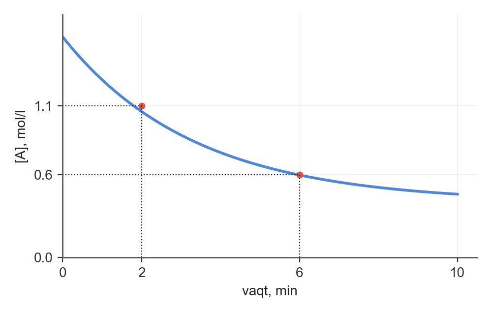

2-minutdan 6-minutgacha A moddaning konsentratsiyasi necha foizga kamaygan (2-minutdagiga nisbatan)?
A) 54,5  B) 83,3  C) 45,5  D) 50

**9.** 9,6 g Mg va 14,6 g HCl aralashtirilib, reaksiya o'tkazildi (Mg + 2HCl → MgCl2 + H2). Hosil bo'lgan MgCl2 massasini (g) aniqlang.
A) 38  B) 9,5  C) 19  D) 28,5

**10.** Quyidagi zarrachalardan qaysilari argon atomi bilan izoelektron? 1) Ca²⁺; 2) F⁻; 3) S²⁻; 4) N³⁻
A) 1, 2, 4  B) 1, 3  C) 1, 2  D) 2, 4

**11.** CuSO4 ning suvli eritmasi inert elektrodlar bilan elektroliz qilinganda qaysi moddalar ajraladi?
A) Ag va O2  B) Zn, H2 va O2  C) H2 va O2  D) Cu va O2

**12.** Jadvalda bog'lar hosil qiluvchi atomlarning elektrmanfiyliklari berilgan:

| Bog' | EM (1-atom) | EM (2-atom) |
|---|---|---|
| H–O | 2,1 | 3,5 |
| C–H | 2,5 | 2,1 |
| H–Cl | 2,1 | 3 |
| Si–O | 1,8 | 3,5 |

Qaysi bog' eng qutbli (eng ko'p ionli xarakterga ega)?
A) H–O  B) C–H  C) Si–O  D) H–Cl

**13.** 3 mol Ba(OH)2 va 3 mol K3PO4 suvda eritilib, eritma hajmi 2 l ga yetkazildi. Eritmadagi barcha ionlarning umumiy molyar konsentratsiyasini (mol/l) aniqlang (kuchli elektrolitlar to'liq dissotsilanadi).
A) 3  B) 10,5  C) 21  D) 5,25

### ANORGANIK KIMYO (14–19)

**14.** 4Fe(OH)2 + O2 + 2H2O → 4Fe(OH)3 jarayoni uchun 22,5 g Fe(OH)2 olingan. Fe(OH)3 massasini (g) aniqlang.
A) 53,5  B) 13,38  C) 26,75  D) 40,12

**15.** 0,02 mol Ca(HCO3)2 tutgan suv qaynatilganda ajralgan CO2 hajmini (l, n.sh.)  ni toping.
A) 0,9  B) 0,45  C) 0,22  D) 0,67

**16.** N2O5 + H2O → 2HNO3 jarayoni uchun 216 g N2O5 olingan (unum 50 %). HNO3 miqdorini (mol) aniqlang.
A) 1  B) 2  C) 4  D) 3

**17.** Qaysi juftliklar o'zaro reaksiyaga kirishadi? 1) Ag va H2SO4(suyult.); 2) MgCl2 va KNO3; 3) Fe va HCl; 4) Na2CO3 va HCl
A) 3, 4  B) 1, 3  C) 2, 3, 4  D) 1, 2, 4

**18.** Reaksiya tenglamasi: 2KCl + H2SO4 → K2SO4 + 2HCl. Reaksiyaga 49 g H2SO4 kirishdi. HCl hajmini (l, n.sh.) hisoblang.
A) 5,6  B) 22,4  C) 44,8  D) 11,2

**19.** NaNO3 qizdirilganda qanday moddalar hosil bo'ladi?
A) KNO2 va O2  B) Ag, NO2 va O2  C) ZnO, NO2 va O2  D) NaNO2 va O2

### ORGANIK KIMYO (20–29)

**20.** CH3–CO–CH2–CH3 birikmaning sistematik nomi qaysi qatorda to'g'ri keltirilgan?
A) butanon  B) butanal  C) butanol-2  D) propanon

**21.** Etilen va asetilendan iborat 5,4 g aralashma mo'l bromli suv bilan to'liq reaksiyaga kirishdi. Sarflangan brom massasini (g) aniqlang. Aralashmadagi etilen va asetilenning mol nisbati 1 : 1.
A) 48  B) 96  C) 24  D) 32

**22.** 39 g benzoldan nitrobenzol olishda unum 75 % bo'lsa, mahsulot massasini (g) aniqlang.
A) 61,5  B) 92,25  C) 29,25  D) 46,12

**23.** Rasmdagi zanjirda CH3COOC2H5 dan CH3COONa olish uchun X reagent va sharoitni aniqlang.

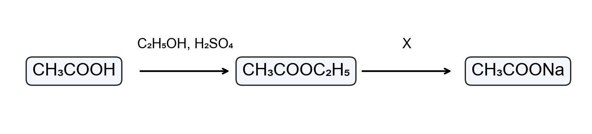
A) H2SO4 (kons.), 170 °C  B) H2, kat.  C) NaOH  D) Br2

**24.** Aldegid va ketonlar haqida qaysi fikrlar to'g'ri? 1) Aldegidlar qaytarilganda ikkilamchi spirt hosil bo'ladi; 2) Aseton Cu(OH)2 ni qaytaradi; 3) Aseton suvda erimaydi; 4) Sirka aldegid Kucherov reaksiyasi bilan olinadi
A) 1, 3  B) 3  C) 4  D) 1

**25.** Karbon kislotalar haqida qaysi fikrlar to'g'ri? 1) Sirka kislota karbonatlar bilan CO2 ajratadi; 2) Karboksil guruh karbonil va gidroksil guruhlardan iborat; 3) Chumoli kislota "kumush ko'zgu" reaksiyasini beradi; 4) Olein kislota Br2 ni biriktiradi
A) 2, 3, 4  B) 1, 2, 3  C) 1, 3, 4  D) 1, 2, 3, 4

**26.** 14,8 g CH3COOCH3 mo'l NaOH bilan to'liq gidrolizlandi. Hosil bo'lgan tuz massasini (g) aniqlang.
A) 16,4  B) 14,8  C) 32,8  D) 8,2

**27.** 36 g C6H12O6 dan quyidagi ikki bosqichda C2H5ONa olinadi:
1) C6H12O6 → 2C2H5OH + 2CO2 (unum 75 %);
2) 2C2H5OH + 2Na → 2C2H5ONa + H2 (unum 90 %).
Oxirgi mahsulot C2H5ONa ning massasini (g) toping.
A) 24,48  B) 20,4  C) 27,2  D) 18,36

**28.** 0,4 mol CH3NH2 to'liq yondirilganda hosil bo'lgan CO2 va N2 hajmlari yig'indisini (l, n.sh.) aniqlang (4CH3NH2 + 9O2 → 4CO2 + 10H2O + 2N2).
A) 8,96  B) 13,44  C) 17,92  D) 4,48

**29.** Izobutilen monomeridan olingan polimerning polimerlanish darajasi 2000 bo'lsa, uning molyar massasini (g/mol) aniqlang.
A) 56000  B) 224000  C) 112000  D) 2056

### KIMYOVIY TAHLIL (30–32)

**30.** Metiloranj indikatori ishqoriy muhitda qanday rang beradi?
A) sariq  B) rangsiz  C) qizil  D) ko'k

**31.** Rasmdagi asbob bilan qaysi aralashmani ajratish mumkin?

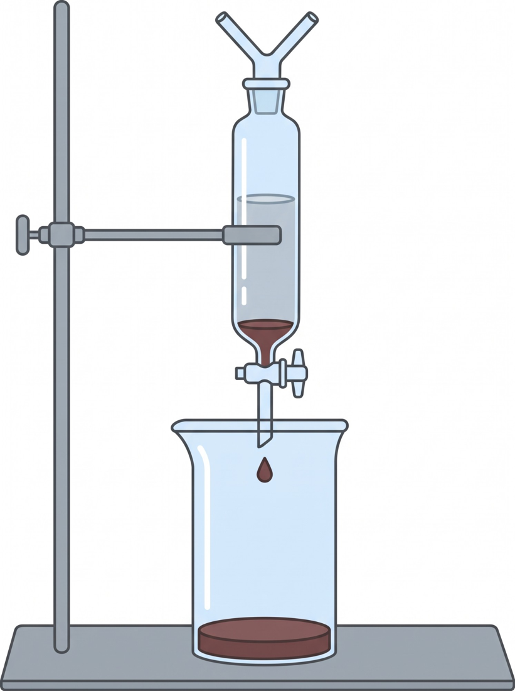
A) suv va kerosin  B) suv va etanol  C) osh tuzi eritmasi  D) suv va qum

**32.** Laboratoriyada etilen olish uchun qaysi moddalar ishlatiladi?
A) FeS + HCl  B) CaC2 + H2O  C) C2H5OH + H2SO4 (kons.), 170 °C  D) CH3COONa + NaOH (qizdirish)

## II QISM. MOSLASHTIRISH (33–35)

**33–35.** Topshiriqlarga mos javoblarni A–F variantlaridan tanlang.
Al va Al2O3 dan iborat 12,9 g aralashma mo'l xlorid kislotada eritilganda 3,36 l (n.sh.) vodorod ajraldi.

**33.** Aralashmadagi Al2O3 massasini (g) aniqlang.
**34.** Aralashmani eritish uchun sarflangan 20 % li HCl eritmasining massasini (g) aniqlang (M(HCl) = 36,5 g/mol).
**35.** Hosil bo'lgan AlCl3 massasini (g) aniqlang.

A) 10,2  B) 164,25  C) 328,5  D) 60,08  E) 20,03  F) 40,05

## III QISM. QISQA JAVOBLI (36–40) — javobni son bilan yozing

**36.** Cu + H2SO4 → CuSO4 + SO2 + H2O reaksiya tenglamasini tenglang. Oksidlovchi va qaytaruvchi oldidagi koeffitsiyentlar yig'indisini aniqlang.

**37.** Zichligi 1,12 g/ml bo'lgan 20 % li HNO3 eritmasining molyar konsentratsiyasini (mol/l) aniqlang.

**38.** 50 m³ suvda Ca(HCO3)2 konsentratsiyasi 10 mol/m³, Mg(HCO3)2 niki 10 mol/m³. Suvni Ca(OH)2 bilan to'liq yumshatish uchun Ca(OH)2 ning massasini (kg) hisoblang.

**39.** Etilatsetat va metilatsetat dan iborat 25 g aralashma mo'l NaOH eritmasi bilan to'liq gidrolizlandi. Hosil bo'lgan spirtlar umumiy massasini (g) toping.

**40.** To'yingan bir atomli aldegidning 7,2 g massasi Ag2O ning ammiakli eritmasi bilan oksidlanganda 21,6 g kumush ajraldi. Aldegidning molyar massasini (g/mol) toping.

## IV QISM. YOZMA ISH (41–43) — to'liq yechim ko'rsatiladi

### 41-topshiriq (umumiy kimyo; 5 band, 25 ball)
HCOONa tuzining 1 mol/l li suvli eritmasi berilgan. HCOOH ning dissotsilanish konstantasi Ka = 1·10^-4, K(suv) = 1·10⁻¹⁴.
1) Tuzning gidrolizlanish reaksiyasi tenglamasini yozing va gidroliz konstantasini (Kh) hisoblang.
2) Eritmadagi OH⁻ ionlarining konsentratsiyasini (mol/l) toping. pOH ni ham hisoblang.
3) Eritmaning pH ini hisoblang.
4) Gidrolizlanish darajasini (%) aniqlang. Eritmadagi H⁺ konsentratsiyasini (mol/l) ham toping.
5) Shunday eritmadan 500 ml tayyorlash uchun necha gramm HCOONa kerak? Eritma 10 marta suyultirilsa gidrolizlanish darajasi necha marta ortadi?

### 42-topshiriq (organik kimyo; 3 band, 25 ball; hisob-kitob yo'q)
Quyidagi o'zgarishlar zanjirida X, Y, Z noma'lum organik moddalar:
CH3COOC2H5 —NaOH→ X —NaOH (suyuqlanma), t°→ Y —Cl2, yorug'lik→ CH3Cl
1) CH3COOC2H5 → X : reaksiya tenglamasini yozing; hosil bo'lgan moddani nomlang.
2) X → Y : reaksiya tenglamasini yozing; hosil bo'lgan moddani nomlang.
3) Y → CH3Cl : reaksiya tenglamasini yozing; hosil bo'lgan moddani nomlang.

### 43-topshiriq (anorganik kimyo yoki kimyoviy tahlil; 5 band, 25 ball)
Uch probirkada XCl2, YCl2 va ZCl2 tarkibli metall xloridlarining eritmalari bor. Har bir eritmaga reagentlar ta'sir ettirildi, kuzatuvlar jadvalda ("—" belgisi reaksiya bormasligini bildiradi, bo'sh kataklar bo'yicha ma'lumot berilmagan):

| Reagent | XCl2 | YCl2 | ZCl2 |
|---|---|---|---|
| H2S | qora cho'kma | — | |
| Na2S | qora cho'kma | qora cho'kma | oq cho'kma |
| NaOH | havorang cho'kma | och yashil cho'kma | oq cho'kma |
| Zn plastinka | qizil qoplama | | — |

X, Y, Z — davriy sistemaning to'rtinchi davridagi metallar.
1) Jadvalda kuzatilgan barcha reaksiyalarning molekulyar tenglamalarini yozing. XCl2 eritmasiga tushirilgan Zn plastinkada 0,1 mol X ajralgan bo'lsa, plastinka massasi qanchaga (g) o'zgargan?
2) X, Y, Z metallarni aniqlang va tuzlarning formulalarini yozing. XCl2 tarkibida X ning massa ulushi 47,4 % ekanini hisob bilan tasdiqlang.
3) 25,4 g YCl2 eritmasiga mo'l NaOH qo'shildi, hosil bo'lgan cho'kma havoda to'liq oksidlanguncha qoldirildi. Barcha reaksiya tenglamalarini yozing va oxirgi cho'kma massasini (g) aniqlang.
4) ZCl2 ning 13,6 g massasi mo'l NaOH eritmasi bilan reaksiyaga kirishganda hosil bo'lgan kompleks tuz massasini (g) hisoblang (reaksiya tenglamalarini yozing).
5) Hosil bo'lgan Cu(OH)2 cho'kmasi (0,1 mol) qizdirilganda hosil bo'ladigan CuO massasini (g) hisoblang.

# VARIANT 4

## I QISM. YOPIQ TESTLAR (1–32, har biri bitta to'g'ri javob)

### UMUMIY KIMYO (1–13)

**1.** A moddaning parchalanish reaksiyasida konsentratsiyaning vaqt bo'yicha o'zgarishi jadvalda berilgan:

| t, min | c, mol/l |
|---|---|
| 0 | 1,6 |
| 2 | 1,44 |
| 4 | 1,28 |
| 6 | 1,12 |

2-minutdan 6-minutgacha o'rtacha tezlikni mol/(l·min) hisoblang.
A) 0,16  B) 0,08  C) 0,04  D) 0,32

**2.** Mo'l kislota bilan Zn ning turli massalari ta'sirlashganda ajralgan H2 hajmi grafikda keltirilgan (n.sh.).

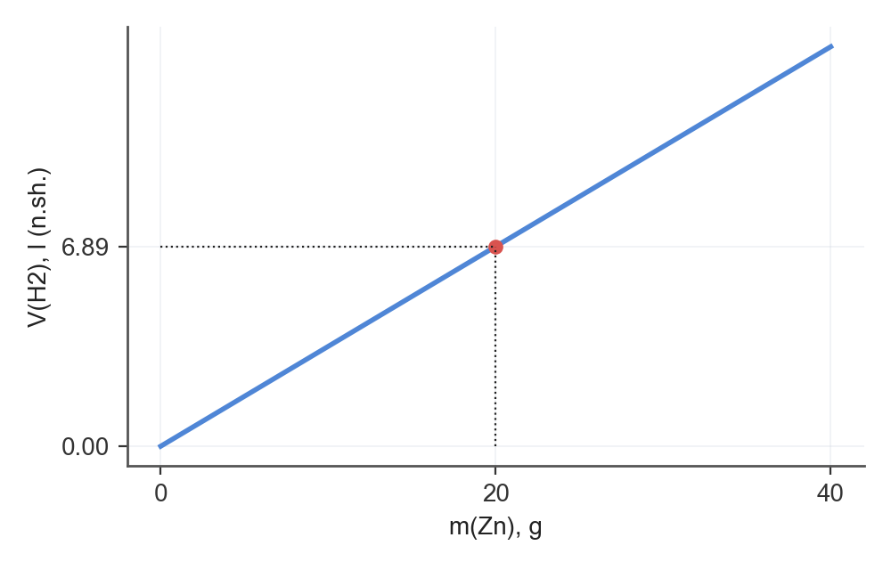

Zn ning molyar massasini (g/mol) grafikdan aniqlang.
A) 130  B) 32,5  C) 65  D) 87,4

**3.** 17-tartib raqamli elementning barcha elektronlaridan nechtasining spin kvant soni m_s = +½ ga teng (Hund qoidasi bo'yicha to'ldirilgan holat)?
A) 9  B) 10  C) 8  D) 11

**4.** 10 l CO va 7,5 l O2 aralashmasi reaksiyaga kirishdi (2CO + O2 → 2CO2, hamma moddalar bir xil sharoitda gaz holida). Reaksiyadan keyingi gaz aralashmasining hajmini (l) aniqlang.
A) 17,5  B) 12,5  C) 10  D) 2,5

**5.** HNO2 tarkibida N ning oksidlanish darajasini aniqlang.
A) −3  B) +2  C) −3 va +5  D) +3

**6.** X³⁺ ionida 10 ta elektron va 16 ta neytron bor. X atomining nisbiy atom massasini aniqlang.
A) 29  B) 32  C) 26  D) 13

**7.** 2SO2 + O2 ⇌ 2SO3 reaksiyada muvozanat qaror topganda [SO2] = 0,5, [O2] = 3, [SO3] = 2 mol/l bo'ldi. SO2 ning boshlang'ich konsentratsiyasini (mol/l) aniqlang.
A) 0,5  B) 3,5  C) 2,5  D) 1,5

**8.** CaCO3 ⇌ CaO + CO2 – Q muvozanatni o'ngga siljitadigan o'zgarishlarni toping: 1) haroratni pasaytirish; 2) bosimni oshirish; 3) bosimni pasaytirish; 4) haroratni oshirish.
A) 1, 3, 4  B) 1, 2  C) 3, 4  D) 1, 3

**9.** Na2SO4·10H2O kristallogidratida kristallizatsion suvning massa ulushini (%) aniqlang.
A) 44,1  B) 55,9  C) 28  D) 126,8

**10.** CuCl2 eritmasi inert elektrodlar yordamida 10 A tok kuchi bilan 9650 s elektroliz qilindi. Katodda ajralgan Cu massasi (g) ni toping.
A) 64  B) 32  C) 16  D) 48

**11.** Zarracha haqida ma'lumot jadvalda berilgan:

| Zarracha tarkibi | Soni |
|---|---|
| proton | 16 |
| neytron | 17 |
| elektron | 17 |

Shu zarrachaning massa sonini aniqlang.
A) 34  B) 32  C) 33  D) 35

**12.** Qaysi juftliklarda reaksiya bormaydi? 1) Fe va MgCl2; 2) Zn va CuSO4; 3) Al va CuSO4; 4) Cu va ZnSO4
A) 1, 4  B) 3, 4  C) 1, 2  D) 4

**13.** Zichligi 1,15 g/ml bo'lgan 30 % li HCl eritmasining molyar konsentratsiyasini (mol/l) aniqlang.
A) 9,45  B) 0,95  C) 18,9  D) 8,22

### ANORGANIK KIMYO (14–19)

**14.** Qaysi juftliklar o'zaro reaksiyaga kirishadi? 1) CuSO4 va NaOH; 2) Zn va NaOH; 3) MgCl2 va KNO3; 4) Cu va HNO3(kons.)
A) 1, 4  B) 1, 2, 4  C) 1, 3  D) 2, 3, 4

**15.** 2KClO3 → 2KCl + 3O2 reaksiyasida 245 g KClO3 ishtirok etdi. O2 hajmini (l, n.sh.) toping.
A) 29,87  B) 67,2  C) 134,4  D) 33,6

**16.** K2SO4 tarkibidagi kaliy ning massa ulushini (%) aniqlang.
A) 22,4  B) 89,7  C) 2,2  D) 44,8

**17.** AgNO3 qizdirilganda qanday moddalar hosil bo'ladi?
A) CuO, NO2 va O2  B) KNO2 va O2  C) ZnO, NO2 va O2  D) Ag, NO2 va O2

**18.** Reaksiya tenglamasi: FeS + 2HCl → FeCl2 + H2S. Reaksiyaga 11,2 l (n.sh.) HCl kirishdi. FeCl2 massasini (g) hisoblang.
A) 31,75  B) 127  C) 63,5  D) 15,88

**19.** Reaksiya tenglamasi: NH4Cl + NaOH → NaCl + NH3 + H2O. Reaksiyaga tarkibida 60 % aralashma bo'lgan 40 g namuna (asosiy modda NaOH) kirishdi. NH3 hajmini (l, n.sh.) hisoblang.
A) 8,96  B) 17,92  C) 4,48  D) 13,44

### ORGANIK KIMYO (20–29)

**20.** Rasmda α-aminokislotaning tuzilish formulasi berilgan.

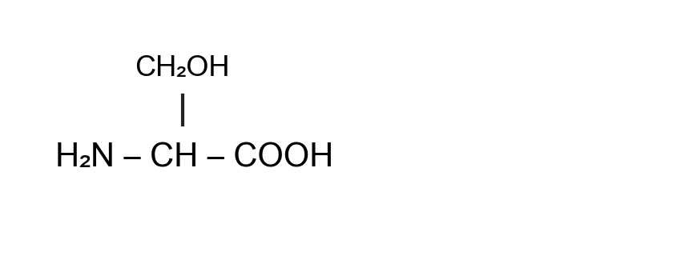

Aminokislotaning nomini toping.
A) alanin  B) serin  C) glitsin  D) valin

**21.** Alken, alkadiyen va alkinlar haqida qaysi fikrlar to'g'ri? 1) Alkenlarda π-bog' yo'q; 2) Alkinlar uchun umumiy formula CnH2n+2; 3) Kauchuk izoprenning polimeri; 4) Etilen sanoatda kreking gazlaridan olinadi
A) 1, 2, 4  B) 1, 2, 3  C) 1, 3  D) 3, 4

**22.** Arenlar, neft va tabiiy gaz haqida qaysi fikrlar to'g'ri? 1) Benzol bromli suvni rangsizlantirmaydi; 2) Benzoldan nitrobenzol nitrolash bilan olinadi; 3) Neft fraksiyalaridan gazolin 150 °C gacha haydaladi; 4) Naftalin – bir halqali aren
A) 3, 4  B) 1, 2, 4  C) 1, 3  D) 1, 2, 3

**23.** Spirt va fenollar haqida qaysi fikrlar to'g'ri? 1) Fenol FeCl3 bilan binafsha rang beradi; 2) Uchlamchi spirtlar oson oksidlanadi; 3) Fenol Cu(OH)2 ni eritib ko'k kompleks hosil qiladi; 4) Glitserin Cu(OH)2 bilan ko'k kompleks hosil qiladi
A) 1, 2, 3  B) 1, 3, 4  C) 1, 3  D) 1, 4

**24.** 44 g CH3CHO dan quyidagi ikki bosqichda (CH3COO)2Ca olinadi:
1) CH3CHO + 2Cu(OH)2 → CH3COOH + Cu2O + 2H2O (unum 60 %);
2) 2CH3COOH + CaCO3 → (CH3COO)2Ca + CO2 + H2O (unum 90 %).
Oxirgi mahsulot (CH3COO)2Ca ning massasini (g) toping.
A) 71,1  B) 47,4  C) 79  D) 42,66

**25.** Karbon kislotalar haqida qaysi fikrlar to'g'ri? 1) Sirka kislota karbonatlar bilan CO2 ajratadi; 2) Qattiq suvda sovun yaxshi ko'piklanadi; 3) Benzoy kislota Na2CO3 bilan reaksiyaga kirishmaydi; 4) Chumoli kislota "kumush ko'zgu" reaksiyasini beradi
A) 3, 4  B) 1, 3  C) 1, 4  D) 2, 3

**26.** CH3COOCH3 + NaOH → CH3COONa + CH3OH jarayoni uchun 20 g NaOH olingan (unum 90 %). CH3COONa massasini (g) aniqlang.
A) 41  B) 73,8  C) 36,9  D) 18,45

**27.** Quyidagi birikmalardan qaysi biri spirt sinfiga kiradi?
A) CH3COOH  B) C6H5NH2  C) C2H5OH  D) CH3COOC2H5

**28.** NH2CH2COOH + C2H5OH → NH2CH2COOC2H5 + H2O reaksiyasida 46 g C2H5OH ishtirok etdi (unum 90 %). NH2CH2COOC2H5 massasini (g) toping.
A) 92,7  B) 103  C) 185,4  D) 46,35

**29.** Izopren monomeridan olingan polimerning molyar massasi 34000 g/mol. Polimerlanish darajasini aniqlang.
A) 1000  B) 500  C) 250  D) 510

### KIMYOVIY TAHLIL (30–32)

**30.** Ba²⁺ ionini aniqlash uchun qaysi reagent mos va qanday belgi kuzatiladi?
A) H2SO4: oq cho'kma (BaSO4), HCl da erimaydi
B) AgNO3: sariq cho'kma (Ag3PO4), HNO3 da eriydi
C) AgNO3: och sariq cho'kma (AgBr)
D) HCl: rangsiz gaz (CO2) ajraladi

**31.** Uch probirkada (X, Y, Z) glyukoza, saxaroza, kraxmal eritmalari bor (tartibsiz). Ularga yod va Cu(OH)2 ta'sir ettirildi. Kuzatuvlar jadvalda:

| Probirka | I2 eritmasi | Cu(OH)2 (qizdirilganda) |
|---|---|---|
| X | o'zgarish yo'q | o'zgarish yo'q |
| Y | o'zgarish yo'q | qizdirilganda qizil cho'kma |
| Z | ko'k rang | o'zgarish yo'q |

X, Y, Z probirkalardagi moddalarni aniqlang.
A) X – glyukoza, Y – saxaroza, Z – kraxmal
B) X – glyukoza, Y – kraxmal, Z – saxaroza
C) X – kraxmal, Y – saxaroza, Z – glyukoza
D) X – saxaroza, Y – glyukoza, Z – kraxmal

**32.** Rasmdagi asbobda sirka kislota va izoamil spirti konsentrlangan H2SO4 ishtirokida qizdirilmoqda. Qanday modda hosil bo'ladi?

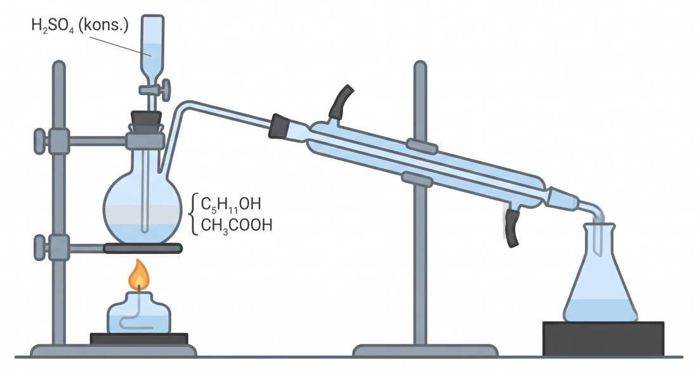
A) aldegid  B) uglevod  C) murakkab efir (izoamilasetat)  D) oddiy efir

## II QISM. MOSLASHTIRISH (33–35)

**33–35.** Topshiriqlarga mos javoblarni A–F variantlaridan tanlang.
Propan (C3H8) va eten (C2H4) dan iborat 6,72 l (n.sh.) aralashma bromli suvdan o'tkazilganda 16 g brom yutildi.

**33.** Aralashmadagi eten (C2H4) hajmini (l, n.sh.) aniqlang.
**34.** Aralashmadagi eten (C2H4) hajmiy ulushini (%) aniqlang.
**35.** Aralashmani to'liq yoqish uchun zarur havo hajmini (l, n.sh.; havoda 21 % kislorod bor) aniqlang.

A) 138,67  B) 208  C) 33,33  D) 2,24  E) 26,67  F) 3,36

## III QISM. QISQA JAVOBLI (36–40) — javobni son bilan yozing

**36.** KMnO4 + Na2SO3 + H2O → MnO2 + Na2SO4 + KOH reaksiya tenglamasini tenglang. Oksidlovchi va qaytaruvchi oldidagi koeffitsiyentlar yig'indisini aniqlang.

**37.** 1 l hajmli yopiq idishda 1 mol N2O4 qizdirilganda N2O4 ⇄ 2NO2 muvozanati qaror topdi. Muvozanat aralashmasining vodorodga nisbatan zichligi 30,67 ga teng. Shu haroratdagi muvozanat konstantasini (K, mol/l) hisoblang.

**38.** Alyuminiy va mis dan iborat 9,1 g aralashma mo'l NaOH eritmasida eritildi. Ajralgan gazning hajmini (l, n.sh.) aniqlang (mis ishqor bilan reaksiyaga kirishmaydi).

**39.** 4,6 g etanol avval sirka aldegidgacha (unum 75 %), so'ng sirka kislotagacha (unum 60 %) oksidlandi; hosil bo'lgan kislota mo'l etanol bilan efirlandi (unum 100 %). Etilatsetat massasini (g) toping.

**40.** Polipropilen polimerining (polimerlanish darajasi 2000) 168 g namunasini olish uchun polimerlanish unumi 90 % bo'lganda qancha monomer (C3H6) kerak (g)?

## IV QISM. YOZMA ISH (41–43) — to'liq yechim ko'rsatiladi

### 41-topshiriq (umumiy kimyo; 5 band, 25 ball)
Laboratoriyada xlor olish uchun K2Cr2O7 ga konsentrlangan xlorid kislota ta'sir ettirildi: K2Cr2O7 + 14HCl → 2KCl + 2CrCl3 + 3Cl2 + 7H2O. Ajralgan 13,44 l (n.sh.) xlor gazining yarmi mo'l KI eritmasidan o'tkazildi, qolgan yarmi esa issiq mo'l KOH eritmasiga yuttirildi.
1) Reaksiyani elektron balans usulida tenglang: oksidlovchi va qaytaruvchini ko'rsating, koeffitsiyentlar yig'indisini toping.
2) K2Cr2O7 ning sarflangan massasini (g) hisoblang. Sarflangan oksidlovchining miqdorini (mol) ham toping.
3) Sarflangan HCl miqdorini (mol) va shundan qaytaruvchi sifatida ishtirok etgan qismini (mol) aniqlang.
4) Xlor mo'l KI eritmasidan o'tkazilganda ajralgan yodning massasini (g) toping (reaksiya tenglamasini yozing). Sarflangan KI massasini (g) ham toping.
5) Issiq KOH eritmasiga yuttirilganda (3Cl2 + 6KOH → KClO3 + 5KCl + 3H2O) hosil bo'lgan KClO3 massasini (g) aniqlang. Agar xlor sovuq KOH eritmasiga yuttirilsa (Cl2 + 2KOH → KCl + KClO + H2O), hosil bo'ladigan KClO massasini (g) ham toping.

### 42-topshiriq (organik kimyo; 4 band, 25 ball; hisob-kitob yo'q)
Quyidagi o'zgarishlar zanjirida X, Y, Z noma'lum organik moddalar:
CaC2 —H2O→ X —C (aktiv), 600 °C→ Y —HNO3, H2SO4→ Z —Fe, HCl→ C6H5NH2
1) CaC2 → X : reaksiya tenglamasini yozing; hosil bo'lgan moddani nomlang.
2) X → Y : reaksiya tenglamasini yozing; hosil bo'lgan moddani nomlang.
3) Y → Z : reaksiya tenglamasini yozing; hosil bo'lgan moddani nomlang.
4) Z → C6H5NH2 : reaksiya tenglamasini yozing; hosil bo'lgan moddani nomlang.

### 43-topshiriq (anorganik kimyo yoki kimyoviy tahlil; 5 band, 25 ball)
33,1 g Pb(NO3)2 qizdirilganda qisman parchalandi va qattiq qoldiq massasi 30,4 g bo'ldi. Ajralgan gazlar aralashmasi 300 g suvga to'liq yuttirildi. Qattiq qoldiqdagi PbO esa mo'l suyultirilgan H2SO4 bilan reaksiyaga kiritildi.
1) Parchalanish reaksiyasi tenglamasini yozing. Parchalangan Pb(NO3)2 ning ulushini (%) va ajralgan gazlar umumiy hajmini (l, n.sh.) aniqlang.
2) Qattiq qoldiqdagi PbO ning massa ulushini (%) hisoblang.
3) Gazlar suvga yuttirilganda hosil bo'lgan eritmadagi HNO3 ning massa ulushini (%) toping (reaksiya tenglamasini yozing).
4) Qoldiqdagi PbO ni to'liq eritish uchun 20 % li H2SO4 eritmasidan necha gramm kerak va hosil bo'lgan PbSO4 ning massasi qancha?
5) Ajralgan NO2 va O2 gazlari aralashmasining o'rtacha molyar massasini (g/mol) hisoblang.

# VARIANT 5

## I QISM. YOPIQ TESTLAR (1–32, har biri bitta to'g'ri javob)

### UMUMIY KIMYO (1–13)

**1.** Quyidagi tuzlarning qaysilari suvli eritmasi kislotali muhitga ega? 1) CH3COONa; 2) Na2SO4; 3) FeCl3; 4) Na2CO3
A) 2  B) 3  C) 2, 4  D) 1, 3

**2.** 2NO + O2 ⇌ 2NO2 reaksiyasi 2 l hajmli idishda o'tkazildi. Ma'lumotlar jadvalda berilgan:

| Modda | NO | O2 | NO2 |
|---|---|---|---|
| Boshlang'ich, mol | 4 | 6 | 0 |
| Muvozanatda, mol | — | — | 3 |

NO ning necha foizi reaksiyaga kirishganini aniqlang.
A) 37,5  B) 112,5  C) 25  D) 75

**3.** N2O4 ⇌ 2NO2 reaksiyasi 1 l hajmli idishda o'tkazildi. Ma'lumotlar jadvalda berilgan:

| Modda | N2O4 | NO2 |
|---|---|---|
| Boshlang'ich, mol | 4 | 0 |
| Muvozanatda, mol | — | 1 |

Muvozanat konstantasini (K) hisoblang.
A) 0,571  B) 0,143  C) 0,286  D) 3,5

**4.** CH3–CH2–CH3 molekulasidagi σ va π bog'lar sonini aniqlang.
A) 9 va 0  B) 10 va 1  C) 10 va 0  D) 11 va 0

**5.** 1 mol CH4 tarkibidagi atomlar sonini toping (N_A = 6,02·10²³). Javobni 10²³ birligida yozing.
A) 6,02  B) 1,505  C) 0,602  D) 3,01

**6.** Zn + HNO3 → Zn(NO3)2 + NH4NO3 + H2O reaksiya tenglamasini tenglang va barcha koeffitsiyentlar yig'indisini aniqlang.
A) 23  B) 21  C) 24  D) 22

**7.** Na2SO4 ning suvli eritmasi inert elektrodlar bilan elektroliz qilinganda qaysi moddalar ajraladi?
A) Zn, H2 va O2  B) H2 va O2  C) H2, Cl2 va NaOH  D) Ag va O2

**8.** Reaksiyaning energetik diagrammasi berilgan (boshlang'ich moddalar energiyasi 20, mahsulotlar 90 kJ/mol).

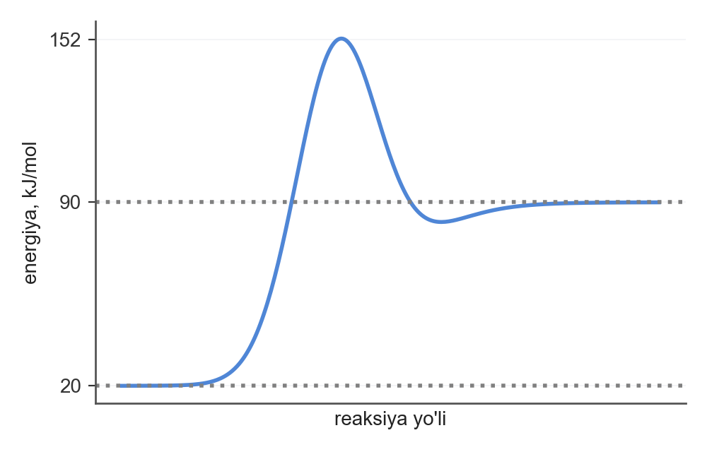

To'g'ri reaksiyaning aktivlanish energiyasini (kJ/mol) aniqlang.
A) 202  B) 70  C) 132  D) 264

**9.** Mn2O7 tarkibida marganes ning valentligini aniqlang.
A) VII  B) II  C) V  D) III

**10.** Mis atomida d-pog'onachadagi elektronlar sonini aniqlang (Z = 29).
A) 11  B) 9  C) 12  D) 10

**11.** Cu + H2SO4 → CuSO4 + SO2 + H2O reaksiyasida 2 mol Cu erisa, H2SO4 ning necha moli oksidlovchi vazifasini bajaradi?
A) 4  B) 2  C) 1  D) 3

**12.** HC≡C–CH=CH2 molekulasida sp gibridlangan uglerod atomlari nechta?
A) 3  B) 4  C) 1  D) 2

**13.** H2 + I2 ⇌ 2HI reaksiyada muvozanat holatida [H2] = 2, [I2] = 0,5, [HI] = 2 mol/l. Muvozanat konstantasini (K) hisoblang.
A) 8  B) 2  C) 1,6  D) 4

### ANORGANIK KIMYO (14–19)

**14.** Nodir gazlar haqida qaysi fikrlar to'g'ri? 1) Nodir gazlar kimyoviy jihatdan juda faol; 2) Geliy eng yengil inert gaz; 3) Argon havoning hajmi bo'yicha eng ko'p uchraydigan inert gazi; 4) Geliyda 8 ta tashqi elektron bor
A) 3  B) 2, 3  C) 4  D) 2, 3, 4

**15.** 10,1 g KNO3 to'liq parchalanguncha qizdirildi. Qattiq qoldiq massasini (g) aniqlang.
A) 8,5  B) 10,1  C) 17  D) 4,25

**16.** Qaysi juftliklar o'zaro reaksiyaga kirishadi? 1) Ag va H2SO4(suyult.); 2) CO2 va CaO; 3) Na2CO3 va HCl; 4) Fe va HCl
A) 3, 4  B) 2, 3, 4  C) 1, 3, 4  D) 1, 3

**17.** 44,8 l (n.sh.) ammiakdan nitrat kislota olindi (jami unum 80 %). Kislota massasini (g) aniqlang.
A) 126  B) 201,6  C) 50,4  D) 100,8

**18.** 0,3 mol NaOH tutgan eritmadan 0,15 mol CO2 o'tkazildi. Hosil bo'lgan Na2CO3 massasini (g) aniqlang.
A) 31,8  B) 15,9  C) 7,95  D) 12

**19.** 11,7 g NaCl ga mo'l kons. H2SO4 ta'sir ettirilib, ajralgan HCl 500 g suvda eritildi. Hosil bo'lgan xlorid kislota massa ulushini (%) aniqlang.
A) 1,46  B) 2,88  C) 1,44  D) 0,72

### ORGANIK KIMYO (20–29)

**20.** Rasmda aromatik uglevodorod hosilasining tuzilish formulasi berilgan.

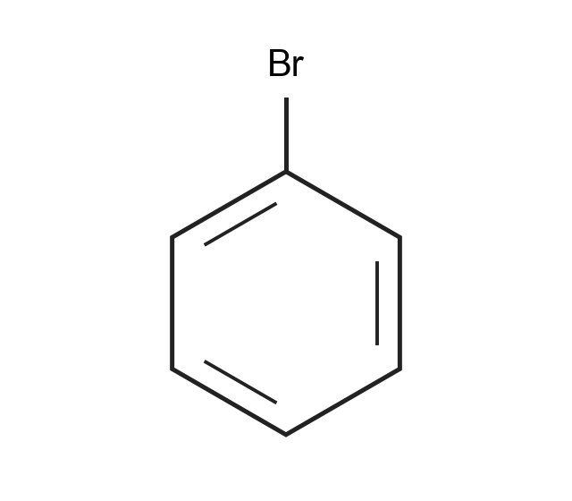

Birikmaning nomini toping.
A) toluol  B) fenol  C) brombenzol  D) benzoy kislota

**21.** Alken, alkadiyen va alkinlar haqida qaysi fikrlar to'g'ri? 1) Propenga HBr birikishi Markovnikov qoidasiga bo'ysunadi; 2) Alkinlar uchun umumiy formula CnH2n+2; 3) Asetilenni Kucherov reaksiyasi bilan sirka aldegidiga aylantirish mumkin; 4) Asetilen Ag2O ning ammiakli eritmasi bilan cho'kma beradi (butin-2 beradi)
A) 1  B) 1, 2  C) 1, 3  D) 3

**22.** Arenlar, neft va tabiiy gaz haqida qaysi fikrlar to'g'ri? 1) Neft fraksiyalaridan gazolin 150 °C gacha haydaladi; 2) Naftalin – bir halqali aren; 3) Benzoldan nitrobenzol nitrolash bilan olinadi; 4) Toluol KMnO4 bilan benzoy kislotagacha oksidlanadi
A) 2, 3  B) 1, 2, 3  C) 3, 4  D) 1, 3, 4

**23.** Reaksiya tenglamasi: C6H12O6 → 2C2H5OH + 2CO2. Reaksiyaga 360 g C6H12O6 kirishdi (unum 75 %). C2H5OH massasini (g) hisoblang.
A) 46  B) 138  C) 276  D) 69

**24.** 2,3 g chumoli kislota Ag2O ning ammiakli eritmasi bilan to'liq oksidlanganda hosil bo'lgan kumush massasini (g) aniqlang.
A) 10,8  B) 5,4  C) 21,6  D) 2,3

**25.** Karbon kislotalar haqida qaysi fikrlar to'g'ri? 1) Sirka angidrid ikki molekula sirka kislotadan suv chiqib hosil bo'ladi; 2) Olein kislota Br2 ni biriktiradi; 3) Stearin kislota to'yinmagan kislota; 4) Sirka kislota karbonatlar bilan CO2 ajratadi
A) 1, 2, 4  B) 1, 3, 4  C) 3, 4  D) 2, 3

**26.** Murakkab efirlar va yog'lar haqida qaysi fikrlar to'g'ri? 1) Suyuq yog'larni gidrogenlab qattiq yog' olinadi; 2) Efirlanish reaksiyasi qaytmas; 3) Dietil efir spirtdan yuqori haroratda qaynaydi; 4) Sovun — yuqori yog' kislotalarning natriyli tuzi
A) 1, 4  B) 2, 3  C) 3, 4  D) 4

**27.** 6CO2 + 6H2O → C6H12O6 + 6O2 jarayoni uchun 11,2 l (n.sh.) CO2 olingan. O2 massasini (g) aniqlang.
A) 32  B) 8  C) 16  D) 24

**28.** Aminlar, aminokislotalar va oqsillar haqida qaysi fikrlar to'g'ri? 1) Nitrobenzoldan anilin Zinin reaksiyasi bilan olinadi; 2) Dipeptidda 2 ta peptid bog' bor; 3) Aminokislotalar amfoter birikmalar; 4) Anilin bromli suv bilan oq cho'kma beradi
A) 1, 2  B) 1, 3, 4  C) 3, 4  D) 1, 2, 4

**29.** Yuqori molekulyar birikmalar haqida qaysi fikrlar to'g'ri? 1) Teflon — polivinilxlorid; 2) Termoreaktiv polimerlar qizdirilganda qayta yumshaydi; 3) Lavsan poliamid tola; 4) Tabiiy kauchuk – sis-1,4-poliizopren
A) 1, 3  B) 1  C) 4  D) 1, 4

### KIMYOVIY TAHLIL (30–32)

**30.** 100 g 10 % li Na2CO3 eritmasini Na2CO3·10H2O dan tayyorlash uchun necha gramm kristallogidrat kerak?
A) 26,98  B) 10  C) 53,96  D) 13,49

**31.** Quyidagi aralashmani ajratish uchun qaysi usul mos: qum va suv aralashmasi?
A) filtrlash
B) suvda eritib, filtrlash, so'ng bug'latish
C) distillash (fraksiyalab haydash)
D) ajratgich voronka

**32.** Rasmdagi asbobda osh tuzining quruq kristallari lampochkani yondirmaydi, eritmasi esa yondiradi. Sababi nima?

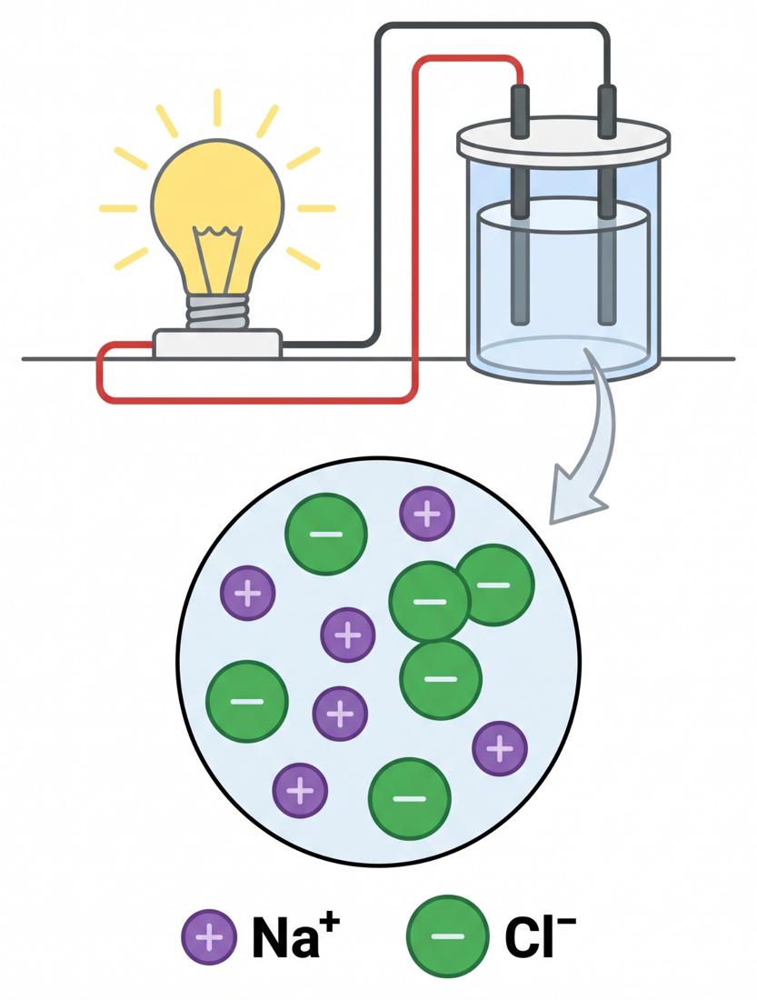
A) eritmada erkin harakatlanuvchi ionlar hosil bo'ladi
B) tuz suvda molekulalarga parchalanadi
C) eritmada erkin elektronlar bor
D) suv metall o'tkazgich

## II QISM. MOSLASHTIRISH (33–35)

**33–35.** Topshiriqlarga mos javoblarni A–F variantlaridan tanlang.
CaCO3 va Na2CO3 dan iborat 30,6 g aralashma mo'l xlorid kislota bilan reaksiyaga kirishdi. Ajralgan gaz 0,45 mol NaOH tutgan eritmadan o'tkazildi.

**33.** Ajralgan gazning hajmini (l, n.sh.) aniqlang.
**34.** Aralashmani to'liq eritish uchun sarflangan HCl miqdorini (mol) aniqlang.
**35.** Gaz NaOH eritmasidan o'tkazilganda hosil bo'lgan tuz (NaHCO3) massasini (g) aniqlang (reaksiya unumi 80 %).

A) 13,44  B) 6,72  C) 10,08  D) 0,6  E) 5,38  F) 0,3

## III QISM. QISQA JAVOBLI (36–40) — javobni son bilan yozing

**36.** KMnO4 + KI + H2SO4 → MnSO4 + I2 + K2SO4 + H2O reaksiya tenglamasini tenglang. Oksidlovchi va qaytaruvchi oldidagi koeffitsiyentlar yig'indisini aniqlang.

**37.** H2SO4 ning 0,025 mol/l li eritmasidan 0,4 l va Ba(OH)2 ning 0,025 mol/l li eritmasidan 0,6 l aralashtirildi (umumiy hajm 1 l, ikkala modda to'liq dissotsilanadi, BaSO4 cho'kmasi e'tiborga olinmasin). Hosil bo'lgan eritmaning pH ini aniqlang.

**38.** NaBr va NaI dan iborat 28,1 g aralashma eritilib, mo'l xlor o'tkazildi, eritma bug'latilib quruq qoldiq 14,62 g chiqdi. Aralashmadagi NaI ning massasini (g) toping.

**39.** Etilen va asetilendan iborat 4,48 l (n.sh.) aralashma bromli suvdan o'tkazilganda 40 g brom yutildi. Aralashmadagi asetilenning hajmini (l, n.sh.) toping.

**40.** Alkanning vodorodga nisbatan zichligi 36, uglerodning massa ulushi 83,33 %. Shu alkan molekulasidagi σ-bog'lar umumiy sonini toping.

## IV QISM. YOZMA ISH (41–43) — to'liq yechim ko'rsatiladi

### 41-topshiriq (umumiy kimyo; 5 band, 25 ball)
Tabiiy mis ikki izotopdan iborat: ⁶³Cu (70 %) va ⁶⁵Cu (30 %). 32 g shu element namunasi olingan (Z = 29, N_A = 6,02·10²³).
1) Elementning o'rtacha nisbiy atom massasini hisoblang.
2) Namunadagi atomlarning umumiy miqdorini (mol) toping. Namunadagi protonlar sonini (mol) ham toping.
3) Og'irroq izotop (⁶⁵Cu) atomlarining miqdorini (mol) hisoblang.
4) Namunadagi neytronlarning umumiy miqdorini (mol) toping. Bitta atom massasini (g) ham hisoblang.
5) Namunadagi atomlar sonini (10²³ birligida) aniqlang. Namunadagi protonlar sonining neytronlar soniga nisbatini ham toping.

### 42-topshiriq (organik kimyo; 4 band, 25 ball; hisob-kitob yo'q)
Quyidagi o'zgarishlar zanjirida X, Y, Z noma'lum organik moddalar:
C2H5Cl —KOH (suvli)→ X —H2SO4 (kons.), 170 °C→ Y —Br2→ Z —KOH (spirtli)→ C2H2
1) C2H5Cl → X : reaksiya tenglamasini yozing; hosil bo'lgan moddani nomlang.
2) X → Y : reaksiya tenglamasini yozing; hosil bo'lgan moddani nomlang.
3) Y → Z : reaksiya tenglamasini yozing; hosil bo'lgan moddani nomlang.
4) Z → C2H2 : reaksiya tenglamasini yozing; hosil bo'lgan moddani nomlang.

### 43-topshiriq (anorganik kimyo yoki kimyoviy tahlil; 5 band, 25 ball)
CaCO3 va MgCO3 dan iborat 28,4 g aralashma doimiy massagacha qizdirildi. Ajralgan gaz mo'l Ca(OH)2 eritmasidan o'tkazildi.
1) Aralashmadagi har bir tuzning massasini (g) va massa ulushini (%) aniqlang (reaksiya tenglamalarini yozing).
2) Ajralgan gaz hajmini (l, n.sh.) va qattiq qoldiq massasini (g) toping. Qoldiqdagi CaO ning massa ulushini (%) ham hisoblang.
3) Gaz Ca(OH)2 eritmasidan o'tkazilganda hosil bo'lgan cho'kma massasini (g) hisoblang.
4) Qattiq qoldiqni to'liq eritish uchun 10 % li HCl eritmasidan necha gramm kerak?
5) Qoldiq oksidlar suvga solinganda hosil bo'ladigan Ca(OH)2 massasini (g) toping (CaO + H2O → Ca(OH)2).

# VARIANT 6

## I QISM. YOPIQ TESTLAR (1–32, har biri bitta to'g'ri javob)

### UMUMIY KIMYO (1–13)

**1.** Rasmda kristall panjara tuzilishi tasvirlangan.

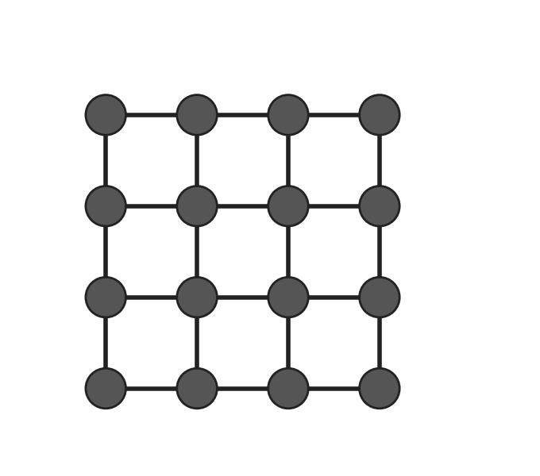

Shunday panjarali moddalar uchun qaysi xususiyat xos?
A) Yuqori suyuqlanish harorati, suyuqlanmasi elektr tokini o'tkazadi
B) Past suyuqlanish harorati, uchuvchan
C) Juda qattiq, suyuqlanish harorati juda yuqori
D) Elektr tokini yaxshi o'tkazadi, plastik

**2.** 4 g metall oksidlanganda 5,6 g oksid hosil bo'ldi. Metallning ekvivalent massasini (g/mol) aniqlang.
A) 40  B) 20  C) 10  D) 30

**3.** Radioaktiv izotop yadrolari sonining vaqtga bog'liqligi grafikda berilgan.

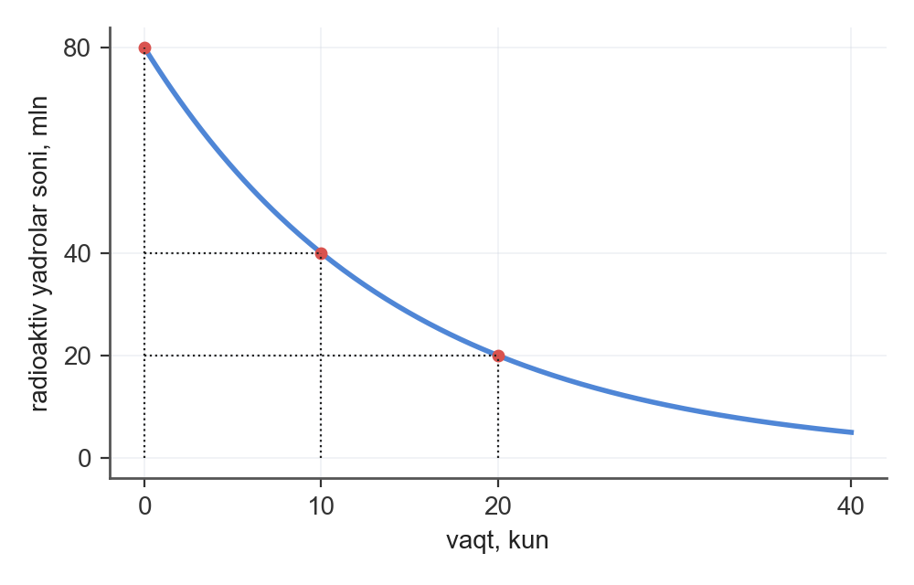

20 kundan keyin necha mln yadro yemirilgan bo'ladi?
A) 20  B) 60  C) 40  D) 80

**4.** C6H5CH3 molekulasidagi σ va π bog'lar sonini aniqlang.
A) 15 va 3  B) 14 va 3  C) 15 va 4  D) 16 va 3

**5.** Jadvalda Mn elementining birikmalaridagi oksidlanish darajasi berilgan:

| Modda | Oksidlanish darajasi |
|---|---|
| K2MnO4 | +6 |
| MnO2 | +4 |
| KMnO4 | +7 |
| MnSO4 | +2 |

Ushbu moddalardan nechtasida Mn elementi ham oksidlovchi, ham qaytaruvchi xossani namoyon qiladi? (Mn uchun eng past oksidlanish darajasi 0, eng yuqorisi +7)
A) 3  B) 4  C) 5  D) 1

**6.** Gazlar aralashmasi tarkibi jadvalda berilgan (n.sh.):

| Gaz | Hajmi, l |
|---|---|
| H2 | 3 |
| NH3 | 2 |
| CH4 | 3 |

Aralashmaning havoga nisbatan zichligini aniqlang (M(havo) = 29 g/mol).
A) 0,76  B) 0,19  C) 0,38  D) 11

**7.** K2CO3 ning suvli eritmasi inert elektrodlar bilan elektroliz qilinganda qaysi moddalar ajraladi?
A) Zn, H2 va O2  B) H2 va O2  C) Cu va Cl2  D) Ag va O2

**8.** S + HNO3 → H2SO4 + NO reaksiya tenglamasini tenglang va barcha koeffitsiyentlar yig'indisini aniqlang.
A) 7  B) 5  C) 8  D) 6

**9.** Zn plastinka 33,1 g Pb(NO3)2 ni tutgan eritmaga tushirildi va Pb to'liq ajralib chiqquncha ushlab turildi. Plastinka massasi necha gramm ortadi?
A) 28,4  B) 7,1  C) 33,1  D) 14,2

**10.** Massasi 7 g bo'lgan gaz 27 °C va 0,5 atm bosimda 12,3 l hajm egallaydi. Gazning vodorodga nisbatan zichligini aniqlang. (R = 0,082 l·atm/(mol·K))
A) 14  B) 28  C) 7  D) 56

**11.** Quyidagi zarrachalardan qaysilari argon atomi bilan izoelektron? 1) Ca²⁺; 2) K⁺; 3) Cl⁻; 4) Li⁺
A) 1, 2  B) 1, 2, 3  C) 1, 2, 4  D) 1, 3

**12.** 30-tartib raqamli element atomida n = 3 va l = 2 bo'lgan elektronlar sonini aniqlang.
A) 11  B) 10  C) 9  D) 12

**13.** X moddaning parchalanish reaksiyasida konsentratsiyaning vaqt bo'yicha o'zgarishi jadvalda berilgan:

| t, min | c, mol/l |
|---|---|
| 0 | 2,4 |
| 2 | 1,92 |
| 4 | 1,44 |
| 6 | 0,96 |

0-minutdan 2-minutgacha o'rtacha tezlikni mol/(l·min) hisoblang.
A) 0,48  B) 0,12  C) 1,2  D) 0,24

### ANORGANIK KIMYO (14–19)

**14.** Qaysi juftliklar o'zaro reaksiyaga kirishadi? 1) SiO2 va H2O; 2) Ag va H2SO4(suyult.); 3) MgCl2 va KNO3; 4) Fe va HCl
A) 2, 3  B) 1  C) 3, 4  D) 4

**15.** 37,8 g Zn(NO3)2 to'liq parchalanguncha qizdirildi. Qattiq qoldiq massasini (g) aniqlang.
A) 16,2  B) 37,8  C) 32,4  D) 8,1

**16.** 0,2 mol NaOH tutgan eritmadan 0,15 mol CO2 o'tkazildi. Hosil bo'lgan NaHCO3 massasini (g) aniqlang.
A) 8,4  B) 4,2  C) 2,1  D) 8

**17.** Reaksiya tenglamasi: 2NaCl + H2SO4 → Na2SO4 + 2HCl. Reaksiyaga 196 g H2SO4 kirishdi. HCl massasini (g) hisoblang.
A) 36,5  B) 292  C) 146  D) 73

**18.** Li va K dan iborat 6 g aralashma suv bilan reaksiyaga kirishdi. Ajralgan vodorodning hajmini (l, n.sh.) aniqlang.
A) 4,48  B) 8,96  C) 2,24  D) 3

**19.** Alyuminiy (0,2 mol) va magniy (0,2 mol) aralashmasi mo'l xlorid kislotada eritildi. Ajralgan vodorodning hajmini (l, n.sh.) aniqlang.
A) 11,2  B) 8,96  C) 22,4  D) 5,6

### ORGANIK KIMYO (20–29)

**20.** CH3–CH(CH3)–CH(C2H5)–CH2–CH3 birikmaning sistematik nomi qaysi qatorda to'g'ri keltirilgan?
A) 2-metil-3-etilpentan  B) 3-izopropilpentan  C) 3-etil-2-metilpentan  D) 2,3-dietilbutan

**21.** Alken, alkadiyen va alkinlar haqida qaysi fikrlar to'g'ri? 1) Asetilen Ag2O ning ammiakli eritmasi bilan cho'kma beradi (butin-2 beradi); 2) Etilen sanoatda kreking gazlaridan olinadi; 3) Alkinlar uchun umumiy formula CnH2n+2; 4) Kauchuk izoprenning polimeri
A) 1, 3  B) 1, 4  C) 2, 4  D) 1, 3, 4

**22.** 18,8 g fenoldan 2,4,6-tribromfenol olishda unum 75 % bo'lsa, mahsulot massasini (g) aniqlang.
A) 66,2  B) 99,3  C) 14,1  D) 49,65

**23.** C6H5OH + 3Br2 → C6H2Br3OH + 3HBr reaksiyasida 9,4 g C6H5OH ishtirok etdi. C6H2Br3OH miqdorini (mol) toping.
A) 0,1  B) 0,2  C) 0,05  D) 0,15

**24.** 11,6 g propanal Ag2O ning ammiakli eritmasi bilan to'liq oksidlanganda hosil bo'lgan kumush massasini (g) aniqlang.
A) 21,6  B) 43,2  C) 86,4  D) 11,6

**25.** 60 g CH3COOH dan quyidagi ikki bosqichda Na2CO3 olinadi:
1) CH3COOH + NaOH → CH3COONa + H2O (unum 90 %);
2) CH3COONa + NaOH → CH4 + Na2CO3 (unum 50 %).
Oxirgi mahsulot Na2CO3 ning massasini (g) toping.
A) 53  B) 95,4  C) 47,7  D) 106

**26.** 60 g CH3COOH dan quyidagi ikki bosqichda CH3COONa olinadi:
1) CH3COOH + C2H5OH → CH3COOC2H5 + H2O (unum 60 %);
2) CH3COOC2H5 + NaOH → CH3COONa + C2H5OH (unum 50 %).
Oxirgi mahsulot CH3COONa ning massasini (g) toping.
A) 41  B) 24,6  C) 49,2  D) 82

**27.** Uglevodlar haqida qaysi fikrlar to'g'ri? 1) Kraxmal va selluloza bir xil M ga ega; 2) Saxaroza Feling suyuqligini qaytaradi; 3) Maltoza gidrolizlanganda ikki molekula glyukoza hosil qiladi; 4) Glyukoza "kumush ko'zgu" reaksiyasini beradi
A) 3, 4  B) 1, 3  C) 2  D) 2, 3

**28.** Quyidagi birikmalardan qaysi biri fenol sinfiga kiradi?
A) H2NCH2COOH  B) CH3CHO  C) C6H12O6  D) C6H5OH

**29.** Izobutilen monomeridan olingan polimerning molyar massasi 140000 g/mol. Polimerlanish darajasini aniqlang.
A) 5000  B) 1250  C) 2500  D) 2510

### KIMYOVIY TAHLIL (30–32)

**30.** Rasmdagi tajribada etanolga konsentrlangan H2SO4 ning vazifasi nima?

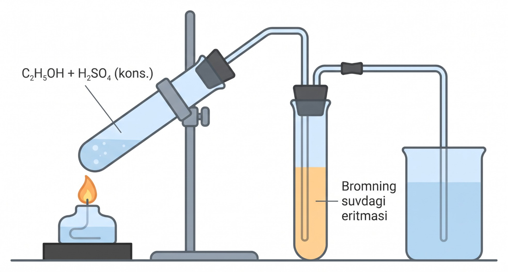
A) oksidlovchi, etilenni oksidlaydi  B) faqat erituvchi  C) reaksiyada ishtirok etmaydi  D) suv tortuvchi va katalizator

**31.** Kimyo laboratoriyasida ishlash qoidalari haqida qaysi fikrlar to'g'ri? 1) Zaharli gaz ajraladigan tajriba mo'rili shkafda o'tkaziladi; 2) Kimyoviy moddalar hidini bevosita nafas olib aniqlash kerak; 3) Suvni konsentrlangan kislotaga tez quyish mumkin; 4) Ortiqcha reaktiv idishga qaytariladi
A) 1, 4  B) 1, 3  C) 1  D) 4

**32.** 400 g 4 % li CuSO4 eritmasini CuSO4·5H2O dan tayyorlash uchun necha gramm kristallogidrat kerak?
A) 16  B) 50  C) 12,5  D) 25

## II QISM. MOSLASHTIRISH (33–35)

**33–35.** Topshiriqlarga mos javoblarni A–F variantlaridan tanlang.
CuO va Fe2O3 dan iborat 32 g aralashma qizdirilib, H2 oqimida to'liq qaytarildi; qoldiq (metallar) massasi 24 g.

**33.** Aralashmadagi CuO massasini (g) aniqlang.
**34.** Qaytarish uchun (20 % ortiqcha olingan) sarflangan H2 hajmini (l, n.sh.) aniqlang.
**35.** Qaytarish natijasida hosil bo'lgan suv massasini (g) aniqlang.

A) 18  B) 9  C) 16  D) 13,44  E) 12,8  F) 24

## III QISM. QISQA JAVOBLI (36–40) — javobni son bilan yozing

**36.** KMnO4 + Na2SO3 + H2O → MnO2 + Na2SO4 + KOH reaksiya tenglamasini tenglang. Reagentlar (chap qism) koeffitsiyentlari yig'indisini toping.

**37.** NaCl eritmasi inert elektrodlar yordamida 2 A tok kuchi bilan 3860 s elektroliz qilindi. Katodda ajralgan H2 massasi (g) ni toping.

**38.** Zn va ZnO dan iborat 22,7 g aralashma mo'l NaOH eritmasida eritilganda 2,24 l (n.sh.) vodorod ajraldi. Aralashmadagi ZnO massasini (g) aniqlang.

**39.** Etanol va fenoldan iborat 23,4 g aralashma natriy bilan to'liq reaksiyaga kirishganda 3,36 l (n.sh.) vodorod ajraldi. Shu aralashmaga mo'l bromli suv ta'sir ettirilganda hosil bo'ladigan cho'kma massasini (g) toping.

**40.** Etilen monomeridan olingan polimerning molyar massasi 56000 g/mol. Polimerlanish darajasini aniqlang.

## IV QISM. YOZMA ISH (41–43) — to'liq yechim ko'rsatiladi

### 41-topshiriq (umumiy kimyo; 5 band, 25 ball)
300 g 20 % li NaCl eritmasi inert elektrodlar yordamida 5 A tok kuchi bilan 3860 s elektroliz qilindi.
1) Katodda va anodda ajralgan gazlarning hajmlarini (l, n.sh.) hisoblang.
2) Elektrolizdan keyingi eritma massasini (g) aniqlang. Ajralgan gazlarning umumiy massasini (g) ham hisoblang.
3) Elektrolizdan keyingi eritmada NaOH ning massa ulushini (%) toping.
4) Hosil bo'lgan NaOH ni to'liq neytrallash uchun 10 % li HCl eritmasidan necha gramm kerak? Hosil bo'lgan NaCl massasini (g) ham hisoblang.
5) Anodda ajralgan xlor KI eritmasidan o'tkazilsa, ajralgan yod massasini (g) aniqlang. Anodda ajralgan xlorning massasini (g) ham toping.

### 42-topshiriq (organik kimyo; 7 band, 25 ball; hisob-kitob yo'q)
Reaksiya tenglamalarini tugallang va tenglang. Hosil bo'lgan organik moddalarning tuzilish formulalarini yozing va ularni nomlang.
1) C6H5–CH3 + Cl2 —yorug'lik→
2) CH3–CH2–OH + CuO —t→
3) 2CH4 —1500 °C→
4) CH3CHO + Ag2O —NH3, t→
5) C2H5Br + KOH(spirtli) →
6) n CH2=CH–CH=CH2 →
7) CH3–CH=CH2 + HBr →

### 43-topshiriq (anorganik kimyo yoki kimyoviy tahlil; 5 band, 25 ball)
0,05 mol AlCl3 saqlagan eritmaga NaOH eritmasi qo'shildi. Avval 0,15 mol NaOH qo'shilganda cho'kma hosil bo'ldi, so'ng yana 0,05 mol NaOH qo'shilganda cho'kma to'liq erib ketdi (Na[Al(OH)4] hosil bo'ldi).
1) Cho'kma hosil bo'lish va erish reaksiyalari tenglamalarini yozing. Cho'kma massasini (g) hisoblang.
2) Jami sarflangan NaOH massasini (g) aniqlang.
3) Hosil bo'lgan Na[Al(OH)4] eritmasidan mo'l CO2 o'tkazilganda cho'kadigan Al(OH)3 massasini (g) toping.
4) Al(OH)3 cho'kmasi qizdirilganda hosil bo'ladigan oksid massasini (g) hisoblang.
5) Na[Al(OH)4] eritmasining hajmi 500 ml bo'lsa, tuzning molyar konsentratsiyasini (mol/l) hisoblang.

# VARIANT 7

## I QISM. YOPIQ TESTLAR (1–32, har biri bitta to'g'ri javob)

### UMUMIY KIMYO (1–13)

**1.** 1 mol CO2 tarkibida necha mol atom bor?
A) 3  B) 2  C) 4  D) 1

**2.** pH = 9 bo'lgan eritmada gidroksid ionlari konsentratsiyasi 10^(−x) mol/l ga teng. x ni aniqlang.
A) 9  B) 5  C) 6  D) 8

**3.** Tuzning eruvchanligi yuqori haroratda 150 g, past haroratda 40 g (100 g suvda). Yuqori haroratda to'yingan 500 g eritma past haroratgacha sovitilsa, necha gramm tuz cho'kmaga tushadi?
A) 300  B) 80  C) 220  D) 440

**4.** Zichligi 1,11 g/ml bo'lgan 10 % li NaOH eritmasining molyar konsentratsiyasini (mol/l) aniqlang.
A) 2,78  B) 0,28  C) 5,55  D) 2,5

**5.** Gazlar aralashmasi tarkibi jadvalda berilgan (n.sh.):

| Gaz | Hajmi, l |
|---|---|
| CO2 | 1 |
| N2 | 2 |
| SO2 | 3 |

Aralashmaning havoga nisbatan zichligini aniqlang (M(havo) = 29 g/mol).
A) 1,68  B) 3,36  C) 0,84  D) 48,67

**6.** Metall oksidida kislorodning massa ulushi 22,22 %. Metallning ekvivalent massasini (g/mol) aniqlang.
A) 56  B) 14  C) 28  D) 42

**7.** Jadvalda nuklidlarning proton soni (Z) va massa soni (A) berilgan:

| Nuklid | Z | A |
|---|---|---|
| X | 20 | 40 |
| Y | 20 | 42 |
| T | 21 | 40 |
| U | 21 | 41 |
| V | 20 | 42 |

X nuklidning nechta izobari jadvalda keltirilgan?
A) 2  B) 3  C) 1  D) 4

**8.** Quyidagi tuzlarning qaysilari suvli eritmasi ishqoriy muhitga ega? 1) CH3COONa; 2) FeCl3; 3) Al2(SO4)3; 4) Na2CO3
A) 1, 3  B) 3  C) 1  D) 1, 4

**9.** Hajmi 5 l bo'lgan idishda A modda miqdori 30 s davomida 3 mol ga kamaydi. Reaksiyaning o'rtacha tezligini (mol/(l·s)) toping.
A) 0,1  B) 0,6  C) 0,02  D) 0,5

**10.** VA guruh elementlarining vodorodli birikmalari qaynash haroratlari grafikda berilgan.

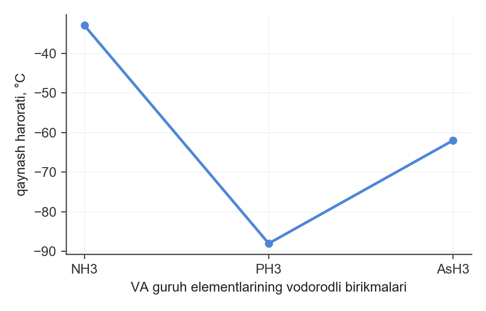

Qaysi birikmaning qaynash harorati qonuniyatdan keskin farq qiladi?
A) NH3  B) PH3  C) AsH3

**11.** Rux (Z = 30) atomining tashqi energetik pog'onasidagi elektronlar sonini aniqlang.
A) 3  B) 1  C) 4  D) 2

**12.** A + B → mahsulot reaksiyada v = k·[A]^2·[B]^2. Idish hajmi 2 marta kamaytirilsa (T = const), reaksiya tezligi necha marta o'zgaradi?
A) 4  B) 2  C) 16  D) 32

**13.** Rasmda tasvirlangan A elementi haqida qaysi fikr to'g'ri?

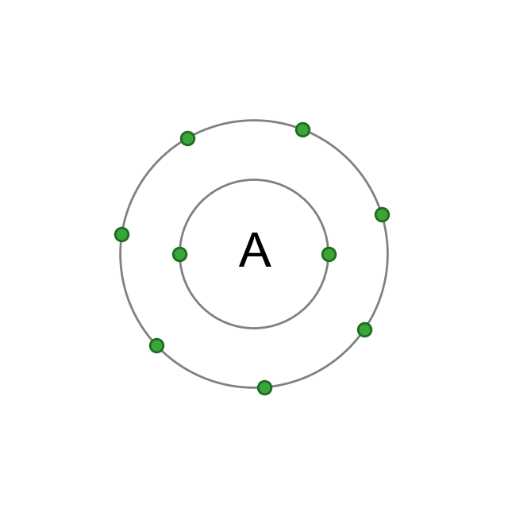
A) Metall, oksidi asosli xossali
B) Metall, vodorodli birikma hosil qilmaydi
C) Inert gaz, birikmalar hosil qilmaydi
D) Metallmas, oksidi kislotali xossali

### ANORGANIK KIMYO (14–19)

**14.** 3,1 g fosfor yondirilib, hosil bo'lgan oksid suvda eritildi (ortofosfat kislota), so'ng 0,3 mol NaOH qo'shildi. Hosil bo'lgan Na3PO4 massasini (g) aniqlang.
A) 32,8  B) 16,4  C) 8,2  D) 12

**15.** NaBr + AgNO3 → AgBr + NaNO3 reaksiyasida 51,5 g NaBr ishtirok etdi. AgBr miqdorini (mol) toping.
A) 1  B) 0,25  C) 0,75  D) 0,5

**16.** Ishqoriy metallar haqida qaysi fikrlar to'g'ri? 1) Natriy yonganda Na2O2 hosil bo'ladi; 2) Natriy kerosin ostida saqlanadi; 3) Natriyning olinishi suyuqlanma NaCl elektrolizi bilan; 4) Ishqoriy metallar tabiatda erkin holda uchraydi
A) 2, 4  B) 2, 3  C) 1, 3, 4  D) 1, 2, 3

**17.** Alyuminiy va magniy dan iborat 5,1 g aralashma mo'l xlorid kislotada eritilganda 5,6 l (n.sh.) vodorod ajraldi. Aralashmadagi alyuminiyning massa ulushini (%) aniqlang.
A) 52,9  B) 47,1  C) 26,5  D) 2,7

**18.** D-metallar va ularning birikmalari haqida qaysi fikrlar to'g'ri? 1) Cu(OH)2 qizdirilganda CuO ga parchalanadi; 2) Fe(OH)2 havoda qo'ng'ir rangga o'tadi; 3) Cr2O3 asosli oksid; 4) Mis suyultirilgan HCl bilan reaksiyaga kirishadi
A) 1, 2  B) 4  C) 1, 2, 3  D) 1, 3, 4

**19.** 0,1 mol Ca(HCO3)2 tutgan suv qaynatilganda hosil bo'lgan CaCO3 cho'kma massasini (g)  ni toping.
A) 20  B) 10  C) 5  D) 15

### ORGANIK KIMYO (20–29)

**20.** CH3–C(CH3)2–CH2–CH3 birikmaning sistematik nomi qaysi qatorda to'g'ri keltirilgan?
A) 2-metilpentan  B) 3,3-dimetilbutan  C) 2,2-dimetilpropan  D) 2,2-dimetilbutan

**21.** Etilen va asetilendan iborat 5,4 g aralashmani to'liq gidrogenlash uchun sarflanadigan vodorod hajmini (l, n.sh.) aniqlang. Aralashmadagi etilen va asetilenning mol nisbati 1 : 1.
A) 13,44  B) 6,72  C) 3,36  D) 4,48

**22.** Reaksiya tenglamasi: 2C6H6 + 15O2 → 12CO2 + 6H2O. Reaksiyaga 32 g O2 kirishdi. CO2 hajmini (l, n.sh.) hisoblang.
A) 28  B) 35,84  C) 8,96  D) 17,92

**23.** CH3CHO + Ag2O (NH3) reaksiyasi natijasida qaysi organik modda hosil bo'ladi?
A) etilatsetat  B) sirka kislota  C) metan  D) sirka aldegid

**24.** Aldegid va ketonlar haqida qaysi fikrlar to'g'ri? 1) Formalin — formaldegidning 40 % li eritmasi; 2) Sirka aldegid Kucherov reaksiyasi bilan olinadi; 3) Aseton suvda erimaydi; 4) Formaldegid gaz holatda, suvda yaxshi eriydi
A) 1, 3, 4  B) 1, 2, 4  C) 1, 4  D) 2, 3, 4

**25.** Karbon kislotalar haqida qaysi fikrlar to'g'ri? 1) Sirka kislota karbonatlar bilan CO2 ajratadi; 2) Sirka angidrid ikki molekula sirka kislotadan suv chiqib hosil bo'ladi; 3) Benzoy kislota Na2CO3 bilan reaksiyaga kirishmaydi; 4) Karboksil guruh karbonil va gidroksil guruhlardan iborat
A) 3, 4  B) 2, 3  C) 1, 2, 4  D) 1, 3

**26.** 88 g CH3COOC2H5 dan quyidagi ikki bosqichda C2H4 olinadi:
1) CH3COOC2H5 + H2O → CH3COOH + C2H5OH (unum 75 %);
2) C2H5OH → C2H4 + H2O (unum 50 %).
Oxirgi mahsulot C2H4 ning hajmini (l, n.sh.) toping.
A) 11,2  B) 16,8  C) 8,4  D) 22,4

**27.** 68,4 g maltoza to'liq gidrolizlanib, hosil bo'lgan mahsulot Ag2O ning ammiakli eritmasi bilan oksidlandi. Ajralgan kumush massasini (g) aniqlang.
A) 43,2  B) 172,8  C) 86,4  D) 21,6

**28.** 61,5 g C6H5NO2 dan quyidagi ikki bosqichda C6H5NH3Cl olinadi:
1) C6H5NO2 + 3H2 → C6H5NH2 + 2H2O (unum 80 %);
2) C6H5NH2 + HCl → C6H5NH3Cl (unum 75 %).
Oxirgi mahsulot C6H5NH3Cl ning massasini (g) toping.
A) 48,56  B) 38,85  C) 51,8  D) 64,75

**29.** Vinilxlorid monomeridan olingan polimerning molyar massasi 62500 g/mol. Polimerlanish darajasini aniqlang.
A) 1000  B) 2000  C) 500  D) 1010

### KIMYOVIY TAHLIL (30–32)

**30.** Rasmdagi asbobda oxirgi idishga NaOH eritmasi solingan. Uning vazifasi nima?

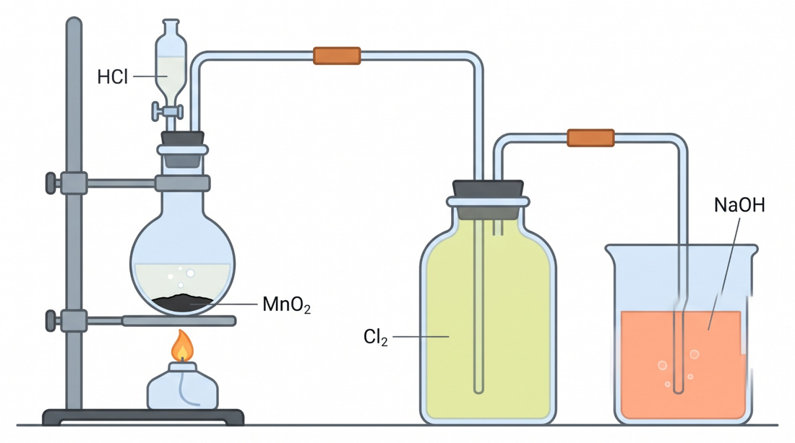
A) xlorni suvda eritish
B) ortiqcha xlorni yutib, atrof-muhitni zaharlanishdan saqlash
C) xlorni quritish
D) reaksiyani tezlashtirish

**31.** I⁻ ionini aniqlash uchun qaysi reagent mos va qanday belgi kuzatiladi?
A) AgNO3: sariq cho'kma (AgI), HNO3 da erimaydi
B) NaOH: qo'ng'ir cho'kma (Fe(OH)3)
C) HCl: rangsiz gaz (CO2) ajraladi
D) AgNO3: sariq cho'kma (Ag3PO4), HNO3 da eriydi

**32.** Uch probirkada (X, Y, Z) Na2SO4, K2CO3, NH4Cl eritmalari bor (tartibsiz). Ularga HCl va NaOH ta'sir ettirildi. Kuzatuvlar jadvalda:

| Probirka | HCl qo'shilganda | NaOH qo'shib qizdirilganda |
|---|---|---|
| X | gaz ajraladi | o'zgarish yo'q |
| Y | o'zgarish yo'q | o'tkir hidli gaz ajraladi |
| Z | o'zgarish yo'q | o'zgarish yo'q |

X, Y, Z probirkalardagi moddalarni aniqlang.
A) X – NH4Cl, Y – Na2SO4, Z – K2CO3  B) X – Na2SO4, Y – NH4Cl, Z – K2CO3  C) X – NH4Cl, Y – K2CO3, Z – Na2SO4  D) X – K2CO3, Y – NH4Cl, Z – Na2SO4

## II QISM. MOSLASHTIRISH (33–35)

**33–35.** Topshiriqlarga mos javoblarni A–F variantlaridan tanlang.
NaHCO3 va KHCO3 dan iborat 36,8 g aralashma mo'l xlorid kislota bilan to'liq reaksiyaga kirishdi.

**33.** Ajralgan gaz hajmini (l, n.sh.) aniqlang.
**34.** Aralashmani to'liq eritish uchun sarflangan 10 % li HCl eritmasining massasini (g) aniqlang (M(HCl) = 36,5 g/mol).
**35.** Ajralgan gaz mo'l Ca(OH)2 eritmasidan o'tkazilganda hosil bo'lgan cho'kma massasini (g) aniqlang.

A) 32  B) 8,96  C) 40  D) 116,8  E) 146  F) 7,17

## III QISM. QISQA JAVOBLI (36–40) — javobni son bilan yozing

**36.** KMnO4 + KI + H2SO4 → MnSO4 + I2 + K2SO4 + H2O reaksiya tenglamasini elektron balans usulida tenglang va barcha koeffitsiyentlar yig'indisini aniqlang.

**37.** AgNO3 eritmasi inert elektrodlar yordamida 2 A tok kuchi bilan 965 s elektroliz qilindi. Anodda ajralgan O2 hajmi (l, n.sh.) ni toping.

**38.** 47 g Cu(NO3)2 to'liq parchalanguncha qizdirildi. Qattiq qoldiq massasini (g) aniqlang.

**39.** 12 g sirka kislotani neytrallash uchun 10 % li NaOH eritmasidan necha gramm kerak?

**40.** 12,3 g nitrobenzol anilinga qaytarildi (unum 80 %), hosil bo'lgan anilin mo'l bromli suv bilan reaksiyaga kirishdi (unum 80 %). Hosil bo'lgan 2,4,6-tribromanilin (M = 330 g/mol) massasini (g) toping.

## IV QISM. YOZMA ISH (41–43) — to'liq yechim ko'rsatiladi

### 41-topshiriq (umumiy kimyo; 5 band, 25 ball)
29,25 g NaCl 300 g suvda eritildi. Hosil bo'lgan eritma inert elektrodlar yordamida 20 A tok kuchi bilan 965 s davomida elektroliz qilindi.
1) Elektroliz tenglamasini yozing. Katodda va anodda ajralgan gazlarning hajmini (l, n.sh.) hisoblang (F = 96500 C/mol).
2) Elektroliz qilingan NaCl ning massasini (g) toping. Elektroliz davomida o'tgan zaryadni (C) ham hisoblang.
3) Elektroliz tugagach eritmadagi NaOH va qolgan NaCl ning massa ulushlarini (%) aniqlang.
4) Anodda ajralgan gaz mo'l KI eritmasidan o'tkazildi. Ajralgan yodning massasini (g) hisoblang (reaksiya tenglamasini yozing). Neytrallash uchun sarflangan HCl miqdorini (mol) ham toping.
5) Elektroliz tugagan eritmani to'liq neytrallash uchun 10 % li HCl eritmasidan necha gramm kerak? Elektroliz tugagan eritmadan CO2 o'rta tuz (karbonat) hosil bo'lguncha yuttirilsa, hosil bo'ladigan karbonat massasini (g) ham hisoblang.

### 42-topshiriq (organik kimyo; 3 band, 25 ball; hisob-kitob yo'q)
Quyidagi o'zgarishlar zanjirida X, Y, Z noma'lum organik moddalar:
C2H2 —H2O, Hg²⁺→ X —Ag2O, NH3→ Y —Cl2, P→ ClCH2COOH
1) C2H2 → X : reaksiya tenglamasini yozing; hosil bo'lgan moddani nomlang.
2) X → Y : reaksiya tenglamasini yozing; hosil bo'lgan moddani nomlang.
3) Y → ClCH2COOH : reaksiya tenglamasini yozing; hosil bo'lgan moddani nomlang.

### 43-topshiriq (anorganik kimyo yoki kimyoviy tahlil; 5 band, 25 ball)
11,2 g temir mo'l xlorda yondirildi. Hosil bo'lgan tuz suvda eritilib, avval ishqor bilan, so'ng boshqa porsiyasi KI eritmasi bilan ta'sirlashtirildi.
1) Reaksiya tenglamasini yozing. Sarflangan xlor hajmini (l, n.sh.) va hosil bo'lgan tuz massasini (g) toping. Hosil bo'lgan FeCl3 miqdorini (mol) ham toping.
2) Tuz eritmasiga mo'l NaOH qo'shilganda hosil bo'lgan cho'kma massasini (g) aniqlang.
3) Cho'kma qizdirilganda hosil bo'ladigan oksid massasini (g) hisoblang.
4) Tuzning shunday miqdoriga mo'l KI qo'shilganda ajraladigan yod massasini (g) toping (2FeCl3 + 2KI → 2FeCl2 + 2KCl + I2).
5) Hosil bo'lgan FeCl3 eritmasiga temir qo'shilib FeCl2 hosil qilindi (2FeCl3 + Fe → 3FeCl2). Sarflangan temir massasini (g) toping.

# VARIANT 8

## I QISM. YOPIQ TESTLAR (1–32, har biri bitta to'g'ri javob)

### UMUMIY KIMYO (1–13)

**1.** Qotishmaning massa bo'yicha tarkibi doira diagrammasida ko'rsatilgan.

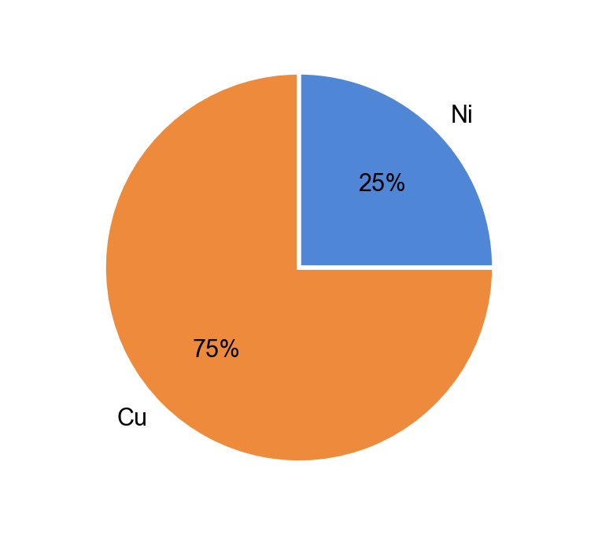

200 g qotishmadagi Ni massasini (g) toping.
A) 150  B) 50  C) 100  D) 5000

**2.** H2O2 moddaning parchalanish reaksiyasida konsentratsiyaning vaqt bo'yicha o'zgarishi jadvalda berilgan:

| t, min | c, mol/l |
|---|---|
| 0 | 2,4 |
| 2 | 2,04 |
| 4 | 1,68 |
| 6 | 1,32 |

0-minutdan 2-minutgacha o'rtacha tezlikni mol/(l·min) hisoblang.
A) 0,36  B) 0,09  C) 1,2  D) 0,18

**3.** 40 l H2 va 40 l O2 aralashmasi reaksiyaga kirishdi (2H2 + O2 → 2H2O, hamma moddalar bir xil sharoitda gaz holida, suv bug' holida). Reaksiyadan keyingi gaz aralashmasining hajmini (l) aniqlang.
A) 80  B) 60  C) 40  D) 20

**4.** Brom atomida d-pog'onachadagi elektronlar sonini aniqlang (Z = 35).
A) 11  B) 9  C) 10  D) 12

**5.** pH = 3 bo'lgan HCl eritmasining 100 ml siga pH = 11 bo'lgan NaOH eritmasidan 100 ml qo'shildi. Hosil bo'lgan eritmaning pH qiymatini aniqlang.
A) 3  B) 11  C) 4  D) 7

**6.** 35-tartib raqamli element atomida magnit kvant soni m_l = 1 bo'lgan elektronlardan nechtasining spin kvant soni m_s = +½ ga, nechtasiniki m_s = −½ ga teng?
A) 3 va 4  B) 5 va 3  C) 4 va 4  D) 4 va 3

**7.** MgSO4·7H2O kristallogidratida kristallizatsion suvning massa ulushini (%) aniqlang.
A) 51,2  B) 48,8  C) 25,6  D) 105

**8.** 40 g NaOH 250 g suvda eritildi. Eritmaning molyal konsentratsiyasini (mol/kg) aniqlang.
A) 4  B) 3,45  C) 0  D) 8

**9.** 50 g CuSO4·5H2O 100 g suvda eritildi. Eritmadagi tuzning massa ulushini (%) aniqlang.
A) 32  B) 21,33  C) 33,33  D) 42,67

**10.** 13,9 g FeSO4·7H2O 100 g suvda eritildi. Eritmadagi tuzning massa ulushini (%) aniqlang.
A) 6,67  B) 7,6  C) 12,2  D) 13,35

**11.** Quyidagi zarrachalardan qaysilari argon atomi bilan izoelektron? 1) O²⁻; 2) Cl⁻; 3) Na⁺; 4) Ca²⁺
A) 1, 3  B) 3, 4  C) 2, 4  D) 1, 2

**12.** 2 mol HNO3 va 2 mol Ba(OH)2 suvda eritilib, eritma hajmi 5 l ga yetkazildi. Eritmadagi barcha ionlarning umumiy molyar konsentratsiyasini (mol/l) aniqlang (kuchli elektrolitlar to'liq dissotsilanadi).
A) 0,8  B) 4  C) 2  D) 1

**13.** N2 + 3H2 ⇌ 2NH3 reaksiyasi 4 l hajmli idishda o'tkazildi. Moddalar miqdori jadvalda berilgan:

| Modda | N2 | H2 | NH3 |
|---|---|---|---|
| Boshlang'ich miqdor, mol | 4 | 6 | 0 |
| Muvozanatdagi miqdor, mol | — | — | 2 |

Muvozanat konstantasini (K) hisoblang.
A) 1,58  B) 0,395  C) 3,16  D) 0,79

### ANORGANIK KIMYO (14–19)

**14.** 4Li + O2 → 2Li2O jarayoni uchun 64 g O2 olingan. Li2O massasini (g) aniqlang.
A) 30  B) 120  C) 240  D) 60

**15.** 0,4 mol Ca(OH)2 tutgan eritmadan 0,6 mol karbonat angidrid o'tkazildi. Eritmada qolgan kalsiy gidrokarbonatning massasini (g) aniqlang.
A) 32,4  B) 40  C) 97,2  D) 20

**16.** D-metallar va ularning birikmalari haqida qaysi fikrlar to'g'ri? 1) Fe(OH)2 havoda qo'ng'ir rangga o'tadi; 2) Xrom (VI) oksidi (CrO3) kislotali oksid; 3) Rux eritmada Fe²⁺ ni siqib chiqara olmaydi; 4) Cr2O3 asosli oksid
A) 1, 3  B) 1, 4  C) 2, 3  D) 1, 2

**17.** Ca(HCO3)2 → CaCO3 + CO2 + H2O jarayoni uchun tarkibida 80 % aralashma bo'lgan 81 g namuna (asosiy modda Ca(HCO3)2) olingan. CO2 hajmini (l, n.sh.) aniqlang.
A) 4,48  B) 1,12  C) 2,24  D) 3,36

**18.** CaO + CO2 → CaCO3 jarayoni uchun 4,48 l (n.sh.) CO2 olingan. CaCO3 miqdorini (mol) aniqlang.
A) 0,4  B) 0,2  C) 0,1  D) 0,3

**19.** Ca → ? → ? → ? o'zgarishlar zanjirida (reagentlar: O2, H2O, CO2) 1-bosqichda hosil bo'ladigan modda formulasini toping.
A) NaCl  B) CaO  C) K3PO4  D) H2SO3

### ORGANIK KIMYO (20–29)

**20.** 0,1 mol metan xlor bilan to'liq xlorlanib, CCl4 olindi. Sarflangan xlor hajmini (l, n.sh.) aniqlang.
A) 8,96  B) 2,24  C) 4,48  D) 6,72

**21.** 23 g C2H5OH dan quyidagi ikki bosqichda C2H6 olinadi:
1) C2H5OH → C2H4 + H2O (unum 50 %);
2) C2H4 + H2 → C2H6 (unum 50 %).
Oxirgi mahsulot C2H6 ning hajmini (l, n.sh.) toping.
A) 5,6  B) 11,2  C) 1,4  D) 2,8

**22.** Arenlar, neft va tabiiy gaz haqida qaysi fikrlar to'g'ri? 1) Benzolda 6 ta sp² gibridlangan uglerod bor; 2) Benzoldan nitrobenzol nitrolash bilan olinadi; 3) Benzol uchun birikish reaksiyalari mutlaqo xos emas; 4) Benzol bromli suvni rangsizlantirmaydi
A) 1, 2, 4  B) 1, 4  C) 1, 3  D) 3, 4

**23.** C2H5Cl + KOH → C2H5OH + KCl reaksiyasida 5,6 g KOH ishtirok etdi. KCl massasini (g) toping.
A) 14,9  B) 3,73  C) 7,45  D) 11,18

**24.** 3 g metanal Ag2O ning ammiakli eritmasi bilan to'liq oksidlanganda hosil bo'lgan kumush massasini (g) aniqlang.
A) 10,8  B) 43,2  C) 86,4  D) 21,6

**25.** Karbon kislotalar haqida qaysi fikrlar to'g'ri? 1) Sirka angidrid ikki molekula sirka kislotadan suv chiqib hosil bo'ladi; 2) Karboksil guruh karbonil va gidroksil guruhlardan iborat; 3) Olein kislota Br2 ni biriktiradi; 4) Chumoli kislota "kumush ko'zgu" reaksiyasini beradi
A) 1, 2, 3  B) 2, 3, 4  C) 1, 2, 3, 4  D) 1, 3, 4

**26.** Murakkab efirlar va yog'lar haqida qaysi fikrlar to'g'ri? 1) Dietil efir spirtdan yuqori haroratda qaynaydi; 2) Suyuq yog'larni gidrogenlab qattiq yog' olinadi; 3) Suyuq yog'lar to'yinmagan kislotalardan hosil bo'lgan; 4) Murakkab efirlarning gidrolizi ishqoriy muhitda qaytmas
A) 1, 4  B) 2, 3  C) 1, 2  D) 2, 3, 4

**27.** Quyidagi birikmalardan qaysi biri amin sinfiga kiradi?
A) CH3COOH  B) C2H5NH2  C) C12H22O11  D) C6H5OH

**28.** 4CH3NH2 + 9O2 → 4CO2 + 10H2O + 2N2 reaksiyasida 4,48 l (n.sh.) CH3NH2 ishtirok etdi. O2 hajmini (l, n.sh.) toping.
A) 1,99  B) 20,16  C) 5,04  D) 10,08

**29.** Rasmda organik birikmaning tuzilish formulasi keltirilgan.

Molekuladagi uglerod atomlari sonini aniqlang.
A) 5  B) 6  C) 4  D) 7

### KIMYOVIY TAHLIL (30–32)

**30.** Kimyo laboratoriyasida ishlash qoidalari haqida qaysi fikrlar to'g'ri? 1) Ortiqcha reaktiv idishga qaytariladi; 2) Reaktivlarni tatib ko'rish mumkin; 3) Suvni konsentrlangan kislotaga tez quyish mumkin; 4) Zaharli gaz ajraladigan tajriba mo'rili shkafda o'tkaziladi
A) 1, 4  B) 3, 4  C) 4  D) 2, 4

**31.** Rasmdagi asbobda 23,4 g NaCl ga konsentrlangan H2SO4 ta'sir ettirib qizdirildi (NaCl + H2SO4 → NaHSO4 + HCl). Ajralgan HCl hajmini (l, n.sh.) aniqlang.

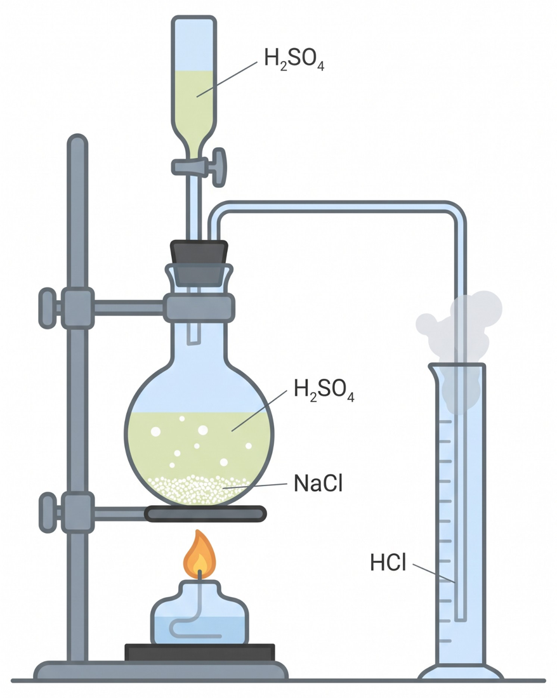
A) 8,96  B) 17,92  C) 4,48  D) 0,64

**32.** 400 g 12 % li NaCl eritmasidan 100 g suv bug'latildi. Qolgan eritmadagi tuzning massa ulushini (%) toping.
A) 9,6  B) 3  C) 16  D) 12,8

## II QISM. MOSLASHTIRISH (33–35)

**33–35.** Topshiriqlarga mos javoblarni A–F variantlaridan tanlang.
Na va Na2O dan iborat 17 g aralashma 100 g suvda to'liq eritildi, bunda 2,24 l (n.sh.) vodorod ajraldi. Hosil bo'lgan eritma sirka kislota bilan to'liq neytrallandi.

**33.** Hosil bo'lgan eritmadagi NaOH ning massa ulushini (%) aniqlang.
**34.** Dastlabki aralashmadagi Na2O massasini (g) aniqlang.
**35.** Neytrallash uchun sarflangan 20 % li sirka kislota eritmasining massasini (g) aniqlang.

A) 12,4  B) 20,55  C) 30,82  D) 180  E) 90  F) 24,8

## III QISM. QISQA JAVOBLI (36–40) — javobni son bilan yozing

**36.** Mg + HNO3 → Mg(NO3)2 + NH4NO3 + H2O reaksiya tenglamasini elektron balans usulida tenglang va barcha koeffitsiyentlar yig'indisini aniqlang.

**37.** CH4 va H2 dan iborat 20 ml aralashma mo'l kisloroda yondirildi (suv suyuq holatda; hajmlar bir xil sharoitda o'lchandi). Reaksiyadan so'ng gazlar hajmi 35 ml ga kamaydi. Aralashmadagi CH4 hajmini (ml) toping.

**38.** 6,2 g fosfor yondirib hosil bo'lgan oksid suvda eritildi, so'ng eritmaga 0,3 mol NaOH qo'shildi (NaOH : H3PO4 = 1,5 : 1). Hosil bo'lgan tuzlar umumiy massasini (g) toping.

**39.** Uglevodorodning 5,6 g massasi yondirilganda 17,6 g CO2 va 7,2 g H2O hosil bo'ldi. Uglevodorodning molyar massasini (g/mol) aniqlang.

**40.** Polietilen polimerining (polimerlanish darajasi 2000) 280 g namunasini olish uchun polimerlanish unumi 90 % bo'lganda qancha monomer (C2H4) kerak (g)?

## IV QISM. YOZMA ISH (41–43) — to'liq yechim ko'rsatiladi

### 41-topshiriq (umumiy kimyo; 5 band, 25 ball)
CO va CO2 dan iborat gazlar aralashmasi (n.sh.) 4,48 l hajm egallaydi va massasi 7,2 g.
1) Aralashmadagi gazlarning mol miqdorlarini hisoblang.
2) Aralashmaning vodorodga nisbatan zichligini va gazlarning hajmiy ulushlarini (%) aniqlang. Aralashmaning to'liq massasini (g) ham ayting.
3) Aralashmani to'liq yoqish uchun zarur kislorod hajmini (l, n.sh.) toping.
4) Yonishdan keyingi gazlar mo'l NaOH eritmasidan o'tkazildi. Hosil bo'lgan Na2CO3 massasini (g) hisoblang (CO2 + 2NaOH → Na2CO3 + H2O). NaOH sarfini (g) ham toping.
5) Aralashmaning o'rtacha molyar massasini (g/mol) toping. Shu miqdor CO ni yoqish uchun havo (21 % O2) hajmi qancha (l, n.sh.)?

### 42-topshiriq (organik kimyo; 3 band, 25 ball; hisob-kitob yo'q)
Quyidagi o'zgarishlar zanjirida X, Y, Z noma'lum organik moddalar:
CH4 —Cl2, yorug'lik→ X —Na→ Y —Cl2, yorug'lik→ C2H5Cl
1) CH4 → X : reaksiya tenglamasini yozing; hosil bo'lgan moddani nomlang.
2) X → Y : reaksiya tenglamasini yozing; hosil bo'lgan moddani nomlang.
3) Y → C2H5Cl : reaksiya tenglamasini yozing; hosil bo'lgan moddani nomlang.

### 43-topshiriq (anorganik kimyo yoki kimyoviy tahlil; 5 band, 25 ball)
Rux, temir va misdan iborat 27,4 g aralashma mo'l NaOH eritmasi bilan reaksiyaga kirishganda 4,48 l (n.sh.) vodorod ajraldi. Xuddi shunday tarkibli 27,4 g aralashma mo'l xlorid kislota bilan reaksiyaga kirishganda esa 8,96 l (n.sh.) vodorod ajraldi.
1) Aralashmadagi har bir metallning massasini (g) va massa ulushini (%) aniqlang (reaksiya tenglamalarini yozing).
2) Xlorid kislota bilan reaksiyadan keyin qolgan qoldiq konsentrlangan HNO3 da to'liq eritildi. Ajralgan gazning hajmini (l, n.sh.) hisoblang.
3) Xlorid kislota bilan olingan eritmaga mo'l NaOH qo'shildi, cho'kma ajratib olinib, havoda to'liq oksidlandi. Cho'kma massasini (g) toping.
4) Hosil bo'lgan Cu(NO3)2 eritmasi bug'latilib, quruq tuz qizdirilganda hosil bo'ladigan qattiq qoldiq massasini (g) va gazlar aralashmasining hajmini (l, n.sh.) aniqlang.
5) Ushbu aralashma (butun massasi) to'liq reaksiyaga kirishishi uchun 20 % li HCl eritmasidan necha gramm kerak (mis reaksiyaga kirishmaydi)?

# VARIANT 9

## I QISM. YOPIQ TESTLAR (1–32, har biri bitta to'g'ri javob)

### UMUMIY KIMYO (1–13)

**1.** A + B ⇌ C reaksiyada moddalar konsentratsiyalarining vaqt bo'yicha o'zgarishi grafikda ko'rsatilgan.

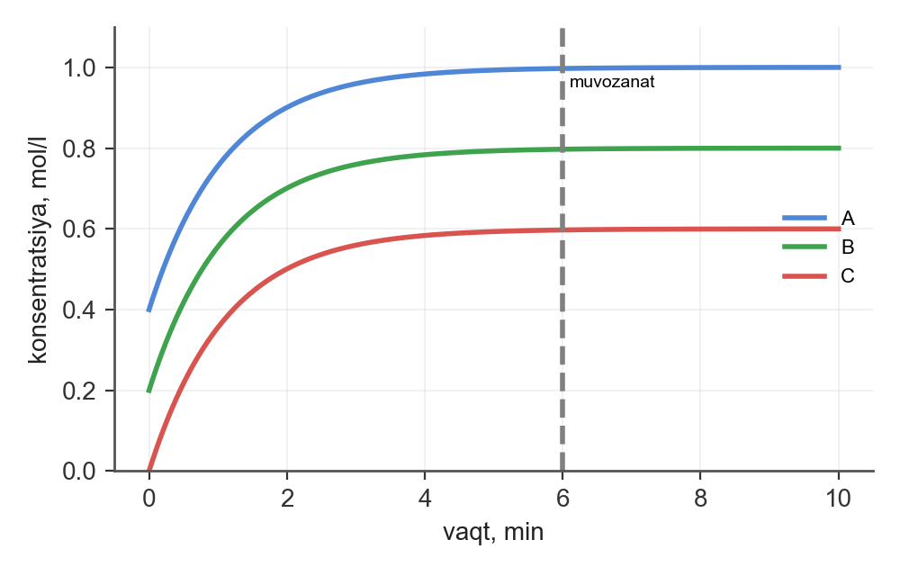

Grafikdan foydalanib, muvozanat konstantasini (K) aniqlang.
A) 15  B) 7,5  C) 3,75  D) 1

**2.** Quyidagi zarrachalardan qaysilari neon atomi bilan izoelektron? 1) Al³⁺; 2) Cl⁻; 3) S²⁻; 4) F⁻
A) 2, 3, 4  B) 1, 2  C) 1, 4  D) 2, 4

**3.** N2 + 3H2 ⇌ 2NH3 reaksiyasi 2 l hajmli idishda o'tkazildi. Ma'lumotlar jadvalda berilgan:

| Modda | N2 | H2 | NH3 |
|---|---|---|---|
| Boshlang'ich, mol | 4 | 6 | 0 |
| Muvozanatda, mol | — | — | 2 |

N2 ning necha foizi reaksiyaga kirishganini aniqlang.
A) 12,5  B) 25  C) 37,5  D) 75

**4.** Quyidagi tuzlarning qaysilari suvli eritmasi ishqoriy muhitga ega? 1) K3PO4; 2) ZnCl2; 3) K2SO4; 4) NH4Cl
A) 1  B) 2, 3  C) 3  D) 3, 4

**5.** Gazlar aralashmasi tarkibi jadvalda berilgan (n.sh.):

| Gaz | Hajmi, l |
|---|---|
| He | 1 |
| N2 | 1 |
| SO2 | 2 |

Aralashmaning havoga nisbatan zichligini aniqlang (M(havo) = 29 g/mol).
A) 2,76  B) 0,69  C) 40  D) 1,38

**6.** Reaksiya tezligining harorat koeffitsiyenti γ = 4. 20 °C da reaksiya 32 minutda tugasa, 40 °C da necha sekundda tugaydi?
A) 30720  B) 480  C) 2  D) 120

**7.** 1 M HCl eritmasining normal konsentratsiyasini (n) aniqlang.
A) 2  B) 0,5  C) 1  D) 1,5

**8.** NaCl eritmasi inert elektrodlar yordamida 10 A tok kuchi bilan 965 s elektroliz qilindi. Anodda ajralgan Cl2 hajmi (l, n.sh.) ni toping.
A) 2,24  B) 1,12  C) 0,56  D) 0,112

**9.** H2 + I2 ⇌ 2HI reaksiyada muvozanat qaror topganda [H2] = 1, [I2] = 2, [HI] = 4 mol/l bo'ldi. I2 ning boshlang'ich konsentratsiyasini (mol/l) aniqlang.
A) 4  B) 2  C) 6  D) 8

**10.** Faqat oksidlovchi bo'la oladigan ionlarni aniqlang: 1) I⁻; 2) Cl⁻; 3) K⁺; 4) Na⁺
A) 1  B) 1, 2, 4  C) 2, 4  D) 3, 4

**11.** CuCl2 ning suvli eritmasi inert elektrodlar bilan elektroliz qilinganda qaysi moddalar ajraladi?
A) Cu va O2  B) Cu va Cl2  C) Zn, H2 va O2  D) Ag va O2

**12.** 4,6 g Na va 3,55 g Cl2 aralashtirilib, reaksiya o'tkazildi (2Na + Cl2 → 2NaCl). Hosil bo'lgan NaCl massasini (g) aniqlang.
A) 5,85  B) 11,7  C) 2,93  D) 8,78

**13.** 18,25 g HCl 500 g suvda eritildi. Eritmaning molyal konsentratsiyasini (mol/kg) aniqlang.
A) 0,96  B) 0  C) 2  D) 1

### ANORGANIK KIMYO (14–19)

**14.** Reaksiya tenglamasi: ZnO + 2HCl → ZnCl2 + H2O. Reaksiyaga tarkibida 20 % aralashma bo'lgan 20,25 g namuna (asosiy modda ZnO) kirishdi. HCl hajmini (l, n.sh.) hisoblang.
A) 2,24  B) 17,92  C) 8,96  D) 4,48

**15.** Mg(HCO3)2 → MgCO3 + CO2 + H2O reaksiyasida 146 g Mg(HCO3)2 ishtirok etdi. MgCO3 massasini (g) toping.
A) 168  B) 42  C) 84  D) 126

**16.** Reaksiya tenglamasi: N2O5 + H2O → 2HNO3. Reaksiyaga tarkibida 10 % aralashma bo'lgan 12 g namuna (asosiy modda N2O5) kirishdi. HNO3 massasini (g) hisoblang.
A) 3,15  B) 25,2  C) 12,6  D) 6,3

**17.** P → ? → ? → ? o'zgarishlar zanjirida (reagentlar: O2, H2O, KOH) 3-bosqichda hosil bo'ladigan modda formulasini toping.
A) SO2  B) Na2O  C) K3PO4  D) NaOH

**18.** NH3 + H3PO4 → NH4H2PO4 jarayoni uchun 98 g H3PO4 olingan (unum 60 %). NH4H2PO4 massasini (g) aniqlang.
A) 115  B) 138  C) 69  D) 34,5

**19.** NH4NO3 qizdirilganda qanday moddalar hosil bo'ladi?
A) Ag, NO2 va O2  B) KNO2 va O2  C) CuO, NO2 va O2  D) N2O va H2O

### ORGANIK KIMYO (20–29)

**20.** CH4 + Cl2 → CH3Cl + HCl jarayoni uchun 4,48 l (n.sh.) CH4 olingan. CH3Cl miqdorini (mol) aniqlang.
A) 0,4  B) 0,1  C) 0,3  D) 0,2

**21.** Alken, alkadiyen va alkinlar haqida qaysi fikrlar to'g'ri? 1) Alkinlar uchun umumiy formula CnH2n+2; 2) Asetilen Ag2O ning ammiakli eritmasi bilan cho'kma beradi (butin-2 beradi); 3) Etilen bromli suvni rangsizlantiradi; 4) Alkenlarda π-bog' yo'q
A) 2, 3  B) 3  C) 1, 4  D) 1, 3

**22.** Rasmda siklik uglevodorodning tuzilish formulasi berilgan.

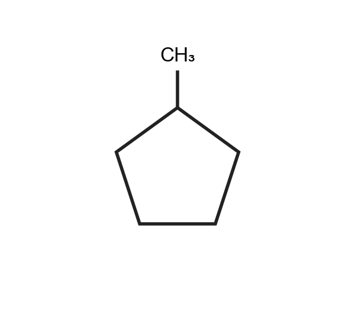

Birikmaning nomini toping.
A) 1,2-dimetilsiklogeksan  B) metilsiklopropan  C) 1,2-dimetilsiklopentan  D) metilsiklopentan

**23.** Spirt va fenollar haqida qaysi fikrlar to'g'ri? 1) Fenol FeCl3 bilan binafsha rang beradi; 2) Glitserin Cu(OH)2 bilan ko'k kompleks hosil qiladi; 3) Fenol Cu(OH)2 ni eritib ko'k kompleks hosil qiladi; 4) Uchlamchi spirtlar oson oksidlanadi
A) 4  B) 1, 2  C) 3  D) 1, 2, 4

**24.** 18 g glyukoza Ag2O ning ammiakli eritmasi bilan to'liq oksidlanganda hosil bo'lgan kumush massasini (g) aniqlang.
A) 21,6  B) 10,8  C) 43,2  D) 18

**25.** Karbon kislotalar haqida qaysi fikrlar to'g'ri? 1) Sirka kislota karbonatlar bilan CO2 ajratadi; 2) Sirka angidrid ikki molekula sirka kislotadan suv chiqib hosil bo'ladi; 3) Benzoy kislota Na2CO3 bilan reaksiyaga kirishmaydi; 4) Olein kislota Br2 ni biriktiradi
A) 1, 2, 4  B) 1, 3  C) 2, 3, 4  D) 2, 4

**26.** Murakkab efirlar va yog'lar haqida qaysi fikrlar to'g'ri? 1) Suyuq yog'lar to'yinmagan kislotalardan hosil bo'lgan; 2) Yog'lar glitserin va yuqori yog' kislotalarning murakkab efirlari; 3) Efirlanish reaksiyasi qaytmas; 4) Sovun — yuqori yog' kislotalarning natriyli tuzi
A) 1, 4  B) 1, 2, 4  C) 1, 3, 4  D) 1, 3

**27.** Uglevodlar haqida qaysi fikrlar to'g'ri? 1) Kraxmal yod bilan ko'k rang beradi; 2) Selluloza β-glyukoza qoldiqlaridan iborat; 3) Glyukoza gidrolizlanadi; 4) Glyukoza "kumush ko'zgu" reaksiyasini beradi
A) 1, 3, 4  B) 2, 3  C) 1, 2, 4  D) 1, 2, 3

**28.** 15 g glitsin HCl bilan reaksiyaga kirishganda hosil bo'lgan tuz massasini (g) aniqlang.
A) 22,3  B) 15  C) 7,3  D) 44,6

**29.** 5,6 g C2H4 dan quyidagi ikki bosqichda C2H5OH olinadi:
1) C2H4 + HCl → C2H5Cl (unum 80 %);
2) C2H5Cl + KOH → C2H5OH + KCl (unum 75 %).
Oxirgi mahsulot C2H5OH ning massasini (g) toping.
A) 6,9  B) 5,52  C) 7,36  D) 9,2

### KIMYOVIY TAHLIL (30–32)

**30.** Rasmda tasvirlangan usul bilan qaysi aralashmani ajratish mumkin?

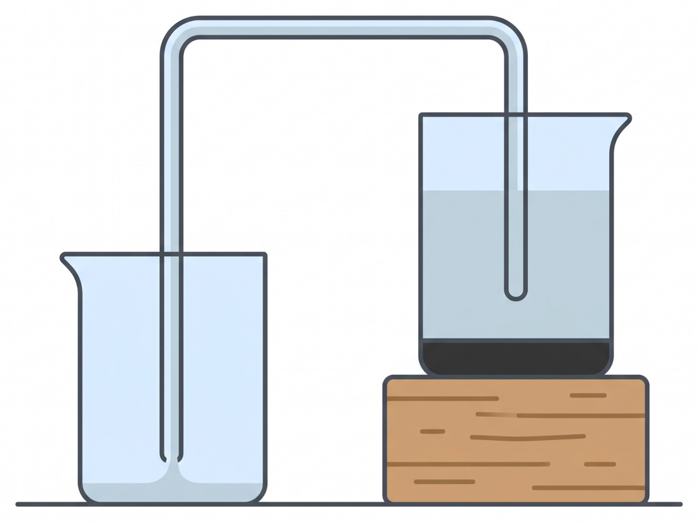
A) loyqa suv (suv va qum zarrachalari)
B) suv va etanol
C) suv va kerosin
D) osh tuzi eritmasi

**31.** Quyidagi aralashmani ajratish uchun qaysi usul mos: suv va etanol aralashmasi?
A) distillash (fraksiyalab haydash)
B) ajratgich voronka
C) bug'latish
D) magnit yordamida ajratish (temir tortiladi)

**32.** Eritmaga BaCl2 qo'shilganda oq cho'kma (BaSO4), HCl da erimaydi kuzatildi. Eritmada qaysi ion bor?
A) NH4⁺  B) Br⁻  C) CO3²⁻  D) SO4²⁻

## II QISM. MOSLASHTIRISH (33–35)

**33–35.** Topshiriqlarga mos javoblarni A–F variantlaridan tanlang.
NaBr va NaCl dan iborat 16,15 g aralashma suvda eritilib, mo'l AgNO3 eritmasi qo'shildi; hosil bo'lgan cho'kmalarning umumiy massasi 33,15 g.

**33.** Aralashmadagi NaBr massasini (g) aniqlang.
**34.** Sarflangan 10 % li AgNO3 eritmasining massasini (g) aniqlang (M(AgNO3) = 170 g/mol).
**35.** Eritmada hosil bo'lgan nitratlarning umumiy massasini (g) aniqlang.

A) 5,15  B) 8,5  C) 10,3  D) 17  E) 340  F) 510

## III QISM. QISQA JAVOBLI (36–40) — javobni son bilan yozing

**36.** Cu + HNO3 → Cu(NO3)2 + NO + H2O reaksiya tenglamasini tenglang va barcha koeffitsiyentlar yig'indisini aniqlang.

**37.** Reaksiya 30 °C da 72 minutda tugaydi. γ = 2. Harorat 20 °C ga oshirilib, reagentlardan birining konsentratsiyasi 2 marta oshirildi (reaksiya shu modda bo'yicha 1-tartibli). Reaksiya necha minutda tugaydi?

**38.** 37,6 g Cu(NO3)2 qizdirilganda qisman parchalandi, qattiq qoldiq massasi 26,8 g bo'ldi. Ajralgan gazlar (n.sh.) hajmini (l) hisoblang.

**39.** Etilen va asetilendan iborat 4,48 l (n.sh.) aralashma bromli suvdan o'tkazilganda 40 g brom yutildi. Aralashmadagi asetilenning hajmini (l, n.sh.) toping.

**40.** Polistirol polimerining (polimerlanish darajasi 2000) 416 g namunasini olish uchun polimerlanish unumi 80 % bo'lganda qancha monomer (C8H8) kerak (g)?

## IV QISM. YOZMA ISH (41–43) — to'liq yechim ko'rsatiladi

### 41-topshiriq (umumiy kimyo; 5 band, 25 ball)
Elementar 2SO2 + O2 → 2SO3 reaksiyasi 30 °C da 162 minutda tugaydi. Reaksiyaning temperatura koeffitsiyenti γ = 3. Boshlang'ich konsentratsiyalar [SO2] = [O2] = 0,2 mol/l bo'lganda boshlang'ich tezlik 1·10⁻³ mol/(l·min) ga teng.
1) Reaksiya tezligi konstantasini (k) hisoblang va kinetik tenglamani yozing.
2) Harorat 40 °C ga oshirilganda reaksiya tezligi necha marta ortadi?
3) Harorat 40 °C ga oshirilganda reaksiya necha minutda tugaydi?
4) Idish hajmi 2 marta kamaytirilsa, 30 °C da tezlik necha marta o'zgaradi? Idish hajmi 3 marta oshirilsa tezlik necha marta kamayadi?
5) SO2 ning konsentratsiyasini 3 marta oshirib, O2 niki o'zgarmasa, tezlik necha marta o'zgaradi? Shuningdek harorat 30 °C dan 10 °C gacha pasaytirilsa tezlik necha marta kamayadi?

### 42-topshiriq (organik kimyo; 4 band, 25 ball; hisob-kitob yo'q)
Quyidagi o'zgarishlar zanjirida X, Y, Z noma'lum organik moddalar:
C2H5OH —CuO, t°→ X —Ag2O, NH3→ Y —Cl2, P→ Z —NH3→ NH2CH2COOH
1) C2H5OH → X : reaksiya tenglamasini yozing; hosil bo'lgan moddani nomlang.
2) X → Y : reaksiya tenglamasini yozing; hosil bo'lgan moddani nomlang.
3) Y → Z : reaksiya tenglamasini yozing; hosil bo'lgan moddani nomlang.
4) Z → NH2CH2COOH : reaksiya tenglamasini yozing; hosil bo'lgan moddani nomlang.

### 43-topshiriq (anorganik kimyo yoki kimyoviy tahlil; 5 band, 25 ball)
12,4 g qizil fosfor mo'l kislorodda yondirildi, hosil bo'lgan oksid suvda to'liq eritildi (ortofosfat kislota). Eritmaga 0,8 mol NaOH qo'shildi.
1) Reaksiya tenglamalarini yozing. Hosil bo'lgan P2O5 massasini (g) hisoblang.
2) Hosil bo'lgan H3PO4 massasini (g) toping. Kislotada fosforning massa ulushini (%) ham hisoblang.
3) Eritmada qanday tuz hosil bo'lganini aniqlang va uning massasini (g) hisoblang.
4) Hosil bo'lgan eritmani to'liq neytrallash uchun yana qancha NaOH (g) kerak (Na2HPO4 → Na3PO4)?
5) Hosil bo'lgan tuzning 10 % li eritmasi massasini (g) hisoblang.

# VARIANT 10

## I QISM. YOPIQ TESTLAR (1–32, har biri bitta to'g'ri javob)

### UMUMIY KIMYO (1–13)

**1.** PCl5 ⇌ PCl3 + Cl2 reaksiyasi 1 l hajmli idishda o'tkazildi. Ma'lumotlar jadvalda berilgan:

| Modda | PCl5 | PCl3 |
|---|---|---|
| Boshlang'ich, mol | 6 | 0 |
| Muvozanatda, mol | — | 0,5 |

Muvozanat konstantasini (K) hisoblang.
A) 0,091  B) 0,045  C) 0,023  D) 22

**2.** 10 l SO2 va 10 l O2 aralashmasi reaksiyaga kirishdi (2SO2 + O2 → 2SO3, hamma moddalar bir xil sharoitda gaz holida). Reaksiyadan keyingi gaz aralashmasining hajmini (l) aniqlang.
A) 15  B) 20  C) 10  D) 5

**3.** KClO3 tarkibida Cl ning oksidlanish darajasini aniqlang.
A) +6  B) +7  C) +5  D) −2

**4.** Azot atomining p- va d- pog'onachalaridagi elektronlardan nechtasining magnit kvant soni m_l = 1 ga teng? (Z = 7)
A) 2  B) 1  C) 4  D) 3

**5.** 1 mol AlCl3 va 3 mol Ba(OH)2 suvda eritilib, eritma hajmi 2 l ga yetkazildi. Eritmadagi barcha ionlarning umumiy molyar konsentratsiyasini (mol/l) aniqlang (kuchli elektrolitlar to'liq dissotsilanadi).
A) 2  B) 13  C) 3,25  D) 6,5

**6.** 16,8 g CaO va 8,1 g H2O aralashtirilib, reaksiya o'tkazildi (CaO + H2O → Ca(OH)2). Hosil bo'lgan Ca(OH)2 massasini (g) aniqlang.
A) 33,3  B) 44,4  C) 22,2  D) 11,1

**7.** N2 + 3H2 ⇌ 2NH3 reaksiyada muvozanat qaror topganda [N2] = 1, [H2] = 1, [NH3] = 4 mol/l bo'ldi. N2 ning boshlang'ich konsentratsiyasini (mol/l) aniqlang.
A) 3  B) 1  C) 5  D) 6

**8.** Gazlar aralashmasi tarkibi jadvalda berilgan (n.sh.):

| Gaz | Hajmi, l |
|---|---|
| NH3 | 1 |
| SO2 | 3 |
| O2 | 3 |

Aralashmaning havoga nisbatan zichligini aniqlang (M(havo) = 29 g/mol).
A) 3  B) 1,5  C) 0,75  D) 43,57

**9.** 300 g 10 % li Na2SO4 eritmasiga 25 g shu tuzning o'zi qo'shilib eritildi. Hosil bo'lgan eritmaning massa ulushini (%) aniqlang.
A) 16,92  B) 18,33  C) 9,17  D) 13,54

**10.** Azot (Z = 7) atomining tashqi energetik pog'onasidagi elektronlar sonini aniqlang.
A) 6  B) 4  C) 5  D) 7

**11.** Quyidagi zarrachalardan qaysilari argon atomi bilan izoelektron? 1) Na⁺; 2) Cl⁻; 3) Ca²⁺; 4) K⁺
A) 2, 4  B) 1, 3, 4  C) 2, 3, 4  D) 1, 4

**12.** KNO3 va NaCl eruvchanligining haroratga bog'liqligi grafikda berilgan.

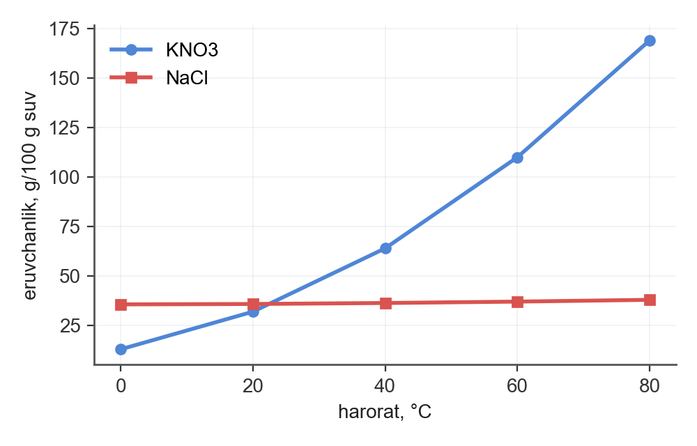

60 °C da qaysi tuzning eruvchanligi katta?
A) NaCl  B) KCl  C) NH4Cl  D) KNO3

**13.** 16,1 g Na2SO4·10H2O 100 g suvda eritildi. Eritmadagi tuzning massa ulushini (%) aniqlang.
A) 7,1  B) 13,87  C) 12,23  D) 6,12

### ANORGANIK KIMYO (14–19)

**14.** Quyidagi tuzlardan qaysilari asosli tuz? 1) K2SO4; 2) (CuOH)2CO3; 3) CaCO3; 4) KAl(SO4)2
A) 2, 4  B) 2  C) 2, 3  D) 4

**15.** CaCO3 → CaO + CO2 jarayoni uchun 50 g CaCO3 olingan (unum 90 %). CaO massasini (g) aniqlang.
A) 28  B) 50,4  C) 25,2  D) 12,6

**16.** Nodir gazlar haqida qaysi fikrlar to'g'ri? 1) Argon elektr lampalarida ishlatiladi; 2) Nodir gazlar odatiy sharoitda ko'p atomli molekulalar hosil qiladi; 3) Nodir gazlar kimyoviy jihatdan juda faol; 4) Neon reklama naylarida ishlatiladi
A) 1, 2, 3  B) 2, 3  C) 3, 4  D) 1, 4

**17.** 2NaNO3 → 2NaNO2 + O2 reaksiyasida tarkibida 60 % aralashma bo'lgan 42,5 g namuna (asosiy modda NaNO3) ishtirok etdi. NaNO2 massasini (g) toping.
A) 27,6  B) 6,9  C) 13,8  D) 20,7

**18.** 60 g FeS2 yondirilib, hosil bo'lgan SO2 dan H2SO4 olindi (jami unum 100 %). Sulfat kislota massasini (g) aniqlang.
A) 98  B) 49  C) 196  D) 147

**19.** KNO3 qizdirilganda qanday moddalar hosil bo'ladi?
A) N2O va H2O  B) Ag, NO2 va O2  C) KNO2 va O2  D) CuO, NO2 va O2

### ORGANIK KIMYO (20–29)

**20.** Rasmda uchta uglevodorodning tuzilish formulasi berilgan.

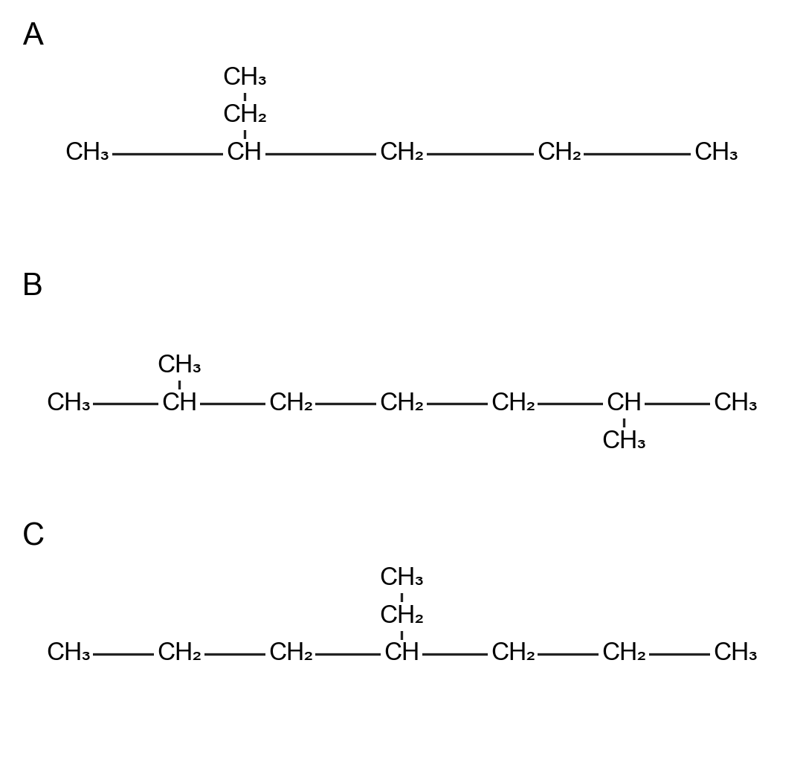

Qaysi juftlik o'zaro izomerlar hisoblanadi?
A) A va B  B) A va C  C) A, B va C  D) B va C

**21.** CH2=CH–CH2–CH3 birikmaning sistematik nomi qaysi qatorda to'g'ri keltirilgan?
A) buten-2  B) buten-1  C) 1-butin  D) butan

**22.** Arenlar, neft va tabiiy gaz haqida qaysi fikrlar to'g'ri? 1) Benzol bromli suvni rangsizlantirmaydi; 2) Tabiiy gazning asosiy qismi propan; 3) Neft fraksiyalaridan gazolin 150 °C gacha haydaladi; 4) Benzoldan nitrobenzol nitrolash bilan olinadi
A) 3, 4  B) 1, 2  C) 1, 3, 4  D) 2, 3, 4

**23.** C2H5OH + CuO (t) reaksiyasi natijasida qaysi organik modda hosil bo'ladi?
A) sirka aldegid  B) etilen  C) etanol  D) asetilen

**24.** Aldegid va ketonlar haqida qaysi fikrlar to'g'ri? 1) Formalin — formaldegidning 40 % li eritmasi; 2) Aldegidlar qaytarilganda ikkilamchi spirt hosil bo'ladi; 3) Sirka aldegid Kucherov reaksiyasi bilan olinadi; 4) Ketonlar kuchsiz oksidlovchilar bilan oksidlanmaydi
A) 2, 3, 4  B) 1, 3  C) 1, 4  D) 1, 3, 4

**25.** CH3COOH + C2H5OH → CH3COOC2H5 + H2O jarayoni uchun 46 g C2H5OH olingan (unum 75 %). CH3COOC2H5 massasini (g) aniqlang.
A) 88  B) 132  C) 33  D) 66

**26.** Murakkab efirlar va yog'lar haqida qaysi fikrlar to'g'ri? 1) Murakkab efirlarning gidrolizi ishqoriy muhitda qaytmas; 2) Suyuq yog'larni gidrogenlab qattiq yog' olinadi; 3) Sovun — yuqori yog' kislotalarning natriyli tuzi; 4) Suyuq yog'lar to'yinmagan kislotalardan hosil bo'lgan
A) 1, 2, 3, 4  B) 1, 2, 3  C) 1, 3, 4  D) 1, 2, 4

**27.** 68,4 g saxaroza gidrolizlanganda necha gramm glyukoza hosil bo'ladi?
A) 36  B) 68,4  C) 72  D) 18

**28.** 26,7 g alanin HCl bilan reaksiyaga kirishganda hosil bo'lgan tuz massasini (g) aniqlang.
A) 26,7  B) 10,95  C) 75,3  D) 37,65

**29.** C2H4 + Cl2 → C2H4Cl2 reaksiyasida 4,48 l (n.sh.) Cl2 ishtirok etdi. C2H4Cl2 massasini (g) toping.
A) 39,6  B) 19,8  C) 9,9  D) 29,7

### KIMYOVIY TAHLIL (30–32)

**30.** Rasmdagi asbobda 6,5 g rux mo'l xlorid kislota bilan reaksiyaga kirishdi (Zn + 2HCl → ZnCl2 + H2). Ajralgan vodorodning hajmini (l, n.sh.) aniqlang.

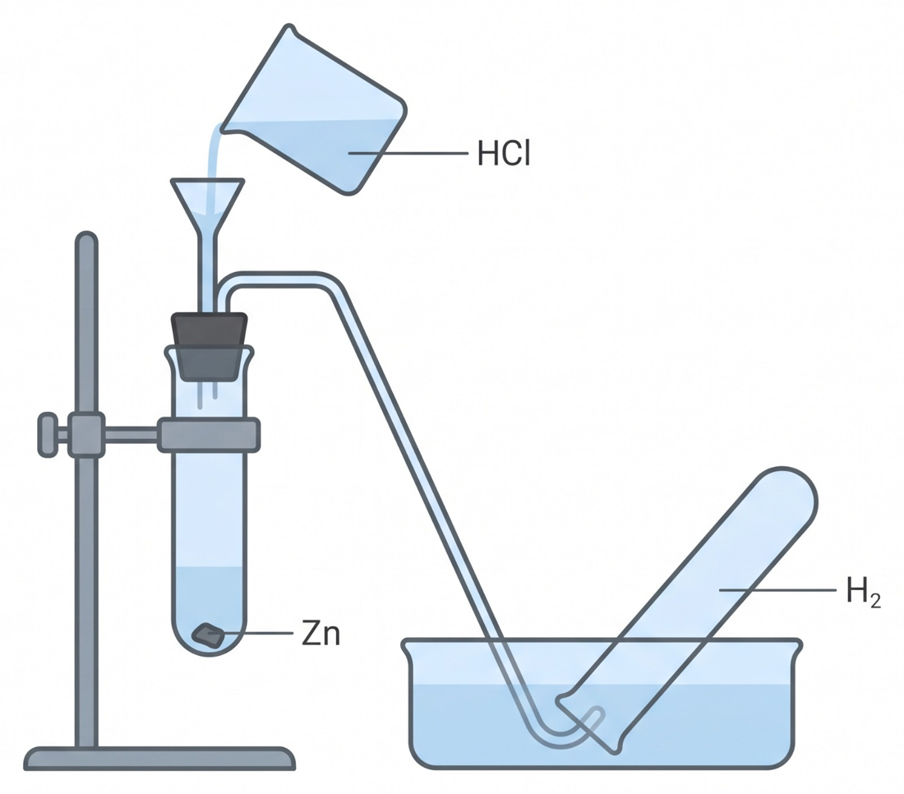
A) 4,48  B) 2,24  C) 1,12  D) 0,1

**31.** 200 g 30 % li va 100 g 50 % li Na2SO4 eritmalari aralashtirildi. Yangi eritmaning massa ulushini (%) toping.
A) 36,67  B) 40  C) 80  D) 33

**32.** Kimyoviy laboratoriyada o'lchov silindri nima uchun ishlatiladi?
A) eritmaning kichik hajmlarini o'lchab olish
B) suyuqlik hajmini o'lchash
C) eritmalarni bug'latish
D) titrlashda reagent hajmini aniq o'lchash

## II QISM. MOSLASHTIRISH (33–35)

**33–35.** Topshiriqlarga mos javoblarni A–F variantlaridan tanlang.
Etanol va fenoldan iborat 28 g aralashma natriy bilan to'liq reaksiyaga kirishganda 4,48 l (n.sh.) vodorod ajraldi. Xuddi shu massadagi aralashma NaOH eritmasi bilan (faqat fenol) va bromli suv bilan (faqat fenol) ham reaksiyaga kirishadi.

**33.** Aralashmadagi fenol massa ulushini (%) aniqlang.
**34.** Fenolni to'liq neytrallash uchun zarur NaOH massasini (g) aniqlang.
**35.** Mo'l bromli suv bilan reaksiyada hosil bo'lgan tribromfenol massasini (g) aniqlang (reaksiya unumi 90 %).

A) 67,14  B) 47,66  C) 8  D) 119,16  E) 59,58  F) 12

## III QISM. QISQA JAVOBLI (36–40) — javobni son bilan yozing

**36.** Cu + HNO3 → Cu(NO3)2 + NO2 + H2O reaksiya tenglamasini tenglang va barcha koeffitsiyentlar yig'indisini aniqlang.

**37.** Ketma-ket ulangan ikkita elektrolizyordan (CuSO4 va AgNO3 eritmalari, inert elektrodlar) tok o'tkazildi. Birinchi elektrolizyor katodida 12,8 g mis ajraldi. Ikkala elektrolizyor anodlarida ajralgan kislorodning umumiy hajmini (l, n.sh.) toping (anodda ikkalasida ham O2 ajraladi).

**38.** Alyuminiy va kalsiy dan iborat 13,4 g aralashma mo'l xlorid kislotada eritilganda 11,2 l (n.sh.) vodorod ajraldi. Aralashmadagi alyuminiyning massa ulushini (%) aniqlang.

**39.** 61,5 g nitrobenzoldan anilin olishda unum 75 % bo'lsa, mahsulot massasini (g) aniqlang.

**40.** 22,2 g propion kislota va 9,6 g metanol dan 75 % unum bilan murakkab efir olindi. Efir massasini (g) toping.

## IV QISM. YOZMA ISH (41–43) — to'liq yechim ko'rsatiladi

### 41-topshiriq (umumiy kimyo; 5 band, 25 ball)
1,2 g noma'lum metall kislota bilan to'liq reaksiyaga kirishib, 1,12 l (n.sh.) vodorod ajratdi. (Vodorodning ekvivalent hajmi V_E(H2) = 11,2 l/mol.)
1) Metallning ekvivalent massasini (g/mol) hisoblang.
2) Metallning valentligi 2 bo'lsa, uning atom massasini hisoblab, metallni aniqlang. Ajralgan vodorodning massasini (g) ham hisoblang.
3) Shu metallning oksidi formulasini yozing va molyar massasini hisoblang.
4) 1,2 g metall to'liq yonganda hosil bo'lgan oksid massasini (g) toping. Metall oksidining ekvivalent massasini (g/mol) ham aniqlang.
5) Yonishga sarflangan kislorod hajmini (l, n.sh.) aniqlang. Shuningdek metall xloridida (MCl2) metallning massa ulushini (%) toping.

### 42-topshiriq (organik kimyo; 3 band, 25 ball; hisob-kitob yo'q)
Quyidagi o'zgarishlar zanjirida X, Y, Z noma'lum organik moddalar:
C12H22O11 —H2O, H⁺→ X —bijg'ish→ Y —Na→ C2H5ONa
1) C12H22O11 → X : reaksiya tenglamasini yozing; hosil bo'lgan moddani nomlang.
2) X → Y : reaksiya tenglamasini yozing; hosil bo'lgan moddani nomlang.
3) Y → C2H5ONa : reaksiya tenglamasini yozing; hosil bo'lgan moddani nomlang.

### 43-topshiriq (anorganik kimyo yoki kimyoviy tahlil; 5 band, 25 ball)
NaBr va NaI dan iborat 32,8 g aralashma suvda eritilib, mo'l xlor o'tkazildi. Eritma bug'latilib, qoldiq quritilganda uning massasi 14,62 g bo'ldi.
1) Reaksiya tenglamalarini yozing. Aralashmadagi NaBr va NaI massalarini (g) toping.
2) Sarflangan xlor hajmini (l, n.sh.) hisoblang. Hosil bo'lgan NaCl miqdorini (mol) ham toping.
3) Ajralgan brom va yodning massalarini (g) toping.
4) Dastlabki aralashma eritmasiga mo'l AgNO3 qo'shilganda hosil bo'ladigan cho'kmalar massasini (g) aniqlang.
5) Ajralgan brom va yod aralashmasida bromning massa ulushini (%) toping.

# VARIANT 11

## I QISM. YOPIQ TESTLAR (1–32, har biri bitta to'g'ri javob)

### UMUMIY KIMYO (1–13)

**1.** 19,5 g Zn va 4,8 g S aralashtirilib, reaksiya o'tkazildi (Zn + S → ZnS). Hosil bo'lgan ZnS massasini (g) aniqlang.
A) 14,55  B) 29,1  C) 7,27  D) 21,82

**2.** 28,6 g Na2CO3·10H2O 300 g suvda eritildi. Eritmadagi tuzning massa ulushini (%) aniqlang.
A) 3,53  B) 8,7  C) 3,23  D) 6,45

**3.** Quyidagi jadvalda MgSO4 tuzining eritmalari keltirilgan:

| № | m(eritma), g | ω, % |
|---|---|---|
| I | 150 | 20 |
| II | 100 | 30 |

Eritmalar aralashtirildi. Oxirgi eritmadagi tuzning massa ulushini (%) toping.
A) 24  B) 25  C) 50  D) 26

**4.** Jadvalda bog'lar hosil qiluvchi atomlarning elektrmanfiyliklari berilgan:

| Bog' | EM (1-atom) | EM (2-atom) |
|---|---|---|
| Mg–O | 1,2 | 3,5 |
| H–F | 2,1 | 4 |
| Si–O | 1,8 | 3,5 |
| C–H | 2,5 | 2,1 |

Qaysi bog' eng qutbli (eng ko'p ionli xarakterga ega)?
A) H–F  B) Si–O  C) Mg–O  D) C–H

**5.** 1 mol C2H6 tarkibidagi atomlar sonini toping (N_A = 6,02·10²³). Javobni 10²³ birligida yozing.
A) 9,632  B) 2,408  C) 4,816  D) 0,602

**6.** Na2CO3·10H2O kristallogidratida kristallizatsion suvning massa ulushini (%) aniqlang.
A) 37,1  B) 62,9  C) 31,5  D) 169,8

**7.** ZnSO4 ning suvli eritmasi inert elektrodlar bilan elektroliz qilinganda qaysi moddalar ajraladi?
A) Zn, H2 va O2  B) H2, Cl2 va NaOH  C) Cu va Cl2  D) Ag va O2

**8.** Massa soni 226, zaryadi 88 bo'lgan yadro massa soni 206, zaryadi 82 bo'lgan yadroga aylandi (α va β⁻ parchalanish). Nechta β⁻-zarra chiqarilgan?
A) 5  B) 3  C) 4  D) 6

**9.** Quyidagi tuzlarning qaysilari suvli eritmasi ishqoriy muhitga ega? 1) K3PO4; 2) K2S; 3) Al2(SO4)3; 4) NaCl
A) 1  B) 4  C) 1, 2  D) 1, 2, 3

**10.** CH3–C≡CH molekulasida sp gibridlangan uglerod atomlari nechta?
A) 3  B) 4  C) 1  D) 2

**11.** A elementi atomining ketma-ket ionlanish energiyalari diagrammada berilgan.

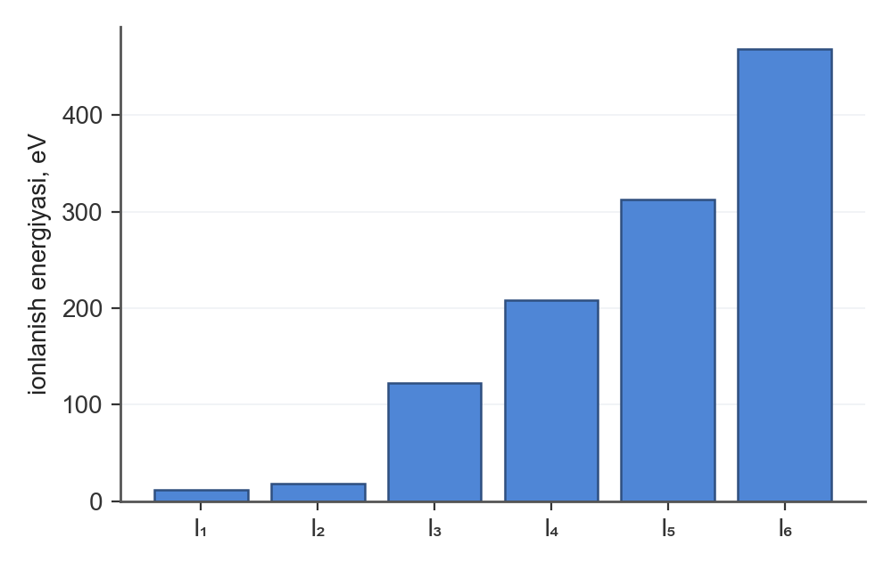

A elementining eng yuqori oksidi formulasini toping.
A) A2O  B) AO  C) A2O3  D) AO2

**12.** Massa soni 238 va zaryadi 92 bo'lgan yadro massa soni 206, zaryadi 82 bo'lgan yadroga aylanishida nechta α- va β⁻-zarra chiqaradi?
A) 8α va 6β  B) 9α va 6β  C) 8α va 8β  D) 6α va 8β

**13.** N2O5 tarkibida azot ning valentligini aniqlang.
A) V  B) VI  C) VII  D) IV

### ANORGANIK KIMYO (14–19)

**14.** Nodir gazlar haqida qaysi fikrlar to'g'ri? 1) Geliy eng yengil inert gaz; 2) Argon elektr lampalarida ishlatiladi; 3) Neon atomida 8 ta tashqi elektron bor; 4) Neon reklama naylarida ishlatiladi
A) 1, 3, 4  B) 1, 2, 4  C) 1, 2, 3  D) 1, 2, 3, 4

**15.** Zn(NO3)2 qizdirilganda qanday moddalar hosil bo'ladi?
A) NaNO2 va O2  B) ZnO, NO2 va O2  C) CuO, NO2 va O2  D) Ag, NO2 va O2

**16.** 2ZnS + 3O2 → 2ZnO + 2SO2 reaksiyasida tarkibida 75 % aralashma bo'lgan 77,6 g namuna (asosiy modda ZnS) ishtirok etdi. SO2 massasini (g) toping.
A) 25,6  B) 6,4  C) 19,2  D) 12,8

**17.** 42,5 g AgNO3 to'liq parchalanguncha qizdirildi. Qattiq qoldiq massasini (g) aniqlang.
A) 42,5  B) 27  C) 54  D) 13,5

**18.** 2CO + O2 → 2CO2 reaksiyasida 32 g O2 ishtirok etdi (unum 80 %). CO2 hajmini (l, n.sh.) toping.
A) 11,2  B) 35,84  C) 71,68  D) 17,92

**19.** NaCl + AgNO3 → AgCl + NaNO3 jarayoni uchun 85 g AgNO3 olingan. NaCl massasini (g) aniqlang.
A) 58,5  B) 14,62  C) 43,88  D) 29,25

### ORGANIK KIMYO (20–29)

**20.** Reaksiya tenglamasi: C3H8 + 5O2 → 3CO2 + 4H2O. Reaksiyaga 11,2 l (n.sh.) C3H8 kirishdi. O2 hajmini (l, n.sh.) hisoblang.
A) 2,24  B) 56  C) 112  D) 28

**21.** C2H5OH → C2H4 + H2O jarayoni uchun 46 g C2H5OH olingan. C2H4 hajmini (l, n.sh.) aniqlang.
A) 44,8  B) 11,2  C) 33,6  D) 22,4

**22.** 32 g CaC2 suv bilan reaksiyaga kirishganda ajraladigan asetilen hajmini (l, n.sh.) aniqlang (unum 80 %).
A) 8,96  B) 11,2  C) 25,6  D) 22,4

**23.** Rasmda ko'rsatilgan molekulalar o'zaro ta'sirlashganda (H2SO4 ishtirokida) hosil bo'lgan murakkab efir molekulasidagi uglerod atomlarining sp³ gibrid orbitallari sonini sp² gibrid orbitallari soniga nisbatini aniqlang.

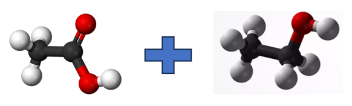
A) 3  B) 5  C) 4  D) 2,5

**24.** Aldegid va ketonlar haqida qaysi fikrlar to'g'ri? 1) Aldegidlar qaytarilganda ikkilamchi spirt hosil bo'ladi; 2) Sirka aldegid Kucherov reaksiyasi bilan olinadi; 3) Formaldegid gaz holatda, suvda yaxshi eriydi; 4) Aldegidlar "kumush ko'zgu" reaksiyasini beradi
A) 2, 3, 4  B) 2, 3  C) 1, 2, 3  D) 1, 3

**25.** Karbon kislotalar haqida qaysi fikrlar to'g'ri? 1) Karboksil guruh karbonil va gidroksil guruhlardan iborat; 2) Qattiq suvda sovun yaxshi ko'piklanadi; 3) Olein kislota Br2 ni biriktiradi; 4) Sirka angidrid ikki molekula sirka kislotadan suv chiqib hosil bo'ladi
A) 1, 2, 3  B) 1, 3, 4  C) 1, 3  D) 2, 4

**26.** 161,2 g tripalmitin natriy ishqori bilan to'liq gidrolizlanganda necha gramm sovun hosil bo'ladi?
A) 55,6  B) 111,2  C) 161,2  D) 166,8

**27.** Quyidagi birikmalardan qaysi biri keton sinfiga kiradi?
A) C6H5OH  B) CH3OCH3  C) CH3COOH  D) CH3COCH3

**28.** Aminlar, aminokislotalar va oqsillar haqida qaysi fikrlar to'g'ri? 1) Glitsin optik faol; 2) Dipeptidda 2 ta peptid bog' bor; 3) Anilin bromli suv bilan oq cho'kma beradi; 4) Aminokislotalar faqat kislotali xossaga ega
A) 2, 4  B) 3, 4  C) 3  D) 1, 2

**29.** 26 g C2H2 dan quyidagi ikki bosqichda C2H6 olinadi:
1) C2H2 + H2 → C2H4 (unum 50 %);
2) C2H4 + H2 → C2H6 (unum 50 %).
Oxirgi mahsulot C2H6 ning hajmini (l, n.sh.) toping.
A) 11,2  B) 5,6  C) 22,4  D) 2,8

### KIMYOVIY TAHLIL (30–32)

**30.** Laboratoriyada vodorod olish uchun qaysi moddalar ishlatiladi?
A) CaCO3 + HCl  B) CH3COONa + NaOH (qizdirish)  C) KMnO4 (qizdirish)  D) Zn + HCl

**31.** Rasmdagi usul bilan qaysi moddani eritmadan ajratib olish mumkin?

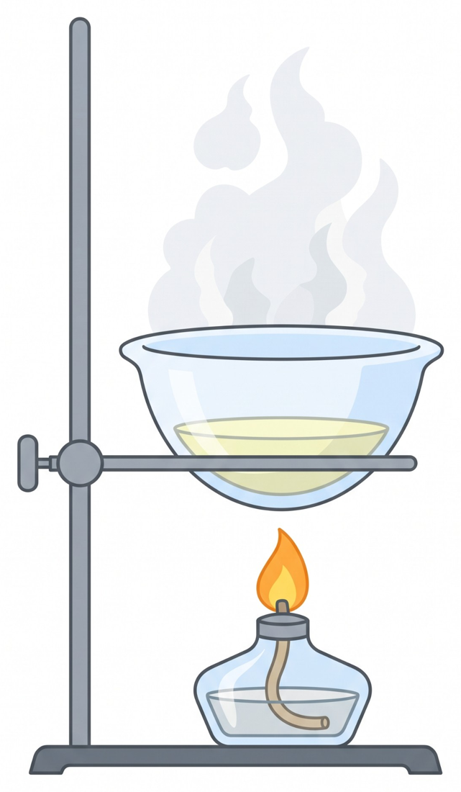
A) osh tuzini tuz eritmasidan
B) kerosinni suvdan
C) qumni suvdan
D) suvni osh tuzi eritmasidan (toza holda)

**32.** NaNO3 ning 50 % li eritmasidan 200 g 10 % li eritma tayyorlash uchun necha gramm suv kerak?
A) 40  B) 200  C) 160  D) 320

## II QISM. MOSLASHTIRISH (33–35)

**33–35.** Topshiriqlarga mos javoblarni A–F variantlaridan tanlang.
K2CO3 va BaCO3 dan iborat 60,1 g aralashma mo'l xlorid kislota bilan to'liq reaksiyaga kirishdi.

**33.** Ajralgan gaz hajmini (l, n.sh.) aniqlang.
**34.** Aralashmani to'liq eritish uchun sarflangan 10 % li HCl eritmasining massasini (g) aniqlang (M(HCl) = 36,5 g/mol).
**35.** Reaksiyadan so'ng eritmadagi tuzlar umumiy massasini (g) aniqlang.

A) 7,84  B) 52,77  C) 255,5  D) 11,76  E) 6,27  F) 204,4

## III QISM. QISQA JAVOBLI (36–40) — javobni son bilan yozing

**36.** K2Cr2O7 + FeSO4 + H2SO4 → Cr2(SO4)3 + Fe2(SO4)3 + K2SO4 + H2O reaksiya tenglamasini tenglang va barcha koeffitsiyentlar yig'indisini aniqlang.

**37.** 5,4 g Al reaksiyaga kirishdi (2Al + 6HCl → 2AlCl3 + 3H2). Ajralgan H2 hajmini (l, n.sh.) hisoblang (unum 80 %).

**38.** Al, Fe va Cu dan iborat aralashma mo'l NaOH eritmasi bilan ta'sirlashganda 6,72 l (n.sh.) vodorod ajraldi; xuddi shunday massadagi aralashma mo'l HCl bilan ta'sirlashganda 11,2 l (n.sh.) vodorod ajraldi, erimay qolgan qoldiq (mis) massasi 6,4 g. Aralashmaning dastlabki massasini (g) toping.

**39.** 180 g glyukoza spirtli bijg'ish natijasida etanolga (unum 80 %), hosil bo'lgan etanol esa sirka kislotagacha (unum 75 %) aylantirildi. Olingan kislotani to'liq neytrallash uchun NaOH ning massasini (g) toping.

**40.** Polivinilxlorid polimerining (polimerlanish darajasi 1000) 62,5 g namunasini olish uchun polimerlanish unumi 50 % bo'lganda qancha monomer (C2H3Cl) kerak (g)?

## IV QISM. YOZMA ISH (41–43) — to'liq yechim ko'rsatiladi

### 41-topshiriq (umumiy kimyo; 5 band, 25 ball)
2 l hajmli idishda N2 + 3H2 ⇌ 2NH3 reaksiyasi muvozanat holatiga keldi. Muvozanatda idishda 4 mol N2, 4 mol H2 va 8 mol NH3 bor.
1) Muvozanat konstantasini (K) hisoblang.
2) Azot va vodorodning boshlang'ich konsentratsiyalarini (mol/l) aniqlang. H2 ning boshlang'ich massasini (g) ham toping.
3) Vodorodning necha foizi reaksiyaga kirishgan?
4) Hosil bo'lgan ammiakning hammasi 800 g suvda eritildi. Eritmadagi ammiakning massa ulushini (%) hisoblang. Ajralgan NH3 hajmini (l, n.sh.) ham toping.
5) Shu eritmani (NH4)2SO4 hosil bo'lguncha neytrallash uchun 20 % li H2SO4 eritmasidan necha gramm kerak? Idish hajmi 2 marta kamaytirilsa, to'g'ri reaksiya tezligi (elementar deb hisoblang) necha marta ortadi?

### 42-topshiriq (organik kimyo; 4 band, 25 ball; hisob-kitob yo'q)
Quyidagi o'zgarishlar zanjirida X, Y, Z noma'lum organik moddalar:
CaC2 —H2O→ X —H2O, Hg²⁺→ Y —Ag2O, NH3→ Z —Cl2, P→ ClCH2COOH
1) CaC2 → X : reaksiya tenglamasini yozing; hosil bo'lgan moddani nomlang.
2) X → Y : reaksiya tenglamasini yozing; hosil bo'lgan moddani nomlang.
3) Y → Z : reaksiya tenglamasini yozing; hosil bo'lgan moddani nomlang.
4) Z → ClCH2COOH : reaksiya tenglamasini yozing; hosil bo'lgan moddani nomlang.

### 43-topshiriq (anorganik kimyo yoki kimyoviy tahlil; 5 band, 25 ball)
Uch probirkada (X, Y, Z) natriy yoki kaliy tuzlarining eritmalari bor: Na2CO3, Na3PO4, NaBr (tartibsiz). Har bir eritmaga reagentlar ta'sir ettirildi, kuzatuvlar jadvalda:

| Reagent | X | Y | Z |
|---|---|---|---|
| AgNO3 | och sariq cho'kma (AgBr) | oq-sarg'ish cho'kma | sariq cho'kma (Ag3PO4) |
| BaCl2 | — | oq cho'kma (BaCO3) | oq cho'kma |
| HCl | — | gaz (CO2) ajraladi | — |
1) X, Y, Z probirkalardagi moddalarni aniqlang va kuzatilgan reaksiyalarning ionli tenglamalarini yozing.
2) X probirkadagi tuz 0,2 mol miqdorda olingan. Unga mo'l AgNO3 qo'shilganda hosil bo'lgan cho'kma massasini (g) toping.
3) Uchala eritmaning har biriga 0,2 mol dan solingan bo'lsa, mo'l AgNO3 qo'shilganda hosil bo'ladigan barcha cho'kmalarning umumiy massasini (g) toping (ularning formulalarini yozing).
4) Eritmalarda kuzatilgan hodisalarni (cho'kma yoki gaz hosil bo'lishi) tushuntiring: qaysi ion qaysi reagent bilan qanday birikma hosil qiladi? Shu usul bilan ionlarni aniqlash qoidasini yozing.
5) Uchala eritmaning har biriga 0,2 mol dan solingan. AgNO3 bilan cho'kadigan ionlarni to'liq cho'ktirish uchun 10 % li AgNO3 eritmasidan necha gramm kerak?

# VARIANT 12

## I QISM. YOPIQ TESTLAR (1–32, har biri bitta to'g'ri javob)

### UMUMIY KIMYO (1–13)

**1.** Qaysi juftliklarda reaksiya boradi? 1) Pb va ZnCl2; 2) Al va CuSO4; 3) Zn va CuSO4; 4) Ag va CuSO4
A) 1, 2  B) 4  C) 1, 2, 4  D) 2, 3

**2.** Jadvalda bog'lar hosil qiluvchi atomlarning elektrmanfiyliklari berilgan:

| Bog' | EM (1-atom) | EM (2-atom) |
|---|---|---|
| H–Cl | 2,1 | 3 |
| H–O | 2,1 | 3,5 |
| H–F | 2,1 | 4 |
| C–O | 2,5 | 3,5 |

Qaysi bog' eng qutbli (eng ko'p ionli xarakterga ega)?
A) H–Cl  B) H–O  C) C–O  D) H–F

**3.** Rasmda neytral atom elektron qavatlarining orbital diagrammasi (kataklar – orbitallar, o'qlar – elektronlar) berilgan.

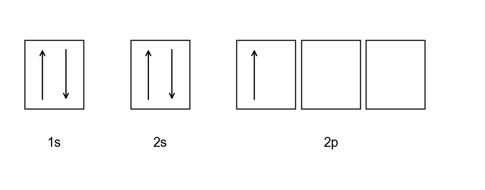

Diagramma qaysi element atomiga tegishli?
A) kislorod  B) bor  C) azot  D) uglerod

**4.** Gazlar aralashmasi tarkibi jadvalda berilgan (n.sh.):

| Gaz | Hajmi, l |
|---|---|
| N2 | 1 |
| H2 | 1 |
| SO2 | 3 |

Aralashmaning havoga nisbatan zichligini aniqlang (M(havo) = 29 g/mol).
A) 3,06  B) 0,77  C) 1,53  D) 44,4

**5.** FeSO4·7H2O kristallogidratida kristallizatsion suvning massa ulushini (%) aniqlang.
A) 54,7  B) 22,7  C) 82,9  D) 45,3

**6.** Konsentratsiyasi bir xil (0,1 mol/l) eritmalarning pH qiymatlari diagrammada berilgan.

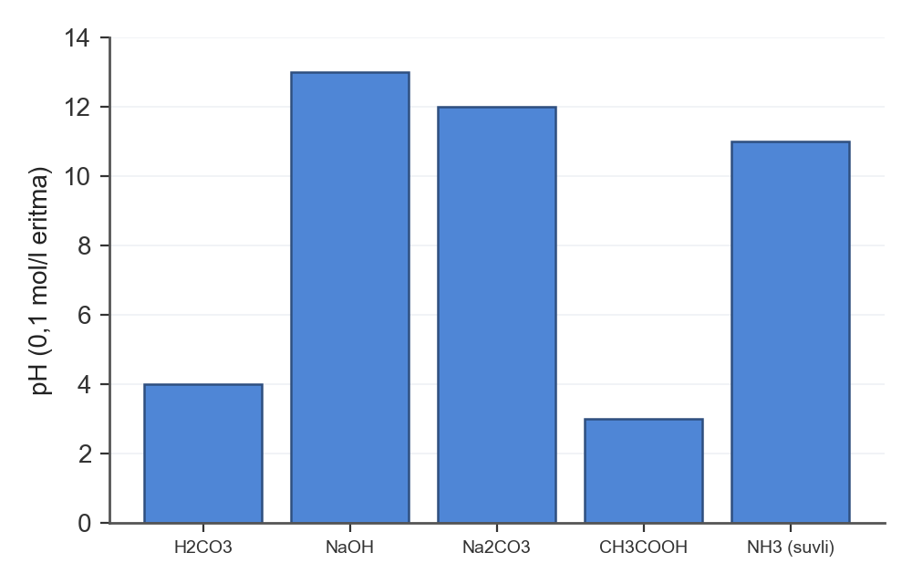

Qaysi eritmada [H⁺] eng katta?
A) CH3COOH  B) NH3 (suvli)  C) Na2CO3  D) H2CO3

**7.** Fosfor (Z = 15) atomida nechta juftlashmagan elektron bor?
A) 4  B) 2  C) 5  D) 3

**8.** 4 g NaOH ni to'liq neytrallash uchun 6 g CH3COOH sarflandi. CH3COOH ning ekvivalent massasini (g/mol) aniqlang.
A) 60  B) 120  C) 30  D) 6

**9.** 100 g 10 % li MgSO4 eritmasiga 50 g shu tuzning o'zi qo'shilib eritildi. Hosil bo'lgan eritmaning massa ulushini (%) aniqlang.
A) 40  B) 60  C) 30  D) 32

**10.** 1,5 mol H2O tarkibida necha mol atom bor?
A) 3  B) 4,5  C) 6  D) 1,5

**11.** Fe plastinka 8 g CuSO4 ni tutgan eritmaga tushirildi va Cu to'liq ajralib chiqquncha ushlab turildi. Plastinka massasi necha gramm ortadi?
A) 0,4  B) 0,8  C) 0,2  D) 8

**12.** H3PO3 tarkibida P ning oksidlanish darajasini aniqlang.
A) +3  B) −1  C) +3 va +5  D) +4

**13.** Mishyak (Z = 33) atomi elektron konfiguratsiyasida jami nechta juftlashgan elektron bor?
A) 31  B) 29  C) 30  D) 32

### ANORGANIK KIMYO (14–19)

**14.** Qaysi juftliklar o'zaro reaksiyaga kirishadi? 1) Fe va HCl; 2) Fe2O3 va H2O; 3) CuSO4 va NaOH; 4) CuO va H2
A) 1, 2, 4  B) 2, 3  C) 1, 3, 4  D) 1, 3

**15.** Cu(NO3)2 qizdirilganda qanday moddalar hosil bo'ladi?
A) CuO, NO2 va O2  B) ZnO, NO2 va O2  C) Ag, NO2 va O2  D) NaNO2 va O2

**16.** 6,2 g fosfor yondirilib, hosil bo'lgan oksid suvda eritildi (ortofosfat kislota), so'ng 0,3 mol NaOH qo'shildi. Hosil bo'lgan NaH2PO4 massasini (g) aniqlang.
A) 24  B) 6  C) 12  D) 32,8

**17.** 2NaBr + Cl2 → 2NaCl + Br2 jarayoni uchun 22,4 l (n.sh.) Cl2 olingan (unum 75 %). Br2 massasini (g) aniqlang.
A) 160  B) 120  C) 240  D) 60

**18.** Li va Na dan iborat 6,7 g aralashma suv bilan reaksiyaga kirishdi. Ajralgan vodorodning hajmini (l, n.sh.) aniqlang.
A) 11,2  B) 2,8  C) 5,6  D) 3,35

**19.** Alyuminiy va rux dan iborat 18,4 g aralashma mo'l xlorid kislotada eritilganda 11,2 l (n.sh.) vodorod ajraldi. Aralashmadagi alyuminiyning massa ulushini (%) aniqlang.
A) 70,7  B) 29,3  C) 14,7  D) 5,4

### ORGANIK KIMYO (20–29)

**20.** Uglevodorodning 4,4 g massasi yondirilganda 13,2 g CO2 va 7,2 g H2O hosil bo'ldi. Uglevodorod molekulasidagi uglerod atomlari sonini toping (M = 44 g/mol).
A) 4  B) 3  C) 2  D) 8

**21.** CH3–CH2–CH(CH3)–CHO birikmaning sistematik nomi qaysi qatorda to'g'ri keltirilgan?
A) 3-metilbutanal  B) 2-metilbutanal  C) pentanal  D) 2-metilbutanon

**22.** 6,5 g C2H2 dan quyidagi ikki bosqichda C2H5OH olinadi:
1) C2H2 + H2O → CH3CHO (unum 80 %);
2) CH3CHO + H2 → C2H5OH (unum 50 %).
Oxirgi mahsulot C2H5OH ning massasini (g) toping.
A) 5,75  B) 9,2  C) 11,5  D) 4,6

**23.** CH3COONa + NaOH (t) reaksiyasi natijasida qaysi organik modda hosil bo'ladi?
A) sirka aldegid  B) metan  C) etilen  D) benzoy kislota

**24.** Aldegid va ketonlar haqida qaysi fikrlar to'g'ri? 1) Aseton Cu(OH)2 ni qaytaradi; 2) Aldegidlar "kumush ko'zgu" reaksiyasini beradi; 3) Ketonlar kuchsiz oksidlovchilar bilan oksidlanmaydi; 4) Formalin — formaldegidning 40 % li eritmasi
A) 1, 2, 3  B) 2, 3, 4  C) 1, 3, 4  D) 2, 4

**25.** Reaksiya tenglamasi: C2H5COOH + KOH → C2H5COOK + H2O. Reaksiyaga 56 g KOH kirishdi. C2H5COOH miqdorini (mol) hisoblang.
A) 2  B) 0,5  C) 1,5  D) 1

**26.** Murakkab efirlar va yog'lar haqida qaysi fikrlar to'g'ri? 1) Suyuq yog'lar to'yinmagan kislotalardan hosil bo'lgan; 2) Etilatsetat efir hidli suyuqlik; 3) Murakkab efirlarning gidrolizi ishqoriy muhitda qaytmas; 4) Dietil efir spirtdan yuqori haroratda qaynaydi
A) 2, 3, 4  B) 1, 4  C) 1, 2, 3  D) 1, 3, 4

**27.** Quyidagi birikmalardan qaysi biri aldegid sinfiga kiradi?
A) CH3CHO  B) CH3COCH3  C) C6H5OH  D) H2NCH2COOH

**28.** Quyidagi birikmalardan qaysi biri murakkab efir sinfiga kiradi?
A) C6H5OH  B) CH3COOH  C) CH3COOC2H5  D) CH3CHO

**29.** Yuqori molekulyar birikmalar haqida qaysi fikrlar to'g'ri? 1) Kapron poliamid tola; 2) Teflon — polivinilxlorid; 3) Fenolformaldegid smola polikondensatsiya mahsuloti; 4) Polimerning M = zveno M · polimerlanish darajasi
A) 1, 3  B) 3, 4  C) 2, 3, 4  D) 1, 3, 4

### KIMYOVIY TAHLIL (30–32)

**30.** Uch probirkada (X, Y, Z) NaCl, NaBr, NaI eritmalari bor (tartibsiz). Ularga AgNO3 ta'sir ettirildi. Kuzatuvlar jadvalda:

| Probirka | AgNO3 qo'shilganda |
|---|---|
| X | och sariq cho'kma |
| Y | oq cho'kma |
| Z | sariq cho'kma |

X, Y, Z probirkalardagi moddalarni aniqlang.
A) X – NaBr, Y – NaCl, Z – NaI  B) X – NaI, Y – NaCl, Z – NaBr  C) X – NaBr, Y – NaI, Z – NaCl  D) X – NaCl, Y – NaBr, Z – NaI

**31.** Kimyo laboratoriyasida ishlash qoidalari haqida qaysi fikrlar to'g'ri? 1) Kuygan joy ko'p suv bilan yuviladi; 2) Ishqor teriga tushsa, qo'l suv bilan yuviladi; 3) Zaharli gaz ajraladigan tajriba mo'rili shkafda o'tkaziladi; 4) Konsentrlangan kislotani suvga ohista, aralashtirib quyiladi
A) 1, 2, 3  B) 1, 3, 4  C) 2, 3, 4  D) 1, 2, 3, 4

**32.** Rasmda aralashmani ajratish usuli ko'rsatilgan. Bu usulni toping.

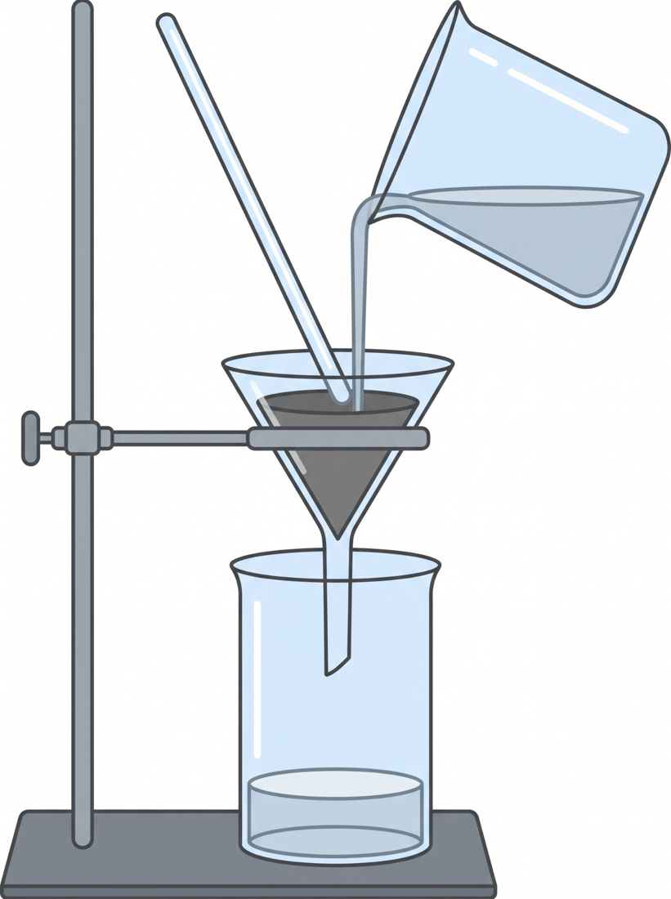
A) distillash  B) magnit yordamida ajratish  C) filtrlash  D) bug'latish

## II QISM. MOSLASHTIRISH (33–35)

**33–35.** Topshiriqlarga mos javoblarni A–F variantlaridan tanlang.
Alyuminiy va temir (Al va Fe) dan iborat 12,45 g qotishma mo'l H2SO4 eritmasida eritilganda 8,4 l (n.sh.) gaz ajraldi.

**33.** Qotishmadagi Al massa ulushini (%) aniqlang.
**34.** Reaksiya uchun sarflangan 20 % li H2SO4 massasini (g) aniqlang.
**35.** Eritmadagi tuzlarning umumiy massasini (g) aniqlang.

A) 48,45  B) 183,75  C) 48,8  D) 91,88  E) 32,53  F) 38,76

## III QISM. QISQA JAVOBLI (36–40) — javobni son bilan yozing

**36.** Fe + H2SO4 → Fe2(SO4)3 + SO2 + H2O reaksiya tenglamasini tenglang. Oksidlovchi va qaytaruvchi oldidagi koeffitsiyentlar yig'indisini aniqlang.

**37.** CuSO4 eritmasi inert elektrodlar yordamida 2 A tok kuchi bilan 9650 s elektroliz qilindi. Katodda ajralgan Cu massasi (g) ni toping.

**38.** CaCO3 va MgCO3 dan iborat 18,4 g aralashma doimiy massagacha qizdirilganda qoldiq massasi 9,6 g bo'ldi. Aralashmadagi CaCO3 ning massasini (g) toping.

**39.** 4,4 g etanal Ag2O ning ammiakli eritmasi bilan to'liq oksidlanganda hosil bo'lgan kumush massasini (g) aniqlang.

**40.** 1,5 mol asetilendan Zelinskiy usuli bilan (100 % unum) benzol olindi. Benzol massasini (g) aniqlang.

## IV QISM. YOZMA ISH (41–43) — to'liq yechim ko'rsatiladi

### 41-topshiriq (umumiy kimyo; 5 band, 25 ball)
14,35 g ZnSO4·7H2O 400 g suvda eritildi.
1) Hosil bo'lgan eritmadagi ZnSO4 ning massa ulushini (%) toping.
2) Eritmaga mo'l BaCl2 eritmasi qo'shildi. Hosil bo'lgan cho'kma massasini (g) toping. Eritmadagi kation miqdorini (mol) ham toping.
3) Xuddi shunday eritmaga ekvivalent miqdorda NaOH qo'shilganda hosil bo'lgan Zn(OH)2 cho'kmasining massasini (g) toping.
4) Eritmaga Mg plastinka tushirildi (ZnSO4 tuzidagi metall to'liq siqib chiqarildi). Plastinka massasi qanchaga (g) o'zgargan? Dastlabki eritma massasini (g) ham ayting.
5) Kristallogidratdagi kristallizatsion suvning massa ulushini (%) va unda suv molekulalari sonini toping. Shu miqdor kristallogidrat suvsizlantirilganda massa necha gramm kamayadi?

### 42-topshiriq (organik kimyo; 7 band, 25 ball; hisob-kitob yo'q)
Reaksiya tenglamalarini tugallang va tenglang. Hosil bo'lgan organik moddalarning tuzilish formulalarini yozing va ularni nomlang.
1) CH3COOCH3 + NaOH —t→
2) CH3COOH + NaHCO3 →
3) CH4 + Cl2 —yorug'lik→
4) CH2=CH2 + Br2 →
5) C6H5NO2 + H2 —kat.→
6) C2H5OH —H2SO4(kons.), 170 °C→
7) CH3CHO + Ag2O —NH3, t→

### 43-topshiriq (anorganik kimyo yoki kimyoviy tahlil; 5 band, 25 ball)
75,2 g Cu(NO3)2 qizdirilganda qisman parchalandi va qattiq qoldiq massasi 64,4 g bo'ldi. Ajralgan gazlar aralashmasi 300 g suvga to'liq yuttirildi. Qattiq qoldiq esa CuO ni to'liq eritadigan (ortiqcha bo'lmagan) miqdordagi suyultirilgan H2SO4 da eritildi, hosil bo'lgan eritmaga temir qipig'i solindi.
1) Parchalanish reaksiyasi tenglamasini yozing. Parchalangan Cu(NO3)2 ning ulushini (%) va ajralgan gazlar hajmini (l, n.sh.) aniqlang.
2) Qattiq qoldiqdagi CuO ning massa ulushini (%) hisoblang.
3) Gazlar suvga yuttirilganda hosil bo'lgan eritmadagi HNO3 ning massa ulushini (%) toping (reaksiya tenglamasini yozing).
4) Temir qipig'i eritmadagi barcha Cu²⁺ ionlarini siqib chiqarishi uchun zarur temir massasini (g) va ajralgan mis massasini (g) aniqlang (reaksiya tenglamalarini yozing).
5) Ajralgan NO2 va O2 gazlari aralashmasining o'rtacha molyar massasini (g/mol) hisoblang.

# VARIANT 13

## I QISM. YOPIQ TESTLAR (1–32, har biri bitta to'g'ri javob)

### UMUMIY KIMYO (1–13)

**1.** Reaksiya tezligining haroratga bog'liqligi diagrammada ko'rsatilgan.

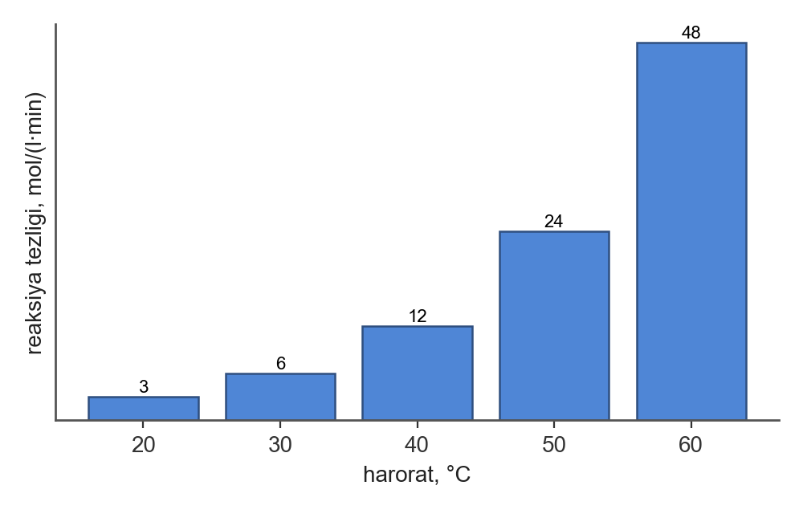

Haroratni 20 °C dan 50 °C gacha ko'tarilganda tezlik necha marta ortadi?
A) 8  B) 6  C) 16  D) 4

**2.** CO + Cl2 ⇌ COCl2 reaksiyasi 5 l hajmli idishda o'tkazildi. Ma'lumotlar jadvalda berilgan:

| Modda | CO | Cl2 | COCl2 |
|---|---|---|---|
| Boshlang'ich, mol | 6 | 3 | 0 |
| Muvozanatda, mol | — | — | 1 |

Muvozanat konstantasini (K) hisoblang.
A) 1  B) 0,5  C) 0,25  D) 2,5

**3.** N2 + 3H2 ⇌ 2NH3 reaksiyasida N2 va H2 stexiometrik nisbatda olingan umumiy 20 mol aralashma muvozanat qaror topganda doimiy T va V da bosim 25 % ga kamaydi. Muvozanatdagi NH3 ning miqdorini (mol) aniqlang.
A) 5  B) 2,5  C) 7,5  D) 10

**4.** Qaysi juftliklarda reaksiya boradi? 1) Cu va ZnSO4; 2) Fe va CuCl2; 3) Ag va CuSO4; 4) Zn va CuSO4
A) 2, 4  B) 1, 2, 3  C) 2  D) 3

**5.** 12 g NaOH ni to'liq neytrallash uchun 18,9 g HNO3 sarflandi. HNO3 ning ekvivalent massasini (g/mol) aniqlang.
A) 126  B) 31,5  C) 18,9  D) 63

**6.** AgNO3 eritmasi inert elektrodlar yordamida 2 A tok kuchi bilan 965 s elektroliz qilindi. Katodda ajralgan Ag massasi (g) ni toping.
A) 2,16  B) 4,32  C) 1,08  D) 0,043

**7.** Xlor (Z = 17) atomining tashqi energetik pog'onasidagi elektronlar sonini aniqlang.
A) 7  B) 8  C) 6  D) 9

**8.** Quyidagi tuzlarning qaysilari suvli eritmasi kislotali muhitga ega? 1) ZnCl2; 2) NH4Cl; 3) CH3COONa; 4) Na2CO3
A) 1, 4  B) 1, 2  C) 3  D) 4

**9.** Laboratoriyada NH4NO3 eritmalari quyidagicha tayyorlangan:

| Idish | Eritma massasi, g | ω(NH4NO3), % |
|---|---|---|
| A | 200 | 5 |
| B | 300 | 40 |

Bu ikki eritma bir idishga quyilib va ustiga 100 g suv qo'shilsa, yangi eritmadagi NH4NO3 ning massa ulushi (%) qancha bo'ladi?
A) 22,5  B) 21,67  C) 45  D) 19

**10.** CO2 gazining 27 °C va 4 atm bosimdagi zichligini (g/l) aniqlang. (R = 0,082 l·atm/(mol·K))
A) 14,31  B) 7,15  C) 3,58  D) 1,96

**11.** HC≡C–CH=CH2 molekulasida sp2 gibridlangan uglerod atomlari nechta?
A) 3  B) 4  C) 1  D) 2

**12.** NaCl ning suvli eritmasi inert elektrodlar bilan elektroliz qilinganda qaysi moddalar ajraladi?
A) Zn, H2 va O2  B) H2, Cl2 va NaOH  C) H2 va O2  D) Ag va O2

**13.** Tabiiy elementning ikki izotopi: ⁶³Cu (70 %) va ⁶⁵Cu (30 %). Elementning o'rtacha nisbiy atom massasini aniqlang.
A) 63,6  B) 64  C) 64,4  D) 63

### ANORGANIK KIMYO (14–19)

**14.** 2Mg + CO2 → 2MgO + C reaksiyasida 4,4 g CO2 ishtirok etdi. C miqdorini (mol) toping.
A) 0,2  B) 0,05  C) 0,15  D) 0,1

**15.** Reaksiya tenglamasi: H2 + Cl2 → 2HCl. Reaksiyaga 0,5 g H2 kirishdi. HCl hajmini (l, n.sh.) hisoblang.
A) 2,8  B) 22,4  C) 11,2  D) 5,6

**16.** Ishqoriy metallar haqida qaysi fikrlar to'g'ri? 1) Litiy eng yengil metall; 2) Natriy suv bilan reaksiyada H2 va NaOH hosil qiladi; 3) Natriyning olinishi suyuqlanma NaCl elektrolizi bilan; 4) Natriy atomining tashqi qavatida 2 ta elektron bor
A) 1, 2, 3  B) 1, 3  C) 1, 4  D) 1, 2

**17.** Alyuminiy va magniy dan iborat 10,5 g aralashma mo'l NaOH eritmasida eritildi. Ajralgan gazning hajmini (l, n.sh.) aniqlang (magniy ishqor bilan reaksiyaga kirishmaydi).
A) 20,16  B) 5,04  C) 8,71  D) 10,08

**18.** D-metallar va ularning birikmalari haqida qaysi fikrlar to'g'ri? 1) Fe(OH)2 havoda qo'ng'ir rangga o'tadi; 2) Zn(OH)2 amfoter xossaga ega; 3) Mis nam havoda (CuOH)2CO3 qoplamasi bilan qoplanadi; 4) Temir sovuq konsentrlangan HNO3 da passivlanadi
A) 1, 2, 4  B) 1, 3, 4  C) 1, 2, 3, 4  D) 2, 3, 4

**19.** Reaksiya tenglamasi: MgCl2 + Na2CO3 → MgCO3 + 2NaCl. Reaksiyaga 47,5 g MgCl2 kirishdi. MgCO3 massasini (g) hisoblang.
A) 84  B) 21  C) 42  D) 63

### ORGANIK KIMYO (20–29)

**20.** Alkanlar va sikloalkanlar haqida qaysi fikrlar to'g'ri? 1) Sikloalkanlarning umumiy formulasi CnH2n; 2) Metanning katalitik oksidlanishidan formaldegid olinadi; 3) Metan suvda yaxshi eriydi; 4) Propan odatiy sharoitda gaz
A) 1, 3, 4  B) 1, 3  C) 1, 2, 4  D) 2, 4

**21.** CH3–CH(CH3)–CH2–OH birikmaning sistematik nomi qaysi qatorda to'g'ri keltirilgan?
A) butanol-1  B) 2-metilpropanol-2  C) butanol-2  D) 2-metilpropanol-1

**22.** Arenlar, neft va tabiiy gaz haqida qaysi fikrlar to'g'ri? 1) Benzol bromli suvni rangsizlantirmaydi; 2) Naftalin – bir halqali aren; 3) Toluol KMnO4 bilan benzoy kislotagacha oksidlanadi; 4) Neft fraksiyalaridan gazolin 150 °C gacha haydaladi
A) 1, 3, 4  B) 2, 4  C) 1, 3  D) 2, 3, 4

**23.** Rasmda tasvirlangan molekuladagi sp³-gibridlangan uglerod atomlari sonini aniqlang.

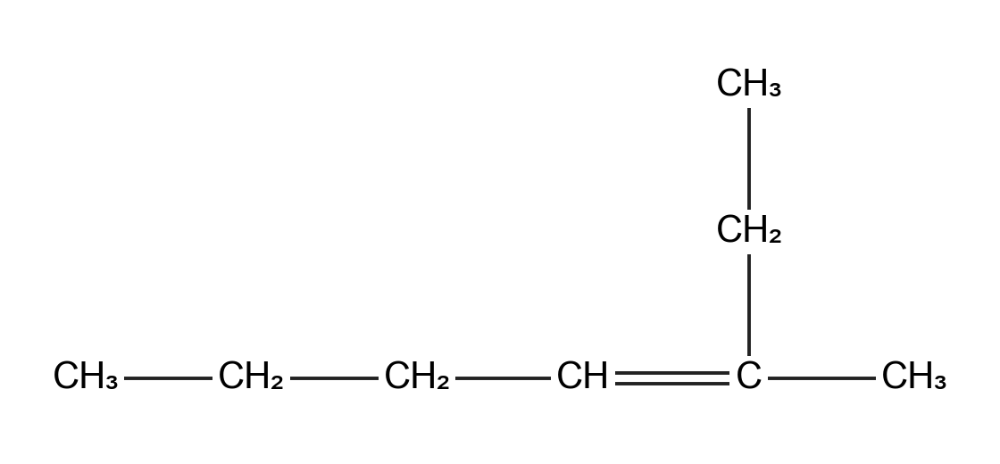
A) 7  B) 5  C) 8  D) 6

**24.** CH3CHO + H2 → C2H5OH reaksiyasida 22,4 l (n.sh.) H2 ishtirok etdi. C2H5OH massasini (g) toping.
A) 92  B) 23  C) 69  D) 46

**25.** Reaksiya tenglamasi: CH3COOH + NaHCO3 → CH3COONa + CO2 + H2O. Reaksiyaga 12 g CH3COOH kirishdi. CO2 hajmini (l, n.sh.) hisoblang.
A) 8,96  B) 2,24  C) 6,72  D) 4,48

**26.** Murakkab efirlar va yog'lar haqida qaysi fikrlar to'g'ri? 1) Etilatsetat efir hidli suyuqlik; 2) Suyuq yog'larni gidrogenlab qattiq yog' olinadi; 3) Murakkab efirlarning gidrolizi ishqoriy muhitda qaytmas; 4) Yog'lar glitserin va yuqori yog' kislotalarning murakkab efirlari
A) 1, 2, 4  B) 2, 3, 4  C) 1, 2, 3, 4  D) 1, 2, 3

**27.** 1 mol glyukoza spirtli bijg'itilganda hosil bo'lgan etanol massasini (g) aniqlang.
A) 46  B) 184  C) 92  D) 180

**28.** Aminlar, aminokislotalar va oqsillar haqida qaysi fikrlar to'g'ri? 1) Oqsillar biuret reaksiyasini beradi; 2) Nitrobenzoldan anilin Zinin reaksiyasi bilan olinadi; 3) Dipeptidda 2 ta peptid bog' bor; 4) Aminokislotalar faqat kislotali xossaga ega
A) 1, 3, 4  B) 1, 2  C) 1, 3  D) 2, 4

**29.** 2,6 g C2H2 dan quyidagi ikki bosqichda C2H5OH olinadi:
1) C2H2 + H2 → C2H4 (unum 80 %);
2) C2H4 + H2O → C2H5OH (unum 50 %).
Oxirgi mahsulot C2H5OH ning massasini (g) toping.
A) 2,3  B) 3,68  C) 1,84  D) 4,6

### KIMYOVIY TAHLIL (30–32)

**30.** Kimyo laboratoriyasida ishlash qoidalari haqida qaysi fikrlar to'g'ri? 1) Ishqor teriga tushsa, qo'l suv bilan yuviladi; 2) Zaharli gaz ajraladigan tajriba mo'rili shkafda o'tkaziladi; 3) Spirt lampa boshqa lampadan yoqilmaydi; 4) Konsentrlangan kislotani suvga ohista, aralashtirib quyiladi
A) 1, 2, 3  B) 1, 2, 3, 4  C) 1, 3, 4  D) 2, 3, 4

**31.** Quyidagi aralashmani ajratish uchun qaysi usul mos: osh tuzi eritmasidan tuz?
A) sublimatsiya (yod haydaladi)
B) bug'latish
C) magnit yordamida ajratish (temir tortiladi)
D) filtrlash

**32.** Rasmdagi usul bilan qaysi aralashmani ajratish mumkin?

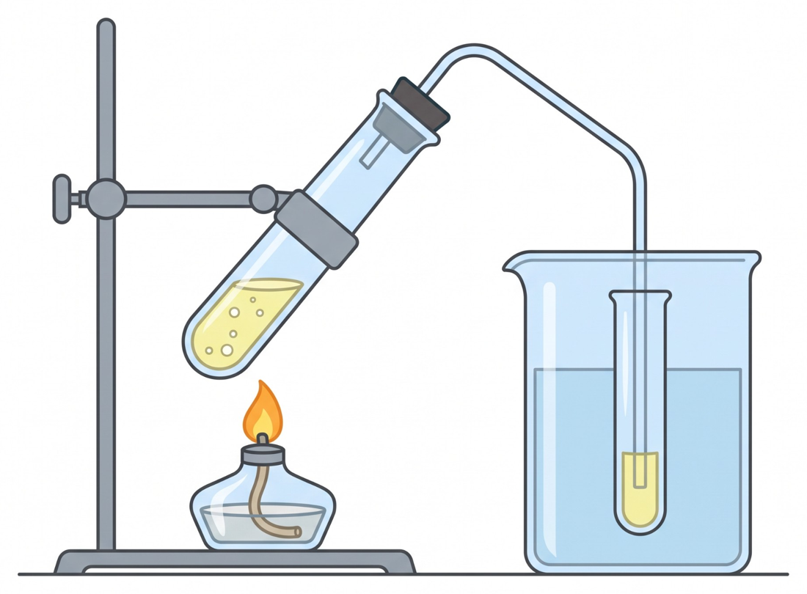
A) osh tuzi va qum  B) suv va qum  C) suv va etanol  D) suv va kerosin

## II QISM. MOSLASHTIRISH (33–35)

**33–35.** Topshiriqlarga mos javoblarni A–F variantlaridan tanlang.
NaBr va KI dan iborat 28,9 g aralashma suvda eritilib, mo'l AgNO3 eritmasi qo'shildi; hosil bo'lgan cho'kmalarning umumiy massasi 49,35 g.

**33.** Aralashmadagi NaBr massasini (g) aniqlang.
**34.** Sarflangan 10 % li AgNO3 eritmasining massasini (g) aniqlang (M(AgNO3) = 170 g/mol).
**35.** Eritmada hosil bo'lgan nitratlarning umumiy massasini (g) aniqlang.

A) 850  B) 20,6  C) 16,48  D) 22,05  E) 425  F) 11,03

## III QISM. QISQA JAVOBLI (36–40) — javobni son bilan yozing

**36.** C + HNO3 → CO2 + NO2 + H2O reaksiya tenglamasini tenglang. Reagentlar (chap qism) koeffitsiyentlari yig'indisini toping.

**37.** 2NO + O2 ⇌ 2NO2 reaksiyada muvozanat holatida [NO] = 1, [O2] = 1, [NO2] = 1 mol/l. Muvozanat konstantasini (K) hisoblang.

**38.** Alyuminiy (0,1 mol) va kalsiy (0,1 mol) aralashmasi mo'l xlorid kislotada eritildi. Ajralgan vodorodning hajmini (l, n.sh.) aniqlang.

**39.** 180 g glyukoza spirtli bijg'ish natijasida etanolga (unum 80 %), hosil bo'lgan etanol esa sirka kislotagacha (unum 80 %) aylantirildi. Olingan kislotani to'liq neytrallash uchun NaOH ning massasini (g) toping.

**40.** 17,8 g tristearin mo'l NaOH eritmasi bilan to'liq gidrolizlandi (sovun unumi 80 %). Hosil bo'lgan natriy stearat (M = 306 g/mol) massasini (g) toping.

## IV QISM. YOZMA ISH (41–43) — to'liq yechim ko'rsatiladi

### 41-topshiriq (umumiy kimyo; 5 band, 25 ball)
Hajmi 2 l bo'lgan idishda 2NO + O2 ⇌ 2NO2 sistema muvozanat holatiga keldi. Muvozanat qaror topganda idishdagi moddalar miqdori: NO – 2 mol, O2 – 0,5 mol; NO2 – 1 mol.
1) Muvozanat konstantasini (K) hisoblang.
2) Moddalarning boshlang'ich konsentratsiyalarini (mol/l) aniqlang. Boshlang'ich moddalarning umumiy miqdorini (mol) ham toping.
3) NO ning necha foizi reaksiyaga kirishgan?
4) Idish hajmi izotermik ravishda 2 marta kamaytirilsa, to'g'ri reaksiya tezligi (elementar reaksiya deb hisoblang) necha marta o'zgaradi? Teskari reaksiya uchun K' = 1/K ni ham hisoblang.
5) Bosim oshirilganda muvozanat qaysi tomonga siljiydi va K qiymati qanday o'zgaradi? Muvozanatdagi umumiy mol miqdorining boshlang'ich mol miqdoriga nisbatini toping. Muvozanat aralashmasining o'rtacha molyar massasini (g/mol) ham hisoblang.

### 42-topshiriq (organik kimyo; 3 band, 25 ball; hisob-kitob yo'q)
Quyidagi o'zgarishlar zanjirida X, Y, Z noma'lum organik moddalar:
CH3CHO —H2, Ni→ X —H2SO4 (kons.), 170 °C→ Y —Br2→ C2H4Br2
1) CH3CHO → X : reaksiya tenglamasini yozing; hosil bo'lgan moddani nomlang.
2) X → Y : reaksiya tenglamasini yozing; hosil bo'lgan moddani nomlang.
3) Y → C2H4Br2 : reaksiya tenglamasini yozing; hosil bo'lgan moddani nomlang.

### 43-topshiriq (anorganik kimyo yoki kimyoviy tahlil; 5 band, 25 ball)
60 g pirit (FeS2) yondirildi: 4FeS2 + 11O2 → 2Fe2O3 + 8SO2 (unum 100 %). Hosil bo'lgan SO2 katalizator ishtirokida SO3 gacha oksidlandi (unum 80 %), SO3 suvda eritildi.
1) Hosil bo'lgan SO2 hajmini (l, n.sh.) va qattiq qoldiq Fe2O3 massasini (g) hisoblang. Shuningdek SO2 massasini (g) ham toping.
2) SO3 ning massasini (g) toping (2SO2 + O2 ⇄ 2SO3).
3) Hosil bo'lgan H2SO4 massasini (g) aniqlang.
4) Shu kislotani to'liq neytrallash uchun zarur NaOH massasini (g) va mo'l BaCl2 bilan hosil bo'ladigan cho'kma massasini (g) toping.
5) Shu H2SO4 dan 20 % li eritma tayyorlash uchun qancha suv (g) kerak?

# VARIANT 14

## I QISM. YOPIQ TESTLAR (1–32, har biri bitta to'g'ri javob)

### UMUMIY KIMYO (1–13)

**1.** Mis (Z = 29) atomida nechta juftlashmagan elektron bor?
A) 2  B) 3  C) 1  D) 0

**2.** 12 g NaOH ni to'liq neytrallash uchun 10,95 g HCl sarflandi. HCl ning ekvivalent massasini (g/mol) aniqlang.
A) 73  B) 36,5  C) 18,25  D) 10,95

**3.** Jadvalda metall plastinkalarning tuz eritmalariga tushirilishidagi kuzatuvlar berilgan («+» – metall ajraladi, reaksiya boradi; «−» – reaksiya bormaydi):

| Metall | ZnSO4 eritmasi | MgSO4 eritmasi | CuSO4 eritmasi |
|---|---|---|---|
| Fe | − | − | + |
| Zn | − | − | + |
| Mg | + | − | + |

Ushbu metallardan qaysi biri eng faol?
A) Fe  B) Zn  C) Mg  D) Cu

**4.** 26,24 l Cl2 127 °C va 0,5 atm bosimda necha gramm keladi? (R = 0,082 l·atm/(mol·K))
A) 56,8  B) 28,4  C) 14,2  D) 83,17

**5.** Rasmda Li va F atomlari orasida elektron o'tishi sxematik ko'rsatilgan (ion bog' hosil bo'lishi).

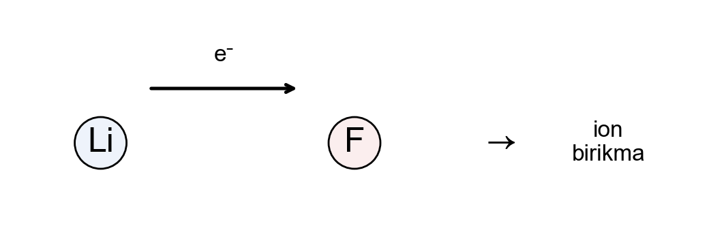

Li atomi qancha elektron berib, qanday zaryadli ionga aylanadi?
A) 1 ta, −1  B) 2 ta, +2  C) 3 ta, +3  D) 1 ta, +1

**6.** AgNO3 ning suvli eritmasi inert elektrodlar bilan elektroliz qilinganda qaysi moddalar ajraladi?
A) Ag va O2  B) Zn, H2 va O2  C) H2 va O2  D) H2, Cl2 va NaOH

**7.** Reaksiya tezligining haroratga bog'liqligi jadvalda berilgan:

| T, °C | 20 | 30 | 40 |
|---|---|---|---|
| v, mol/(l·s) | 0,5 | 1,5 | 4,5 |

Jadvaldan foydalanib, shu reaksiyaning 60 °C dagi tezligini (mol/(l·s)) aniqlang.
A) 40,5  B) 13,5  C) 121,5  D) 81

**8.** Quyidagi jadvalda BaCl2 tuzining eritmalari keltirilgan:

| № | m(eritma), g | ω, % |
|---|---|---|
| I | 200 | 10 |
| II | 200 | 30 |

Eritmalar aralashtirilib, ustiga 50 g suv qo'shildi. Oxirgi eritmadagi tuzning massa ulushini (%) toping.
A) 20  B) 40  C) 17,78  D) 16

**9.** Jadvalda bog'lar hosil qiluvchi atomlarning elektrmanfiyliklari berilgan:

| Bog' | EM (1-atom) | EM (2-atom) |
|---|---|---|
| Al–Cl | 1,5 | 3 |
| Si–O | 1,8 | 3,5 |
| H–O | 2,1 | 3,5 |
| H–Cl | 2,1 | 3 |

Qaysi bog' eng qutbli (eng ko'p ionli xarakterga ega)?
A) Al–Cl  B) H–O  C) H–Cl  D) Si–O

**10.** Xrom (Z = 24) atomi elektron konfiguratsiyasida jami nechta juftlashgan elektron bor?
A) 19  B) 18  C) 17  D) 20

**11.** He va O2 gazlari 2 : 1 hajmiy nisbatda aralashtirildi. Aralashmaning vodorodga nisbatan zichligini aniqlang.
A) 6,67  B) 13,33  C) 7,67  D) 9

**12.** Gazlar aralashmasi tarkibi jadvalda berilgan (n.sh.):

| Gaz | Hajmi, l |
|---|---|
| O2 | 2 |
| NH3 | 2 |
| N2 | 2 |

Aralashmaning havoga nisbatan zichligini aniqlang (M(havo) = 29 g/mol).
A) 1,77  B) 0,44  C) 0,89  D) 25,67

**13.** 25 ml HCl eritmasi 0,05 mol/l li NaOH eritmasi bilan titrlandi. Titrlash egri chizig'i grafikda berilgan (ekvivalent nuqta 25 ml da).

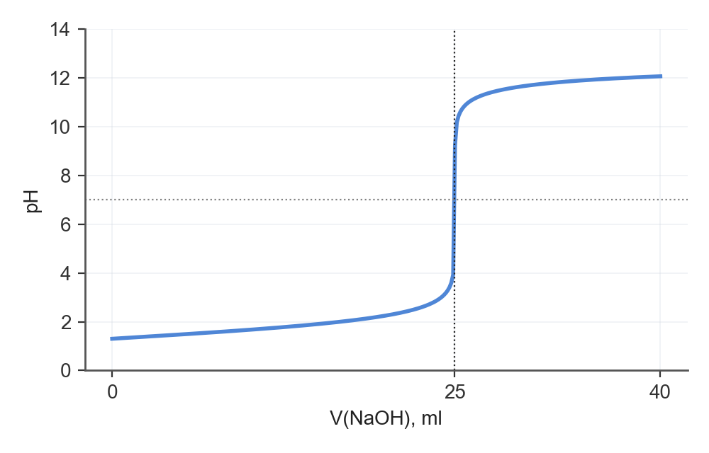

Grafikning boshlang'ich nuqtasi (V = 0) pH ining qiymatiga mos keluvchi HCl eritmasidagi H⁺ konsentratsiyasini (mol/l) toping.
A) 0,5  B) 0,005  C) 0,1  D) 0,05

### ANORGANIK KIMYO (14–19)

**14.** K va Li dan iborat 13,1 g aralashma suv bilan reaksiyaga kirishdi. Ajralgan vodorodning hajmini (l, n.sh.) aniqlang.
A) 11,2  B) 2,8  C) 6,55  D) 5,6

**15.** Alyuminiy va temir dan iborat 19,3 g aralashma mo'l NaOH eritmasida eritilganda 10,08 l (n.sh.) gaz ajraldi. Aralashmadagi temir ning massa ulushini (%) aniqlang.
A) 42  B) 29  C) 58  D) 37,8

**16.** D-metallar va ularning birikmalari haqida qaysi fikrlar to'g'ri? 1) Mis suyultirilgan HCl bilan reaksiyaga kirishadi; 2) Fe(OH)2 havoda qo'ng'ir rangga o'tadi; 3) Xrom (VI) oksidi (CrO3) kislotali oksid; 4) Temirning Cl2 bilan reaksiyasida FeCl2 hosil bo'ladi
A) 1, 4  B) 2, 3  C) 4  D) 1, 2, 4

**17.** Reaksiya tenglamasi: CaSO4 + Na2CO3 → CaCO3 + Na2SO4. Reaksiyaga 26,5 g Na2CO3 kirishdi. CaCO3 massasini (g) hisoblang.
A) 50  B) 12,5  C) 37,5  D) 25

**18.** SO3 + 2KOH → K2SO4 + H2O jarayoni uchun 160 g SO3 olingan (unum 80 %). K2SO4 miqdorini (mol) aniqlang.
A) 1,6  B) 2  C) 3,2  D) 0,8

**19.** Qaysi juftliklar o'zaro reaksiyaga kirishmaydi? 1) Na2CO3 va HCl; 2) Fe2O3 va H2O; 3) NaCl va HNO3; 4) Ag va H2SO4(suyult.)
A) 2, 3, 4  B) 2, 3  C) 1, 2, 3  D) 1, 2

### ORGANIK KIMYO (20–29)

**20.** CH3–CH(NH2)–CH2–CH3 birikmaning sistematik nomi qaysi qatorda to'g'ri keltirilgan?
A) butan-2-amin  B) butan-1-amin  C) 2-metilpropan-1-amin  D) 2-aminobutanol

**21.** CH3–C≡C–CH2–CH3 birikmaning sistematik nomi qaysi qatorda to'g'ri keltirilgan?
A) pentin-2  B) pentin-3  C) pentin-1  D) 2-pentin-4

**22.** 18,4 g toluoldan benzoy kislota olishda unum 80 % bo'lsa, mahsulot massasini (g) aniqlang.
A) 24,4  B) 39,04  C) 14,72  D) 19,52

**23.** 2C2H5OH + 2Na → 2C2H5ONa + H2 reaksiyasida 5,75 g Na ishtirok etdi (unum 80 %). H2 miqdorini (mol) toping.
A) 0,5  B) 0,2  C) 0,1  D) 0,05

**24.** Aldegid va ketonlar haqida qaysi fikrlar to'g'ri? 1) Aldegidlar qaytarilganda ikkilamchi spirt hosil bo'ladi; 2) Aseton Cu(OH)2 ni qaytaradi; 3) Formalin — formaldegidning 40 % li eritmasi; 4) Formaldegid gaz holatda, suvda yaxshi eriydi
A) 3, 4  B) 2, 3  C) 1, 4  D) 1, 2

**25.** Karbon kislotalar haqida qaysi fikrlar to'g'ri? 1) Chumoli kislota "kumush ko'zgu" reaksiyasini beradi; 2) Karboksil guruh karbonil va gidroksil guruhlardan iborat; 3) Olein kislota Br2 ni biriktiradi; 4) Benzoy kislota Na2CO3 bilan reaksiyaga kirishmaydi
A) 3, 4  B) 2, 4  C) 1, 2, 3  D) 2, 3

**26.** 14,8 g CH3COOCH3 dan quyidagi ikki bosqichda CH3ONa olinadi:
1) CH3COOCH3 + NaOH → CH3COONa + CH3OH (unum 50 %);
2) 2CH3OH + 2Na → 2CH3ONa + H2 (unum 80 %).
Oxirgi mahsulot CH3ONa ning massasini (g) toping.
A) 8,64  B) 4,32  C) 5,4  D) 10,8

**27.** Uglevodlar haqida qaysi fikrlar to'g'ri? 1) Kraxmal yod bilan ko'k rang beradi; 2) Glyukoza "kumush ko'zgu" reaksiyasini beradi; 3) Fruktoza ketospirt; 4) Glyukoza gidrolizlanadi
A) 2, 3  B) 1, 2, 3  C) 1, 2, 4  D) 1, 4

**28.** CH3NH2 + HCl → CH3NH3Cl jarayoni uchun 22,4 l (n.sh.) HCl olingan. CH3NH3Cl miqdorini (mol) aniqlang.
A) 2  B) 0,5  C) 1,5  D) 1

**29.** Yuqori molekulyar birikmalar haqida qaysi fikrlar to'g'ri? 1) Polimerning M = zveno M · polimerlanish darajasi; 2) Kapron poliamid tola; 3) Tabiiy kauchuk – sis-1,4-poliizopren; 4) Teflon — polivinilxlorid
A) 3, 4  B) 1, 2, 3  C) 2, 3  D) 1, 3

### KIMYOVIY TAHLIL (30–32)

**30.** 20 % li va 5 % li eritmalardan 300 g 15 % li eritma tayyorlash uchun 20 % li eritmadan necha gramm olish kerak?
A) 100  B) 200  C) 225  D) 400

**31.** Lakmus indikatori ishqoriy muhitda qanday rang beradi?
A) malina rangga kiradi (pushti)  B) rangsiz  C) qizil  D) ko'k

**32.** Rasmdagi asbobda olingan karbonat angidrid qanday yig'iladi?

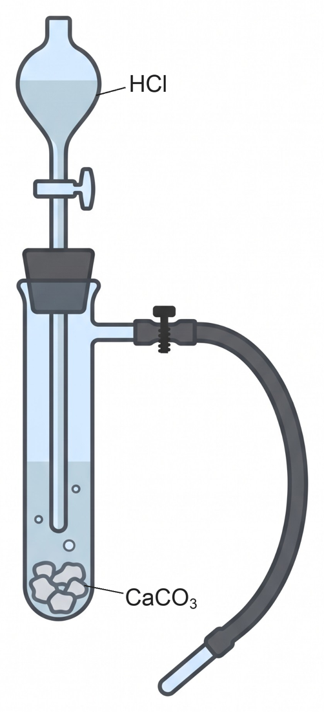
A) yig'ib bo'lmaydi
B) suvni siqib chiqarish usulida (CO2 suvda erimaydi)
C) idishning og'zi yuqoriga, havoni siqib chiqarish usulida
D) og'zi pastga qaratilgan idishda

## II QISM. MOSLASHTIRISH (33–35)

**33–35.** Topshiriqlarga mos javoblarni A–F variantlaridan tanlang.
Alyuminiy va rux (Al va Zn) dan iborat 11,9 g qotishma mo'l HCl eritmasida eritilganda 8,96 l (n.sh.) gaz ajraldi.

**33.** Qotishmadagi Al massa ulushini (%) aniqlang.
**34.** Reaksiya uchun sarflangan 20 % li HCl massasini (g) aniqlang.
**35.** Eritmadagi tuzlarning umumiy massasini (g) aniqlang.

A) 45,38  B) 40,3  C) 90,76  D) 292  E) 146  F) 60,45

## III QISM. QISQA JAVOBLI (36–40) — javobni son bilan yozing

**36.** P + HNO3 + H2O → H3PO4 + NO reaksiya tenglamasini tenglang. Oksidlovchi va qaytaruvchi oldidagi koeffitsiyentlar yig'indisini aniqlang.

**37.** Reaksiya 30 °C da 72 minutda tugaydi. γ = 2. Harorat 30 °C ga oshirilib, reagentlardan birining konsentratsiyasi 2 marta oshirildi (reaksiya shu modda bo'yicha 1-tartibli). Reaksiya necha minutda tugaydi?

**38.** Al, Fe va Cu dan iborat aralashma mo'l NaOH eritmasi bilan ta'sirlashganda 3,36 l (n.sh.) vodorod ajraldi; xuddi shunday massadagi aralashma mo'l HCl bilan ta'sirlashganda 5,6 l (n.sh.) vodorod ajraldi, erimay qolgan qoldiq (mis) massasi 3,2 g. Aralashmaning dastlabki massasini (g) toping.

**39.** Etanol va fenoldan iborat 18,6 g aralashma natriy bilan to'liq reaksiyaga kirishganda 3,36 l (n.sh.) vodorod ajraldi. Shu aralashmaga mo'l bromli suv ta'sir ettirilganda hosil bo'ladigan cho'kma massasini (g) toping.

**40.** 17,8 g tristearin mo'l NaOH eritmasi bilan to'liq gidrolizlandi (sovun unumi 80 %). Hosil bo'lgan natriy stearat (M = 306 g/mol) massasini (g) toping.

## IV QISM. YOZMA ISH (41–43) — to'liq yechim ko'rsatiladi

### 41-topshiriq (umumiy kimyo; 5 band, 25 ball)
Ketma-ket ulangan ikkita elektrolizyorda CuSO4 va AgNO3 eritmalari inert elektrodlar bilan elektroliz qilindi. Birinchi elektrolizyorning katodida 6,4 g Cu ajraldi (F = 96500 C/mol).
1) Elektrolizyordan o'tgan zaryad miqdorini (C) hisoblang.
2) Tok kuchi 5 A bo'lsa, elektroliz necha sekund davom etgan? O'tgan elektronlar miqdorini (mol) ham toping.
3) Ikkinchi elektrolizyorning katodida ajralgan Ag massasini (g) aniqlang.
4) Birinchi elektrolizyor anodida ajralgan gaz hajmini (l, n.sh.) toping. Ikkinchi elektrolizyor katodida ajralgan metallning miqdorini (mol) ham toping.
5) Ikkala elektrolizyorda o'tgan elektronlar sonini (mol) taqqoslab, ularning teng ekanligini isbotlang. Agar tok kuchi 2 marta oshirilsa, shuncha zaryad o'tishi uchun necha sekund kerak?

### 42-topshiriq (organik kimyo; 3 band, 25 ball; hisob-kitob yo'q)
Quyidagi o'zgarishlar zanjirida X, Y, Z noma'lum organik moddalar:
C6H12O6 —bijg'ish→ X —H2SO4 (kons.), 170 °C→ Y —Br2→ C2H4Br2
1) C6H12O6 → X : reaksiya tenglamasini yozing; hosil bo'lgan moddani nomlang.
2) X → Y : reaksiya tenglamasini yozing; hosil bo'lgan moddani nomlang.
3) Y → C2H4Br2 : reaksiya tenglamasini yozing; hosil bo'lgan moddani nomlang.

### 43-topshiriq (anorganik kimyo yoki kimyoviy tahlil; 5 band, 25 ball)
Laboratoriyada 1–4-raqamli probirkalarda tartibsiz holda glyukoza, kraxmal kleysteri, tuxum oqsili va glitserin eritmalari bor. Ularni aniqlash uchun quyidagi tajribalar o'tkazildi:
a) 1-probirkaga yodning spirtdagi eritmasidan qo'shildi — eritma ko'k rangga bo'yaldi.
b) 2-probirkaga ishqor eritmasi va bir necha tomchi mis(II)-sulfat qo'shilganda eritma qizil-binafsha rangga bo'yaldi; boshqa porsiyasiga konsentrlangan HNO3 qo'shib qizdirilganda sariq rang paydo bo'ldi.
c) 3- va 4-probirkalarga yangi cho'ktirilgan Cu(OH)2 qo'shilganda ikkalasida ham cho'kma erib, ko'k eritma hosil bo'ldi. 3-probirka qizdirilganda avval sariq, so'ng qizil cho'kma tushdi, 4-probirkada esa o'zgarish bo'lmadi.
1) Glyukozaning Cu(OH)2 bilan reaksiya tenglamasini yozing. 36 g glyukoza mo'l Cu(OH)2 bilan qizdirilganda hosil bo'lgan qizil cho'kmaning massasini (g) hisoblang.
2) 1–4-probirkalardagi moddalarni aniqlang (probirka raqami bilan moslab yozing).
3) a), b) va c) bo'yicha kuzatilgan rang o'zgarishlarining sababini tushuntiring: qaysi funksional guruh yoki bog' bilan bog'liq?
4) Tajribada probirkani qizdirish va konsentrlangan HNO3 bilan ishlashda qanday xavfsizlik qoidalariga rioya qilish kerak? Kamida uchta qoida yozing.
5) Glyukozaning (36 g) spirtli bijg'ishida ajraladigan CO2 hajmini (l, n.sh.) hisoblang.

# VARIANT 15

## I QISM. YOPIQ TESTLAR (1–32, har biri bitta to'g'ri javob)

### UMUMIY KIMYO (1–13)

**1.** 29-tartib raqamli element atomida bosh kvant soni n = 2, orbital kvant soni l = 1 bo'lgan elektronlar soni nechta?
A) 7  B) 5  C) 6  D) 8

**2.** Doimiy tok kuchida Ag tuzining eritmasi elektroliz qilinganda katodda ajralgan metall massasining vaqtga bog'liqligi grafikda berilgan (M(Ag) = 108 g/mol, valentlik 1).

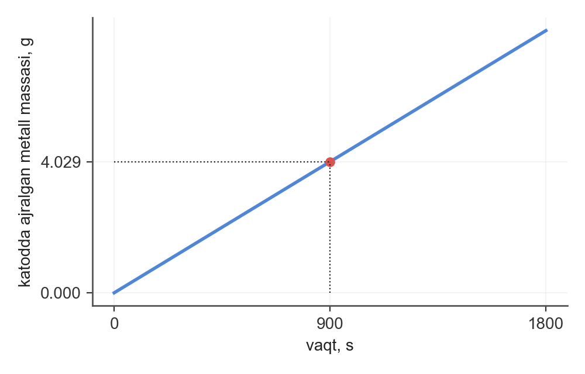

Grafikdagi nuqtaga mos kelgan jarayonda elektrodlardan o'tgan zaryad miqdorini (C) hisoblang.
A) 3600  B) 7200  C) 1800  D) 388800

**3.** 0,1 M Ca(OH)2 eritmasining normal konsentratsiyasini (n) aniqlang.
A) 0,1  B) 0,4  C) 0,05  D) 0,2

**4.** Jadvalda bog'lar hosil qiluvchi atomlarning elektrmanfiyliklari berilgan:

| Bog' | EM (1-atom) | EM (2-atom) |
|---|---|---|
| N–H | 3 | 2,1 |
| Na–Cl | 0,9 | 3 |
| H–O | 2,1 | 3,5 |
| H–Cl | 2,1 | 3 |

Qaysi bog' eng qutbli (eng ko'p ionli xarakterga ega)?
A) N–H  B) Na–Cl  C) H–O  D) H–Cl

**5.** 0,2 M H2SO4 eritmasining normal konsentratsiyasini (n) aniqlang.
A) 0,4  B) 0,2  C) 0,8  D) 0,1

**6.** Zn plastinka 8 g CuSO4 ni tutgan eritmaga tushirildi va Cu to'liq ajralib chiqquncha ushlab turildi. Plastinka massasi necha gramm kamayadi?
A) 0,1  B) 0,03  C) 8  D) 0,05

**7.** 28 g N2 127 °C va 2 atm bosimda qancha hajm (l) egallaydi? (R = 0,082 l·atm/(mol·K))
A) 32,8  B) 8,2  C) 22,4  D) 16,4

**8.** 2 mol Ba(OH)2 va 2 mol HNO3 suvda eritilib, eritma hajmi 4 l ga yetkazildi. Eritmadagi barcha ionlarning umumiy molyar konsentratsiyasini (mol/l) aniqlang (kuchli elektrolitlar to'liq dissotsilanadi).
A) 1  B) 5  C) 2,5  D) 1,25

**9.** Rasmda molekulaning elektron (Lyuis) formulasi berilgan.

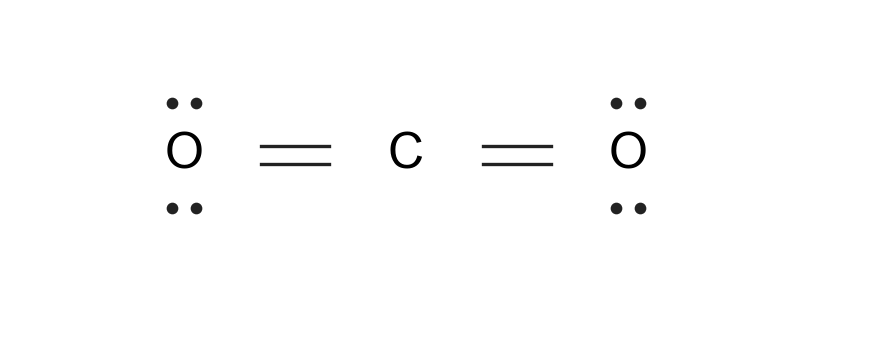

Molekulaning formulasini aniqlang.
A) Cl2  B) H2O  C) CO2  D) HCl

**10.** Tabiiy elementning ikki izotopi: ⁷⁹Br (50 %) va ⁸¹Br (50 %). Elementning o'rtacha nisbiy atom massasini aniqlang.
A) 79  B) 80  C) 81  D) 160

**11.** Laboratoriyada Na2SO4 eritmalari quyidagicha tayyorlangan:

| Idish | Eritma massasi, g | ω(Na2SO4), % |
|---|---|---|
| A | 50 | 12 |
| B | 300 | 40 |

Bu ikki eritma bir idishga quyilib va ustiga 50 g suv qo'shilsa, yangi eritmadagi Na2SO4 ning massa ulushi (%) qancha bo'ladi?
A) 26  B) 52  C) 31,5  D) 16

**12.** Jadvalda NaCl ning ikki eritmasi haqida ma'lumot berilgan:

| Eritma | Massasi, g | Massa ulushi, % |
|---|---|---|
| 1 | 50 | 5 |
| 2 | 300 | 30 |

Eritmalar aralashtirildi. Hosil bo'lgan eritmaning massa ulushini (%) aniqlang.
A) 17,5  B) 26,43  C) 35  D) 8,57

**13.** Faqat oksidlovchi bo'la oladigan ionlarni aniqlang: 1) Fe³⁺; 2) S²⁻; 3) Cl⁻; 4) Zn²⁺
A) 3  B) 4  C) 3, 4  D) 2

### ANORGANIK KIMYO (14–19)

**14.** D-metallar va ularning birikmalari haqida qaysi fikrlar to'g'ri? 1) Fe(OH)2 havoda qo'ng'ir rangga o'tadi; 2) Xrom (VI) oksidi (CrO3) kislotali oksid; 3) Cu(OH)2 qizdirilganda CuO ga parchalanadi; 4) Temir sovuq konsentrlangan HNO3 da passivlanadi
A) 2, 3, 4  B) 1, 2, 4  C) 1, 3, 4  D) 1, 2, 3, 4

**15.** Reaksiya tenglamasi: Mg(HCO3)2 → MgCO3 + CO2 + H2O. Reaksiyaga tarkibida 20 % aralashma bo'lgan 36,5 g namuna (asosiy modda Mg(HCO3)2) kirishdi. CO2 massasini (g) hisoblang.
A) 17,6  B) 4,4  C) 13,2  D) 8,8

**16.** SO3 + 2KOH → K2SO4 + H2O jarayoni uchun 80 g SO3 olingan. KOH massasini (g) aniqlang.
A) 28  B) 224  C) 112  D) 56

**17.** BaCl2 + Na2SO4 → BaSO4 + 2NaCl reaksiyasida tarkibida 20 % aralashma bo'lgan 260 g namuna (asosiy modda BaCl2) ishtirok etdi. BaSO4 massasini (g) toping.
A) 233  B) 466  C) 116,5  D) 349,5

**18.** Quyidagi mineral o'g'itlardan qaysilari fosforli o'g'itlar jumlasiga kiradi? 1) Ca(H2PO4)2; 2) Ca3(PO4)2; 3) K2SO4; 4) (NH4)2HPO4
A) 3, 4  B) 1, 2  C) 1, 4  D) 2, 3

**19.** Reaksiya tenglamasi: 2NaNO3 → 2NaNO2 + O2. Reaksiyaga 17 g NaNO3 kirishdi. NaNO2 massasini (g) hisoblang.
A) 27,6  B) 6,9  C) 20,7  D) 13,8

### ORGANIK KIMYO (20–29)

**20.** 15 g C2H6 dan quyidagi ikki bosqichda C2H5OH olinadi:
1) C2H6 + Cl2 → C2H5Cl + HCl (unum 60 %);
2) C2H5Cl + KOH → C2H5OH + KCl (unum 75 %).
Oxirgi mahsulot C2H5OH ning massasini (g) toping.
A) 10,35  B) 17,25  C) 13,8  D) 23

**21.** Alken, alkadiyen va alkinlar haqida qaysi fikrlar to'g'ri? 1) Propenga HBr birikishi Markovnikov qoidasiga bo'ysunadi; 2) Alkinlar uchun umumiy formula CnH2n+2; 3) Alkenlar KMnO4 ning suvli eritmasi bilan glikol hosil qiladi; 4) Asetilenni Kucherov reaksiyasi bilan sirka aldegidiga aylantirish mumkin
A) 1, 3, 4  B) 1, 2  C) 2, 3, 4  D) 3, 4

**22.** Arenlar, neft va tabiiy gaz haqida qaysi fikrlar to'g'ri? 1) Naftalin – bir halqali aren; 2) Benzol uchun birikish reaksiyalari mutlaqo xos emas; 3) Benzolda 6 ta sp² gibridlangan uglerod bor; 4) Tabiiy gazning asosiy qismi propan
A) 2, 3  B) 3  C) 1, 4  D) 3, 4

**23.** Reaksiya tenglamasi: C6H5OH + NaOH → C6H5ONa + H2O. Reaksiyaga tarkibida 75 % aralashma bo'lgan 32 g namuna (asosiy modda NaOH) kirishdi. C6H5OH massasini (g) hisoblang.
A) 18,8  B) 37,6  C) 9,4  D) 28,2

**24.** Aldegid va ketonlar haqida qaysi fikrlar to'g'ri? 1) Aseton Cu(OH)2 ni qaytaradi; 2) Formalin — formaldegidning 40 % li eritmasi; 3) Formaldegid gaz holatda, suvda yaxshi eriydi; 4) Sirka aldegid Kucherov reaksiyasi bilan olinadi
A) 2, 4  B) 2, 3  C) 2, 3, 4  D) 1, 3

**25.** C4H10 alkanning izomerlari soni nechta?
A) 2  B) 3  C) 1  D) 4

**26.** 442 g triolein (M = 884) nikel katalizatori ishtirokida to'liq gidrogenlandi. Sarflangan vodorod hajmini (l, n.sh.) aniqlang.
A) 11,2  B) 67,2  C) 33,6  D) 16,8

**27.** Uglevodlar haqida qaysi fikrlar to'g'ri? 1) Maltoza gidrolizlanganda ikki molekula glyukoza hosil qiladi; 2) Kraxmal yod bilan ko'k rang beradi; 3) Selluloza β-glyukoza qoldiqlaridan iborat; 4) Fruktoza ketospirt
A) 2, 3, 4  B) 1, 2, 3, 4  C) 1, 3, 4  D) 1, 2, 4

**28.** Aminlar, aminokislotalar va oqsillar haqida qaysi fikrlar to'g'ri? 1) Dipeptidda 2 ta peptid bog' bor; 2) Anilin bromli suv bilan oq cho'kma beradi; 3) Oqsillar biuret reaksiyasini beradi; 4) Glitsin optik faol
A) 4  B) 1  C) 2, 3  D) 1, 2

**29.** Reaksiya tenglamasi: C2H4 + Cl2 → C2H4Cl2. Reaksiyaga 7 g C2H4 kirishdi. C2H4Cl2 massasini (g) hisoblang.
A) 49,5  B) 24,75  C) 12,38  D) 37,12

### KIMYOVIY TAHLIL (30–32)

**30.** Rasmda ammiak olish tajribasi ko'rsatilgan. Qaysi moddalar aralashmasi qizdirilmoqda?

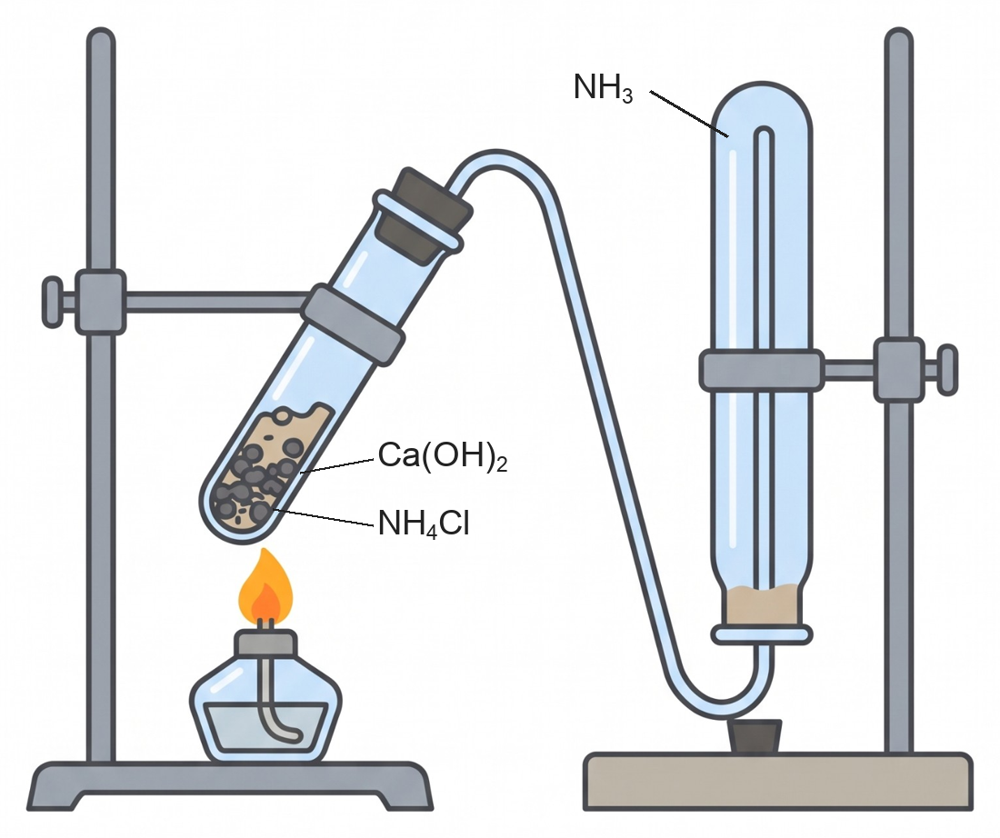
A) NH4Cl va Ca(OH)2  B) NaCl va H2SO4  C) Zn va HCl  D) CaCO3 va HCl

**31.** 200 g 5 % li eritma tayyorlash uchun 50 % li eritmadan necha gramm olish kerak (qolgani suv)?
A) 180  B) 10  C) 40  D) 20

**32.** Kimyoviy laboratoriyada pipetka nima uchun ishlatiladi?
A) qattiq moddalarni yuqori haroratda qizdirish
B) titrlashda reagent hajmini aniq o'lchash
C) vakuum ostida filtrlash
D) eritmaning kichik hajmlarini o'lchab olish

## II QISM. MOSLASHTIRISH (33–35)

**33–35.** Topshiriqlarga mos javoblarni A–F variantlaridan tanlang.
Sirka kislota va etanoldan iborat 25,8 g aralashmaga mo'l NaHCO3 eritmasi qo'shilganda 4,48 l (n.sh.) gaz ajraldi. Xuddi shunday massadagi aralashma natriy bilan ta'sirlashganda esa 5,6 l (n.sh.) vodorod ajraldi.

**33.** Aralashmadagi sirka kislota massasini (g) aniqlang.
**34.** Aralashmadagi etanol massasini (g) aniqlang.
**35.** Aralashma to'liq neytrallanganda (faqat kislota) hosil bo'lgan natriy atsetat massasini (g) aniqlang (reaksiya unumi 80 %).

A) 6  B) 9,6  C) 12  D) 11,04  E) 13,12  F) 13,8

## III QISM. QISQA JAVOBLI (36–40) — javobni son bilan yozing

**36.** K2Cr2O7 + KI + H2SO4 → Cr2(SO4)3 + I2 + K2SO4 + H2O reaksiya tenglamasini tenglang. Oksidlovchi va qaytaruvchi oldidagi koeffitsiyentlar yig'indisini aniqlang.

**37.** 14 g Fe reaksiyaga kirishdi (Fe + 2HCl → FeCl2 + H2). Ajralgan H2 hajmini (l, n.sh.) hisoblang (unum 90 %).

**38.** 75,2 g Cu(NO3)2 qizdirilganda qisman parchalandi, qattiq qoldiq massasi 53,6 g bo'ldi. Ajralgan gazlar (n.sh.) hajmini (l) hisoblang.

**39.** Etilen va asetilendan iborat 3,36 l (n.sh.) aralashma bromli suvdan o'tkazilganda 40 g brom yutildi. Aralashmadagi asetilenning hajmini (l, n.sh.) toping.

**40.** 18 g sirka kislota va 6,4 g metanol dan 80 % unum bilan murakkab efir olindi. Efir massasini (g) toping.

## IV QISM. YOZMA ISH (41–43) — to'liq yechim ko'rsatiladi

### 41-topshiriq (umumiy kimyo; 5 band, 25 ball)
Hajmi 1 l bo'lgan idishga 0,4 mol SO2 va ma'lum miqdorda O2 solindi hamda katalizator ishtirokida qizdirildi: 2SO2 + O2 ⇌ 2SO3. Muvozanat qaror topganda idishda SO2, O2 va SO3 ning mol nisbati 1 : 1 : 3 bo'ldi.
Hosil bo'lgan SO3 ning hammasi 100 g 30 % li H2SO4 eritmasiga yuttirildi (oleum hosil bo'lmadi, SO3 to'liq suv bilan reaksiyaga kirishdi). Olingan eritmaga mo'l BaCl2 eritmasi qo'shildi.
1) O2 ning boshlang'ich miqdorini (mol) va muvozanat konstantasini (K) hisoblang.
2) SO2 ning necha foizi reaksiyaga kirishgan? Muvozanatda SO3 ning hajmiy ulushini (%) ham toping.
3) SO3 yuttirilgandan keyingi eritmada H2SO4 ning massa ulushini (%) aniqlang.
4) BaCl2 qo'shilganda hosil bo'lgan cho'kma massasini (g) toping. BaCl2 sarfini (g) ham toping.
5) Doimiy haroratda idish hajmi 2 marta kamaytirilsa (v = k·[SO2]²·[O2]), to'g'ri reaksiya tezligi necha marta o'zgaradi? Shuningdek muvozanatda umumiy bosimning boshlang'ich bosimga nisbatini (T = const) toping.

### 42-topshiriq (organik kimyo; 4 band, 25 ball; hisob-kitob yo'q)
Quyidagi o'zgarishlar zanjirida X, Y, Z noma'lum organik moddalar:
C2H5Cl —KOH (spirtli)→ X —Br2→ Y —KOH (spirtli)→ Z —C (aktiv), 600 °C→ C6H6
1) C2H5Cl → X : reaksiya tenglamasini yozing; hosil bo'lgan moddani nomlang.
2) X → Y : reaksiya tenglamasini yozing; hosil bo'lgan moddani nomlang.
3) Y → Z : reaksiya tenglamasini yozing; hosil bo'lgan moddani nomlang.
4) Z → C6H6 : reaksiya tenglamasini yozing; hosil bo'lgan moddani nomlang.

### 43-topshiriq (anorganik kimyo yoki kimyoviy tahlil; 5 band, 25 ball)
67,2 l (n.sh.) ammiak katalizator ishtirokida kislorodda oksidlandi (4NH3 + 5O2 → 4NO + 6H2O, unum 80 %). Hosil bo'lgan NO ni nitrat kislotagacha qayta ishlash unumi 80 %.
1) Hosil bo'lgan NO hajmini (l, n.sh.) hisoblang. Hosil bo'lgan NO ning massasini (g) ham toping.
2) Nitrat kislota ishlab chiqarishning keyingi bosqichlari tenglamalarini yozing va olingan HNO3 massasini (g) toping.
3) Hosil bo'lgan HNO3 ni to'liq neytrallash uchun zarur ammiak hajmini (l, n.sh.) aniqlang (NH3 + HNO3 → NH4NO3).
4) Hosil bo'lgan ammoniy nitrat massasini (g) hisoblang va azotning massa ulushini (%) toping.
5) Olingan HNO3 dan 63 % li eritma necha gramm tayyorlanadi?

# VARIANT 16

## I QISM. YOPIQ TESTLAR (1–32, har biri bitta to'g'ri javob)

### UMUMIY KIMYO (1–13)

**1.** 2SO2 + O2 ⇌ 2SO3 reaksiyasi 4 l hajmli idishda o'tkazildi. Ma'lumotlar jadvalda berilgan:

| Modda | SO2 | O2 | SO3 |
|---|---|---|---|
| Boshlang'ich, mol | 6 | 4 | 0 |
| Muvozanatda, mol | — | — | 4 |

SO2 ning necha foizi reaksiyaga kirishganini aniqlang.
A) 33,3  B) 66,7  C) 100  D) 133,3

**2.** 16,4 l CO2 -23 °C va 0,5 atm bosimda necha gramm keladi? (R = 0,082 l·atm/(mol·K))
A) 35,2  B) 8,8  C) 17,6  D) 32,21

**3.** Quyidagi moddalarning qaysilarida donor–akseptor bog' mavjud? 1) CO2; 2) KNO3; 3) NaOH; 4) (NH4)2SO4
A) 3, 4  B) 2, 4  C) 2, 3  D) 4

**4.** N2O5 moddaning parchalanish reaksiyasida konsentratsiyaning vaqt bo'yicha o'zgarishi jadvalda berilgan:

| t, min | c, mol/l |
|---|---|
| 0 | 2 |
| 2 | 1,7 |
| 4 | 1,4 |
| 6 | 1,1 |

0-minutdan 2-minutgacha o'rtacha tezlikni mol/(l·min) hisoblang.
A) 0,3  B) 0,075  C) 1  D) 0,15

**5.** Faqat qaytaruvchi bo'la oladigan ionlarni aniqlang: 1) Cl⁻; 2) Fe³⁺; 3) Fe²⁺; 4) K⁺
A) 2, 3  B) 3, 4  C) 1, 4  D) 1

**6.** 0,5 mol CO2 tarkibidagi atomlar sonini toping (N_A = 6,02·10²³). Javobni 10²³ birligida yozing.
A) 1,806  B) 0,451  C) 0,903  D) 0,301

**7.** Hajmi 2 l bo'lgan idishda A modda miqdori 30 s davomida 6 mol ga kamaydi. Reaksiyaning o'rtacha tezligini (mol/(l·s)) toping.
A) 0,1  B) 0,2  C) 3  D) 0,4

**8.** 0,1 M H3PO4 eritmasining normal konsentratsiyasini (n) aniqlang.
A) 0,1  B) 0,6  C) 0,3  D) 0,033

**9.** Zn + HNO3 → Zn(NO3)2 + NO + H2O reaksiyasida 6 mol Zn erisa, HNO3 ning necha moli oksidlovchi vazifasini bajaradi?
A) 16  B) 12  C) 8  D) 4

**10.** 2SO2 + O2 ⇌ 2SO3 reaksiyada muvozanat holatida [SO2] = 0,5, [O2] = 0,5, [SO3] = 4 mol/l. Muvozanat konstantasini (K) hisoblang.
A) 256  B) 128  C) 64  D) 16

**11.** Quyidagi tuzlarning qaysilari suvli eritmasi ishqoriy muhitga ega? 1) NaNO2; 2) CuSO4; 3) NH4Cl; 4) NaCl
A) 1  B) 1, 2  C) 3  D) 4

**12.** Na2CO3·10H2O kristallogidrat namunasi (50 g) bosqichma-bosqich qizdirilganda uning massasi o'zgarishi grafikda keltirilgan.

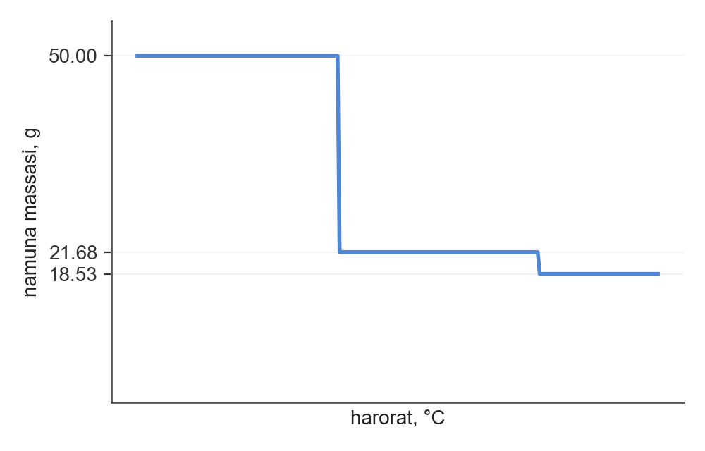

To'liq suvsizlangandan keyin qolgan Na2CO3 ning massasini (g) toping.
A) 31,47  B) 21,68  C) 18,53  D) 37,06

**13.** NaCl ning suvli eritmasi inert elektrodlar bilan elektroliz qilinganda qaysi moddalar ajraladi?
A) Zn, H2 va O2  B) Ag va O2  C) Cu va O2  D) H2, Cl2 va NaOH

### ANORGANIK KIMYO (14–19)

**14.** Rasmdagi o'zgarishlar zanjirida X moddaning formulasini aniqlang.

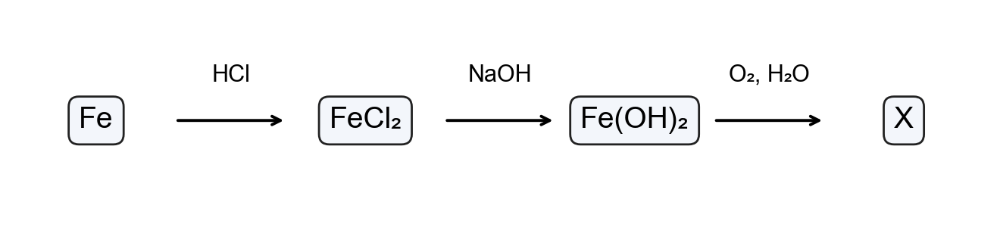
A) Fe(OH)3  B) FeCl2  C) SO3  D) Fe(OH)2

**15.** Cu → ? → ? → ? o'zgarishlar zanjirida (reagentlar: O2, H2SO4, NaOH) 1-bosqichda hosil bo'ladigan modda formulasini toping.
A) Na2SO3  B) Ca(OH)2  C) CuO  D) NaCl

**16.** NH3 + H3PO4 → NH4H2PO4 jarayoni uchun 4,48 l (n.sh.) NH3 olingan (unum 90 %). NH4H2PO4 miqdorini (mol) aniqlang.
A) 0,2  B) 0,36  C) 0,18  D) 0,09

**17.** 14,8 g Mg(NO3)2 to'liq parchalanguncha qizdirildi. Qattiq qoldiq massasini (g) aniqlang.
A) 4  B) 14,8  C) 8  D) 2

**18.** S + O2 → SO2 jarayoni uchun 8,96 l (n.sh.) O2 olingan. SO2 hajmini (l, n.sh.) aniqlang.
A) 17,92  B) 4,48  C) 8,96  D) 13,44

**19.** 2NO + O2 → 2NO2 jarayoni uchun 8,96 l (n.sh.) O2 olingan. NO hajmini (l, n.sh.) aniqlang.
A) 4,48  B) 17,92  C) 35,84  D) 8,96

### ORGANIK KIMYO (20–29)

**20.** C3H8 + 5O2 → 3CO2 + 4H2O jarayoni uchun 8,96 l (n.sh.) C3H8 olingan. CO2 hajmini (l, n.sh.) aniqlang.
A) 2,99  B) 53,76  C) 26,88  D) 13,44

**21.** 46 g C2H5OH dan quyidagi ikki bosqichda C2H4Cl2 olinadi:
1) C2H5OH → C2H4 + H2O (unum 80 %);
2) C2H4 + Cl2 → C2H4Cl2 (unum 75 %).
Oxirgi mahsulot C2H4Cl2 ning massasini (g) toping.
A) 59,4  B) 74,25  C) 79,2  D) 99

**22.** Arenlar, neft va tabiiy gaz haqida qaysi fikrlar to'g'ri? 1) Neft fraksiyalaridan gazolin 150 °C gacha haydaladi; 2) Benzolda 6 ta sp² gibridlangan uglerod bor; 3) Benzoldan nitrobenzol nitrolash bilan olinadi; 4) Benzol uchun birikish reaksiyalari mutlaqo xos emas
A) 1, 2, 3  B) 1, 4  C) 2, 3  D) 2, 3, 4

**23.** C2H4 + H2O (H⁺) reaksiyasi natijasida qaysi organik modda hosil bo'ladi?
A) benzol  B) asetilen  C) etilen  D) etanol

**24.** Aldegid va ketonlar haqida qaysi fikrlar to'g'ri? 1) Ketonlar kuchsiz oksidlovchilar bilan oksidlanmaydi; 2) Sirka aldegid Kucherov reaksiyasi bilan olinadi; 3) Aldegidlar "kumush ko'zgu" reaksiyasini beradi; 4) Formaldegid gaz holatda, suvda yaxshi eriydi
A) 1, 2, 4  B) 2, 3, 4  C) 1, 3, 4  D) 1, 2, 3, 4

**25.** C4H8O2 karbon kislotalarning izomerlari soni nechta?
A) 3  B) 1  C) 4  D) 2

**26.** 22,2 g propion kislota va 9,2 g etanol dan 80 % unum bilan murakkab efir olindi. Efir massasini (g) toping.
A) 20,4  B) 16,32  C) 24,48  D) 32,64

**27.** 6CO2 + 6H2O → C6H12O6 + 6O2 reaksiyasida 44 g CO2 ishtirok etdi. O2 hajmini (l, n.sh.) toping.
A) 44,8  B) 22,4  C) 11,2  D) 33,6

**28.** Aminlar, aminokislotalar va oqsillar haqida qaysi fikrlar to'g'ri? 1) Nitrobenzoldan anilin Zinin reaksiyasi bilan olinadi; 2) Aminlar kuchsiz asoslar xossasini namoyon qiladi; 3) Aminokislotalar faqat kislotali xossaga ega; 4) Dipeptidda 2 ta peptid bog' bor
A) 4  B) 1, 2  C) 1  D) 3

**29.** Yuqori molekulyar birikmalar haqida qaysi fikrlar to'g'ri? 1) Lavsan poliamid tola; 2) Kapron poliamid tola; 3) Tabiiy kauchuk – sis-1,4-poliizopren; 4) Teflon — polivinilxlorid
A) 2, 3  B) 3, 4  C) 1, 2  D) 3

### KIMYOVIY TAHLIL (30–32)

**30.** 100 g 30 % li va 100 g 40 % li NaOH eritmalari aralashtirildi. Yangi eritmaning massa ulushini (%) toping.
A) 70  B) 35  C) 31,5  D) 38,5

**31.** Kimyo laboratoriyasida ishlash qoidalari haqida qaysi fikrlar to'g'ri? 1) Ishqor teriga tushsa, qo'l suv bilan yuviladi; 2) Probirka qizdirilganda og'zi odamga qaratilmaydi; 3) Zaharli gaz ajraladigan tajriba mo'rili shkafda o'tkaziladi; 4) Konsentrlangan kislotani suvga ohista, aralashtirib quyiladi
A) 1, 2, 3, 4  B) 2, 3, 4  C) 1, 3, 4  D) 1, 2, 4

**32.** Rasmda spirt lampasi alangasi tasvirlangan. Alanganing qaysi qismi eng kam issiq va pilikka yaqin?

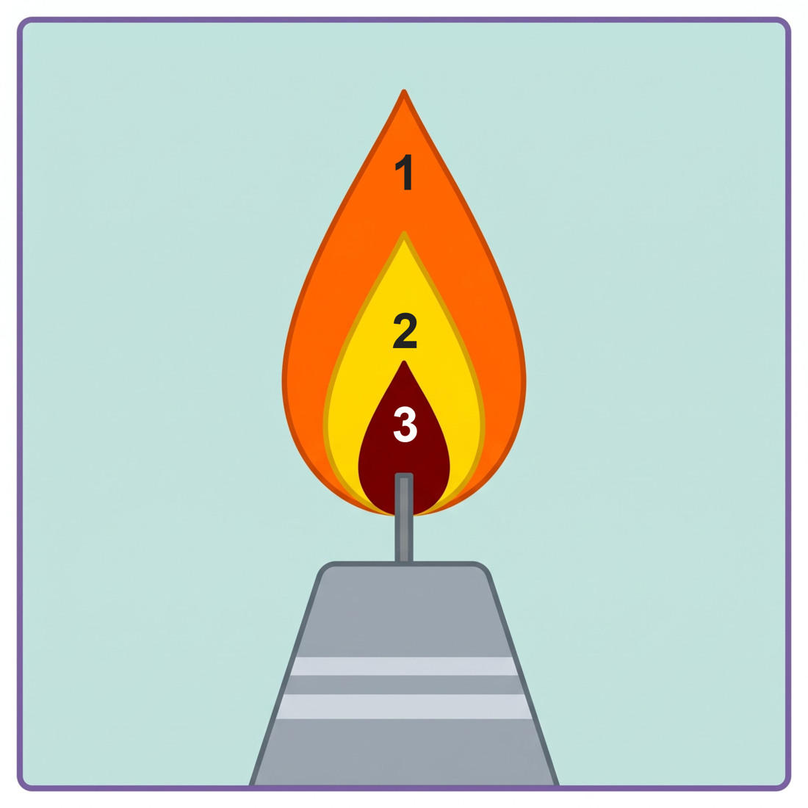
A) hamma qismi bir xil  B) 3 – pastki qism  C) 2 – o'rta qism  D) 1 – yuqori qism

## II QISM. MOSLASHTIRISH (33–35)

**33–35.** Topshiriqlarga mos javoblarni A–F variantlaridan tanlang.
Metan (CH4) va propen (C3H6) dan iborat 7,84 l (n.sh.) aralashma bromli suvdan o'tkazilganda 8 g brom yutildi.

**33.** Aralashmadagi propen (C3H6) hajmini (l, n.sh.) aniqlang.
**34.** Aralashmadagi propen (C3H6) hajmiy ulushini (%) aniqlang.
**35.** Aralashmani to'liq yoqish uchun zarur havo hajmini (l, n.sh.; havoda 21 % kislorod bor) aniqlang.

A) 88  B) 11,43  C) 21,43  D) 14,29  E) 1,12  F) 176

## III QISM. QISQA JAVOBLI (36–40) — javobni son bilan yozing

**36.** KMnO4 + K2SO3 + H2O → MnO2 + K2SO4 + KOH reaksiya tenglamasini tenglang va barcha koeffitsiyentlar yig'indisini aniqlang.

**37.** 50 g CaCO3 reaksiyaga kirishdi (CaCO3 + 2HCl → CaCl2 + CO2 + H2O). Ajralgan CO2 hajmini (l, n.sh.) hisoblang.

**38.** 75,2 g Cu(NO3)2 qizdirilganda qisman parchalandi, qattiq qoldiq massasi 53,6 g bo'ldi. Ajralgan gazlar (n.sh.) hajmini (l) hisoblang.

**39.** Etilen va asetilendan iborat 5,6 l (n.sh.) aralashma bromli suvdan o'tkazilganda 56 g brom yutildi. Aralashmadagi asetilenning hajmini (l, n.sh.) toping.

**40.** 14,8 g HCOOC2H5 mo'l NaOH bilan to'liq gidrolizlandi. Hosil bo'lgan spirt massasini (g) aniqlang.

## IV QISM. YOZMA ISH (41–43) — to'liq yechim ko'rsatiladi

### 41-topshiriq (umumiy kimyo; 5 band, 25 ball)
Quyidagi eritmalar berilgan: HCl ning 0,02 mol/l li eritmasi va NaOH ning 0,01 mol/l li eritmasi. Ularni aralashtirib, umumiy hajmi 1 l bo'lgan eritma tayyorlandi (0,3 l HCl eritmasi va 0,7 l NaOH eritmasi). Shuningdek, sirka kislotaning 0,1 mol/l li eritmasida dissotsilanish darajasi 1 %.
1) Aralashtirilgandan keyingi eritmaning pH ini aniqlang.
2) Dastlabki HCl eritmasining pH ini hisoblang. 1 l shu eritmadagi HCl massasini (g) ham hisoblang.
3) Dastlabki NaOH eritmasining pH ini hisoblang.
4) Sirka kislota eritmasidagi H⁺ ionlari konsentratsiyasini (mol/l) va pH ni aniqlang (lg 2 = 0,3, lg 5 = 0,7 ni ishlating). Shuningdek NaOH eritmasi 100 marta suyultirilsa pH qancha bo'ladi?
5) Sirka kislotaning dissotsilanish konstantasini hisoblang (K = Cα²/(1 − α)). Shuningdek HCl eritmasi 10 marta suyultirilsa pH necha bo'ladi?

### 42-topshiriq (organik kimyo; 4 band, 25 ball; hisob-kitob yo'q)
Quyidagi o'zgarishlar zanjirida X, Y, Z noma'lum organik moddalar:
CH3Cl —Na→ X —Cl2, yorug'lik→ Y —KOH (suvli)→ Z —CuO, t°→ CH3CHO
1) CH3Cl → X : reaksiya tenglamasini yozing; hosil bo'lgan moddani nomlang.
2) X → Y : reaksiya tenglamasini yozing; hosil bo'lgan moddani nomlang.
3) Y → Z : reaksiya tenglamasini yozing; hosil bo'lgan moddani nomlang.
4) Z → CH3CHO : reaksiya tenglamasini yozing; hosil bo'lgan moddani nomlang.

### 43-topshiriq (anorganik kimyo yoki kimyoviy tahlil; 5 band, 25 ball)
Magniy (Mg) va rux (Zn) dan iborat 15,4 g qotishma mo'l suyultirilgan sulfat kislotada eritildi, bunda 6,72 l (n.sh.) gaz ajraldi. Hosil bo'lgan eritmaga mo'l NaOH eritmasi qo'shildi, hosil bo'lgan cho'kma ajratib olindi va havoda qizdirib quritildi.
1) Reaksiya tenglamalarini yozing va qotishmadagi har bir metallning massasini (g) aniqlang.
2) Qotishmadagi Mg ning massa ulushini (%) hisoblang.
3) Eritish uchun sarflangan 20 % li H2SO4 eritmasining massasini (g) aniqlang.
4) Mo'l NaOH qo'shilganda hosil bo'lgan cho'kmaning formulasi va massasini (g) toping (reaksiya tenglamalarini yozing).
5) Cho'kma havoda to'liq qizdirilganda hosil bo'lgan oksidning massasini (g) hisoblang.

# VARIANT 17

## I QISM. YOPIQ TESTLAR (1–32, har biri bitta to'g'ri javob)

### UMUMIY KIMYO (1–13)

**1.** 3 mol Na2SO4 va 2 mol K3PO4 suvda eritilib, eritma hajmi 5 l ga yetkazildi. Eritmadagi barcha ionlarning umumiy molyar konsentratsiyasini (mol/l) aniqlang (kuchli elektrolitlar to'liq dissotsilanadi).
A) 3,4  B) 1  C) 6,8  D) 1,7

**2.** 13,12 l He 127 °C va 1 atm bosimda necha gramm keladi? (R = 0,082 l·atm/(mol·K))
A) 3,2  B) 1,6  C) 0,8  D) 2,34

**3.** 1 M Al2(SO4)3 eritmasining normal konsentratsiyasini (n) aniqlang.
A) 1  B) 12  C) 0,167  D) 6

**4.** Quyidagi tuzlarning qaysilari suvli eritmasi kislotali muhitga ega? 1) Na2CO3; 2) ZnCl2; 3) CuSO4; 4) K2S
A) 3, 4  B) 2, 3  C) 1, 3, 4  D) 4

**5.** Jadvalda bog'lar hosil qiluvchi atomlarning elektrmanfiyliklari berilgan:

| Bog' | EM (1-atom) | EM (2-atom) |
|---|---|---|
| C–H | 2,5 | 2,1 |
| K–Br | 0,8 | 2,8 |
| N–H | 3 | 2,1 |
| Si–O | 1,8 | 3,5 |

Qaysi bog' eng qutbli (eng ko'p ionli xarakterga ega)?
A) C–H  B) N–H  C) Si–O  D) K–Br

**6.** 29,25 g NaCl 250 g suvda eritildi. Eritmaning molyal konsentratsiyasini (mol/kg) aniqlang.
A) 1,79  B) 0  C) 4  D) 2

**7.** Rasmda indikatorlarning pH ga bog'liq rangi ko'rsatilgan.

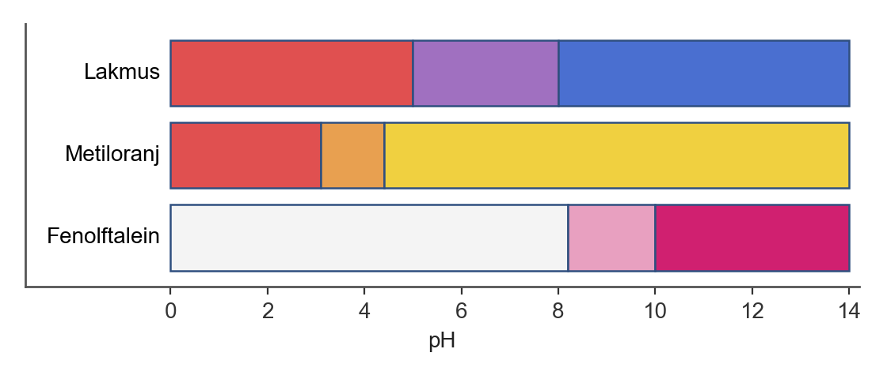

pH = 13 bo'lgan eritmada metiloranj qanday rangga kiradi?
A) sariq  B) qizil  C) malina rang  D) rangsiz

**8.** Laboratoriyada KBr eritmalari quyidagicha tayyorlangan:

| Idish | Eritma massasi, g | ω(KBr), % |
|---|---|---|
| A | 100 | 20 |
| B | 100 | 40 |

Bu ikki eritma bir idishga quyilib va ustiga 50 g suv qo'shilsa, yangi eritmadagi KBr ning massa ulushi (%) qancha bo'ladi?
A) 30  B) 24  C) 60  D) 21,6

**9.** Quyidagi jadvalda KNO3 tuzining eritmalari keltirilgan:

| № | m(eritma), g | ω, % |
|---|---|---|
| I | 100 | 20 |
| II | 150 | 25 |

Eritmalar aralashtirildi. Oxirgi eritmadagi tuzning massa ulushini (%) toping.
A) 22,5  B) 45  C) 23  D) 22

**10.** Elementning massa-spektri (izotoplar tarqalganligi) berilgan.

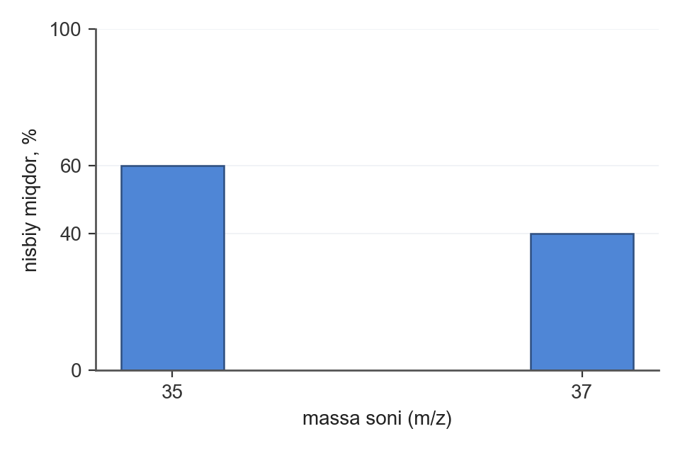

Elementning o'rtacha nisbiy atom massasini aniqlang.
A) 36  B) 36,2  C) 35,8  D) 35

**11.** 32,8 l O2 127 °C va 0,5 atm bosimda necha gramm keladi? (R = 0,082 l·atm/(mol·K))
A) 32  B) 8  C) 16  D) 46,86

**12.** Al + HNO3 → Al(NO3)3 + NO + H2O reaksiyasida 1 mol Al erisa, HNO3 ning necha moli oksidlovchi vazifasini bajaradi?
A) 1  B) 4  C) 3  D) 2

**13.** 40 l C2H2 va 240 l H2 aralashmasi C2H2 + 2H2 → C2H6 tenglama bo'yicha to'liq reaksiyaga kirishdi (barcha gazlar bir xil sharoitda o'lchandi). Aralashma hajmi necha litrga o'zgargan (modul bo'yicha)?
A) 280  B) 80  C) 200  D) 40

### ANORGANIK KIMYO (14–19)

**14.** KNO3 tarkibidagi kaliy ning massa ulushini (%) aniqlang.
A) 38,6  B) 19,3  C) 77,2  D) 2,6

**15.** 17 g NaNO3 to'liq parchalanguncha qizdirildi. Qattiq qoldiq massasini (g) aniqlang.
A) 17  B) 27,6  C) 6,9  D) 13,8

**16.** H2S + CuSO4 → CuS + H2SO4 jarayoni uchun 4,48 l (n.sh.) H2S olingan (unum 60 %). CuS miqdorini (mol) aniqlang.
A) 0,2  B) 0,24  C) 0,06  D) 0,12

**17.** Reaksiya tenglamasi: 2Cu(NO3)2 → 2CuO + 4NO2 + O2. Reaksiyaga tarkibida 60 % aralashma bo'lgan 117,5 g namuna (asosiy modda Cu(NO3)2) kirishdi. O2 hajmini (l, n.sh.) hisoblang.
A) 2,8  B) 11,2  C) 5,6  D) 1,4

**18.** 3,1 g fosfor yondirilib, hosil bo'lgan oksid suvda eritildi (ortofosfat kislota), so'ng 0,2 mol NaOH qo'shildi. Hosil bo'lgan Na2HPO4 massasini (g) aniqlang.
A) 28,4  B) 14,2  C) 7,1  D) 12

**19.** 2KClO3 → 2KCl + 3O2 reaksiyasida 122,5 g KClO3 ishtirok etdi (unum 75 %). O2 hajmini (l, n.sh.) toping.
A) 25,2  B) 14,93  C) 50,4  D) 12,6

### ORGANIK KIMYO (20–29)

**20.** C2H6 + Cl2 → C2H5Cl + HCl jarayoni uchun 22,4 l (n.sh.) C2H6 olingan (unum 75 %). HCl hajmini (l, n.sh.) aniqlang.
A) 22,4  B) 33,6  C) 16,8  D) 8,4

**21.** CH3–CH2–CH(CH3)–CH2–CH3 birikmaning sistematik nomi qaysi qatorda to'g'ri keltirilgan?
A) 2-etilbutan  B) 3-metilpentan  C) 2-metilpentan  D) 3-etilbutan

**22.** Arenlar, neft va tabiiy gaz haqida qaysi fikrlar to'g'ri? 1) Benzoldan nitrobenzol nitrolash bilan olinadi; 2) Benzol bromli suvni rangsizlantirmaydi; 3) Benzol uchun birikish reaksiyalari mutlaqo xos emas; 4) Benzolda 6 ta sp² gibridlangan uglerod bor
A) 2, 3  B) 3, 4  C) 1, 2, 4  D) 1, 2, 3

**23.** C2H2 + H2O (Hg²⁺) reaksiyasi natijasida qaysi organik modda hosil bo'ladi?
A) etilatsetat  B) asetilen  C) sirka aldegid  D) etanol

**24.** Aldegid va ketonlar haqida qaysi fikrlar to'g'ri? 1) Aldegidlar qaytarilganda ikkilamchi spirt hosil bo'ladi; 2) Ketonlar kuchsiz oksidlovchilar bilan oksidlanmaydi; 3) Formaldegid gaz holatda, suvda yaxshi eriydi; 4) Aldegidlar "kumush ko'zgu" reaksiyasini beradi
A) 1, 2, 3  B) 3, 4  C) 2, 3  D) 2, 3, 4

**25.** 14,8 g propion kislotani neytrallash uchun 10 % li NaOH eritmasidan necha gramm kerak?
A) 8  B) 80  C) 40  D) 148

**26.** Murakkab efirlar va yog'lar haqida qaysi fikrlar to'g'ri? 1) Sovun — yuqori yog' kislotalarning natriyli tuzi; 2) Yog'lar glitserin va yuqori yog' kislotalarning murakkab efirlari; 3) Suyuq yog'lar to'yinmagan kislotalardan hosil bo'lgan; 4) Dietil efir spirtdan yuqori haroratda qaynaydi
A) 1, 2, 3  B) 2, 3, 4  C) 1, 4  D) 1, 3, 4

**27.** Reaksiya tenglamasi: C6H12O6 → 2C2H5OH + 2CO2. Reaksiyaga 72 g C6H12O6 kirishdi. CO2 hajmini (l, n.sh.) hisoblang.
A) 4,48  B) 35,84  C) 17,92  D) 8,96

**28.** Aminlar, aminokislotalar va oqsillar haqida qaysi fikrlar to'g'ri? 1) Oqsillar biuret reaksiyasini beradi; 2) Aminokislotalar amfoter birikmalar; 3) Anilin bromli suv bilan oq cho'kma beradi; 4) Glitsin optik faol
A) 1, 4  B) 1, 2  C) 2, 3  D) 1, 2, 3

**29.** Reaksiya tenglamasi: C3H6 + H2 → C3H8. Reaksiyaga 5,6 l (n.sh.) C3H6 kirishdi. C3H8 hajmini (l, n.sh.) hisoblang.
A) 5,6  B) 11,2  C) 2,8  D) 8,4

### KIMYOVIY TAHLIL (30–32)

**30.** Kimyoviy laboratoriyada ajratgich voronka nima uchun ishlatiladi?
A) probirkani qizdirish
B) eritmaning kichik hajmlarini o'lchab olish
C) gaz (H₂, CO₂, H₂S) olish
D) aralashmaydigan suyuqliklarni ajratish

**31.** Kimyo laboratoriyasida ishlash qoidalari haqida qaysi fikrlar to'g'ri? 1) Reaktivlarni tatib ko'rish mumkin; 2) Zaharli gaz ajraladigan tajriba mo'rili shkafda o'tkaziladi; 3) Spirt lampa boshqa lampadan yoqilmaydi; 4) Probirka qizdirilganda og'zi odamga qaratilmaydi
A) 1, 2  B) 3, 4  C) 2, 3, 4  D) 1, 3, 4

**32.** Rasmdagi tajribada cho'g'langan yog'och konsentrlangan HNO3 bug'lari ichida yonmoqda. Bu jarayonda HNO3 qanday vazifani bajaradi?

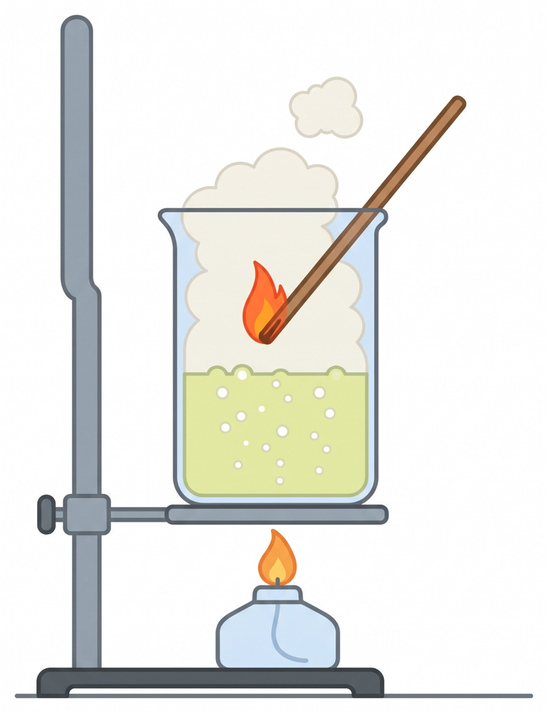
A) qaytaruvchi  B) oksidlovchi  C) katalizator  D) erituvchi

## II QISM. MOSLASHTIRISH (33–35)

**33–35.** Topshiriqlarga mos javoblarni A–F variantlaridan tanlang.
Temir va alyuminiy (Fe va Al) dan iborat 6,85 g qotishma mo'l HCl eritmasida eritilganda 6,16 l (n.sh.) gaz ajraldi.

**33.** Qotishmadagi Fe massa ulushini (%) aniqlang.
**34.** Reaksiya uchun sarflangan 20 % li HCl massasini (g) aniqlang.
**35.** Eritmadagi tuzlarning umumiy massasini (g) aniqlang.

A) 150,56  B) 100,38  C) 81,75  D) 200,75  E) 40,88  F) 26,38

## III QISM. QISQA JAVOBLI (36–40) — javobni son bilan yozing

**36.** Mg + H2SO4 → MgSO4 + H2S + H2O reaksiya tenglamasini tenglang va barcha koeffitsiyentlar yig'indisini aniqlang.

**37.** 8,5 g H2O2 reaksiyaga kirishdi (2H2O2 → 2H2O + O2). Ajralgan O2 hajmini (l, n.sh.) hisoblang (unum 75 %).

**38.** NaBr va NaI dan iborat 17,8 g aralashma eritilib, mo'l xlor o'tkazildi, eritma bug'latilib quruq qoldiq 8,78 g chiqdi. Aralashmadagi NaI ning massasini (g) toping.

**39.** Etilen va asetilendan iborat 3,36 l (n.sh.) aralashma bromli suvdan o'tkazilganda 32 g brom yutildi. Aralashmadagi asetilenning hajmini (l, n.sh.) toping.

**40.** 80,6 g tripalmitin gidrolizlanganda necha gramm glitserin hosil bo'ladi?

## IV QISM. YOZMA ISH (41–43) — to'liq yechim ko'rsatiladi

### 41-topshiriq (umumiy kimyo; 5 band, 25 ball)
Tarkibida 2 mol H2SO4 va 0,25 mol SO3 bo'lgan oleum namunasi 200 g suvda eritildi.
1) Oleumdagi SO3 ning massa ulushini (%) hisoblang.
2) SO3 suv bilan reaksiyaga kirishgandan so'ng eritmadagi H2SO4 ning umumiy miqdorini (mol) toping (reaksiya tenglamasini yozing). Hosil bo'lgan eritmadagi suvning massasini (g) ham hisoblang.
3) Hosil bo'lgan eritmadagi H2SO4 ning massa ulushini (%) aniqlang.
4) Shu eritmani to'liq neytrallash uchun zichligi 1,11 g/ml bo'lgan 10 % li NaOH eritmasidan necha ml kerak? Hosil bo'lgan Na2SO4 massasini (g) ham toping.
5) Eritmaga mo'l BaCl2 eritmasi qo'shilganda hosil bo'ladigan cho'kma massasini (g) toping. Hosil bo'lgan eritmaning zichligi 1,4 g/ml bo'lsa, uning molyar konsentratsiyasini (mol/l) toping.

### 42-topshiriq (organik kimyo; 3 band, 25 ball; hisob-kitob yo'q)
Quyidagi o'zgarishlar zanjirida X, Y, Z noma'lum organik moddalar:
C2H5OH —CuO, t°→ X —Ag2O, NH3→ Y —Cl2, P→ ClCH2COOH
1) C2H5OH → X : reaksiya tenglamasini yozing; hosil bo'lgan moddani nomlang.
2) X → Y : reaksiya tenglamasini yozing; hosil bo'lgan moddani nomlang.
3) Y → ClCH2COOH : reaksiya tenglamasini yozing; hosil bo'lgan moddani nomlang.

### 43-topshiriq (anorganik kimyo yoki kimyoviy tahlil; 5 band, 25 ball)
Alyuminiy, temir va misdan iborat 11,5 g aralashma mo'l NaOH eritmasi bilan reaksiyaga kirishganda 3,36 l (n.sh.) vodorod ajraldi. Xuddi shunday tarkibli ikkinchi aralashma (11,5 g) mo'l xlorid kislota bilan reaksiyaga kirishganda 5,6 l (n.sh.) vodorod ajraldi (temir FeCl2 ga o'tdi).
1) Aralashmadagi har bir metallning massasini (g) va massa ulushini (%) aniqlang (reaksiya tenglamalarini yozing).
2) Xlorid kislota bilan reaksiyadan keyin qolgan qoldiq konsentrlangan HNO3 da to'liq eritildi. Ajralgan gazning hajmini (l, n.sh.) aniqlang.
3) Xlorid kislota bilan olingan eritmaga mo'l NaOH qo'shildi, hosil bo'lgan cho'kma ajratib olinib, havoda to'liq oksidlanguncha qoldirildi. Cho'kma massasini (g) toping.
4) Mis nitrat eritmasi bug'latilib, quruq tuz qizdirilganda hosil bo'ladigan qattiq qoldiq massasini (g) va gazlar aralashmasining hajmini (l, n.sh.) aniqlang.
5) Aralashmadagi alyuminiyni eritish uchun (2Al + 2NaOH + 6H2O → 2Na[Al(OH)4] + 3H2) 10 % li NaOH eritmasidan necha gramm kerak?

# VARIANT 18

## I QISM. YOPIQ TESTLAR (1–32, har biri bitta to'g'ri javob)

### UMUMIY KIMYO (1–13)

**1.** N2O4 ⇌ 2NO2 reaksiyasi 1 l hajmli idishda o'tkazildi. Ma'lumotlar jadvalda berilgan:

| Modda | N2O4 | NO2 |
|---|---|---|
| Boshlang'ich, mol | 4 | 0 |
| Muvozanatda, mol | — | 1 |

N2O4 ning necha foizi reaksiyaga kirishganini aniqlang.
A) 12,5  B) 6,2  C) 18,8  D) 87,5

**2.** Rasmda molekulaning sharsimon modeli tasvirlangan (yashil – C, sariq – H, qizil – O, ko'k – N).

Molekula fazoviy shakli qanday?
A) uchburchakli piramida  B) burchakli  C) tetraedr  D) chiziqli

**3.** H2O2 tarkibida O ning oksidlanish darajasini aniqlang.
A) −2  B) −3 va +5  C) −1  D) +6

**4.** Na2SO4 eritmasiga 0,5 mol/l li BaCl2 eritmasi oz-ozdan qo'shilganda hosil bo'lgan cho'kma massasining qo'shilgan hajmga bog'liqligi grafikda keltirilgan.

Dastlabki eritmadagi Na2SO4 ning massasini (g) hisoblang.
A) 9,32  B) 8,32  C) 5,68  D) 11,36

**5.** 2NO + O2 ⇌ 2NO2 reaksiyada muvozanat qaror topganda [NO] = 1, [O2] = 1, [NO2] = 4 mol/l bo'ldi. NO ning boshlang'ich konsentratsiyasini (mol/l) aniqlang.
A) 5  B) 1  C) 7  D) 3

**6.** Quyidagi jadvalda Na2CO3 tuzining eritmalari keltirilgan:

| № | m(eritma), g | ω, % |
|---|---|---|
| I | 100 | 20 |
| II | 200 | 30 |

Eritmalar aralashtirildi. Oxirgi eritmadagi tuzning massa ulushini (%) toping.
A) 25  B) 26,67  C) 50  D) 23,33

**7.** 11,2 g Fe va 3,2 g S aralashtirilib, reaksiya o'tkazildi (Fe + S → FeS). Hosil bo'lgan FeS massasini (g) aniqlang.
A) 17,6  B) 4,4  C) 13,2  D) 8,8

**8.** 8 g NaOH 500 g suvda eritildi. Eritmaning molyal konsentratsiyasini (mol/kg) aniqlang.
A) 0,4  B) 0,39  C) 0  D) 0,8

**9.** Faqat qaytaruvchi bo'la oladigan ionlarni aniqlang: 1) Fe³⁺; 2) Fe²⁺; 3) K⁺; 4) Cl⁻
A) 1  B) 2  C) 1, 3  D) 4

**10.** C6H6 molekulasidagi σ va π bog'lar sonini aniqlang.
A) 11 va 3  B) 12 va 3  C) 12 va 4  D) 13 va 3

**11.** CH4 gazining 27 °C va 1 atm bosimdagi zichligini (g/l) aniqlang. (R = 0,082 l·atm/(mol·K))
A) 1,3  B) 0,33  C) 0,71  D) 0,65

**12.** 3 mol NaCl va 3 mol HNO3 suvda eritilib, eritma hajmi 4 l ga yetkazildi. Eritmadagi barcha ionlarning umumiy molyar konsentratsiyasini (mol/l) aniqlang (kuchli elektrolitlar to'liq dissotsilanadi).
A) 1,5  B) 6  C) 3  D) 2,25

**13.** Na2SO4 ning suvli eritmasi inert elektrodlar bilan elektroliz qilinganda qaysi moddalar ajraladi?
A) Ag va O2  B) H2 va O2  C) Cu va O2  D) Cu va Cl2

### ANORGANIK KIMYO (14–19)

**14.** Qaysi juftliklar o'zaro reaksiyaga kirishmaydi? 1) Fe2O3 va H2O; 2) SiO2 va H2O; 3) Zn va NaOH; 4) NaCl va HNO3
A) 3, 4  B) 1, 4  C) 1, 2, 3  D) 1, 2, 4

**15.** Cu + 4HNO3 → Cu(NO3)2 + 2NO2 + 2H2O jarayoni uchun tarkibida 50 % aralashma bo'lgan 128 g namuna (asosiy modda Cu) olingan. Cu(NO3)2 massasini (g) aniqlang.
A) 376  B) 188  C) 94  D) 282

**16.** CO2 + Ca(OH)2 → CaCO3 + H2O reaksiyasida 2,24 l (n.sh.) CO2 ishtirok etdi. CaCO3 massasini (g) toping.
A) 20  B) 10  C) 5  D) 15

**17.** NaBr + AgNO3 → AgBr + NaNO3 reaksiyasida tarkibida 60 % aralashma bo'lgan 103 g namuna (asosiy modda NaBr) ishtirok etdi. AgBr massasini (g) toping.
A) 75,2  B) 150,4  C) 37,6  D) 112,8

**18.** Ishqoriy metallar haqida qaysi fikrlar to'g'ri? 1) Kaliy suvdan og'ir; 2) KOH – kuchli ishqor; 3) Ishqoriy metallar faqat oksidlovchi bo'ladi; 4) Natriy suv bilan reaksiyada H2 va NaOH hosil qiladi
A) 2, 3  B) 1  C) 1, 2, 4  D) 2, 4

**19.** Alyuminiy va temir dan iborat 13,9 g aralashma mo'l NaOH eritmasida eritildi. Ajralgan gazning hajmini (l, n.sh.) aniqlang (temir ishqor bilan reaksiyaga kirishmaydi).
A) 6,72  B) 3,36  C) 1,68  D) 11,53

### ORGANIK KIMYO (20–29)

**20.** C5H10O aldegidlarning izomerlari soni nechta?
A) 5  B) 3  C) 4  D) 6

**21.** CH3–CH(CH3)–COOH birikmaning sistematik nomi qaysi qatorda to'g'ri keltirilgan?
A) butan kislota  B) 3-metilpropan kislota  C) 2-metilpropan kislota  D) 2-metilbutan kislota

**22.** 6,4 g CaC2 dan quyidagi ikki bosqichda C2H2Br4 olinadi:
1) CaC2 + 2H2O → C2H2 + Ca(OH)2 (unum 75 %);
2) C2H2 + 2Br2 → C2H2Br4 (unum 80 %).
Oxirgi mahsulot C2H2Br4 ning massasini (g) toping.
A) 20,76  B) 27,68  C) 25,95  D) 34,6

**23.** C2H5OH va CH3OH dan iborat 11 g aralashma natriy bilan to'liq reaksiyaga kirishganda ajraladigan vodorod hajmini (l, n.sh.) toping.
A) 3,36  B) 6,72  C) 1,68  D) 1,58

**24.** Aldegid va ketonlar haqida qaysi fikrlar to'g'ri? 1) Sirka aldegid Kucherov reaksiyasi bilan olinadi; 2) Formalin — formaldegidning 40 % li eritmasi; 3) Aseton Cu(OH)2 ni qaytaradi; 4) Aseton suvda erimaydi
A) 2, 3, 4  B) 3, 4  C) 1, 2  D) 2, 4

**25.** Karbon kislotalar haqida qaysi fikrlar to'g'ri? 1) Qattiq suvda sovun yaxshi ko'piklanadi; 2) Karboksil guruh karbonil va gidroksil guruhlardan iborat; 3) Olein kislota Br2 ni biriktiradi; 4) Chumoli kislota "kumush ko'zgu" reaksiyasini beradi
A) 1, 4  B) 1, 2, 4  C) 2, 3, 4  D) 1, 3, 4

**26.** 445 g tristearin gidrolizlanganda necha gramm glitserin hosil bo'ladi?
A) 138  B) 46  C) 23  D) 445

**27.** 68,4 g C12H22O11 dan quyidagi ikki bosqichda C2H5OH olinadi:
1) C12H22O11 + H2O → 2C6H12O6 (unum 60 %);
2) C6H12O6 → 2C2H5OH + 2CO2 (unum 75 %).
Oxirgi mahsulot C2H5OH ning massasini (g) toping.
A) 27,6  B) 22,08  C) 16,56  D) 36,8

**28.** Aminlar, aminokislotalar va oqsillar haqida qaysi fikrlar to'g'ri? 1) Dipeptidda 2 ta peptid bog' bor; 2) Glitsin optik faol; 3) Oqsillar biuret reaksiyasini beradi; 4) Aminokislotalar amfoter birikmalar
A) 1, 4  B) 1  C) 2  D) 3, 4

**29.** 5,2 g C2H2 dan quyidagi ikki bosqichda C2H5Cl olinadi:
1) C2H2 + H2 → C2H4 (unum 80 %);
2) C2H4 + HCl → C2H5Cl (unum 75 %).
Oxirgi mahsulot C2H5Cl ning massasini (g) toping.
A) 7,74  B) 9,67  C) 10,32  D) 12,9

### KIMYOVIY TAHLIL (30–32)

**30.** Lakmus indikatori kislotali muhitda qanday rang beradi?
A) sariq  B) qizil  C) binafsha  D) rangsiz

**31.** Rasmda ammiakning suvda erishi ko'rsatilgan. 22,4 l (n.sh.) NH3 1000 g suvda eritilsa, eritmadagi ammiakning massa ulushi necha foiz?

A) 1,67  B) 1,7  C) 3,34  D) 0,84

**32.** Kimyo laboratoriyasida ishlash qoidalari haqida qaysi fikrlar to'g'ri? 1) Konsentrlangan kislotani suvga ohista, aralashtirib quyiladi; 2) Kuygan joy ko'p suv bilan yuviladi; 3) Spirt lampa boshqa lampadan yoqilmaydi; 4) Zaharli gaz ajraladigan tajriba mo'rili shkafda o'tkaziladi
A) 1, 2, 4  B) 2, 3, 4  C) 1, 2, 3  D) 1, 2, 3, 4

## II QISM. MOSLASHTIRISH (33–35)

**33–35.** Topshiriqlarga mos javoblarni A–F variantlaridan tanlang.
CuO va Fe2O3 dan iborat 12 g aralashma qizdirilib, CO oqimida to'liq qaytarildi; qoldiq (metallar) massasi 8,8 g.

**33.** Aralashmadagi CuO massasini (g) aniqlang.
**34.** Qaytarish uchun (20 % ortiqcha olingan) sarflangan CO hajmini (l, n.sh.) aniqlang.
**35.** Qaytarish natijasida hosil bo'lgan CO2 massasini (g) aniqlang.

A) 2  B) 8,8  C) 8,06  D) 5,38  E) 4  F) 3,2

## III QISM. QISQA JAVOBLI (36–40) — javobni son bilan yozing

**36.** Fe + H2SO4 → Fe2(SO4)3 + SO2 + H2O reaksiya tenglamasini tenglang. Reagentlar (chap qism) koeffitsiyentlari yig'indisini toping.

**37.** 4 l hajmli yopiq idishda 1 mol N2O4 qizdirilganda N2O4 ⇄ 2NO2 muvozanati qaror topdi. Muvozanat aralashmasining vodorodga nisbatan zichligi 38,33 ga teng. Shu haroratdagi muvozanat konstantasini (K, mol/l) hisoblang.

**38.** CaCO3 va MgCO3 dan iborat 18,4 g aralashma doimiy massagacha qizdirilganda qoldiq massasi 9,6 g bo'ldi. Aralashmadagi CaCO3 ning massasini (g) toping.

**39.** CH3OH va C2H5OH dan iborat 15,6 g aralashma natriy bilan to'liq reaksiyaga kirishganda ajraladigan vodorod hajmini (l, n.sh.) toping.

**40.** 5,2 g asetilendan Kucherov reaksiyasi bilan (80 % unum) sirka aldegid olindi. Aldegid massasini (g) aniqlang.

## IV QISM. YOZMA ISH (41–43) — to'liq yechim ko'rsatiladi

### 41-topshiriq (umumiy kimyo; 5 band, 25 ball)
Quyidagi eritmalar berilgan: HCl ning 0,02 mol/l li eritmasi va KOH ning 0,04 mol/l li eritmasi. Ularni aralashtirib, umumiy hajmi 1 l bo'lgan eritma tayyorlandi (0,5 l HCl eritmasi va 0,5 l KOH eritmasi). Shuningdek, sirka kislotaning 0,05 mol/l li eritmasida dissotsilanish darajasi 1 %.
1) Aralashtirilgandan keyingi eritmaning pH ini aniqlang.
2) Dastlabki HCl eritmasining pH ini hisoblang. 1 l shu eritmadagi HCl massasini (g) ham hisoblang.
3) Dastlabki KOH eritmasining pH ini hisoblang.
4) Sirka kislota eritmasidagi H⁺ ionlari konsentratsiyasini (mol/l) va pH ni aniqlang (lg 2 = 0,3, lg 5 = 0,7 ni ishlating). Shuningdek KOH eritmasi 100 marta suyultirilsa pH qancha bo'ladi?
5) Sirka kislotaning dissotsilanish konstantasini hisoblang (K = Cα²/(1 − α)). Shuningdek HCl eritmasi 10 marta suyultirilsa pH necha bo'ladi?

### 42-topshiriq (organik kimyo; 7 band, 25 ball; hisob-kitob yo'q)
Reaksiya tenglamalarini tugallang va tenglang. Hosil bo'lgan organik moddalarning tuzilish formulalarini yozing va ularni nomlang.
1) 3C2H2 —C, t→
2) CH3COONa + NaOH —t→
3) CH2=CH2 + Br2 →
4) CH3–C≡CH + H2O —Hg²⁺→
5) CH3COOH + NaHCO3 →
6) CH3–CH=CH2 + HBr →
7) n CH2=CH–CH=CH2 →

### 43-topshiriq (anorganik kimyo yoki kimyoviy tahlil; 5 band, 25 ball)
Temir (Fe) va rux (Zn) dan iborat 30,7 g qotishma mo'l suyultirilgan sulfat kislotada eritildi, bunda 11,2 l (n.sh.) gaz ajraldi. Hosil bo'lgan eritmaga mo'l NaOH eritmasi qo'shildi, hosil bo'lgan cho'kma ajratib olindi va havoda qizdirib quritildi.
1) Reaksiya tenglamalarini yozing va qotishmadagi har bir metallning massasini (g) aniqlang.
2) Qotishmadagi Fe ning massa ulushini (%) hisoblang.
3) Eritish uchun sarflangan 20 % li H2SO4 eritmasining massasini (g) aniqlang.
4) Mo'l NaOH qo'shilganda hosil bo'lgan cho'kmaning formulasi va massasini (g) toping (reaksiya tenglamalarini yozing).
5) Cho'kma havoda to'liq qizdirilganda hosil bo'lgan oksidning massasini (g) hisoblang.

# VARIANT 19

## I QISM. YOPIQ TESTLAR (1–32, har biri bitta to'g'ri javob)

### UMUMIY KIMYO (1–13)

**1.** AgNO3 eritmasi inert elektrodlar yordamida 4 A tok kuchi bilan 965 s elektroliz qilindi. Anodda ajralgan O2 hajmi (l, n.sh.) ni toping.
A) 0,448  B) 0,112  C) 0,009  D) 0,224

**2.** Xrom atomida d-pog'onachadagi elektronlar sonini aniqlang (Z = 24).
A) 5  B) 6  C) 4  D) 7

**3.** Mishyak (Z = 33) atomining tashqi energetik pog'onasidagi elektronlar sonini aniqlang.
A) 5  B) 6  C) 4  D) 7

**4.** Quyidagi tuzlarning qaysilari suvli eritmasi ishqoriy muhitga ega? 1) CH3COONa; 2) FeCl3; 3) K2S; 4) NH4Cl
A) 2, 3, 4  B) 1, 3  C) 2, 3  D) 3

**5.** 2 mol Ba(OH)2 va 2 mol NaCl suvda eritilib, eritma hajmi 4 l ga yetkazildi. Eritmadagi barcha ionlarning umumiy molyar konsentratsiyasini (mol/l) aniqlang (kuchli elektrolitlar to'liq dissotsilanadi).
A) 1  B) 5  C) 2,5  D) 1,25

**6.** Kislotada Mg bo'lagi eritilganda ajralgan vodorod hajmining vaqtga bog'liqligi grafikda berilgan.

2-minutda ajralgan vodorodning miqdorini (mmol) toping (1 mmol gaz = 22,4 ml).
A) 2,23  B) 4,46  C) 1,12  D) 50

**7.** Laboratoriyada CuSO4 eritmalari quyidagicha tayyorlangan:

| Idish | Eritma massasi, g | ω(CuSO4), % |
|---|---|---|
| A | 200 | 5 |
| B | 150 | 40 |

Bu ikki eritma bir idishga quyilib, yangi eritmadagi CuSO4 ning massa ulushi (%) qancha bo'ladi?
A) 22,5  B) 45  C) 20  D) 25

**8.** Jadvalda bog'lar hosil qiluvchi atomlarning elektrmanfiyliklari berilgan:

| Bog' | EM (1-atom) | EM (2-atom) |
|---|---|---|
| H–N | 2,1 | 3 |
| Mg–O | 1,2 | 3,5 |
| C–H | 2,5 | 2,1 |
| Si–O | 1,8 | 3,5 |

Qaysi bog' eng qutbli (eng ko'p ionli xarakterga ega)?
A) H–N  B) C–H  C) Si–O  D) Mg–O

**9.** 8 g NaOH va 5,48 g HCl aralashtirilib, reaksiya o'tkazildi (NaOH + HCl → NaCl + H2O). Hosil bo'lgan NaCl massasini (g) aniqlang.
A) 11,7  B) 17,55  C) 4,39  D) 8,78

**10.** 131,2 l N2 127 °C va 0,5 atm bosimda necha gramm keladi? (R = 0,082 l·atm/(mol·K))
A) 112  B) 56  C) 28  D) 164

**11.** HC≡C–CH=CH2 molekulasidagi σ va π bog'lar sonini aniqlang.
A) 6 va 3  B) 7 va 4  C) 8 va 3  D) 7 va 3

**12.** K2Cr2O7 tarkibida Cr ning oksidlanish darajasini aniqlang.
A) −1  B) +1  C) +6  D) −3

**13.** Faqat qaytaruvchi bo'la oladigan ionlarni aniqlang: 1) Al³⁺; 2) S²⁻; 3) Na⁺; 4) Fe³⁺
A) 1, 4  B) 1, 3  C) 3, 4  D) 2

### ANORGANIK KIMYO (14–19)

**14.** Reaksiya tenglamasi: SiO2 + 2NaOH → Na2SiO3 + H2O. Reaksiyaga tarkibida 20 % aralashma bo'lgan 20 g namuna (asosiy modda NaOH) kirishdi. Na2SiO3 massasini (g) hisoblang.
A) 97,6  B) 48,8  C) 24,4  D) 12,2

**15.** 2NaBr + Cl2 → 2NaCl + Br2 reaksiyasida 71 g Cl2 ishtirok etdi. Br2 miqdorini (mol) toping.
A) 1  B) 2  C) 0,5  D) 1,5

**16.** Ishqoriy metallar haqida qaysi fikrlar to'g'ri? 1) KOH – kuchli ishqor; 2) Natriy atomining tashqi qavatida 2 ta elektron bor; 3) Natriy kerosin ostida saqlanadi; 4) Natriy suv bilan reaksiyada H2 va NaOH hosil qiladi
A) 1, 2, 3  B) 1, 3, 4  C) 2, 3  D) 1, 2, 4

**17.** Mg3N2 + 6H2O → 3Mg(OH)2 + 2NH3 jarayoni uchun 50 g Mg3N2 olingan (unum 90 %). NH3 hajmini (l, n.sh.) aniqlang.
A) 5,6  B) 40,32  C) 20,16  D) 10,08

**18.** 4,5 g Fe(OH)2 havoda to'liq oksidlanib, Fe(OH)3 ga aylandi. Hosil bo'lgan Fe(OH)3 massasini (g) aniqlang.
A) 4,5  B) 5,35  C) 8,03  D) 4,95

**19.** Ca(HCO3)2 + Ca(OH)2 → 2CaCO3 + 2H2O reaksiyasida 40,5 g Ca(HCO3)2 ishtirok etdi (unum 50 %). CaCO3 massasini (g) toping.
A) 12,5  B) 50  C) 25  D) 37,5

### ORGANIK KIMYO (20–29)

**20.** C4H6 alkinlarning izomerlari soni nechta?
A) 3  B) 1  C) 4  D) 2

**21.** CH2=CH–CH=CH2 birikmaning sistematik nomi qaysi qatorda to'g'ri keltirilgan?
A) butadiyen-1,3  B) butadiyen-1,2  C) buten-1  D) butin-1

**22.** C6H6 + HNO3 → C6H5NO2 + H2O reaksiyasida 156 g C6H6 ishtirok etdi. HNO3 massasini (g) toping.
A) 252  B) 63  C) 126  D) 189

**23.** Spirt va fenollar haqida qaysi fikrlar to'g'ri? 1) Etilenglikol zaharsiz; 2) Etanol natriy bilan reaksiyaga kirishadi; 3) Glitserin Cu(OH)2 bilan ko'k kompleks hosil qiladi; 4) Fenol Cu(OH)2 ni eritib ko'k kompleks hosil qiladi
A) 2, 3  B) 4  C) 3, 4  D) 2, 4

**24.** Aldegid va ketonlar haqida qaysi fikrlar to'g'ri? 1) Formalin — formaldegidning 40 % li eritmasi; 2) Ketonlar kuchsiz oksidlovchilar bilan oksidlanmaydi; 3) Aldegidlar qaytarilganda ikkilamchi spirt hosil bo'ladi; 4) Aldegidlar "kumush ko'zgu" reaksiyasini beradi
A) 2, 3  B) 1, 3  C) 1, 3, 4  D) 1, 2, 4

**25.** C4H8 alkenlarning izomerlari soni (sis-trans izomerlar bilan, siklik bo'lmagan) nechta?
A) 5  B) 3  C) 6  D) 4

**26.** CH3COOH + C2H5OH → CH3COOC2H5 + H2O reaksiyasida 120 g CH3COOH ishtirok etdi. CH3COOC2H5 massasini (g) toping.
A) 176  B) 352  C) 88  D) 264

**27.** Uglevodlar haqida qaysi fikrlar to'g'ri? 1) Kraxmal va selluloza bir xil M ga ega; 2) Kraxmal yod bilan ko'k rang beradi; 3) Saxaroza Feling suyuqligini qaytaradi; 4) Fruktoza ketospirt
A) 2, 4  B) 2  C) 1, 2  D) 1, 3, 4

**28.** Rasmda benzol hosilasining tuzilish formulasi berilgan.

Birikmaning molekulyar formulasini aniqlang.
A) C7H6O2  B) C6H5NO2  C) C6H5Cl  D) C6H6O

**29.** Reaksiya tenglamasi: C2H2 + HCl → C2H3Cl. Reaksiyaga 5,2 g C2H2 kirishdi. C2H3Cl miqdorini (mol) hisoblang.
A) 0,4  B) 0,2  C) 0,1  D) 0,3

### KIMYOVIY TAHLIL (30–32)

**30.** Eritmaga NaOH qo'shilganda havorang cho'kma (Cu(OH)2) kuzatildi. Eritmada qaysi ion bor?
A) PO4³⁻  B) Cu²⁺  C) Cl⁻  D) Fe³⁺

**31.** Lakmus indikatori neytral muhitda qanday rang beradi?
A) ko'k  B) binafsha  C) malina rangga kiradi (pushti)  D) qizil

**32.** Rasmdagi asbobda 23 g etanol konsentrlangan H2SO4 bilan 170 °C da qizdirilib, 90 % unum bilan etilen olindi. Hosil bo'lgan etilen hajmini (l, n.sh.) aniqlang.

A) 11,2  B) 10,08  C) 20,16  D) 5,04

## II QISM. MOSLASHTIRISH (33–35)

**33–35.** Topshiriqlarga mos javoblarni A–F variantlaridan tanlang.
Rux va temir (Zn va Fe) dan iborat 20,05 g qotishma mo'l HCl eritmasida eritilganda 7,84 l (n.sh.) gaz ajraldi.

**33.** Qotishmadagi Zn massa ulushini (%) aniqlang.
**34.** Reaksiya uchun sarflangan 20 % li HCl massasini (g) aniqlang.
**35.** Eritmadagi tuzlarning umumiy massasini (g) aniqlang.

A) 67,35  B) 35,92  C) 24,31  D) 127,75  E) 44,9  F) 16,21

## III QISM. QISQA JAVOBLI (36–40) — javobni son bilan yozing

**36.** H2S + HNO3 → H2SO4 + NO2 + H2O reaksiya tenglamasini elektron balans usulida tenglang va barcha koeffitsiyentlar yig'indisini aniqlang.

**37.** CH4 va H2 dan iborat 60 ml aralashma mo'l kisloroda yondirildi (suv suyuq holatda; hajmlar bir xil sharoitda o'lchandi). Reaksiyadan so'ng gazlar hajmi 105 ml ga kamaydi. Aralashmadagi CH4 hajmini (ml) toping.

**38.** Al, Fe va Cu dan iborat aralashma mo'l NaOH eritmasi bilan ta'sirlashganda 6,72 l (n.sh.) vodorod ajraldi; xuddi shunday massadagi aralashma mo'l HCl bilan ta'sirlashganda 11,2 l (n.sh.) vodorod ajraldi, erimay qolgan qoldiq (mis) massasi 6,4 g. Aralashmaning dastlabki massasini (g) toping.

**39.** 23 g etanol avval sirka aldegidgacha (unum 90 %), so'ng sirka kislotagacha (unum 80 %) oksidlandi; hosil bo'lgan kislota mo'l etanol bilan efirlandi (unum 100 %). Etilatsetat massasini (g) toping.

**40.** 18 g sirka kislota va 9,2 g etanol dan 80 % unum bilan murakkab efir olindi. Efir massasini (g) toping.

## IV QISM. YOZMA ISH (41–43) — to'liq yechim ko'rsatiladi

### 41-topshiriq (umumiy kimyo; 5 band, 25 ball)
12,5 g CuSO4·5H2O 400 g suvda eritildi.
1) Hosil bo'lgan eritmadagi CuSO4 ning massa ulushini (%) toping.
2) Eritmaga mo'l BaCl2 eritmasi qo'shildi. Hosil bo'lgan cho'kma massasini (g) toping. Eritmadagi kation miqdorini (mol) ham toping.
3) Xuddi shunday eritmaga ekvivalent miqdorda NaOH qo'shilganda hosil bo'lgan Cu(OH)2 cho'kmasining massasini (g) toping.
4) Eritmaga Fe plastinka tushirildi (CuSO4 tuzidagi metall to'liq siqib chiqarildi). Plastinka massasi qanchaga (g) o'zgargan? Dastlabki eritma massasini (g) ham ayting.
5) Kristallogidratdagi kristallizatsion suvning massa ulushini (%) va unda suv molekulalari sonini toping. Shu miqdor kristallogidrat suvsizlantirilganda massa necha gramm kamayadi?

### 42-topshiriq (organik kimyo; 3 band, 25 ball; hisob-kitob yo'q)
Quyidagi o'zgarishlar zanjirida X, Y, Z noma'lum organik moddalar:
C2H4Br2 —KOH (spirtli)→ X —C (aktiv), 600 °C→ Y —HNO3, H2SO4→ C6H5NO2
1) C2H4Br2 → X : reaksiya tenglamasini yozing; hosil bo'lgan moddani nomlang.
2) X → Y : reaksiya tenglamasini yozing; hosil bo'lgan moddani nomlang.
3) Y → C6H5NO2 : reaksiya tenglamasini yozing; hosil bo'lgan moddani nomlang.

### 43-topshiriq (anorganik kimyo yoki kimyoviy tahlil; 5 band, 25 ball)
Uch probirkada (X, Y, Z) natriy yoki kaliy tuzlarining eritmalari bor: KI, Na3PO4, NaBr (tartibsiz). Har bir eritmaga reagentlar ta'sir ettirildi, kuzatuvlar jadvalda:

| Reagent | X | Y | Z |
|---|---|---|---|
| AgNO3 | sariq cho'kma (AgI) | sariq cho'kma (Ag3PO4) | och sariq cho'kma (AgBr) |
| BaCl2 | — | oq cho'kma | — |
| HCl | — | — | — |
1) X, Y, Z probirkalardagi moddalarni aniqlang va kuzatilgan reaksiyalarning ionli tenglamalarini yozing.
2) Y probirkadagi tuz 0,05 mol miqdorda olingan. Unga mo'l AgNO3 qo'shilganda hosil bo'lgan cho'kma massasini (g) toping.
3) Uchala eritmaning har biriga 0,05 mol dan solingan bo'lsa, mo'l AgNO3 qo'shilganda hosil bo'ladigan barcha cho'kmalarning umumiy massasini (g) toping (ularning formulalarini yozing).
4) Eritmalarda kuzatilgan hodisalarni (cho'kma yoki gaz hosil bo'lishi) tushuntiring: qaysi ion qaysi reagent bilan qanday birikma hosil qiladi? Shu usul bilan ionlarni aniqlash qoidasini yozing.
5) Uchala eritmaning har biriga 0,05 mol dan solingan. AgNO3 bilan cho'kadigan ionlarni to'liq cho'ktirish uchun 10 % li AgNO3 eritmasidan necha gramm kerak?

# VARIANT 20

## I QISM. YOPIQ TESTLAR (1–32, har biri bitta to'g'ri javob)

### UMUMIY KIMYO (1–13)

**1.** 1 g He 127 °C va 1 atm bosimda qancha hajm (l) egallaydi? (R = 0,082 l·atm/(mol·K))
A) 8,2  B) 16,4  C) 4,1  D) 5,6

**2.** Quyidagi tuzlarning qaysilari suvli eritmasi kislotali muhitga ega? 1) NH4Cl; 2) KNO3; 3) FeCl3; 4) Na2SO4
A) 2  B) 1, 2  C) 2, 3, 4  D) 1, 3

**3.** Quyidagilarni jism va moddalarga ajrating: mix, qaychi, etanol, alyuminiy, kislorod, osh tuzi. Ulardan nechtasi modda?
A) 4  B) 5  C) 3  D) 2

**4.** Jadvalda bog'lar hosil qiluvchi atomlarning elektrmanfiyliklari berilgan:

| Bog' | EM (1-atom) | EM (2-atom) |
|---|---|---|
| Na–Cl | 0,9 | 3 |
| N–H | 3 | 2,1 |
| H–F | 2,1 | 4 |
| Mg–O | 1,2 | 3,5 |

Qaysi bog' eng qutbli (eng ko'p ionli xarakterga ega)?
A) Na–Cl  B) N–H  C) Mg–O  D) H–F

**5.** 3 mol AlCl3 va 2 mol HNO3 suvda eritilib, eritma hajmi 5 l ga yetkazildi. Eritmadagi barcha ionlarning umumiy molyar konsentratsiyasini (mol/l) aniqlang (kuchli elektrolitlar to'liq dissotsilanadi).
A) 1  B) 6,4  C) 3,2  D) 1,6

**6.** 2SO2 + O2 ⇌ 2SO3 reaksiyasida SO2 va O2 stexiometrik nisbatda olingan umumiy 12 mol aralashma muvozanat qaror topganda doimiy T va V da bosim 25 % ga kamaydi. Muvozanatdagi SO3 ning miqdorini (mol) aniqlang.
A) 2  B) 1  C) 6  D) 3

**7.** 1 mol C2H6 tarkibida necha mol atom bor?
A) 7  B) 8  C) 9  D) 1

**8.** Quyidagi zarrachalardan qaysilari neon atomi bilan izoelektron? 1) O²⁻; 2) Mg²⁺; 3) Ca²⁺; 4) K⁺
A) 1, 2, 4  B) 2, 3, 4  C) 1, 2  D) 1, 3

**9.** Grafikda tuzning eruvchanligi (g/100 g suv) haroratga bog'liq ko'rsatilgan.

60 °C da tuzning to'yingan eritmasidagi massa ulushini (%) aniqlang.
A) 47,9  B) 92  C) 24  D) 41,2

**10.** Laboratoriyada KNO3 eritmalari quyidagicha tayyorlangan:

| Idish | Eritma massasi, g | ω(KNO3), % |
|---|---|---|
| A | 200 | 20 |
| B | 300 | 35 |

Bu ikki eritma bir idishga quyilib, yangi eritmadagi KNO3 ning massa ulushi (%) qancha bo'ladi?
A) 27,5  B) 55  C) 26  D) 29

**11.** N2 gazining 27 °C va 4 atm bosimdagi zichligini (g/l) aniqlang. (R = 0,082 l·atm/(mol·K))
A) 9,11  B) 4,55  C) 2,28  D) 1,25

**12.** Rasmda davriy jadvalning bir qismi berilgan (X, Y, Z — noma'lum elementlar).

X, Y, Z elementlardan qaysi birining elektrmanfiyligi eng katta?
A) X  B) Z  C) Y  D) uchalasiniki teng

**13.** AgNO3 ning suvli eritmasi inert elektrodlar bilan elektroliz qilinganda qaysi moddalar ajraladi?
A) Cu va Cl2  B) Ag va O2  C) H2, Cl2 va NaOH  D) Zn, H2 va O2

### ANORGANIK KIMYO (14–19)

**14.** Ishqoriy metallar haqida qaysi fikrlar to'g'ri? 1) KOH – kuchli ishqor; 2) Natriyning olinishi suyuqlanma NaCl elektrolizi bilan; 3) Natriy atomining tashqi qavatida 2 ta elektron bor; 4) Natriy suv bilan reaksiyada H2 va NaOH hosil qiladi
A) 1, 2, 4  B) 2, 4  C) 1, 2  D) 2, 3

**15.** Alyuminiy va mis dan iborat 14,5 g aralashma mo'l NaOH eritmasida eritilganda 10,08 l (n.sh.) gaz ajraldi. Aralashmadagi mis ning massa ulushini (%) aniqlang.
A) 55,9  B) 44,1  C) 22,1  D) 50,3

**16.** D-metallar va ularning birikmalari haqida qaysi fikrlar to'g'ri? 1) Temir sovuq konsentrlangan HNO3 da passivlanadi; 2) Mis nam havoda (CuOH)2CO3 qoplamasi bilan qoplanadi; 3) Cr2O3 asosli oksid; 4) Zn(OH)2 amfoter xossaga ega
A) 1, 2, 4  B) 3, 4  C) 1, 2  D) 2, 3

**17.** Reaksiya tenglamasi: CaSO4 + Na2CO3 → CaCO3 + Na2SO4. Reaksiyaga tarkibida 75 % aralashma bo'lgan 136 g namuna (asosiy modda CaSO4) kirishdi. Na2SO4 massasini (g) hisoblang.
A) 71  B) 17,75  C) 53,25  D) 35,5

**18.** Al2O3 + 3H2SO4 → Al2(SO4)3 + 3H2O jarayoni uchun 9,8 g H2SO4 olingan. Al2O3 massasini (g) aniqlang.
A) 30,6  B) 6,8  C) 3,4  D) 1,7

**19.** 2Al + 3CuCl2 → 2AlCl3 + 3Cu reaksiyasida 5,4 g Al ishtirok etdi. Cu massasini (g) toping.
A) 8,53  B) 38,4  C) 9,6  D) 19,2

### ORGANIK KIMYO (20–29)

**20.** 2C2H6 + 7O2 → 4CO2 + 6H2O jarayoni uchun 2,24 l (n.sh.) C2H6 olingan (unum 75 %). CO2 massasini (g) aniqlang.
A) 2,2  B) 13,2  C) 6,6  D) 3,3

**21.** Alken, alkadiyen va alkinlar haqida qaysi fikrlar to'g'ri? 1) Etilen sanoatda kreking gazlaridan olinadi; 2) Propenga HBr birikishi Markovnikov qoidasiga bo'ysunadi; 3) Asetilenni Kucherov reaksiyasi bilan sirka aldegidiga aylantirish mumkin; 4) Etilen bromli suvni rangsizlantiradi
A) 1, 2, 3, 4  B) 1, 2, 4  C) 1, 3, 4  D) 2, 3, 4

**22.** Arenlar, neft va tabiiy gaz haqida qaysi fikrlar to'g'ri? 1) Tabiiy gazning asosiy qismi propan; 2) Benzoldan nitrobenzol nitrolash bilan olinadi; 3) Benzol bromli suvni rangsizlantirmaydi; 4) Benzolda 6 ta sp² gibridlangan uglerod bor
A) 3, 4  B) 1, 3, 4  C) 1, 2, 3  D) 2, 3, 4

**23.** 2C2H5OH + 2Na → 2C2H5ONa + H2 reaksiyasida 4,6 g C2H5OH ishtirok etdi. H2 miqdorini (mol) toping.
A) 0,05  B) 0,2  C) 0,1  D) 0,03

**24.** 44 g CH3CHO dan quyidagi ikki bosqichda CH3COOC2H5 olinadi:
1) CH3CHO + Ag2O → CH3COOH + 2Ag (unum 80 %);
2) CH3COOH + C2H5OH → CH3COOC2H5 + H2O (unum 80 %).
Oxirgi mahsulot CH3COOC2H5 ning massasini (g) toping.
A) 70,4  B) 88  C) 112,64  D) 56,32

**25.** Karbon kislotalar haqida qaysi fikrlar to'g'ri? 1) Stearin kislota to'yinmagan kislota; 2) Sirka angidrid ikki molekula sirka kislotadan suv chiqib hosil bo'ladi; 3) Sirka kislota karbonatlar bilan CO2 ajratadi; 4) Karboksil guruh karbonil va gidroksil guruhlardan iborat
A) 1, 3  B) 2, 3, 4  C) 1, 3, 4  D) 1, 2, 3

**26.** Murakkab efirlar va yog'lar haqida qaysi fikrlar to'g'ri? 1) Dietil efir spirtdan yuqori haroratda qaynaydi; 2) Efirlanish reaksiyasi qaytmas; 3) Yog'lar glitserin va yuqori yog' kislotalarning murakkab efirlari; 4) Suyuq yog'lar to'yinmagan kislotalardan hosil bo'lgan
A) 1, 3  B) 1, 4  C) 3, 4  D) 2, 3, 4

**27.** Uglevodlar haqida qaysi fikrlar to'g'ri? 1) Glyukoza "kumush ko'zgu" reaksiyasini beradi; 2) Fruktoza ketospirt; 3) Kraxmal yod bilan ko'k rang beradi; 4) Selluloza β-glyukoza qoldiqlaridan iborat
A) 1, 2, 4  B) 1, 2, 3, 4  C) 1, 3, 4  D) 1, 2, 3

**28.** Aminlar, aminokislotalar va oqsillar haqida qaysi fikrlar to'g'ri? 1) Aminlar kuchsiz asoslar xossasini namoyon qiladi; 2) Aminokislotalar faqat kislotali xossaga ega; 3) Aminokislotalar amfoter birikmalar; 4) Dipeptidda 2 ta peptid bog' bor
A) 2  B) 1, 3  C) 1, 4  D) 3, 4

**29.** Stirol monomeridan olingan polimerning polimerlanish darajasi 2500 bo'lsa, uning molyar massasini (g/mol) aniqlang.
A) 130000  B) 520000  C) 2604  D) 260000

### KIMYOVIY TAHLIL (30–32)

**30.** Laboratoriyada karbonat angidrid olish uchun qaysi moddalar ishlatiladi?
A) C2H5OH + H2SO4 (kons.), 170 °C  B) KMnO4 (qizdirish)  C) Zn + HCl  D) CaCO3 + HCl

**31.** Rasmda laboratoriyada gaz olish asbobi ko'rsatilgan. Qaysi moddalar o'zaro ta'sirlashadi?

A) MnO2 va konsentrlangan HCl  B) Zn va HCl  C) CaCO3 va HCl  D) NH4Cl va Ca(OH)2

**32.** Fenolftalein indikatori kislotali muhitda qanday rang beradi?
A) malina rangga kiradi (pushti)  B) sariq  C) rangsiz  D) ko'k

## II QISM. MOSLASHTIRISH (33–35)

**33–35.** Topshiriqlarga mos javoblarni A–F variantlaridan tanlang.
Metan (CH4) va eten (C2H4) dan iborat 10,08 l (n.sh.) aralashma bromli suvdan o'tkazilganda 24 g brom yutildi.

**33.** Aralashmadagi eten (C2H4) hajmini (l, n.sh.) aniqlang.
**34.** Aralashmadagi eten (C2H4) hajmiy ulushini (%) aniqlang.
**35.** Aralashmani to'liq yoqish uchun zarur havo hajmini (l, n.sh.; havoda 21 % kislorod bor) aniqlang.

A) 3,36  B) 1,68  C) 6,72  D) 112  E) 33,33  F) 26,67

## III QISM. QISQA JAVOBLI (36–40) — javobni son bilan yozing

**36.** P + HNO3 + H2O → H3PO4 + NO reaksiya tenglamasini tenglang va barcha koeffitsiyentlar yig'indisini aniqlang.

**37.** 5,6 g Fe reaksiyaga kirishdi (Fe + 2HCl → FeCl2 + H2). Ajralgan H2 hajmini (l, n.sh.) hisoblang.

**38.** Alyuminiy va magniy dan iborat 12,9 g aralashma mo'l NaOH eritmasida eritilganda 10,08 l (n.sh.) gaz ajraldi. Aralashmadagi magniy ning massa ulushini (%) aniqlang.

**39.** C3H7OH va C2H5OH dan iborat 15,2 g aralashma natriy bilan to'liq reaksiyaga kirishganda ajraladigan vodorod hajmini (l, n.sh.) toping.

**40.** Vinilxlorid monomeridan olingan polimerning polimerlanish darajasi 2500 bo'lsa, uning molyar massasini (g/mol) aniqlang.

## IV QISM. YOZMA ISH (41–43) — to'liq yechim ko'rsatiladi

### 41-topshiriq (umumiy kimyo; 5 band, 25 ball)
Ketma-ket ulangan ikkita elektrolizyorda CuCl2 va AgNO3 eritmalari inert elektrodlar bilan elektroliz qilindi. Birinchi elektrolizyorning katodida 3,2 g Cu ajraldi (F = 96500 C/mol).
1) Elektrolizyordan o'tgan zaryad miqdorini (C) hisoblang.
2) Tok kuchi 5 A bo'lsa, elektroliz necha sekund davom etgan? O'tgan elektronlar miqdorini (mol) ham toping.
3) Ikkinchi elektrolizyorning katodida ajralgan Ag massasini (g) aniqlang.
4) Birinchi elektrolizyor anodida ajralgan gaz hajmini (l, n.sh.) toping. Ikkinchi elektrolizyor katodida ajralgan metallning miqdorini (mol) ham toping.
5) Ikkala elektrolizyorda o'tgan elektronlar sonini (mol) taqqoslab, ularning teng ekanligini isbotlang. Agar tok kuchi 2 marta oshirilsa, shuncha zaryad o'tishi uchun necha sekund kerak?

### 42-topshiriq (organik kimyo; 4 band, 25 ball; hisob-kitob yo'q)
Quyidagi o'zgarishlar zanjirida X, Y, Z noma'lum organik moddalar:
C2H4 —H2O, H⁺→ X —CuO, t°→ Y —Ag2O, NH3→ Z —C2H5OH, H2SO4→ CH3COOC2H5
1) C2H4 → X : reaksiya tenglamasini yozing; hosil bo'lgan moddani nomlang.
2) X → Y : reaksiya tenglamasini yozing; hosil bo'lgan moddani nomlang.
3) Y → Z : reaksiya tenglamasini yozing; hosil bo'lgan moddani nomlang.
4) Z → CH3COOC2H5 : reaksiya tenglamasini yozing; hosil bo'lgan moddani nomlang.

### 43-topshiriq (anorganik kimyo yoki kimyoviy tahlil; 5 band, 25 ball)
Magniy (Mg) va alyuminiy (Al) dan iborat 6,45 g qotishma mo'l suyultirilgan sulfat kislotada eritildi, bunda 7,28 l (n.sh.) gaz ajraldi. Hosil bo'lgan eritmaga mo'l NaOH eritmasi qo'shildi, hosil bo'lgan cho'kma ajratib olindi va havoda qizdirib quritildi.
1) Reaksiya tenglamalarini yozing va qotishmadagi har bir metallning massasini (g) aniqlang.
2) Qotishmadagi Mg ning massa ulushini (%) hisoblang.
3) Eritish uchun sarflangan 20 % li H2SO4 eritmasining massasini (g) aniqlang.
4) Mo'l NaOH qo'shilganda hosil bo'lgan cho'kmaning formulasi va massasini (g) toping (reaksiya tenglamalarini yozing).
5) Cho'kma havoda to'liq qizdirilganda hosil bo'lgan oksidning massasini (g) hisoblang.

# JAVOBLAR VA YECHIMLAR
## VARIANT 1

### Javoblar kaliti
| 1 | 2 | 3 | 4 | 5 | 6 | 7 | 8 | 9 | 10 | 11 | 12 | 13 | 14 | 15 | 16 |
|---|---|---|---|---|---|---|---|---|---|---|---|---|---|---|---|
| A | C | C | D | D | C | A | A | B | C | B | B | B | C | C | D |

| 17 | 18 | 19 | 20 | 21 | 22 | 23 | 24 | 25 | 26 | 27 | 28 | 29 | 30 | 31 | 32 |
|---|---|---|---|---|---|---|---|---|---|---|---|---|---|---|---|
| D | B | D | A | D | D | B | B | A | C | A | C | B | A | A | D |

33 → **E** (10,86); 34 → **B** (85,33); 35 → **A** (7,04).
36 → **18**; 37 → **3**; 38 → **8**; 39 → **6**; 40 → **14,69**.

### 1–32 qisqa yechimlar
| № | Tur | Javob | Yechim | Manba |
|---|---|---|---|---|
| 1 | jadval | A | Izotoplar – Z bir xil, A har xil; izobarlar – A bir xil, Z har xil | 8-sinf (izotoplar, izobarlar, jadval) |
| 2 | hisob | C | m(tuz) = 300·0,2 + 200·0,3 = 120 g; ω = 120/500 = 24 % | Tirkashev III bob (eritmalar) |
| 3 | nazariy | C | Oksidlanish darajalari yig'indisi 0: KMnO4 da Mn = +7 | 8-sinf; Tirkashev V bob (oksidlanish darajasi) |
| 4 | grafik | D | V(O2) = 100·0,21 = 21 l | 8-sinf (havo tarkibi, diagramma) |
| 5 | jadval | D | Muvozanat miqdorlari: CO 2,5, H2O 1,5; CO2 = 1,5 mol; K = 0,6 | Tirkashev VI bob (muvozanat, jadval) |
| 6 | hisob | C | [H⁺] = α·C = 0,01·1 = 0,01 | 9-sinf; Tirkashev IV bob (dissotsilanish darajasi) |
| 7 | hisob | A | CH4 molekulasida 5 atom: 1,5 · 5 = 7,5 mol | 7-sinf (mol) |
| 8 | nazariy | A | Le-Shatelye prinsipi: haroratni oshirish – chapga; bosimni oshirish – o'ngga; bosimni pasaytirish – chapga; katalizator qo'shish – siljimaydi | Tirkashev VI bob (Le-Shatelye) |
| 9 | jadval | B | 40 °C: tuz 64 g, suv 100 g; 0 °C da 13 g eriydi → cho'kma 51 g | Tirkashev III bob (eruvchanlik, jadval) |
| 10 | nazariy | C | CO2: kovalent qutbli; NaOH: ion, kovalent qutbli; Cl2: kovalent qutbsiz; KNO3: ion, kovalent qutbli | 8-sinf; Tirkashev II bob (kimyoviy bog'lanish) |
| 11 | nazariy | B | Konfiguratsiya: 1s2 2s2 2p6 3s2 3p6 4s2 3d10 4p4 | Tirkashev I bob; 8-sinf (elektron konfiguratsiya) |
| 12 | nazariy | B | Ne: 10 e⁻; zarrachalardagi elektronlar: Al³⁺ – 10, O²⁻ – 10, F⁻ – 10, Cl⁻ – 18 | Tirkashev I bob; 8-sinf (izoelektron) |
| 13 | hisob | B | Tenglama: 2NaCrO2 + 3Br2 + 8NaOH → 2Na2CrO4 + 6NaBr + 4H2O. Yig'indi 25 | Tirkashev V bob; 11-sinf 7-bob (OQR tenglash) |
| 14 | hisob | C | n(CO) = 0,2 mol; tenglamaga ko'ra n(CO2) = n(CO)·2/2 = 0,2 mol → javob: 4,48 l | 9-sinf; Tirkashev (P/C/Si, hisob) |
| 15 | hisob | C | 2NaI + Cl2 → 2NaCl + I2: 1 mol NaI da Δm = 150 − 58,5 = 91,5 g; n(NaI) = 0,2 mol → 30 g → ω = 75 % | Tashev (galogenlar) |
| 16 | hisob | D | n(CO2) = 0,25 mol; tenglamaga ko'ra n(Na2CO3) = n(CO2)·2/2 = 0,25 mol → javob: 0,25 mol | 9-sinf; Tirkashev (IA metallar, hisob) |
| 17 | rasm | D | X = Hg, Z = Cu: kam faol metall faolini siqib chiqarmaydi | 9-sinf (metallar aktivligi) |
| 18 | nazariy | B | 1) to'g'ri; 2) noto'g'ri; 3) to'g'ri; 4) to'g'ri | 9-sinf; Tashev (Fe, Cu, Zn, Cr) |
| 19 | hisob | D | Qaynatganda Ca(HCO3)2 yo'qoladi; doimiy qattiqlik CaSO4 + MgCl2 = 0,04 mol: Na2CO3 0,04 mol = 4,24 g | 9-sinf §24 (doimiy qattiqlik, soda) |
| 20 | nazariy | A | Asosiy zanjir eng uzun va funksional guruh/qo'shbog'ga yaqin uchdan raqamlanadi; o'rinbosarlar alifbo tartibida: 2-metilpropanol-2 | 10-sinf (nomenklatura §6, §11, §20, §24–26) |
| 21 | hisob | D | 2 mol spirtdan 1 mol butadiyen: 0,5 mol → 24,3 g (90 %) | 10-sinf §14; Abdusamatov (Lebedev) |
| 22 | nazariy | D | 1) to'g'ri; 2) to'g'ri; 3) noto'g'ri; 4) to'g'ri | 10-sinf (mavzuga oid paragraflar); Abdusamatov |
| 23 | hisob | B | n(Na) = 0,2 mol; tenglamaga ko'ra n(C2H5ONa) = n(Na)·2/2 = 0,2 mol ; unum 90 % → 0,18 mol → javob: 12,24 g | 10-sinf (spirt, hisob) |
| 24 | hisob | B | n(CH3CHO) = 2 mol; tenglamaga ko'ra n(CO2) = n(CH3CHO)·4/2 = 4 mol → javob: 176 g | 10-sinf (ald, hisob) |
| 25 | nazariy | A | 1) noto'g'ri; 2) to'g'ri; 3) to'g'ri; 4) noto'g'ri | 10-sinf (mavzuga oid paragraflar); Abdusamatov |
| 26 | hisob | C | n = 0,2 mol → etanol 9,2 g | 10-sinf §28 |
| 27 | nazariy | A | 1) to'g'ri; 2) noto'g'ri; 3) noto'g'ri; 4) to'g'ri | 10-sinf (mavzuga oid paragraflar); Abdusamatov |
| 28 | hisob | C | C6H5NH2 + HCl → C6H5NH3Cl: n = 0,2 mol → 25,9 g | 10-sinf §33 |
| 29 | nazariy | B | dehidrogalogenlanish | 10-sinf (olinish usullari) |
| 30 | rasm | A | m(HCl) = 36,5 g; ω = 36,5/(36,5 + 1000) = 3,52 % | 8-sinf (19-rasm; eritmalar) |
| 31 | nazariy | A | fenolftalein: ishqoriy muhit → malina rangga kiradi (pushti) | 8-sinf (indikatorlar) |
| 32 | nazariy | D | asetilen olinadi: CaC2 + H2O | 9–10-sinf (laboratoriya usullari bilan gaz olish) |

### 33–35
**33.** CaC2 → C2H2: 0,2 mol; Al4C3 → 3CH4: 0,15 mol; M(o'rt.) = 21,71; D = 10,86 → **E**
**34.** C2H2 + 2,5O2 (0,5 mol) + CH4 + 2O2 (0,3 mol) = 0,8 mol → 17,92 l; havo hajmi = V(O2)/0,21 → 85,33 → **B**
**35.** C2H2 → CH3CHO: 0,2 · 0,8 = 0,16 mol → 7,04 g → **A**

### 36–40
**36.** Tenglama: 2Fe + 6H2SO4 → Fe2(SO4)3 + 3SO2 + 6H2O. Yig'indi 18 → **18**
**37.** [H⁺] 100 marta kamayadi → pH = 1 + 2 = 3 → **3**
**38.** Cu erimaydi; m(CuO) = 4 g = 0,05 mol; CuO + H2SO4 → CuSO4 + H2O: 8 g → **8**
**39.** x + y = 0,2; 60 x + 46 y = 10,6 → x = 0,1 mol C3H7OH = 6 g → **6**
**40.** n(yog') = 17,8/890 = 0,02 mol; (C17H35COO)3C3H5 + 3NaOH → 3C17H35COONa + C3H5(OH)3: 0,02·3·306 = 18,36 g; unum 80 % → 14,69 g → **14,69**

### 41-topshiriq — yechim va baholash (M — usul, A — hisob)
**1-band (M 6 + A 3 = 9 ball).** C = 10·ω·ρ/M = 10·40·1,3/98 = **5,306 mol/l**
**2-band (M 2 + A 1 = 3 ball).** Cn = 2C = **10,612 ekv/l**; E = 98/2 = **49 g/ekv**
**3-band (M 3 + A 3 = 6 ball).** 40 g H2SO4 60 g suvda: n = 0,408 mol → **6,803 mol/kg**
**4-band (M 2 + A 2 = 4 ball).** V₁ = C₂V₂/C₁ = 0,5·100/5,306 = **9,42 ml**; m(eritma) = 100·1,3 = 130 g; suv = **78 g**
**5-band (M 2 + A 1 = 3 ball).** n(H2SO4) = 5,306·0,1 = 0,531 mol; NaOH = 2·0,531·40 = **42,45 g**; m = C·V·M = 5,306·0,25·98 = **130 g**
Jami: M 15 + A 10 = 25 ball.

### 42-topshiriq — yechim va baholash (M — usul, A — hisob)
1) CH3CHO + Ag2O, NH3 → CH3COOH (sirka kislota)
2) CH3COOH + C2H5OH, H2SO4 → CH3COOC2H5 (etilatsetat)
3) CH3COOC2H5 + NaOH → CH3COONa (natriy atsetat)
4) CH3COONa + NaOH (suyuqlanma), t° → CH4 (metan)
Jami 25 ball.

### 43-topshiriq — yechim va baholash (M — usul, A — hisob)
**1-band (M 6 + A 3 = 9 ball).** n(SO2) = 0,2 mol → n(H2SO4) = 0,2 mol → **19,6 g**; V(SO2) = 0,2·22,4 = **4,48 l**
**2-band (M 2 + A 1 = 3 ball).** H2SO4 + BaCl2 → BaSO4↓ + 2HCl: **46,6 g**
**3-band (M 3 + A 3 = 6 ball).** CO2 + Ba(OH)2 → BaCO3↓ + H2O: 0,1 mol·197 = **19,7 g**
**4-band (M 2 + A 2 = 4 ball).** M = (0,2·64 + 0,1·44)/0,3 = **57,33 g/mol**; D(havo) = 57,33/29 = **1,98**
**5-band (M 2 + A 1 = 3 ball).** SO2 + Br2 + 2H2O → H2SO4 + 2HBr: n(HBr) = 2·0,2 = 0,4 mol → **32,4 g**
Jami: M 15 + A 10 = 25 ball.

## VARIANT 2

### Javoblar kaliti
| 1 | 2 | 3 | 4 | 5 | 6 | 7 | 8 | 9 | 10 | 11 | 12 | 13 | 14 | 15 | 16 |
|---|---|---|---|---|---|---|---|---|---|---|---|---|---|---|---|
| A | B | D | D | B | C | C | B | D | D | D | C | A | C | A | D |

| 17 | 18 | 19 | 20 | 21 | 22 | 23 | 24 | 25 | 26 | 27 | 28 | 29 | 30 | 31 | 32 |
|---|---|---|---|---|---|---|---|---|---|---|---|---|---|---|---|
| A | B | B | B | A | B | C | B | C | C | A | A | C | D | A | D |

33 → **A** (8,3); 34 → **F** (255); 35 → **C** (13,55).
36 → **36**; 37 → **4,48**; 38 → **5,6**; 39 → **25,6**; 40 → **180**.

### 1–32 qisqa yechimlar
| № | Tur | Javob | Yechim | Manba |
|---|---|---|---|---|
| 1 | jadval | A | m(tuz) = 80 g; m(eritma) = 300 g; ω = 26,67 % | Tirkashev III bob (eritmalar, jadval) |
| 2 | hisob | B | M(CuSO4·5H2O) = 250; suv 90 g: 90/250 = 36 % | 7-sinf; Tirkashev (kristallogidrat) |
| 3 | grafik | D | Qavatlar soni bir xil, Z ortadi → tortishuv kuchayadi | 8-sinf (davriy qonun, diagramma) |
| 4 | rasm | D | A = 226 − 4·2 = 218 | 11-sinf (yadro reaksiyalari) |
| 5 | hisob | B | SO3 30 g, H2SO4 70 g; SO3 + H2O → H2SO4: 36,75 g; jami 106,75 g / 400 g = 26,69 % | Tirkashev III bob (oleum); Tashev |
| 6 | hisob | C | K = [NH3]^2/([N2]^1·[H2]^3) = 32 | Tirkashev VI bob (kimyoviy muvozanat) |
| 7 | hisob | C | Al2(SO4)3 → 5 ion, AlCl3 → 4 ion: (3·5 + 3·4)/2 = 13,5 | Tirkashev IV bob (kuchli elektrolitlar) |
| 8 | jadval | B | Eng ko'p tuzdan metallni siqib chiqargan metall – eng faol: Mg | Tirkashev V bob (kuchlanish qatori, jadval) |
| 9 | hisob | D | Boshida 55 l, oxirida 40 l; farq 15 l | 8-sinf (Gey-Lyussak qonuni) |
| 10 | hisob | D | E = m·11,2/V = 20 | 11-sinf (ekvivalentlar qonuni) |
| 11 | nazariy | D | Konfiguratsiya: 1s2 2s2 2p3 | Tirkashev I bob; 8-sinf (elektron konfiguratsiya) |
| 12 | hisob | C | C = 10·ω·ρ/M = 10·40·1,4/56 = 10 | 11-sinf 4-bob (molyar konsentratsiya) |
| 13 | hisob | A | n(KClO3) = 0,5 mol → n(O2) = 0,75 mol; V = 13,44 l | 8-sinf; 9-sinf (stexiometriya) |
| 14 | nazariy | C | 1) noto'g'ri; 2) to'g'ri; 3) to'g'ri; 4) to'g'ri | 9-sinf (ishqoriy metallar); Tashev |
| 15 | hisob | A | n(Ca) = 0,5 mol; tenglamaga ko'ra n(H2) = n(Ca)·1/1 = 0,5 mol → javob: 1 g | 9-sinf; Tirkashev (IIA/IIIA metallar (Ca,Mg,Al), hisob) |
| 16 | hisob | D | 2Fe + 3Cl2 → 2FeCl3 (32,5 g); Fe + 2HCl → FeCl2 + H2 (25,4 g); farq 7,1 g | 9-sinf; Tashev (temir) |
| 17 | hisob | A | n(Mg(HCO3)2) = 0,4 mol; tenglamaga ko'ra n(CO2) = n(Mg(HCO3)2)·1/1 = 0,4 mol ; unum 50 % → 0,2 mol → javob: 0,2 mol | 9-sinf; Tirkashev (suv qattiqligi, hisob) |
| 18 | nazariy | B | Fe2O3 + H2O – bormaydi; SiO2 + H2O – bormaydi; CO2 + CaO – boradi; ZnO + HCl – boradi | 9-sinf; Tashev (anorganik birikmalar xossalari) |
| 19 | hisob | B | n(CuCl2) = 0,2 mol; tenglamaga ko'ra n(Al) = n(CuCl2)·2/3 = 0,133 mol → javob: 3,6 g | 9-sinf; Tirkashev (genetik zanjir/reaksiya turlari, hisob) |
| 20 | nazariy | B | Izomerlarni skelet, funksional guruh o'rni va sinflararo/geometrik izomeriya bo'yicha sanaymiz: 4 ta | 10-sinf §6, §12, §20, §28 (izomeriya) |
| 21 | hisob | A | C2H5OH → C2H4 + H2O: n = 0,5 mol → 10,08 l (90 %) | 10-sinf §21 (etilen olinishi) |
| 22 | nazariy | B | 1) to'g'ri; 2) noto'g'ri; 3) to'g'ri; 4) noto'g'ri | 10-sinf (mavzuga oid paragraflar); Abdusamatov |
| 23 | nazariy | C | 1) noto'g'ri; 2) to'g'ri; 3) noto'g'ri; 4) to'g'ri | 10-sinf (mavzuga oid paragraflar); Abdusamatov |
| 24 | hisob | B | n(HCHO) = 0,1 mol; tenglamaga ko'ra n(Ag2O) = n(HCHO)·1/1 = 0,1 mol → javob: 23,2 g | 10-sinf (ald, hisob) |
| 25 | hisob | C | n(CH3COOH) = 1 mol; n(CH3COONa) = 1·1/1·0,5 = 0,5 mol; n(CH4) = 0,5·1/1·0,75 = 0,375 mol → 8,4 l (n.sh.) | 10-sinf (ikki bosqichli hisob) |
| 26 | hisob | C | (RCOO)3C3H5 + 3NaOH → 3RCOONa + C3H5(OH)3: 0,5 mol → 459 g sovun | 10-sinf §29 (yog'lar, sovunlanish) |
| 27 | hisob | A | n(CO2) = 0,5 mol; n(C6H12O6) = 0,5·1/6·0,6 = 0,05 mol; n(C2H5OH) = 0,05·2/1·0,9 = 0,09 mol → 4,14 g | 10-sinf (ikki bosqichli hisob) |
| 28 | hisob | A | n(C6H5NO2) = 0,2 mol; n(C6H5NH2) = 0,2·1/1·0,8 = 0,16 mol; n(C6H5NH3Cl) = 0,16·1/1·0,75 = 0,12 mol → 15,54 g | 10-sinf (ikki bosqichli hisob) |
| 29 | nazariy | C | Zelinskiy trimerlanishi | 10-sinf (olinish usullari) |
| 30 | jadval | D | Sifat reaksiyalar: Na2SO4: o'zgarish yo'q / o'zgarish yo'q; K2CO3: gaz ajraladi / o'zgarish yo'q; NH4Cl: o'zgarish yo'q / o'tkir hidli gaz ajraladi | 7–10-sinf va Tashev (laboratoriya ishlari, sifat reaksiyalar) |
| 31 | rasm | A | Spirt lampasi: idish (1), metall disk (2), pilik (3), qalpoqcha (4) | 7-sinf (laboratoriya jihozlari, 3-rasm) |
| 32 | hisob | D | ω = (300·10 + 100·40)/400 = 17,5 % | Tirkashev III bob (eritmalar) |

### 33–35
**33.** x·M(KI) + y·M(NaBr) = 18,6; x·235 + y·188 = 30,55 → x = 0,05 mol → **A**
**34.** n(AgNO3) = 0,15 mol → 25,5 g; 10 % li eritma: massa = sof modda/0,1 → 255,00 → **F**
**35.** Nitratlar: 13,55 g → **C**

### 36–40
**36.** Tenglama: 2KMnO4 + 10FeSO4 + 8H2SO4 → 2MnSO4 + 5Fe2(SO4)3 + K2SO4 + 8H2O. Yig'indi 36 → **36**
**37.** n(Cu) = 0,2 mol → n(e⁻) = 2·0,2 = 0,4 mol; har bir elektrolizyorda anodda n(O2) = 0,4/4 = 0,1 mol; jami = 2·0,1 = 0,2 mol → 4,48 l → **4,48**
**38.** 2Al → 3H2: 0,15 mol; Zn → H2: 0,1 mol; jami 0,25 mol = 5,6 l → **5,6**
**39.** n(glyukoza) = 0,5 mol → C2H5OH: 2·0,5·0,8 = 0,8 mol → CH3COOH: ·0,8 = 0,64 mol → NaOH 0,64·40 = 25,6 g → **25,6**
**40.** (C6H10O5)n → n C6H12O6: 1 mol zveno → 180 g (100 %) → **180**

### 41-topshiriq — yechim va baholash (M — usul, A — hisob)
**1-band (M 6 + A 3 = 9 ball).** Q = 5·7720 = 38600 C = 0,4 mol e⁻; Cu²⁺ + 2e⁻ → Cu: n(Cu²⁺) = 0,2 mol → CuSO4·5H2O **50 g**; Na2SO4·10H2O = 114,4 − 50 = **64,4 g** (0,2 mol)
**2-band (M 2 + A 1 = 3 ball).** CuSO4 32 g; Na2SO4 28,4 g; eritma 414,4 g → **7,72 %** va **6,85 %**; Q = 5·7720 = **38600 C**
**3-band (M 3 + A 3 = 6 ball).** Anod: 2H2O − 4e⁻ → O2 + 4H⁺: n(O2) = 0,1 mol → **2,24 l**; eritma: 414,4 − 12,8 (Cu) − 3,2 (O2) = **398,4 g**
**4-band (M 2 + A 2 = 4 ball).** 2CuSO4 + 2H2O → 2Cu + O2 + 2H2SO4: H2SO4 0,2 mol = 19,6 g → **4,92 %**; Na2SO4 28,4 g → **7,13 %**; m(CuSO4) = 0,2·160 = **32 g**
**5-band (M 2 + A 1 = 3 ball).** H2SO4 + 2NaOH → Na2SO4 + 2H2O: NaOH 0,4 mol = 16 g; eritma 80 g; V = 80/1,22 = **65,6 ml**; t = 7720/2 = **3860 s**
Jami: M 15 + A 10 = 25 ball.

### 42-topshiriq — yechim va baholash (M — usul, A — hisob)
1) CH3Cl + Na → C2H6 (etan)
2) C2H6 + Cl2, yorug'lik → C2H5Cl (xloretan)
3) C2H5Cl + KOH (suvli) → C2H5OH (etanol)
Jami 25 ball.

### 43-topshiriq — yechim va baholash (M — usul, A — hisob)
**1-band (M 6 + A 3 = 9 ball).** Ca(HCO3)2 → CaCO3↓ + CO2↑ + H2O; Mg(HCO3)2 → MgCO3↓ + CO2↑ + H2O
**2-band (M 2 + A 1 = 3 ball).** n(Ca(HCO3)2) = 2000 mol → m(CaCO3) = **200 kg**; n(CO2) = n(Ca(HCO3)2) + n(Mg(HCO3)2) = 2500 mol → **56 m³**
**3-band (M 3 + A 3 = 6 ball).** n(Mg(HCO3)2) = 500 mol → m(MgCO3) = **42 kg**
**4-band (M 2 + A 2 = 4 ball).** Ca²⁺ + CO3²⁻ → CaCO3; Mg²⁺ + CO3²⁻ → MgCO3: n(Na2CO3) = 2500 mol → **265 kg**
**5-band (M 2 + A 1 = 3 ball).** n(Ca(OH)2) = 2000 + 2·500 = 3000 mol → **222 kg**
Jami: M 15 + A 10 = 25 ball.

## VARIANT 3

### Javoblar kaliti
| 1 | 2 | 3 | 4 | 5 | 6 | 7 | 8 | 9 | 10 | 11 | 12 | 13 | 14 | 15 | 16 |
|---|---|---|---|---|---|---|---|---|---|---|---|---|---|---|---|
| B | D | B | D | A | D | A | C | C | B | D | C | B | C | B | B |

| 17 | 18 | 19 | 20 | 21 | 22 | 23 | 24 | 25 | 26 | 27 | 28 | 29 | 30 | 31 | 32 |
|---|---|---|---|---|---|---|---|---|---|---|---|---|---|---|---|
| A | B | D | A | A | D | C | C | D | A | D | B | C | A | A | C |

33 → **A** (10,2); 34 → **B** (164,25); 35 → **F** (40,05).
36 → **3**; 37 → **3,56**; 38 → **111**; 39 → **12,4**; 40 → **72**.

### 1–32 qisqa yechimlar
| № | Tur | Javob | Yechim | Manba |
|---|---|---|---|---|
| 1 | nazariy | B | Konfiguratsiya bo'yicha hisoblash: 6 | Tirkashev I bob (kvant sonlari) |
| 2 | jadval | D | Muvozanat miqdorlari: N2 5, H2 3; NH3 = 2 mol; K = 0,474 | Tirkashev VI bob (muvozanat, jadval) |
| 3 | hisob | B | m(tuz) = 60 g; yangi eritma 160 g; bug'langan 240 g | Tirkashev III bob |
| 4 | nazariy | D | Le-Shatelye prinsipi: haroratni oshirish – chapga; katalizator qo'shish – siljimaydi; bosimni oshirish – o'ngga; haroratni pasaytirish – o'ngga | Tirkashev VI bob (Le-Shatelye) |
| 5 | hisob | A | Oksidlovchi HNO3 NO2 ga qaytariladi: n(NO2) = 4 mol → n(HNO3, oksidlovchi) = 4 mol | Tirkashev V bob; Tashev (HNO3, H2SO4) |
| 6 | hisob | D | NaCl → 2 ion, AlCl3 → 4 ion: (3·2 + 3·4)/2 = 9 | Tirkashev IV bob (kuchli elektrolitlar) |
| 7 | hisob | A | H2 ning sarfi = 1·1/2 = 0,5 → boshlang'ich 2 | Tirkashev VI bob |
| 8 | grafik | C | Grafikdan: 2 min – 1,1 mol/l, 6 min – 0,6 mol/l; Δc/c = (1,1 − 0,6)/1,1 = 45,5 % | Tirkashev VI bob (reaksiya tezligi, grafik) |
| 9 | hisob | C | n(Mg) = 0,4, n(HCl) = 0,4; kam miqdordagi modda bo'yicha: 19 g | 8-sinf (ortiqcha modda masalasi) |
| 10 | nazariy | B | Ar: 18 e⁻; zarrachalardagi elektronlar: Ca²⁺ – 18, F⁻ – 10, S²⁻ – 18, N³⁻ – 10 | Tirkashev I bob; 8-sinf (izoelektron) |
| 11 | nazariy | D | Katod: aktivlik qatoriga qarab; anod: kislorodli kislota qoldig'i bo'lsa suv oksidlanadi (O2), Cl⁻ bo'lsa Cl2 | 11-sinf 8-bob; Tirkashev V bob (elektroliz) |
| 12 | jadval | C | Elektrmanfiylik farqi eng katta: Si–O (Δ = 1,7) | 8-sinf (kimyoviy bog'lanish turlari, jadval) |
| 13 | hisob | B | Ba(OH)2 → 3 ion, K3PO4 → 4 ion: (3·3 + 3·4)/2 = 10,5 | Tirkashev IV bob (kuchli elektrolitlar) |
| 14 | hisob | C | n(Fe(OH)2) = 0,25 mol; tenglamaga ko'ra n(Fe(OH)3) = n(Fe(OH)2)·4/4 = 0,25 mol → javob: 26,75 g | 9-sinf; Tirkashev (d-metallar (Fe,Cu,Zn,Cr), hisob) |
| 15 | hisob | B | Ca(HCO3)2 → CaCO3 + H2O + CO2: n = 0,02 mol → 0,45 | 9-sinf §24 (suv qattiqligi) |
| 16 | hisob | B | n(N2O5) = 2 mol; tenglamaga ko'ra n(HNO3) = n(N2O5)·2/1 = 4 mol ; unum 50 % → 2 mol → javob: 2 mol | 9-sinf; Tirkashev (oksid/asos/kislota/tuz, hisob) |
| 17 | nazariy | A | Ag + H2SO4(suyult.) – bormaydi; MgCl2 + KNO3 – bormaydi; Fe + HCl – boradi; Na2CO3 + HCl – boradi | 9-sinf; Tashev (anorganik birikmalar xossalari) |
| 18 | hisob | B | n(H2SO4) = 0,5 mol; tenglamaga ko'ra n(HCl) = n(H2SO4)·2/1 = 1 mol → javob: 22,4 l | 9-sinf; Tirkashev (mineral o'g'itlar/nodir gazlar, hisob) |
| 19 | nazariy | D | Nitratlar parchalanishi: K gacha – nitrit + O2; Mg–Cu oralig'ida – oksid + NO2 + O2; Cu dan keyin – metall + NO2 + O2 | Tashev (nitratlar) |
| 20 | nazariy | A | Asosiy zanjir eng uzun va funksional guruh/qo'shbog'ga yaqin uchdan raqamlanadi; o'rinbosarlar alifbo tartibida: butanon | 10-sinf (nomenklatura §6, §11, §20, §24–26) |
| 21 | hisob | A | 28x + 26y = 5,4; x = 0,1, y = 0,1 mol; etilen 1 mol, asetilen 2 mol birikma → 48 | 10-sinf §13, §15 (alken va alkin birikish reaksiyalari) |
| 22 | hisob | D | C6H6 + HNO3 → C6H5NO2 + H2O: n = 0,5 mol → 61,5 g nazariy → 75 % = 46,12 g | 10-sinf §16, §23, §33 |
| 23 | rasm | C | CH3COOC2H5 → CH3COONa: NaOH | 10-sinf (organik moddalarning o'zaro bog'lanishi) |
| 24 | nazariy | C | 1) noto'g'ri; 2) noto'g'ri; 3) noto'g'ri; 4) to'g'ri | 10-sinf (mavzuga oid paragraflar); Abdusamatov |
| 25 | nazariy | D | 1) to'g'ri; 2) to'g'ri; 3) to'g'ri; 4) to'g'ri | 10-sinf (mavzuga oid paragraflar); Abdusamatov |
| 26 | hisob | A | Efir + NaOH → tuz + spirt: n = 0,2 mol → 16,4 g | 10-sinf §28 (efirlar gidrolizi) |
| 27 | hisob | D | n(C6H12O6) = 0,2 mol; n(C2H5OH) = 0,2·2/1·0,75 = 0,3 mol; n(C2H5ONa) = 0,3·2/2·0,9 = 0,27 mol → 18,36 g | 10-sinf (ikki bosqichli hisob) |
| 28 | hisob | B | 0,4 mol → CO2 0,4 mol + N2 0,2 mol = 13,44 l | 10-sinf §33 |
| 29 | hisob | C | M = 56 · 2000 = 112000 | 10-sinf §35 (YuMB) |
| 30 | nazariy | A | metiloranj: ishqoriy muhit → sariq | 8-sinf (indikatorlar) |
| 31 | rasm | A | Bir-birida erimaydigan suyuqliklar ajratgich voronka yordamida ajratiladi | 7-sinf (10-rasm) |
| 32 | nazariy | C | etilen olinadi: C2H5OH + H2SO4 (kons.), 170 °C | 9–10-sinf (laboratoriya usullari bilan gaz olish) |

### 33–35
**33.** n(H2) = 0,15 → n(Al) = 0,1 mol; m(Al2O3) = 12,9 − 2,7 = 10,2 g → **A**
**34.** n(HCl) = 3·0,1 + 6·0,1 = 0,9 mol → 32,85 g; 20 % li eritma: massa = sof modda/0,2 → 164,25 → **B**
**35.** n(AlCl3) = 0,1 + 2·0,1 = 0,3 mol → 40,05 g → **F**

### 36–40
**36.** Elektron balans: S⁺⁶ + 2e⁻ → S⁺⁴ (1); Cu⁰ − 2e⁻ → Cu⁺² (1); tenglama: Cu + 2H2SO4 → CuSO4 + SO2 + 2H2O; oksidlovchi H2SO4 (2), qaytaruvchi Cu (1) → yig'indi 3 → **3**
**37.** C = 10·ω·ρ/M = 10·20·1,12/63 = 3,556 → **3,56**
**38.** Ca(HCO3)2 + Ca(OH)2 → 2CaCO3 + 2H2O (1:1); Mg(HCO3)2 + 2Ca(OH)2 → Mg(OH)2 + 2CaCO3 + 2H2O (1:2): n = 500 + 2·500 = 1500 mol → 111 kg → **111**
**39.** CH3COOC2H5 (88) + NaOH → C2H5OH (46); CH3COOCH3 (74) → CH3OH (32); x = 0,2, y = 0,1 mol (M ga ko'ra: 88x + 74y = 25); spirt: 0,2·46 + 0,1·32 = 12,4 g → **12,4**
**40.** n(Ag) = 0,2 mol → n(aldegid) = 0,1 mol (RCHO → 2Ag; HCHO → 4Ag) → M = 72 → **72**

### 41-topshiriq — yechim va baholash (M — usul, A — hisob)
**1-band (M 6 + A 3 = 9 ball).** HCOONa + H2O ⇄ HCOOH + NaOH; Kh = Kw/Ka = **1·10^-10**
**2-band (M 2 + A 1 = 3 ball).** [OH⁻] = √(Kh·c) = **1·10^-5 mol/l**; pOH = −lg[OH⁻] = **5**
**3-band (M 3 + A 3 = 6 ball).** pOH = 5 → **pH = 9**
**4-band (M 2 + A 2 = 4 ball).** h = [OH⁻]/c = **0,001 %**; [H⁺] = 10⁻¹⁴/[OH⁻] = **1·10^-9 mol/l**
**5-band (M 2 + A 1 = 3 ball).** m = c·V·M = 1·0,5·68 = **34 g**; h ~ 1/√c: √10 = **3,16 marta**
Jami: M 15 + A 10 = 25 ball.

### 42-topshiriq — yechim va baholash (M — usul, A — hisob)
1) CH3COOC2H5 + NaOH → CH3COONa (natriy atsetat)
2) CH3COONa + NaOH (suyuqlanma), t° → CH4 (metan)
3) CH4 + Cl2, yorug'lik → CH3Cl (xlormetan)
Jami 25 ball.

### 43-topshiriq — yechim va baholash (M — usul, A — hisob)
**1-band (M 6 + A 3 = 9 ball).** CuCl2 + H2S → CuS↓ + 2HCl; CuCl2 + Na2S → CuS↓ + 2NaCl; FeCl2 + Na2S → FeS↓ + 2NaCl; ZnCl2 + Na2S → ZnS↓ + 2NaCl; CuCl2 + 2NaOH → Cu(OH)2↓ + 2NaCl; FeCl2 + 2NaOH → Fe(OH)2↓ + 2NaCl; ZnCl2 + 2NaOH → Zn(OH)2↓ + 2NaCl; CuCl2 + Zn → ZnCl2 + Cu. 0,1 mol Cu ajraladi, 0,1 mol Zn erigan: Δm = 0,1·(64 − 65) = **−0,1 g** (plastinka kamayadi)
**2-band (M 2 + A 1 = 3 ball).** X = Cu (qora CuS, havorang Cu(OH)2, Zn bilan mis ajraladi); Y = Fe (och yashil Fe(OH)2, qora FeS); Z = Zn (oq ZnS, oq amfoter Zn(OH)2). ω(Cu) = 64/135 = **47,4 %**
**3-band (M 3 + A 3 = 6 ball).** n(FeCl2) = 25,4/127 = 0,2 mol. FeCl2 + 2NaOH → Fe(OH)2↓ + 2NaCl; 4Fe(OH)2 + O2 + 2H2O → 4Fe(OH)3: Fe(OH)3 0,2 mol · 107 = **21,4 g**
**4-band (M 2 + A 2 = 4 ball).** ZnCl2 + 2NaOH → Zn(OH)2↓ + 2NaCl; Zn(OH)2 + 2NaOH → Na2[Zn(OH)4]; n(ZnCl2) = 0,1 mol → Na2[Zn(OH)4] (M = 179) = **17,9 g**
**5-band (M 2 + A 1 = 3 ball).** Cu(OH)2 → CuO + H2O: 0,1 mol · 80 = **8 g**
Jami: M 15 + A 10 = 25 ball.

## VARIANT 4

### Javoblar kaliti
| 1 | 2 | 3 | 4 | 5 | 6 | 7 | 8 | 9 | 10 | 11 | 12 | 13 | 14 | 15 | 16 |
|---|---|---|---|---|---|---|---|---|---|---|---|---|---|---|---|
| B | C | A | B | D | A | C | C | B | B | C | A | A | B | B | D |

| 17 | 18 | 19 | 20 | 21 | 22 | 23 | 24 | 25 | 26 | 27 | 28 | 29 | 30 | 31 | 32 |
|---|---|---|---|---|---|---|---|---|---|---|---|---|---|---|---|
| D | A | A | B | D | D | D | D | C | C | C | A | B | A | D | C |

33 → **D** (2,24); 34 → **C** (33,33); 35 → **A** (138,67).
36 → **5**; 37 → **2**; 38 → **3,36**; 39 → **3,96**; 40 → **186,67**.

### 1–32 qisqa yechimlar
| № | Tur | Javob | Yechim | Manba |
|---|---|---|---|---|
| 1 | jadval | B | v = (1,44 − 1,12)/4 = 0,08 | Tirkashev VI bob (tezlik, jadval) |
| 2 | grafik | C | Grafikdan 20 g → 6,89 l, M = m·Vm/V = 65 g/mol | 8-sinf (molyar hajm, grafik) |
| 3 | nazariy | A | Konfiguratsiya bo'yicha hisoblash: 9 | Tirkashev I bob (kvant sonlari) |
| 4 | hisob | B | Hajmiy nisbat bo'yicha: qolgan 2,5 l + hosil 10 l = 12,5 l | 8-sinf (Gey-Lyussak, Avogadro) |
| 5 | nazariy | D | Oksidlanish darajalari yig'indisi 0: HNO2 da N = +3 | 8-sinf; Tirkashev V bob (oksidlanish darajasi) |
| 6 | hisob | A | Z = 10 + 3 = 13; A = Z + N = 29 | 8-sinf (atom tuzilishi) |
| 7 | hisob | C | SO2 ning sarfi = 2·2/2 = 2 → boshlang'ich 2,5 | Tirkashev VI bob |
| 8 | nazariy | C | Le-Shatelye prinsipi: haroratni pasaytirish – chapga; bosimni oshirish – chapga; bosimni pasaytirish – o'ngga; haroratni oshirish – o'ngga | Tirkashev VI bob (Le-Shatelye) |
| 9 | hisob | B | M(Na2SO4·10H2O) = 322; suv 180 g: 180/322 = 55,9 % | 7-sinf; Tirkashev (kristallogidrat) |
| 10 | hisob | B | Q = I·t = 96500 C; n(e⁻) = 1 mol → 32 | 11-sinf 8-bob (Faradey qonunlari); Tirkashev V bob |
| 11 | jadval | C | A = p + n = 16 + 17 = 33 | 8-sinf (atom tuzilishi, jadval) |
| 12 | nazariy | A | Metall o'z tuzidan faolligi pastroq metallni siqib chiqaradi (Mg > Al > Zn > Fe > Pb > H > Cu > Ag) | Tashev; 9-sinf (kuchlanish qatori) |
| 13 | hisob | A | C = 10·ω·ρ/M = 10·30·1,15/36,5 = 9,452 | 11-sinf 4-bob (molyar konsentratsiya) |
| 14 | nazariy | B | CuSO4 + NaOH – boradi; Zn + NaOH – boradi; MgCl2 + KNO3 – bormaydi; Cu + HNO3(kons.) – boradi | 9-sinf; Tashev (anorganik birikmalar xossalari) |
| 15 | hisob | B | n(KClO3) = 2 mol; tenglamaga ko'ra n(O2) = n(KClO3)·3/2 = 3 mol → javob: 67,2 l | 9-sinf; Tirkashev (genetik zanjir/reaksiya turlari, hisob) |
| 16 | hisob | D | ω = 2·39/174 = 44,8 % | Tashev (o'g'itlar) |
| 17 | nazariy | D | Nitratlar parchalanishi: K gacha – nitrit + O2; Mg–Cu oralig'ida – oksid + NO2 + O2; Cu dan keyin – metall + NO2 + O2 | Tashev (nitratlar) |
| 18 | hisob | A | n(HCl) = 0,5 mol; tenglamaga ko'ra n(FeCl2) = n(HCl)·1/2 = 0,25 mol → javob: 31,75 g | 9-sinf; Tirkashev (S/SO2/H2SO4, hisob) |
| 19 | hisob | A | n(NaOH) = 0,4 mol; tenglamaga ko'ra n(NH3) = n(NaOH)·1/1 = 0,4 mol → javob: 8,96 l | 9-sinf; Tirkashev (N/NH3/HNO3, hisob) |
| 20 | rasm | B | Radikal CH2OH → serin | 10-sinf (aminokislotalar) |
| 21 | nazariy | D | 1) noto'g'ri; 2) noto'g'ri; 3) to'g'ri; 4) to'g'ri | 10-sinf (mavzuga oid paragraflar); Abdusamatov |
| 22 | nazariy | D | 1) to'g'ri; 2) to'g'ri; 3) to'g'ri; 4) noto'g'ri | 10-sinf (mavzuga oid paragraflar); Abdusamatov |
| 23 | nazariy | D | 1) to'g'ri; 2) noto'g'ri; 3) noto'g'ri; 4) to'g'ri | 10-sinf (mavzuga oid paragraflar); Abdusamatov |
| 24 | hisob | D | n(CH3CHO) = 1 mol; n(CH3COOH) = 1·1/1·0,6 = 0,6 mol; n((CH3COO)2Ca) = 0,6·1/2·0,9 = 0,27 mol → 42,66 g | 10-sinf (ikki bosqichli hisob) |
| 25 | nazariy | C | 1) to'g'ri; 2) noto'g'ri; 3) noto'g'ri; 4) to'g'ri | 10-sinf (mavzuga oid paragraflar); Abdusamatov |
| 26 | hisob | C | n(NaOH) = 0,5 mol; tenglamaga ko'ra n(CH3COONa) = n(NaOH)·1/1 = 0,5 mol ; unum 90 % → 0,45 mol → javob: 36,9 g | 10-sinf (efir, hisob) |
| 27 | nazariy | C | CH3COOH – karbon kislota; C2H5OH – spirt; C6H5NH2 – aromatik amin; CH3COOC2H5 – murakkab efir | 10-sinf (organik birikmalar sinflari) |
| 28 | hisob | A | n(C2H5OH) = 1 mol; tenglamaga ko'ra n(NH2CH2COOC2H5) = n(C2H5OH)·1/1 = 1 mol ; unum 90 % → 0,9 mol → javob: 92,7 g | 10-sinf (amin, hisob) |
| 29 | hisob | B | n = M(polimer)/M(monomer) = 34000/68 = 500 | 10-sinf §35 |
| 30 | nazariy | A | Ba²⁺ + H2SO4 → oq cho'kma (BaSO4), HCl da erimaydi | 9-sinf (sifat reaksiyalar) |
| 31 | jadval | D | Sifat reaksiyalar: glyukoza: o'zgarish yo'q / qizdirilganda qizil cho'kma; saxaroza: o'zgarish yo'q / o'zgarish yo'q; kraxmal: ko'k rang / o'zgarish yo'q | 7–10-sinf va Tashev (laboratoriya ishlari, sifat reaksiyalar) |
| 32 | rasm | C | CH3COOH + C5H11OH ⇄ CH3COOC5H11 + H2O | 10-sinf (efirlanish, 8-rasm) |

### 33–35
**33.** n(Br2) = 0,1 mol; n(eten) = 0,1 mol → 2,24 l → **D**
**34.** φ = 2,24/6,72 = 33,33 % → **C**
**35.** O2 sarfi 1,3 mol → 29,12 l; havo hajmi = V(O2)/0,21 → 138,67 → **A**

### 36–40
**36.** Elektron balans: Mn⁺⁷ + 3e⁻ → Mn⁺⁴ (2); S⁺⁴ − 2e⁻ → S⁺⁶ (3); tenglama: 2KMnO4 + 3Na2SO3 + H2O → 2MnO2 + 3Na2SO4 + 2KOH; oksidlovchi KMnO4 (2), qaytaruvchi Na2SO3 (3) → yig'indi 5 → **5**
**37.** M(o'rt.) = 2·30,67 = 61,33; M = 92/(1 + α) → α = 0,5; muvozanat: [N2O4] = 0,5, [NO2] = 1 mol/l; K = [NO2]²/[N2O4] = 2 → **2**
**38.** 2Al + 2NaOH + 6H2O → 2Na[Al(OH)4] + 3H2: n(Al) = 0,1 mol → n(H2) = 0,15 mol → 3,36 l → **3,36**
**39.** n(C2H5OH) = 0,1 mol → CH3CHO: 0,1·0,75 = 0,075 mol → CH3COOH: ·0,6 = 0,045 mol → CH3COOC2H5: 0,045·88 = 3,96 g → **3,96**
**40.** M(polimer) = 2000·42 = 84000 g/mol; n(polimer) = 168/84000 = 0,002 mol → monomer: 0,002·2000 = 4 mol (nazariy); amaliy: /0,9 → 186,67 g → **186,67**

### 41-topshiriq — yechim va baholash (M — usul, A — hisob)
**1-band (M 6 + A 3 = 9 ball).** Tenglama: K2Cr2O7 + 14HCl → 2KCl + 2CrCl3 + 3Cl2 + 7H2O; oksidlovchi K2Cr2O7, qaytaruvchi Cl⁻ (HCl); koeffitsiyentlar yig'indisi **29**
**2-band (M 2 + A 1 = 3 ball).** n(Cl2) = 0,6 mol; n(K2Cr2O7) = 0,6·1/3 = 0,2 mol → m = **58,8 g**; n(K2Cr2O7) = **0,2 mol**
**3-band (M 3 + A 3 = 6 ball).** n(HCl) = 2,8 mol (**2,8 mol**); qaytaruvchi: **1,2 mol**
**4-band (M 2 + A 2 = 4 ball).** Cl2 + 2KI → 2KCl + I2: n(Cl2) = 0,3 mol → n(I2) = 0,3 mol → **76,2 g**; n(KI) = 2·0,3 = 0,6 mol → **99,6 g**
**5-band (M 2 + A 1 = 3 ball).** n(Cl2) = 0,3 mol; n(KClO3) = 0,3/3 = 0,1 mol → **12,25 g**; n(KClO) = 0,3 mol → **22,35 g**
Jami: M 15 + A 10 = 25 ball.

### 42-topshiriq — yechim va baholash (M — usul, A — hisob)
1) CaC2 + H2O → C2H2 (asetilen)
2) C2H2 + C (aktiv), 600 °C → C6H6 (benzol)
3) C6H6 + HNO3, H2SO4 → C6H5NO2 (nitrobenzol)
4) C6H5NO2 + Fe, HCl → C6H5NH2 (anilin)
Jami 25 ball.

### 43-topshiriq — yechim va baholash (M — usul, A — hisob)
**1-band (M 6 + A 3 = 9 ball).** 2Pb(NO3)2 → 2PbO + 4NO2 + O2; massa kamayishi 2,7 g; parchalangan 0,025 mol, boshlang'ich 0,1 mol → **25 %**; gazlar: NO2 0,05 + O2 0,013 mol → **1,4 l**
**2-band (M 2 + A 1 = 3 ball).** PbO 0,025 mol = 5,58 g; ω = 5,58/30,4 = **18,3 %**
**3-band (M 3 + A 3 = 6 ball).** 4NO2 + O2 + 2H2O → 4HNO3: HNO3 0,05 mol = 3,15 g; eritma 300 + 2,3 + 0,4 = 302,7 g → **1,04 %**
**4-band (M 2 + A 2 = 4 ball).** PbO + H2SO4 → PbSO4 + H2O: n(H2SO4) = 0,025 mol = 2,45 g → 20 % li eritma **12,25 g**; PbSO4: 0,025 mol · 303 = **7,58 g**
**5-band (M 2 + A 1 = 3 ball).** NO2 : O2 = 4 : 1 → M = (4·46 + 32)/5 = **43,2 g/mol**
Jami: M 15 + A 10 = 25 ball.

## VARIANT 5

### Javoblar kaliti
| 1 | 2 | 3 | 4 | 5 | 6 | 7 | 8 | 9 | 10 | 11 | 12 | 13 | 14 | 15 | 16 |
|---|---|---|---|---|---|---|---|---|---|---|---|---|---|---|---|
| B | D | C | C | D | D | B | C | A | D | B | D | D | B | A | B |

| 17 | 18 | 19 | 20 | 21 | 22 | 23 | 24 | 25 | 26 | 27 | 28 | 29 | 30 | 31 | 32 |
|---|---|---|---|---|---|---|---|---|---|---|---|---|---|---|---|
| D | B | C | C | C | D | B | A | A | A | C | B | C | A | A | A |

33 → **B** (6,72); 34 → **D** (0,6); 35 → **C** (10,08).
36 → **12**; 37 → **12**; 38 → **7,5**; 39 → **1,12**; 40 → **16**.

### 1–32 qisqa yechimlar
| № | Tur | Javob | Yechim | Manba |
|---|---|---|---|---|
| 1 | nazariy | B | CH3COONa – ishqoriy; Na2SO4 – neytral; FeCl3 – kislotali; Na2CO3 – ishqoriy | 9-sinf (gidroliz); Tirkashev IV bob |
| 2 | jadval | D | NO sarfi 3 mol; α = 3/4 = 75 % | Tirkashev VI bob (muvozanat, jadval) |
| 3 | jadval | C | Muvozanat miqdorlari: N2O4 3,5; NO2 = 1 mol; K = 0,286 | Tirkashev VI bob (muvozanat, jadval) |
| 4 | nazariy | C | σ: 10 (har bir oddiy, ikkilamchi va uchlamchi bog'da 1 ta σ; C–H lar 8); π: 0 | 10-sinf §17 (gibridlanish); Abdusamatov |
| 5 | hisob | D | N = n · atomlar soni · N_A = 1 · 5 · 6,02·10²³ = 3,01·10²³ | 7-sinf (Avogadro) |
| 6 | hisob | D | Tenglama: 4Zn + 10HNO3 → 4Zn(NO3)2 + NH4NO3 + 3H2O. Yig'indi 22 | Tirkashev V bob; 11-sinf 7-bob (OQR tenglash) |
| 7 | nazariy | B | Katod: aktivlik qatoriga qarab; anod: kislorodli kislota qoldig'i bo'lsa suv oksidlanadi (O2), Cl⁻ bo'lsa Cl2 | 11-sinf 8-bob; Tirkashev V bob (elektroliz) |
| 8 | grafik | C | Ea = 152 − 20 = 132 | Tirkashev VI bob (aktivlanish energiyasi, grafik) |
| 9 | nazariy | A | Kislorod II valentli: Mn2O7 da marganes ning valentligi VII. | 7-sinf (valentlik) |
| 10 | nazariy | D | Konfiguratsiya: 1s2 2s2 2p6 3s2 3p6 4s1 3d10 | Tirkashev I bob; 8-sinf (elektron konfiguratsiya) |
| 11 | hisob | B | Oksidlovchi H2SO4 SO2 ga qaytariladi: n(SO2) = 2 mol → n(H2SO4, oksidlovchi) = 2 mol | Tirkashev V bob; Tashev (HNO3, H2SO4) |
| 12 | nazariy | D | Gibridlanish: sp, sp, sp2, sp2 | 10-sinf §17 |
| 13 | hisob | D | K = [HI]^2/([H2]^1·[I2]^1) = 4 | Tirkashev VI bob (kimyoviy muvozanat) |
| 14 | nazariy | B | 1) noto'g'ri; 2) to'g'ri; 3) to'g'ri; 4) noto'g'ri | Tashev (nodir gazlar); 8-sinf |
| 15 | hisob | A | KNO3 qizdirilganda qoldiq KNO2: n = 0,1 mol → 8,5 g | Tashev (nitratlar termik parchalanishi) |
| 16 | nazariy | B | Ag + H2SO4(suyult.) – bormaydi; CO2 + CaO – boradi; Na2CO3 + HCl – boradi; Fe + HCl – boradi | 9-sinf; Tashev (anorganik birikmalar xossalari) |
| 17 | hisob | D | NH3 → NO → NO2 → HNO3: n(HNO3) = 1,6 mol → 100,8 g | Tashev (HNO3 olinishi) |
| 18 | hisob | B | CO2 : NaOH = 1 : 2 ≥ 1 : 2 → Na2CO3 0,15 mol → 15,9 g | 9-sinf (uglerod (IV) oksid) |
| 19 | hisob | C | NaCl + H2SO4 → NaHSO4 + HCl: n(HCl) = 0,2 mol = 7,3 g; ω = 7,3/(500 + 7,3) = 1,44 % | Tashev (HCl olinishi) |
| 20 | rasm | C | Benzol halqasida Br o'rinbosar: brombenzol | 10-sinf (arenlar) |
| 21 | nazariy | C | 1) to'g'ri; 2) noto'g'ri; 3) to'g'ri; 4) noto'g'ri | 10-sinf (mavzuga oid paragraflar); Abdusamatov |
| 22 | nazariy | D | 1) to'g'ri; 2) noto'g'ri; 3) to'g'ri; 4) to'g'ri | 10-sinf (mavzuga oid paragraflar); Abdusamatov |
| 23 | hisob | B | n(C6H12O6) = 2 mol; tenglamaga ko'ra n(C2H5OH) = n(C6H12O6)·2/1 = 4 mol ; unum 75 % → 3 mol → javob: 138 g | 10-sinf (spirt, hisob) |
| 24 | hisob | A | chumoli kislota → 2 Ag: 0,1 mol → 10,8 g | 10-sinf §24; §26; §30 (kumush ko'zgu) |
| 25 | nazariy | A | 1) to'g'ri; 2) to'g'ri; 3) noto'g'ri; 4) to'g'ri | 10-sinf (mavzuga oid paragraflar); Abdusamatov |
| 26 | nazariy | A | 1) to'g'ri; 2) noto'g'ri; 3) noto'g'ri; 4) to'g'ri | 10-sinf (mavzuga oid paragraflar); Abdusamatov |
| 27 | hisob | C | n(CO2) = 0,5 mol; tenglamaga ko'ra n(O2) = n(CO2)·6/6 = 0,5 mol → javob: 16 g | 10-sinf (ugl, hisob) |
| 28 | nazariy | B | 1) to'g'ri; 2) noto'g'ri; 3) to'g'ri; 4) to'g'ri | 10-sinf (mavzuga oid paragraflar); Abdusamatov |
| 29 | nazariy | C | 1) noto'g'ri; 2) noto'g'ri; 3) noto'g'ri; 4) to'g'ri | 10-sinf (mavzuga oid paragraflar); Abdusamatov |
| 30 | hisob | A | m(tuz) = 10 g; kristallogidrat: 10·286/106 = 26,98 g | Tirkashev III bob; 7-sinf (eritma tayyorlash) |
| 31 | nazariy | A | qum va suv aralashmasi: filtrlash | 7-sinf (aralashmalarni ajratish usullari) |
| 32 | rasm | A | NaCl → Na⁺ + Cl⁻ (elektrolitik dissotsilanish) | 9-sinf (elektrolitlar, 1-rasm) |

### 33–35
**33.** n(CO2) = n(CaCO3) + n(Na2CO3) = 0,3 mol → 6,72 l → **B**
**34.** CaCO3 + 2HCl; Na2CO3 + 2HCl: n(HCl) = 2·0,3 = 0,6 mol → **D**
**35.** NaOH : CO2 = 0,45 : 0,3 → NaHCO3 12,6 g; unum 80 %: amaliy massa = nazariy · 0,8 → 10,08 → **C**

### 36–40
**36.** Elektron balans: Mn⁺⁷ + 5e⁻ → Mn⁺² (2); 2I⁻ − 2e⁻ → I2⁰ (5); tenglama: 2KMnO4 + 10KI + 8H2SO4 → 2MnSO4 + 5I2 + 6K2SO4 + 8H2O; oksidlovchi KMnO4 (2), qaytaruvchi KI (10) → yig'indi 12 → **12**
**37.** n(H⁺) = 2·0,025·0,4 = 0,02 mol; n(OH⁻) = 2·0,025·0,6 = 0,03 mol; ortiqcha OH⁻: 0,01 mol/1 l = 10⁻2 → pH = 12 → **12**
**38.** x + y = 14,62/58,5 = 0,25 mol; 103x + 150y = 28,1 → y = 0,05 mol → 7,5 g → **7,5**
**39.** x + y = 0,2 mol; C2H4 + Br2: x; C2H2 + 2Br2: 2y → 160x + 320y = 40 → y = 0,05 mol → 1,12 l → **1,12**
**40.** M = 2·36 = 72; n(C) = 72·0,8333/12 = 5; CnH2n+2 → C5H12; σ = (n − 1) + (2n + 2) = 16 → **16**

### 41-topshiriq — yechim va baholash (M — usul, A — hisob)
**1-band (M 6 + A 3 = 9 ball).** Ar = (63·70 + 65·30)/100 = **63,6**
**2-band (M 2 + A 1 = 3 ball).** n = 32/63,6 = **0,503 mol**; n(p) = Z·n = 29·0,503 = **14,591 mol**
**3-band (M 3 + A 3 = 6 ball).** n(⁶⁵Cu) = 0,503·30/100 = **0,151 mol**
**4-band (M 2 + A 2 = 4 ball).** N(neytron) = Σ (A − Z)·ulush: **17,409 mol**; m(atom) = 63,6/(6,02·10²³) = **10,56·10⁻²³ g**
**5-band (M 2 + A 1 = 3 ball).** N = n·N_A = 0,503·6,02·10²³ = **3,03·10²³**; n(p)/n(n) = 14,591/17,409 = **0,838**
Jami: M 15 + A 10 = 25 ball.

### 42-topshiriq — yechim va baholash (M — usul, A — hisob)
1) C2H5Cl + KOH (suvli) → C2H5OH (etanol)
2) C2H5OH + H2SO4 (kons.), 170 °C → C2H4 (etilen)
3) C2H4 + Br2 → C2H4Br2 (1,2-dibrometan)
4) C2H4Br2 + KOH (spirtli) → C2H2 (asetilen)
Jami 25 ball.

### 43-topshiriq — yechim va baholash (M — usul, A — hisob)
**1-band (M 6 + A 3 = 9 ball).** x·100 + y·84 = 28,4; x + y = 0,3 → CaCO3 20 g (70,4 %), MgCO3 8,4 g (29,6 %)
**2-band (M 2 + A 1 = 3 ball).** n(CO2) = 0,3 mol → **6,72 l**; qoldiq CaO + MgO = **15,2 g**; ω(CaO) = 11,2/15,2 = **73,7 %**
**3-band (M 3 + A 3 = 6 ball).** CO2 + Ca(OH)2 → CaCO3↓ + H2O: 0,3 mol → **30 g**
**4-band (M 2 + A 2 = 4 ball).** CaO + 2HCl; MgO + 2HCl: n(HCl) = 0,6 mol = 21,9 g → 10 % li eritma **219 g**
**5-band (M 2 + A 1 = 3 ball).** n(CaO) = 0,2 mol → m(Ca(OH)2) = 0,2·74 = **14,8 g**
Jami: M 15 + A 10 = 25 ball.

## VARIANT 6

### Javoblar kaliti
| 1 | 2 | 3 | 4 | 5 | 6 | 7 | 8 | 9 | 10 | 11 | 12 | 13 | 14 | 15 | 16 |
|---|---|---|---|---|---|---|---|---|---|---|---|---|---|---|---|
| C | B | B | A | A | C | B | D | D | A | B | B | D | D | A | B |

| 17 | 18 | 19 | 20 | 21 | 22 | 23 | 24 | 25 | 26 | 27 | 28 | 29 | 30 | 31 | 32 |
|---|---|---|---|---|---|---|---|---|---|---|---|---|---|---|---|
| C | A | A | C | C | D | A | B | C | B | A | D | C | D | C | D |

33 → **C** (16); 34 → **D** (13,44); 35 → **B** (9).
36 → **6**; 37 → **0,08**; 38 → **16,2**; 39 → **66,2**; 40 → **2000**.

### 1–32 qisqa yechimlar
| № | Tur | Javob | Yechim | Manba |
|---|---|---|---|---|
| 1 | rasm | C | Panjara turi bo'yicha: Juda qattiq, suyuqlanish harorati juda yuqori | 8-sinf (kristall panjaralar) |
| 2 | hisob | B | m(O) = 1,6 g; E = m·8/m(O) = 20 | 11-sinf (ekvivalentlar qonuni) |
| 3 | grafik | B | Qolgan 20 mln; yemirilgan 60 mln | 11-sinf (yadro) |
| 4 | nazariy | A | σ: 15 (har bir oddiy, ikkilamchi va uchlamchi bog'da 1 ta σ; C–H lar 8); π: 3 | 10-sinf §17 (gibridlanish); Abdusamatov |
| 5 | jadval | A | Eng past (0) – faqat qaytaruvchi, eng yuqori (+7) – faqat oksidlovchi, oraliq – ikkala xossa. Natija 3 | Tirkashev V bob (OQR, jadval) |
| 6 | jadval | C | M(o'rt.) = 11 g/mol; D = 11/29 = 0,38 | 11-sinf (gaz aralashmalar, jadval) |
| 7 | nazariy | B | Katod: aktivlik qatoriga qarab; anod: kislorodli kislota qoldig'i bo'lsa suv oksidlanadi (O2), Cl⁻ bo'lsa Cl2 | 11-sinf 8-bob; Tirkashev V bob (elektroliz) |
| 8 | hisob | D | Tenglama: S + 2HNO3 → H2SO4 + 2NO. Yig'indi 6 | Tirkashev V bob; 11-sinf 7-bob (OQR tenglash) |
| 9 | hisob | D | n(Pb(NO3)2) = 0,1 mol; Δm = 14,2 g (ortadi) | Tashev; 9-sinf (metallarning kuchlanish qatori) |
| 10 | hisob | A | M = mRT/(PV) = 28; D(H2) = M/2 = 14 | 11-sinf (Mendeleyev–Klapeyron) |
| 11 | nazariy | B | Ar: 18 e⁻; zarrachalardagi elektronlar: Ca²⁺ – 18, K⁺ – 18, Cl⁻ – 18, Li⁺ – 2 | Tirkashev I bob; 8-sinf (izoelektron) |
| 12 | nazariy | B | Konfiguratsiya: 1s2 2s2 2p6 3s2 3p6 4s2 3d10 | Tirkashev I bob; 8-sinf (elektron konfiguratsiya) |
| 13 | jadval | D | v = (2,4 − 1,92)/2 = 0,24 | Tirkashev VI bob (tezlik, jadval) |
| 14 | nazariy | D | SiO2 + H2O – bormaydi; Ag + H2SO4(suyult.) – bormaydi; MgCl2 + KNO3 – bormaydi; Fe + HCl – boradi | 9-sinf; Tashev (anorganik birikmalar xossalari) |
| 15 | hisob | A | Zn(NO3)2 qizdirilganda qoldiq ZnO: n = 0,2 mol → 16,2 g | Tashev (nitratlar termik parchalanishi) |
| 16 | hisob | B | x + y = 0,15; 2x + y = 0,2 → NaHCO3 0,05 mol → 4,2 g | 9-sinf (uglerod (IV) oksid) |
| 17 | hisob | C | n(H2SO4) = 2 mol; tenglamaga ko'ra n(HCl) = n(H2SO4)·2/1 = 4 mol → javob: 146 g | 9-sinf; Tirkashev (galogenlar, hisob) |
| 18 | hisob | A | 2M + 2H2O → 2MOH + H2: n(Li) = 0,3, n(K) = 0,1 mol → n(H2) = 0,2 mol → 4,48 l | 9-sinf (ishqoriy metallar) |
| 19 | hisob | A | 2Al → 3H2: 0,3 mol; Mg → H2: 0,2 mol; jami 0,5 mol = 11,2 l | 9-sinf |
| 20 | nazariy | C | Asosiy zanjir eng uzun va funksional guruh/qo'shbog'ga yaqin uchdan raqamlanadi; o'rinbosarlar alifbo tartibida: 3-etil-2-metilpentan | 10-sinf (nomenklatura §6, §11, §20, §24–26) |
| 21 | nazariy | C | 1) noto'g'ri; 2) to'g'ri; 3) noto'g'ri; 4) to'g'ri | 10-sinf (mavzuga oid paragraflar); Abdusamatov |
| 22 | hisob | D | C6H5OH + 3Br2 → C6H2Br3OH + 3HBr: n = 0,2 mol → 66,2 g nazariy → 75 % = 49,65 g | 10-sinf §16, §23, §33 |
| 23 | hisob | A | n(C6H5OH) = 0,1 mol; tenglamaga ko'ra n(C6H2Br3OH) = n(C6H5OH)·1/1 = 0,1 mol → javob: 0,1 mol | 10-sinf (spirt, hisob) |
| 24 | hisob | B | propanal → 2 Ag: 0,4 mol → 43,2 g | 10-sinf §24; §26; §30 (kumush ko'zgu) |
| 25 | hisob | C | n(CH3COOH) = 1 mol; n(CH3COONa) = 1·1/1·0,9 = 0,9 mol; n(Na2CO3) = 0,9·1/1·0,5 = 0,45 mol → 47,7 g | 10-sinf (ikki bosqichli hisob) |
| 26 | hisob | B | n(CH3COOH) = 1 mol; n(CH3COOC2H5) = 1·1/1·0,6 = 0,6 mol; n(CH3COONa) = 0,6·1/1·0,5 = 0,3 mol → 24,6 g | 10-sinf (ikki bosqichli hisob) |
| 27 | nazariy | A | 1) noto'g'ri; 2) noto'g'ri; 3) to'g'ri; 4) to'g'ri | 10-sinf (mavzuga oid paragraflar); Abdusamatov |
| 28 | nazariy | D | H2NCH2COOH – aminokislota; C6H5OH – fenol; CH3CHO – aldegid; C6H12O6 – monosaxarid | 10-sinf (organik birikmalar sinflari) |
| 29 | hisob | C | n = M(polimer)/M(monomer) = 140000/56 = 2500 | 10-sinf §35 |
| 30 | rasm | D | C2H5OH → C2H4 + H2O (H2SO4 suvni tortib oladi) | 10-sinf (6-rasm) |
| 31 | nazariy | C | 1) to'g'ri; 2) noto'g'ri; 3) noto'g'ri; 4) noto'g'ri | 7-sinf (xavfsizlik qoidalari); 10-sinf lab. |
| 32 | hisob | D | m(tuz) = 16 g; kristallogidrat: 16·250/160 = 25 g | Tirkashev III bob; 7-sinf (eritma tayyorlash) |

### 33–35
**33.** 80x + 160y = 32; 64x + 112y = 24 → x = 0,2 mol; m(CuO) = 16 g → **C**
**34.** n(H2) = x + 3y = 0,5 mol → 11,2 l; 20 % ortiqcha olingan: hajm · 1,2 → 13,44 → **D**
**35.** n(H2O) = 0,5 mol → 9 g → **B**

### 36–40
**36.** Elektron balans: Mn⁺⁷ + 3e⁻ → Mn⁺⁴ (2); S⁺⁴ − 2e⁻ → S⁺⁶ (3); tenglama: 2KMnO4 + 3Na2SO3 + H2O → 2MnO2 + 3Na2SO4 + 2KOH; oksidlovchi KMnO4 (2), qaytaruvchi Na2SO3 (3) → yig'indi 6 → **6**
**37.** Q = I·t = 7720 C; n(e⁻) = 0,08 mol → 0,08 → **0,08**
**38.** Zn + 2NaOH + 2H2O → Na2[Zn(OH)4] + H2: n(Zn) = 0,1 mol (6,5 g); ZnO = 22,7 − 6,5 = 16,2 g → **16,2**
**39.** x + y = 2·3,36/22,4 = 0,3; 46x + 94y = 23,4 → fenol y = 0,2 mol; C6H5OH + 3Br2 → C6H2Br3OH↓: 0,2·331 = 66,2 g → **66,2**
**40.** n = M(polimer)/M(monomer) = 56000/28 = 2000 → **2000**

### 41-topshiriq — yechim va baholash (M — usul, A — hisob)
**1-band (M 6 + A 3 = 9 ball).** Q = 5·3860 = 19300 C = 0,2 mol e⁻; katod: 2H2O + 2e⁻ → H2 + 2OH⁻: n(H2) = 0,1 mol → **2,24 l**; anod: 2Cl⁻ − 2e⁻ → Cl2: n(Cl2) = 0,1 mol → **2,24 l**
**2-band (M 2 + A 1 = 3 ball).** 2NaCl + 2H2O → H2 + Cl2 + 2NaOH: m = 300 − 0,2 (H2) − 7,1 (Cl2) = **292,7 g**; m = 0,2 + 7,1 = **7,3 g**
**3-band (M 3 + A 3 = 6 ball).** n(NaOH) = n(e⁻) = 0,2 mol = 8 g → ω = **2,73 %**
**4-band (M 2 + A 2 = 4 ball).** NaOH + HCl → NaCl + H2O: HCl 0,2 mol = 7,3 g; eritma 7,3/0,1 = **73 g**; m(NaCl) = 0,2·58,5 = **11,7 g**
**5-band (M 2 + A 1 = 3 ball).** Cl2 + 2KI → 2KCl + I2: n(I2) = 0,1 mol → **25,4 g**; m(Cl2) = 0,1·71 = **7,1 g**
Jami: M 15 + A 10 = 25 ball.

### 42-topshiriq — yechim va baholash (M — usul, A — hisob)
1) C6H5–CH3 + Cl2 —yorug'lik→ C6H5CH2Cl + HCl — benzilxlorid (4 ball)
2) CH3–CH2–OH + CuO —t→ CH3CHO + Cu + H2O — etanal (3 ball)
3) 2CH4 —1500 °C→ C2H2 + 3H2 — asetilen (3 ball)
4) CH3CHO + Ag2O —NH3, t→ CH3COOH + 2Ag↓ — etan (sirka) kislota (4 ball)
5) C2H5Br + KOH(spirtli) → CH2=CH2 + KBr + H2O — etilen (3 ball)
6) n CH2=CH–CH=CH2 → (–CH2–CH=CH–CH2–)n — polibutadiyen (4 ball)
7) CH3–CH=CH2 + HBr → CH3–CHBr–CH3 — 2-brompropan (Markovnikov) (4 ball)
Jami 25 ball.

### 43-topshiriq — yechim va baholash (M — usul, A — hisob)
**1-band (M 6 + A 3 = 9 ball).** AlCl3 + 3NaOH → Al(OH)3↓ + 3NaCl; Al(OH)3 + NaOH → Na[Al(OH)4]; n(Al(OH)3) = 0,05 mol → **3,9 g**
**2-band (M 2 + A 1 = 3 ball).** n(NaOH) = 0,15 + 0,05 = 0,2 mol → **8 g**
**3-band (M 3 + A 3 = 6 ball).** Na[Al(OH)4] + CO2 → Al(OH)3↓ + NaHCO3: **3,9 g**
**4-band (M 2 + A 2 = 4 ball).** 2Al(OH)3 → Al2O3 + 3H2O: n(Al2O3) = 0,025 mol → **2,55 g**
**5-band (M 2 + A 1 = 3 ball).** C = 0,05/0,5 = **0,1 mol/l**
Jami: M 15 + A 10 = 25 ball.

## VARIANT 7

### Javoblar kaliti
| 1 | 2 | 3 | 4 | 5 | 6 | 7 | 8 | 9 | 10 | 11 | 12 | 13 | 14 | 15 | 16 |
|---|---|---|---|---|---|---|---|---|---|---|---|---|---|---|---|
| A | B | C | A | A | C | C | D | C | A | D | C | D | B | D | D |

| 17 | 18 | 19 | 20 | 21 | 22 | 23 | 24 | 25 | 26 | 27 | 28 | 29 | 30 | 31 | 32 |
|---|---|---|---|---|---|---|---|---|---|---|---|---|---|---|---|
| A | A | B | D | B | D | B | B | C | C | C | B | A | B | A | D |

33 → **B** (8,96); 34 → **E** (146); 35 → **C** (40).
36 → **41**; 37 → **0,112**; 38 → **20**; 39 → **80**; 40 → **21,12**.

### 1–32 qisqa yechimlar
| № | Tur | Javob | Yechim | Manba |
|---|---|---|---|---|
| 1 | hisob | A | CO2 molekulasida 3 atom: 1 · 3 = 3 mol | 7-sinf (mol) |
| 2 | hisob | B | pH + pOH = 14 → pOH = 5 | Tirkashev IV bob (suvning ion ko'paytmasi) |
| 3 | hisob | C | Yuqori T: tuz 300 g, suv 200 g; past T da 200 g suvda 80 g eriydi; cho'kma 220 g | Tirkashev III bob (eruvchanlik) |
| 4 | hisob | A | C = 10·ω·ρ/M = 10·10·1,11/40 = 2,775 | 11-sinf 4-bob (molyar konsentratsiya) |
| 5 | jadval | A | M(o'rt.) = 48,67 g/mol; D = 48,67/29 = 1,68 | 11-sinf (gaz aralashmalar, jadval) |
| 6 | hisob | C | ω(O) = 22,22 % → E(Me) = ω(Me)·8/ω(O) = 28 | 11-sinf (ekvivalentlar qonuni) |
| 7 | jadval | C | Izotoplar – Z bir xil, A har xil; izobarlar – A bir xil, Z har xil | 8-sinf (izotoplar, izobarlar, jadval) |
| 8 | nazariy | D | CH3COONa – ishqoriy; FeCl3 – kislotali; Al2(SO4)3 – kislotali; Na2CO3 – ishqoriy | 9-sinf (gidroliz); Tirkashev IV bob |
| 9 | hisob | C | v = Δn/(V·Δt) = 3/(5·30) = 0,02 | 8-sinf; Tirkashev VI bob |
| 10 | grafik | A | Molekulalar orasida vodorod bog'lanish NH3 da | 8-sinf (vodorod bog'lanish, grafik) |
| 11 | nazariy | D | Konfiguratsiya: 1s2 2s2 2p6 3s2 3p6 4s2 3d10 | Tirkashev I bob; 8-sinf (elektron konfiguratsiya) |
| 12 | hisob | C | Konsentratsiyalar 2 marta ortadi: v₂/v₁ = 2^(2+2) = 16 | Tirkashev VI bob (massalar ta'siri qonuni) |
| 13 | rasm | D | Tashqi qavatda 7 e⁻ (davr 2): metallmas | 8-sinf (metallar va metallmaslar) |
| 14 | hisob | B | P → H3PO4 (0,1 mol); NaOH : H3PO4 = 3 → Na3PO4 0,1 mol = 16,4 g | Tashev (fosfor) |
| 15 | hisob | D | n(NaBr) = 0,5 mol; tenglamaga ko'ra n(AgBr) = n(NaBr)·1/1 = 0,5 mol → javob: 0,5 mol | 9-sinf; Tirkashev (galogenlar, hisob) |
| 16 | nazariy | D | 1) to'g'ri; 2) to'g'ri; 3) to'g'ri; 4) noto'g'ri | 9-sinf (ishqoriy metallar); Tashev |
| 17 | hisob | A | 27x + 24 y = 5,1; 1,5x + y = 0,25 → x = 0,1 mol Al → ω = 52,9 % | 9-sinf (Al, Mg, Ca) |
| 18 | nazariy | A | 1) to'g'ri; 2) to'g'ri; 3) noto'g'ri; 4) noto'g'ri | 9-sinf; Tashev (Fe, Cu, Zn, Cr) |
| 19 | hisob | B | Ca(HCO3)2 → CaCO3 + H2O + CO2: n = 0,1 mol → 10 | 9-sinf §24 (suv qattiqligi) |
| 20 | nazariy | D | Asosiy zanjir eng uzun va funksional guruh/qo'shbog'ga yaqin uchdan raqamlanadi; o'rinbosarlar alifbo tartibida: 2,2-dimetilbutan | 10-sinf (nomenklatura §6, §11, §20, §24–26) |
| 21 | hisob | B | 28x + 26y = 5,4; x = 0,1, y = 0,1 mol; etilen 1 mol, asetilen 2 mol birikma → 6,72 | 10-sinf §13, §15 (alken va alkin birikish reaksiyalari) |
| 22 | hisob | D | n(O2) = 1 mol; tenglamaga ko'ra n(CO2) = n(O2)·12/15 = 0,8 mol → javob: 17,92 l | 10-sinf (aren, hisob) |
| 23 | nazariy | B | CH3CHO + Ag2O → CH3COOH + 2Ag | 10-sinf (olinish usullari) |
| 24 | nazariy | B | 1) to'g'ri; 2) to'g'ri; 3) noto'g'ri; 4) to'g'ri | 10-sinf (mavzuga oid paragraflar); Abdusamatov |
| 25 | nazariy | C | 1) to'g'ri; 2) to'g'ri; 3) noto'g'ri; 4) to'g'ri | 10-sinf (mavzuga oid paragraflar); Abdusamatov |
| 26 | hisob | C | n(CH3COOC2H5) = 1 mol; n(C2H5OH) = 1·1/1·0,75 = 0,75 mol; n(C2H4) = 0,75·1/1·0,5 = 0,375 mol → 8,4 l (n.sh.) | 10-sinf (ikki bosqichli hisob) |
| 27 | hisob | C | Maltoza → 2 glyukoza → 4 Ag: 0,2 mol → 86,4 g | 10-sinf §31 (maltoza) |
| 28 | hisob | B | n(C6H5NO2) = 0,5 mol; n(C6H5NH2) = 0,5·1/1·0,8 = 0,4 mol; n(C6H5NH3Cl) = 0,4·1/1·0,75 = 0,3 mol → 38,85 g | 10-sinf (ikki bosqichli hisob) |
| 29 | hisob | A | n = M(polimer)/M(monomer) = 62500/62,5 = 1000 | 10-sinf §35 |
| 30 | rasm | B | Cl2 + 2NaOH → NaCl + NaClO + H2O | 8-sinf (xlor olinishi, 15-rasm) |
| 31 | nazariy | A | I⁻ + AgNO3 → sariq cho'kma (AgI), HNO3 da erimaydi | 9-sinf (sifat reaksiyalar) |
| 32 | jadval | D | Sifat reaksiyalar: Na2SO4: o'zgarish yo'q / o'zgarish yo'q; K2CO3: gaz ajraladi / o'zgarish yo'q; NH4Cl: o'zgarish yo'q / o'tkir hidli gaz ajraladi | 7–10-sinf va Tashev (laboratoriya ishlari, sifat reaksiyalar) |

### 33–35
**33.** n(CO2) = 0,2 + 0,2 = 0,4 mol → 8,96 l → **B**
**34.** n(HCl) = 0,4 mol → 14,6 g; 10 % li eritma: massa = sof modda/0,1 → 146,00 → **E**
**35.** CO2 + Ca(OH)2 → CaCO3: 0,4 mol · 100 = 40 g → **C**

### 36–40
**36.** Elektron balans: Mn⁺⁷ + 5e⁻ → Mn⁺² (2); 2I⁻ − 2e⁻ → I2⁰ (5); tenglama: 2KMnO4 + 10KI + 8H2SO4 → 2MnSO4 + 5I2 + 6K2SO4 + 8H2O; oksidlovchi KMnO4 (2), qaytaruvchi KI (10) → yig'indi 41 → **41**
**37.** Q = I·t = 1930 C; n(e⁻) = 0,02 mol → 0,112 → **0,112**
**38.** Cu(NO3)2 qizdirilganda qoldiq CuO: n = 0,25 mol → 20 g → **20**
**39.** n(NaOH) = 0,2 mol = 8 g; eritma 80 g → **80**
**40.** n(C6H5NO2) = 0,1 mol → C6H5NH2: 0,1·0,8 = 0,08 mol → C6H2Br3NH2: ·0,8 = 0,064 mol → 0,064·330 = 21,12 g → **21,12**

### 41-topshiriq — yechim va baholash (M — usul, A — hisob)
**1-band (M 6 + A 3 = 9 ball).** 2NaCl + 2H2O → 2NaOH + H2↑ + Cl2↑. n(e⁻) = It/F = 20·965/96500 = 0,2 mol; n(H2) = n(Cl2) = 0,1 mol → V = **2,24 l** (har biri)
**2-band (M 2 + A 1 = 3 ball).** n(NaCl) = n(e⁻)/1 = 0,2 mol; m = 0,2·58,5 = **11,7 g**; Q = 20·965 = **19300 C**
**3-band (M 3 + A 3 = 6 ball).** m(eritma) = 29,25 + 300 − 0,2 (H2) − 7,1 (Cl2) = 321,95 g; ω(NaOH) = 8/321,95 = **2,48 %**; ω(NaCl) = 17,55/321,95 = **5,45 %**
**4-band (M 2 + A 2 = 4 ball).** Cl2 + 2KI → 2KCl + I2: n(I2) = 0,1 mol → m = **25,4 g**; n(HCl) = 0,2 mol
**5-band (M 2 + A 1 = 3 ball).** NaOH +  HCl → ...: n(HCl) = 0,2 mol = 7,3 g; 10 % li eritma: 7,3/0,1 = **73 g**; CO2 + 2NaOH → M2CO3 + H2O: n(karbonat) = 0,1 mol → **10,6 g**
Jami: M 15 + A 10 = 25 ball.

### 42-topshiriq — yechim va baholash (M — usul, A — hisob)
1) C2H2 + H2O, Hg²⁺ → CH3CHO (sirka aldegid (etanal))
2) CH3CHO + Ag2O, NH3 → CH3COOH (sirka kislota)
3) CH3COOH + Cl2, P → ClCH2COOH (xlorsirka kislota)
Jami 25 ball.

### 43-topshiriq — yechim va baholash (M — usul, A — hisob)
**1-band (M 6 + A 3 = 9 ball).** 2Fe + 3Cl2 → 2FeCl3: V(Cl2) = 0,2·1,5·22,4 = **6,72 l**; m(FeCl3) = **32,5 g**; n(FeCl3) = n(Fe) = **0,2 mol**
**2-band (M 2 + A 1 = 3 ball).** FeCl3 + 3NaOH → Fe(OH)3↓ + 3NaCl: 0,2·107 = **21,4 g**
**3-band (M 3 + A 3 = 6 ball).** 2Fe(OH)3 → Fe2O3 + 3H2O: n = 0,1 mol → **16 g**
**4-band (M 2 + A 2 = 4 ball).** n(I2) = 0,2/2 = 0,1 mol → **25,4 g**
**5-band (M 2 + A 1 = 3 ball).** n(Fe) = 0,2/2 = 0,1 mol → **5,6 g**
Jami: M 15 + A 10 = 25 ball.

## VARIANT 8

### Javoblar kaliti
| 1 | 2 | 3 | 4 | 5 | 6 | 7 | 8 | 9 | 10 | 11 | 12 | 13 | 14 | 15 | 16 |
|---|---|---|---|---|---|---|---|---|---|---|---|---|---|---|---|
| B | D | B | C | D | D | A | A | B | A | C | C | D | B | A | D |

| 17 | 18 | 19 | 20 | 21 | 22 | 23 | 24 | 25 | 26 | 27 | 28 | 29 | 30 | 31 | 32 |
|---|---|---|---|---|---|---|---|---|---|---|---|---|---|---|---|
| C | B | B | A | D | A | C | B | C | D | B | D | A | C | A | C |

33 → **B** (20,55); 34 → **A** (12,4); 35 → **D** (180).
36 → **22**; 37 → **10**; 38 → **26,2**; 39 → **28**; 40 → **311,11**.

### 1–32 qisqa yechimlar
| № | Tur | Javob | Yechim | Manba |
|---|---|---|---|---|
| 1 | grafik | B | m = 200·25/100 = 50 g | 8-sinf (massa ulushi, diagramma) |
| 2 | jadval | D | v = (2,4 − 2,04)/2 = 0,18 | Tirkashev VI bob (tezlik, jadval) |
| 3 | hisob | B | Hajmiy nisbat bo'yicha: qolgan 20 l + hosil 40 l = 60 l | 8-sinf (Gey-Lyussak, Avogadro) |
| 4 | nazariy | C | Konfiguratsiya: 1s2 2s2 2p6 3s2 3p6 4s2 3d10 4p5 | Tirkashev I bob; 8-sinf (elektron konfiguratsiya) |
| 5 | hisob | D | n(H⁺) = n(OH⁻) = 10^(−3)·0,1 mol → neytral, pH = 7 | 9-sinf (pH) |
| 6 | nazariy | D | Elektronlar to'ldirilishi (Gund qoidasi): m_l = 1, m_s = +½: 4 ta; m_s = −½: 3 ta | Tirkashev I bob (kvant sonlari) |
| 7 | hisob | A | M(MgSO4·7H2O) = 246; suv 126 g: 126/246 = 51,2 % | 7-sinf; Tirkashev (kristallogidrat) |
| 8 | hisob | A | n = 1 mol; b = n/m(erituvchi, kg) = 1/0,25 = 4 | 11-sinf 4-bob (molyal konsentratsiya) |
| 9 | hisob | B | m(tuz) = 32 g; m(eritma) = 150 g; ω = 21,33 % | Tirkashev III bob (kristallogidrat) |
| 10 | hisob | A | m(tuz) = 7,6 g; m(eritma) = 113,9 g; ω = 6,67 % | Tirkashev III bob (kristallogidrat) |
| 11 | nazariy | C | Ar: 18 e⁻; zarrachalardagi elektronlar: O²⁻ – 10, Cl⁻ – 18, Na⁺ – 10, Ca²⁺ – 18 | Tirkashev I bob; 8-sinf (izoelektron) |
| 12 | hisob | C | HNO3 → 2 ion, Ba(OH)2 → 3 ion: (2·2 + 2·3)/5 = 2 | Tirkashev IV bob (kuchli elektrolitlar) |
| 13 | jadval | D | NH3 2 mol → N2 sarfi 1, H2 sarfi 3; muvozanatda N2 3, H2 3 mol; [N2] = 0,75, [H2] = 0,75, [NH3] = 0,5; K = 0,79 | Tirkashev VI bob (muvozanat, jadval) |
| 14 | hisob | B | n(O2) = 2 mol; tenglamaga ko'ra n(Li2O) = n(O2)·2/1 = 4 mol → javob: 120 g | 9-sinf; Tirkashev (IA metallar, hisob) |
| 15 | hisob | A | CO2 + Ca(OH)2 → CaCO3 + H2O (0,4 mol); qolgan CO2 0,2 mol: CaCO3 + CO2 + H2O → Ca(HCO3)2 → 0,2 mol = 32,4 g | 9-sinf (uglerod; suv qattiqligi) |
| 16 | nazariy | D | 1) to'g'ri; 2) to'g'ri; 3) noto'g'ri; 4) noto'g'ri | 9-sinf; Tashev (Fe, Cu, Zn, Cr) |
| 17 | hisob | C | n(Ca(HCO3)2) = 0,1 mol; tenglamaga ko'ra n(CO2) = n(Ca(HCO3)2)·1/1 = 0,1 mol → javob: 2,24 l | 9-sinf; Tirkashev (suv qattiqligi, hisob) |
| 18 | hisob | B | n(CO2) = 0,2 mol; tenglamaga ko'ra n(CaCO3) = n(CO2)·1/1 = 0,2 mol → javob: 0,2 mol | 9-sinf; Tirkashev (oksid/asos/kislota/tuz, hisob) |
| 19 | nazariy | B | Ca: Ca → CaO → Ca(OH)2 → CaCO3 | 8-sinf; 9-sinf (genetik bog'lanish) |
| 20 | hisob | A | CH4 + 4Cl2 → CCl4 + 4HCl: Cl2 0,4 mol → 8,96 l | 10-sinf §8 (alkanlar galogenlanishi) |
| 21 | hisob | D | n(C2H5OH) = 0,5 mol; n(C2H4) = 0,5·1/1·0,5 = 0,25 mol; n(C2H6) = 0,25·1/1·0,5 = 0,125 mol → 2,8 l (n.sh.) | 10-sinf (ikki bosqichli hisob) |
| 22 | nazariy | A | 1) to'g'ri; 2) to'g'ri; 3) noto'g'ri; 4) to'g'ri | 10-sinf (mavzuga oid paragraflar); Abdusamatov |
| 23 | hisob | C | n(KOH) = 0,1 mol; tenglamaga ko'ra n(KCl) = n(KOH)·1/1 = 0,1 mol → javob: 7,45 g | 10-sinf (spirt, hisob) |
| 24 | hisob | B | metanal → 4 Ag: 0,4 mol → 43,2 g | 10-sinf §24; §26; §30 (kumush ko'zgu) |
| 25 | nazariy | C | 1) to'g'ri; 2) to'g'ri; 3) to'g'ri; 4) to'g'ri | 10-sinf (mavzuga oid paragraflar); Abdusamatov |
| 26 | nazariy | D | 1) noto'g'ri; 2) to'g'ri; 3) to'g'ri; 4) to'g'ri | 10-sinf (mavzuga oid paragraflar); Abdusamatov |
| 27 | nazariy | B | CH3COOH – karbon kislota; C12H22O11 – disaxarid; C2H5NH2 – amin; C6H5OH – fenol | 10-sinf (organik birikmalar sinflari) |
| 28 | hisob | D | n(CH3NH2) = 0,2 mol; tenglamaga ko'ra n(O2) = n(CH3NH2)·9/4 = 0,45 mol → javob: 10,08 l | 10-sinf (amin, hisob) |
| 29 | rasm | A | Uglerod atomlari: 5 | 10-sinf (organik birikmalar) |
| 30 | nazariy | C | 1) noto'g'ri; 2) noto'g'ri; 3) noto'g'ri; 4) to'g'ri | 7-sinf (xavfsizlik qoidalari); 10-sinf lab. |
| 31 | rasm | A | n(NaCl) = 0,4 mol; V(HCl) = 8,96 l | 8-sinf (vodorod xlorid olinishi, 17-rasm) |
| 32 | hisob | C | m(tuz) = 48 g; m(eritma) = 300 g; ω = 16 % | Tirkashev III bob (eritmalar) |

### 33–35
**33.** n(Na) = 2n(H2) = 0,2 mol; Na2O = 17 − 4,6 = 12,4 g; NaOH = 0,2 + 0,4 = 0,6 mol = 24 g; eritma 116,8 g → 20,55 % → **B**
**34.** m(Na2O) = 12,4 g → **A**
**35.** CH3COOH + NaOH → CH3COONa + H2O: 0,6 mol · 60 = 36 g; 20 % li eritma: massa = sof modda/0,2 → 180,00 → **D**

### 36–40
**36.** Elektron balans: N⁺⁵ + 8e⁻ → N⁻³ (1); Mg⁰ − 2e⁻ → Mg⁺² (4); tenglama: 4Mg + 10HNO3 → 4Mg(NO3)2 + NH4NO3 + 3H2O; oksidlovchi HNO3 (10), qaytaruvchi Mg (4) → yig'indi 22 → **22**
**37.** CH4 + 2O2 → CO2 + 2H2O(s): ΔV = 2x; 2H2 + O2 → 2H2O(s): ΔV = 1,5y; x + y = 20; 2x + 1,5y = 35 → x = 10 ml → **10**
**38.** NaH2PO4 va Na2HPO4: x + y = 0,2; x + 2y = 0,3 → x = y = 0,1 mol; m = 0,1·120 + 0,1·142 = 26,2 g → **26,2**
**39.** n(C) = 0,4, n(H) = 0,8 mol → C2H4, M = 28 → **28**
**40.** M(polimer) = 2000·28 = 56000 g/mol; n(polimer) = 280/56000 = 0,005 mol → monomer: 0,005·2000 = 10 mol (nazariy); amaliy: /0,9 → 311,11 g → **311,11**

### 41-topshiriq — yechim va baholash (M — usul, A — hisob)
**1-band (M 6 + A 3 = 9 ball).** x + y = 0,2; 28x + 44y = 7,2 → n(CO) = **0,1 mol**, n(CO2) = **0,1 mol**
**2-band (M 2 + A 1 = 3 ball).** M = 36; D(H2) = **18**; φ(CO) = 50 %, φ(CO2) = 50 %; m = **7,2 g**
**3-band (M 3 + A 3 = 6 ball).** 2CO + O2 → 2CO2: 0,1 mol · 0,5 · 22,4 = **1,12 l**
**4-band (M 2 + A 2 = 4 ball).** CO2 jami = 0,2 mol → Na2CO3 = 0,2 mol = **21,2 g**; m(NaOH) = 2·0,2·40 = **16 g**
**5-band (M 2 + A 1 = 3 ball).** M(o'rt.) = m/n = **36 g/mol**; V(havo) = 1,12/0,21 = **5,33 l**
Jami: M 15 + A 10 = 25 ball.

### 42-topshiriq — yechim va baholash (M — usul, A — hisob)
1) CH4 + Cl2, yorug'lik → CH3Cl (xlormetan)
2) CH3Cl + Na → C2H6 (etan)
3) C2H6 + Cl2, yorug'lik → C2H5Cl (xloretan)
Jami 25 ball.

### 43-topshiriq — yechim va baholash (M — usul, A — hisob)
**1-band (M 6 + A 3 = 9 ball).** NaOH bilan faqat Zn reaksiyaga kirishadi: n(Zn) = 0,2 mol = 13 g; HCl bilan: n(Fe) = 0,2 mol = 11,2 g; Cu = 3,2 g. ω: Zn 47,4 %, Fe 40,9 %, Cu 11,7 %
**2-band (M 2 + A 1 = 3 ball).** Cu + 4HNO3(kons.) → Cu(NO3)2 + 2NO2 + 2H2O: NO2 0,1 mol → **2,24 l**
**3-band (M 3 + A 3 = 6 ball).** FeCl2 + 2NaOH → Fe(OH)2↓ + 2NaCl; 4Fe(OH)2 + O2 + 2H2O → 4Fe(OH)3: **21,4 g**
**4-band (M 2 + A 2 = 4 ball).** 2Cu(NO3)2 → 2CuO + 4NO2 + O2: CuO 0,05 mol = **4 g**; gazlar 0,125 mol → **2,8 l**
**5-band (M 2 + A 1 = 3 ball).** n(HCl) = 2·(0,2 + 0,2) = 0,8 mol → m = 0,8·36,5/0,2 = **146 g**
Jami: M 15 + A 10 = 25 ball.

## VARIANT 9

### Javoblar kaliti
| 1 | 2 | 3 | 4 | 5 | 6 | 7 | 8 | 9 | 10 | 11 | 12 | 13 | 14 | 15 | 16 |
|---|---|---|---|---|---|---|---|---|---|---|---|---|---|---|---|
| B | C | B | A | D | D | C | B | A | D | B | A | D | C | C | C |

| 17 | 18 | 19 | 20 | 21 | 22 | 23 | 24 | 25 | 26 | 27 | 28 | 29 | 30 | 31 | 32 |
|---|---|---|---|---|---|---|---|---|---|---|---|---|---|---|---|
| C | C | D | D | B | D | B | A | A | B | C | A | B | A | A | D |

33 → **C** (10,3); 34 → **E** (340); 35 → **D** (17).
36 → **20**; 37 → **9**; 38 → **5,6**; 39 → **1,12**; 40 → **520**.

### 1–32 qisqa yechimlar
| № | Tur | Javob | Yechim | Manba |
|---|---|---|---|---|
| 1 | grafik | B | Grafikdan muvozanatda: [A] = 0,4, [B] = 0,2, [C] = 0,6 mol/l; K = [C]/([A]·[B]) = 7,5 | Tirkashev VI bob (muvozanat, grafik) |
| 2 | nazariy | C | Ne: 10 e⁻; zarrachalardagi elektronlar: Al³⁺ – 10, Cl⁻ – 18, S²⁻ – 18, F⁻ – 10 | Tirkashev I bob; 8-sinf (izoelektron) |
| 3 | jadval | B | N2 sarfi 1 mol; α = 1/4 = 25 % | Tirkashev VI bob (muvozanat, jadval) |
| 4 | nazariy | A | K3PO4 – ishqoriy; ZnCl2 – kislotali; K2SO4 – neytral; NH4Cl – kislotali | 9-sinf (gidroliz); Tirkashev IV bob |
| 5 | jadval | D | M(o'rt.) = 40 g/mol; D = 40/29 = 1,38 | 11-sinf (gaz aralashmalar, jadval) |
| 6 | hisob | D | 20 → 40 °C: Δt = 20, tezlik 4^2 = 16 marta ortadi; 32·60/16 = 120 s | 8-sinf; Tirkashev VI bob (Vant-Goff) |
| 7 | hisob | C | N = M·z = 1·1 = 1 | 11-sinf 4-bob (normal konsentratsiya) |
| 8 | hisob | B | Q = I·t = 9650 C; n(e⁻) = 0,1 mol → 1,12 | 11-sinf 8-bob (Faradey qonunlari); Tirkashev V bob |
| 9 | hisob | A | I2 ning sarfi = 4·1/2 = 2 → boshlang'ich 4 | Tirkashev VI bob |
| 10 | nazariy | D | Eng yuqori oksidlanish darajasidagi ionlar faqat oksidlovchi, eng past darajadagilar faqat qaytaruvchi | Tirkashev V bob; 11-sinf 7-bob |
| 11 | nazariy | B | Katod: aktivlik qatoriga qarab; anod: kislorodli kislota qoldig'i bo'lsa suv oksidlanadi (O2), Cl⁻ bo'lsa Cl2 | 11-sinf 8-bob; Tirkashev V bob (elektroliz) |
| 12 | hisob | A | n(Na) = 0,2, n(Cl2) = 0,05; kam miqdordagi modda bo'yicha: 5,85 g | 8-sinf (ortiqcha modda masalasi) |
| 13 | hisob | D | n = 0,5 mol; b = n/m(erituvchi, kg) = 0,5/0,5 = 1 | 11-sinf 4-bob (molyal konsentratsiya) |
| 14 | hisob | C | n(ZnO) = 0,2 mol; tenglamaga ko'ra n(HCl) = n(ZnO)·2/1 = 0,4 mol → javob: 8,96 l | 9-sinf; Tirkashev (d-metallar (Fe,Cu,Zn,Cr), hisob) |
| 15 | hisob | C | n(Mg(HCO3)2) = 1 mol; tenglamaga ko'ra n(MgCO3) = n(Mg(HCO3)2)·1/1 = 1 mol → javob: 84 g | 9-sinf; Tirkashev (suv qattiqligi, hisob) |
| 16 | hisob | C | n(N2O5) = 0,1 mol; tenglamaga ko'ra n(HNO3) = n(N2O5)·2/1 = 0,2 mol → javob: 12,6 g | 9-sinf; Tirkashev (oksid/asos/kislota/tuz, hisob) |
| 17 | nazariy | C | P: P → P2O5 → H3PO4 → K3PO4 | 8-sinf; 9-sinf (genetik bog'lanish) |
| 18 | hisob | C | n(H3PO4) = 1 mol; tenglamaga ko'ra n(NH4H2PO4) = n(H3PO4)·1/1 = 1 mol ; unum 60 % → 0,6 mol → javob: 69 g | 9-sinf; Tirkashev (mineral o'g'itlar/nodir gazlar, hisob) |
| 19 | nazariy | D | Nitratlar parchalanishi: K gacha – nitrit + O2; Mg–Cu oralig'ida – oksid + NO2 + O2; Cu dan keyin – metall + NO2 + O2 | Tashev (nitratlar) |
| 20 | hisob | D | n(CH4) = 0,2 mol; tenglamaga ko'ra n(CH3Cl) = n(CH4)·1/1 = 0,2 mol → javob: 0,2 mol | 10-sinf (alkan, hisob) |
| 21 | nazariy | B | 1) noto'g'ri; 2) noto'g'ri; 3) to'g'ri; 4) noto'g'ri | 10-sinf (mavzuga oid paragraflar); Abdusamatov |
| 22 | rasm | D | Halqa: siklopentan, o'rinbosarlar 1 ta CH3 | 10-sinf (sikloalkanlar) |
| 23 | nazariy | B | 1) to'g'ri; 2) to'g'ri; 3) noto'g'ri; 4) noto'g'ri | 10-sinf (mavzuga oid paragraflar); Abdusamatov |
| 24 | hisob | A | glyukoza → 2 Ag: 0,2 mol → 21,6 g | 10-sinf §24; §26; §30 (kumush ko'zgu) |
| 25 | nazariy | A | 1) to'g'ri; 2) to'g'ri; 3) noto'g'ri; 4) to'g'ri | 10-sinf (mavzuga oid paragraflar); Abdusamatov |
| 26 | nazariy | B | 1) to'g'ri; 2) to'g'ri; 3) noto'g'ri; 4) to'g'ri | 10-sinf (mavzuga oid paragraflar); Abdusamatov |
| 27 | nazariy | C | 1) to'g'ri; 2) to'g'ri; 3) noto'g'ri; 4) to'g'ri | 10-sinf (mavzuga oid paragraflar); Abdusamatov |
| 28 | hisob | A | glitsin + HCl → [H3N⁺–R–COOH]Cl⁻: n = 0,2 mol → 22,3 g | 10-sinf §34 |
| 29 | hisob | B | n(C2H4) = 0,2 mol; n(C2H5Cl) = 0,2·1/1·0,8 = 0,16 mol; n(C2H5OH) = 0,16·1/1·0,75 = 0,12 mol → 5,52 g | 10-sinf (ikki bosqichli hisob) |
| 30 | rasm | A | Zichligi katta zarrachalar cho'kadi, suv sirtidan quyib olinadi | 7-sinf (9-rasm) |
| 31 | nazariy | A | suv va etanol aralashmasi: distillash (fraksiyalab haydash) | 7-sinf (aralashmalarni ajratish usullari) |
| 32 | nazariy | D | SO4²⁻ + BaCl2 → oq cho'kma (BaSO4), HCl da erimaydi | 9-sinf (sifat reaksiyalar) |

### 33–35
**33.** x·M(NaBr) + y·M(NaCl) = 16,15; x·188 + y·143,5 = 33,15 → x = 0,1 mol → **C**
**34.** n(AgNO3) = 0,2 mol → 34 g; 10 % li eritma: massa = sof modda/0,1 → 340,00 → **E**
**35.** Nitratlar: 17 g → **D**

### 36–40
**36.** Tenglama: 3Cu + 8HNO3 → 3Cu(NO3)2 + 2NO + 4H2O. Yig'indi 20 → **20**
**37.** v₂/v₁ = 2^2 · 2 = 8; t₂ = 72/8 = 9 min → **9**
**38.** Massa kamayishi = 37,6 − 26,8 = 10,8 g; 2Cu(NO3)2 → 2CuO + 4NO2 + O2: 108 g kamayish ⇔ 2 mol parchalanish → 0,1 mol; gazlar 2,5·0,1 = 0,25 mol → 5,6 l → **5,6**
**39.** x + y = 0,2 mol; C2H4 + Br2: x; C2H2 + 2Br2: 2y → 160x + 320y = 40 → y = 0,05 mol → 1,12 l → **1,12**
**40.** M(polimer) = 2000·104 = 208000 g/mol; n(polimer) = 416/208000 = 0,002 mol → monomer: 0,002·2000 = 4 mol (nazariy); amaliy: /0,8 → 520 g → **520**

### 41-topshiriq — yechim va baholash (M — usul, A — hisob)
**1-band (M 6 + A 3 = 9 ball).** v = k·[SO2]^2·[O2]^1; k = 0,001/(0,2^2·0,2^1) = **0,125**
**2-band (M 2 + A 1 = 3 ball).** v₂/v₁ = γ^(ΔT/10) = 3^4 = **81 marta**
**3-band (M 3 + A 3 = 6 ball).** t₂ = 162/81 = **2 min**
**4-band (M 2 + A 2 = 4 ball).** 2^(2+1) = **8 marta ortadi**; 3^3 = **27 marta kamayadi**
**5-band (M 2 + A 1 = 3 ball).** 3^2 = **9 marta ortadi**; 3^2 = **9 marta kamayadi**
Jami: M 15 + A 10 = 25 ball.

### 42-topshiriq — yechim va baholash (M — usul, A — hisob)
1) C2H5OH + CuO, t° → CH3CHO (sirka aldegid (etanal))
2) CH3CHO + Ag2O, NH3 → CH3COOH (sirka kislota)
3) CH3COOH + Cl2, P → ClCH2COOH (xlorsirka kislota)
4) ClCH2COOH + NH3 → NH2CH2COOH (glitsin)
Jami 25 ball.

### 43-topshiriq — yechim va baholash (M — usul, A — hisob)
**1-band (M 6 + A 3 = 9 ball).** 4P + 5O2 → 2P2O5: n(P2O5) = 0,2 mol → **28,4 g**
**2-band (M 2 + A 1 = 3 ball).** P2O5 + 3H2O → 2H3PO4: n = 0,4 mol → **39,2 g**; ω(P) = 31/98 = **31,6 %**
**3-band (M 3 + A 3 = 6 ball).** H3PO4 : NaOH = 1 : 2 → **Na2HPO4** 0,4 mol = **56,8 g**
**4-band (M 2 + A 2 = 4 ball).** Na2HPO4 + NaOH → Na3PO4 + H2O: 0,4 mol · 40 = **16 g**
**5-band (M 2 + A 1 = 3 ball).** m(eritma) = 56,8/0,1 = **568 g**
Jami: M 15 + A 10 = 25 ball.

## VARIANT 10

### Javoblar kaliti
| 1 | 2 | 3 | 4 | 5 | 6 | 7 | 8 | 9 | 10 | 11 | 12 | 13 | 14 | 15 | 16 |
|---|---|---|---|---|---|---|---|---|---|---|---|---|---|---|---|
| B | A | C | B | D | C | A | B | A | C | C | D | D | B | C | D |

| 17 | 18 | 19 | 20 | 21 | 22 | 23 | 24 | 25 | 26 | 27 | 28 | 29 | 30 | 31 | 32 |
|---|---|---|---|---|---|---|---|---|---|---|---|---|---|---|---|
| C | A | C | D | B | C | A | D | D | A | A | D | B | B | A | B |

33 → **A** (67,14); 34 → **C** (8); 35 → **E** (59,58).
36 → **10**; 37 → **4,48**; 38 → **40,3**; 39 → **34,88**; 40 → **19,8**.

### 1–32 qisqa yechimlar
| № | Tur | Javob | Yechim | Manba |
|---|---|---|---|---|
| 1 | jadval | B | Muvozanat miqdorlari: PCl5 5,5; PCl3 = 0,5 mol; K = 0,045 | Tirkashev VI bob (muvozanat, jadval) |
| 2 | hisob | A | Hajmiy nisbat bo'yicha: qolgan 5 l + hosil 10 l = 15 l | 8-sinf (Gey-Lyussak, Avogadro) |
| 3 | nazariy | C | Oksidlanish darajalari yig'indisi 0: KClO3 da Cl = +5 | 8-sinf; Tirkashev V bob (oksidlanish darajasi) |
| 4 | nazariy | B | Konfiguratsiya bo'yicha hisoblash: 1 | Tirkashev I bob (kvant sonlari) |
| 5 | hisob | D | AlCl3 → 4 ion, Ba(OH)2 → 3 ion: (1·4 + 3·3)/2 = 6,5 | Tirkashev IV bob (kuchli elektrolitlar) |
| 6 | hisob | C | n(CaO) = 0,3, n(H2O) = 0,45; kam miqdordagi modda bo'yicha: 22,2 g | 8-sinf (ortiqcha modda masalasi) |
| 7 | hisob | A | N2 ning sarfi = 4·1/2 = 2 → boshlang'ich 3 | Tirkashev VI bob |
| 8 | jadval | B | M(o'rt.) = 43,57 g/mol; D = 43,57/29 = 1,5 | 11-sinf (gaz aralashmalar, jadval) |
| 9 | hisob | A | m(tuz) = 30 + 25 = 55 g; m(eritma) = 325 g; ω = 16,92 % | Tirkashev III bob (eritmalar) |
| 10 | nazariy | C | Konfiguratsiya: 1s2 2s2 2p3 | Tirkashev I bob; 8-sinf (elektron konfiguratsiya) |
| 11 | nazariy | C | Ar: 18 e⁻; zarrachalardagi elektronlar: Na⁺ – 10, Cl⁻ – 18, Ca²⁺ – 18, K⁺ – 18 | Tirkashev I bob; 8-sinf (izoelektron) |
| 12 | grafik | D | 60 °C: KNO3 – 110, NaCl – 37.1 g/100 g | Tirkashev III bob (eruvchanlik, grafik) |
| 13 | hisob | D | m(tuz) = 7,1 g; m(eritma) = 116,1 g; ω = 6,12 % | Tirkashev III bob (kristallogidrat) |
| 14 | nazariy | B | K2SO4 – o'rta; (CuOH)2CO3 – asosli; CaCO3 – o'rta; KAl(SO4)2 – qo'sh | 8-sinf; 9-sinf (tuzlar sinflari) |
| 15 | hisob | C | n(CaCO3) = 0,5 mol; tenglamaga ko'ra n(CaO) = n(CaCO3)·1/1 = 0,5 mol ; unum 90 % → 0,45 mol → javob: 25,2 g | 9-sinf; Tirkashev (genetik zanjir/reaksiya turlari, hisob) |
| 16 | nazariy | D | 1) to'g'ri; 2) noto'g'ri; 3) noto'g'ri; 4) to'g'ri | Tashev (nodir gazlar); 8-sinf |
| 17 | hisob | C | n(NaNO3) = 0,2 mol; tenglamaga ko'ra n(NaNO2) = n(NaNO3)·2/2 = 0,2 mol → javob: 13,8 g | 9-sinf; Tirkashev (tuzlarning termik parchalanishi, hisob) |
| 18 | hisob | A | 4FeS2 + 11O2 → 2Fe2O3 + 8SO2; 1 mol FeS2 → 2 mol H2SO4: 0,5 mol → 98 g (unum 100 %) | Tashev (H2SO4 olinishi) |
| 19 | nazariy | C | Nitratlar parchalanishi: K gacha – nitrit + O2; Mg–Cu oralig'ida – oksid + NO2 + O2; Cu dan keyin – metall + NO2 + O2 | Tashev (nitratlar) |
| 20 | rasm | D | Molekulyar formulalar: A – C7H16, B – C9H20, C – C9H20; tuzilishi har xil → izomerlar B va C | 10-sinf (izomeriya) |
| 21 | nazariy | B | Asosiy zanjir eng uzun va funksional guruh/qo'shbog'ga yaqin uchdan raqamlanadi; o'rinbosarlar alifbo tartibida: buten-1 | 10-sinf (nomenklatura §6, §11, §20, §24–26) |
| 22 | nazariy | C | 1) to'g'ri; 2) noto'g'ri; 3) to'g'ri; 4) to'g'ri | 10-sinf (mavzuga oid paragraflar); Abdusamatov |
| 23 | nazariy | A | C2H5OH + CuO → CH3CHO + Cu + H2O | 10-sinf (olinish usullari) |
| 24 | nazariy | D | 1) to'g'ri; 2) noto'g'ri; 3) to'g'ri; 4) to'g'ri | 10-sinf (mavzuga oid paragraflar); Abdusamatov |
| 25 | hisob | D | n(C2H5OH) = 1 mol; tenglamaga ko'ra n(CH3COOC2H5) = n(C2H5OH)·1/1 = 1 mol ; unum 75 % → 0,75 mol → javob: 66 g | 10-sinf (kis, hisob) |
| 26 | nazariy | A | 1) to'g'ri; 2) to'g'ri; 3) to'g'ri; 4) to'g'ri | 10-sinf (mavzuga oid paragraflar); Abdusamatov |
| 27 | hisob | A | C12H22O11 + H2O → C6H12O6 + C6H12O6: 0,2 mol → glyukoza 36 g | 10-sinf §31 |
| 28 | hisob | D | alanin + HCl → [H3N⁺–R–COOH]Cl⁻: n = 0,3 mol → 37,65 g | 10-sinf §34 |
| 29 | hisob | B | n(Cl2) = 0,2 mol; tenglamaga ko'ra n(C2H4Cl2) = n(Cl2)·1/1 = 0,2 mol → javob: 19,8 g | 10-sinf (pol, hisob) |
| 30 | rasm | B | n(Zn) = 6,5/65 = 0,1 mol; V(H2) = 2,24 l | 7-sinf (28-rasm); 8-sinf (stexiometriya) |
| 31 | hisob | A | ω = (200·30 + 100·50)/300 = 36,67 % | Tirkashev III bob (eritmalar) |
| 32 | nazariy | B | o'lchov silindri – suyuqlik hajmini o'lchash | 7-sinf (laboratoriya jihozlari) |

### 33–35
**33.** x + y = 0,4; 46x + 94y = 28 → fenol 0,2 mol = 18,8 g; ω = m(komponent)/m(aralashma)·100 = 18,80/28·100 = 67,14 % → **A**
**34.** C6H5OH + NaOH → C6H5ONa + H2O: 8 g → **C**
**35.** C6H5OH + 3Br2 → C6H2Br3OH + 3HBr: 0,2 mol · 331 = 66,2 g; unum 90 %: amaliy massa = nazariy · 0,9 → 59,58 → **E**

### 36–40
**36.** Tenglama: Cu + 4HNO3 → Cu(NO3)2 + 2NO2 + 2H2O. Yig'indi 10 → **10**
**37.** n(Cu) = 0,2 mol → n(e⁻) = 2·0,2 = 0,4 mol; har bir elektrolizyorda anodda n(O2) = 0,4/4 = 0,1 mol; jami = 2·0,1 = 0,2 mol → 4,48 l → **4,48**
**38.** 27x + 40 y = 13,4; 1,5x + y = 0,5 → x = 0,2 mol Al → ω = 40,3 % → **40,3**
**39.** C6H5NO2 + 3H2 → C6H5NH2 + 2H2O: n = 0,5 mol → 46,5 g nazariy → 75 % = 34,88 g → **34,88**
**40.** Kam miqdordagi modda: 0,3 mol; nazariy 26,4 g; 75 % → 19,8 g → **19,8**

### 41-topshiriq — yechim va baholash (M — usul, A — hisob)
**1-band (M 6 + A 3 = 9 ball).** E = m·11,2/V = 1,2·11,2/1,12 = **12 g/mol**
**2-band (M 2 + A 1 = 3 ball).** Ar = E·valentlik = 12·2 = 24 → **Mg**; m(H2) = 1,12/11,2 = **0,1 g**
**3-band (M 3 + A 3 = 6 ball).** **MgO**, M = **40 g/mol**
**4-band (M 2 + A 2 = 4 ball).** m(oksid) = m + m(O) = 1,2 + 1,2·8/12 = **2 g**; E(oksid) = E(Me) + 8 = **20 g/mol**
**5-band (M 2 + A 1 = 3 ball).** m(O) = 0,8 g = 0,05 mol O → n(O2) = 0,025 mol → **0,56 l**; ω = 24/(24 + 71) = **25,3 %**
Jami: M 15 + A 10 = 25 ball.

### 42-topshiriq — yechim va baholash (M — usul, A — hisob)
1) C12H22O11 + H2O, H⁺ → C6H12O6 (glyukoza)
2) C6H12O6 + bijg'ish → C2H5OH (etanol)
3) C2H5OH + Na → C2H5ONa (natriy etilat)
Jami 25 ball.

### 43-topshiriq — yechim va baholash (M — usul, A — hisob)
**1-band (M 6 + A 3 = 9 ball).** 103x + 150y = 32,8; 58,5(x + y) = 14,62 → n(NaBr) = 0,1 mol (**10,3 g**), n(NaI) = 0,15 mol (**22,5 g**)
**2-band (M 2 + A 1 = 3 ball).** 2NaBr + Cl2 → 2NaCl + Br2; 2NaI + Cl2 → 2NaCl + I2: n(Cl2) = (x+y)/2 = 0,125 mol → **2,8 l**; n(NaCl) = 0,1 + 0,15 = **0,25 mol**
**3-band (M 3 + A 3 = 6 ball).** Br2: **8 g**; I2: **19,05 g**
**4-band (M 2 + A 2 = 4 ball).** AgBr: 0,1·188 = 18,8 g; AgI: 0,15·235 = 35,25 g; jami **54,05 g**
**5-band (M 2 + A 1 = 3 ball).** ω(Br2) = 8/(8 + 19,05) = **29,6 %**
Jami: M 15 + A 10 = 25 ball.

## VARIANT 11

### Javoblar kaliti
| 1 | 2 | 3 | 4 | 5 | 6 | 7 | 8 | 9 | 10 | 11 | 12 | 13 | 14 | 15 | 16 |
|---|---|---|---|---|---|---|---|---|---|---|---|---|---|---|---|
| A | C | A | C | C | B | A | C | C | D | B | A | A | D | B | D |

| 17 | 18 | 19 | 20 | 21 | 22 | 23 | 24 | 25 | 26 | 27 | 28 | 29 | 30 | 31 | 32 |
|---|---|---|---|---|---|---|---|---|---|---|---|---|---|---|---|
| B | B | D | B | D | A | C | A | B | D | D | C | B | D | A | C |

33 → **A** (7,84); 34 → **C** (255,5); 35 → **B** (52,77).
36 → **26**; 37 → **5,38**; 38 → **23**; 39 → **48**; 40 → **125**.

### 1–32 qisqa yechimlar
| № | Tur | Javob | Yechim | Manba |
|---|---|---|---|---|
| 1 | hisob | A | n(Zn) = 0,3, n(S) = 0,15; kam miqdordagi modda bo'yicha: 14,55 g | 8-sinf (ortiqcha modda masalasi) |
| 2 | hisob | C | m(tuz) = 10,6 g; m(eritma) = 328,6 g; ω = 3,23 % | Tirkashev III bob (kristallogidrat) |
| 3 | jadval | A | m(MgSO4) = 60 g; m(eritma) = 250 g; ω = 24 % | Tirkashev III bob (eritmalar, jadval) |
| 4 | jadval | C | Elektrmanfiylik farqi eng katta: Mg–O (Δ = 2,3) | 8-sinf (kimyoviy bog'lanish turlari, jadval) |
| 5 | hisob | C | N = n · atomlar soni · N_A = 1 · 8 · 6,02·10²³ = 4,816·10²³ | 7-sinf (Avogadro) |
| 6 | hisob | B | M(Na2CO3·10H2O) = 286; suv 180 g: 180/286 = 62,9 % | 7-sinf; Tirkashev (kristallogidrat) |
| 7 | nazariy | A | Katod: aktivlik qatoriga qarab; anod: kislorodli kislota qoldig'i bo'lsa suv oksidlanadi (O2), Cl⁻ bo'lsa Cl2 | 11-sinf 8-bob; Tirkashev V bob (elektroliz) |
| 8 | nazariy | C | ΔA = 20 → 5 α-zarra; zaryad: 88 − 2·5 + β = 82 → β = 4 | 11-sinf 1-bob (yadro reaksiyalari) |
| 9 | nazariy | C | K3PO4 – ishqoriy; K2S – ishqoriy; Al2(SO4)3 – kislotali; NaCl – neytral | 9-sinf (gidroliz); Tirkashev IV bob |
| 10 | nazariy | D | Gibridlanish: sp3, sp, sp | 10-sinf §17 |
| 11 | grafik | B | Valentlik 2 → AO | 8-sinf (ionlanish energiyasi, grafik) |
| 12 | nazariy | A | ΔA = 32 → 8 α-zarra; zaryad: 92 − 2·8 + β = 82 → β = 6 | 11-sinf 1-bob (yadro reaksiyalari) |
| 13 | nazariy | A | Kislorod II valentli: N2O5 da azot ning valentligi V. | 7-sinf (valentlik) |
| 14 | nazariy | D | 1) to'g'ri; 2) to'g'ri; 3) to'g'ri; 4) to'g'ri | Tashev (nodir gazlar); 8-sinf |
| 15 | nazariy | B | Nitratlar parchalanishi: K gacha – nitrit + O2; Mg–Cu oralig'ida – oksid + NO2 + O2; Cu dan keyin – metall + NO2 + O2 | Tashev (nitratlar) |
| 16 | hisob | D | n(ZnS) = 0,2 mol; tenglamaga ko'ra n(SO2) = n(ZnS)·2/2 = 0,2 mol → javob: 12,8 g | 9-sinf; Tirkashev (S/SO2/H2SO4, hisob) |
| 17 | hisob | B | AgNO3 qizdirilganda qoldiq Ag: n = 0,25 mol → 27 g | Tashev (nitratlar termik parchalanishi) |
| 18 | hisob | B | n(O2) = 1 mol; tenglamaga ko'ra n(CO2) = n(O2)·2/1 = 2 mol ; unum 80 % → 1,6 mol → javob: 35,84 l | 9-sinf; Tirkashev (P/C/Si, hisob) |
| 19 | hisob | D | n(AgNO3) = 0,5 mol; tenglamaga ko'ra n(NaCl) = n(AgNO3)·1/1 = 0,5 mol → javob: 29,25 g | 9-sinf; Tirkashev (galogenlar, hisob) |
| 20 | hisob | B | n(C3H8) = 0,5 mol; tenglamaga ko'ra n(O2) = n(C3H8)·5/1 = 2,5 mol → javob: 56 l | 10-sinf (alkan, hisob) |
| 21 | hisob | D | n(C2H5OH) = 1 mol; tenglamaga ko'ra n(C2H4) = n(C2H5OH)·1/1 = 1 mol → javob: 22,4 l | 10-sinf (alken, hisob) |
| 22 | hisob | A | CaC2 + 2H2O → C2H2 + Ca(OH)2: 0,5 mol → 8,96 l | 10-sinf §15 (asetilen olinishi) |
| 23 | rasm | C | CH3COOC2H5: 3 sp³ uglerod → 12 orbital; 1 sp² uglerod (C=O) → 3 orbital; 12/3 = 4 | 10-sinf §17, §28 |
| 24 | nazariy | A | 1) noto'g'ri; 2) to'g'ri; 3) to'g'ri; 4) to'g'ri | 10-sinf (mavzuga oid paragraflar); Abdusamatov |
| 25 | nazariy | B | 1) to'g'ri; 2) noto'g'ri; 3) to'g'ri; 4) to'g'ri | 10-sinf (mavzuga oid paragraflar); Abdusamatov |
| 26 | hisob | D | (RCOO)3C3H5 + 3NaOH → 3RCOONa + C3H5(OH)3: 0,2 mol → 166,8 g sovun | 10-sinf §29 (yog'lar, sovunlanish) |
| 27 | nazariy | D | C6H5OH – fenol; CH3OCH3 – oddiy efir; CH3COCH3 – keton; CH3COOH – karbon kislota | 10-sinf (organik birikmalar sinflari) |
| 28 | nazariy | C | 1) noto'g'ri; 2) noto'g'ri; 3) to'g'ri; 4) noto'g'ri | 10-sinf (mavzuga oid paragraflar); Abdusamatov |
| 29 | hisob | B | n(C2H2) = 1 mol; n(C2H4) = 1·1/1·0,5 = 0,5 mol; n(C2H6) = 0,5·1/1·0,5 = 0,25 mol → 5,6 l (n.sh.) | 10-sinf (ikki bosqichli hisob) |
| 30 | nazariy | D | vodorod olinadi: Zn + HCl | 9–10-sinf (laboratoriya usullari bilan gaz olish) |
| 31 | rasm | A | Suv bug'lanib ketadi, tuz chinni kosachada qoladi | 7-sinf (12-rasm) |
| 32 | hisob | C | Eritma massasi: 200·10/50 = 40 g; suv 200 − 40 = 160 g | Tirkashev III bob (eritmalar) |

### 33–35
**33.** n(CO2) = 0,15 + 0,2 = 0,35 mol → 7,84 l → **A**
**34.** n(HCl) = 0,7 mol → 25,55 g; 10 % li eritma: massa = sof modda/0,1 → 255,50 → **C**
**35.** Xloridlar: 52,77 g → **B**

### 36–40
**36.** Tenglama: K2Cr2O7 + 6FeSO4 + 7H2SO4 → Cr2(SO4)3 + 3Fe2(SO4)3 + K2SO4 + 7H2O. Yig'indi 26 → **26**
**37.** n(Al) = 0,2 mol → n(H2) = 0,3 mol; V = 5,38 l → **5,38**
**38.** NaOH bilan faqat Al: n(Al) = 6,72/1,5/22,4 = 0,2 mol (5,4 g); HCl bilan Al va Fe: n(Fe) = 11,2/22,4 − 1,5·0,2 = 0,2 mol (11,2 g); Cu = 6,4 g; jami = 23 g → **23**
**39.** n(glyukoza) = 1 mol → C2H5OH: 2·1·0,8 = 1,6 mol → CH3COOH: ·0,75 = 1,2 mol → NaOH 1,2·40 = 48 g → **48**
**40.** M(polimer) = 1000·62,5 = 62500 g/mol; n(polimer) = 62,5/62500 = 0,001 mol → monomer: 0,001·1000 = 1 mol (nazariy); amaliy: /0,5 → 125 g → **125**

### 41-topshiriq — yechim va baholash (M — usul, A — hisob)
**1-band (M 6 + A 3 = 9 ball).** Muvozanat konsentratsiyalari: [N2] = 2, [H2] = 2, [NH3] = 4 mol/l; K = [NH3]²/([N2]·[H2]³) = **1**
**2-band (M 2 + A 1 = 3 ball).** NH3 8 mol hosil bo'lgan → N2 sarfi 4 mol, H2 sarfi 12 mol; boshlang'ich N2 = **4 mol/l**, H2 = **8 mol/l**; m(H2) = 16·2 = **32 g**
**3-band (M 3 + A 3 = 6 ball).** α(H2) = 12/16 = **75 %**
**4-band (M 2 + A 2 = 4 ball).** m(NH3) = 8·17 = 136 g; ω = 136/(136 + 800) = **14,53 %**; V = 8·22,4 = **179,2 l**
**5-band (M 2 + A 1 = 3 ball).** 2NH3 + H2SO4 → (NH4)2SO4: H2SO4 4 mol = 392 g; eritma 392/0,2 = **1960 g**; v ~ [N2][H2]³: 2⁴ = **16 marta**
Jami: M 15 + A 10 = 25 ball.

### 42-topshiriq — yechim va baholash (M — usul, A — hisob)
1) CaC2 + H2O → C2H2 (asetilen)
2) C2H2 + H2O, Hg²⁺ → CH3CHO (sirka aldegid (etanal))
3) CH3CHO + Ag2O, NH3 → CH3COOH (sirka kislota)
4) CH3COOH + Cl2, P → ClCH2COOH (xlorsirka kislota)
Jami 25 ball.

### 43-topshiriq — yechim va baholash (M — usul, A — hisob)
**1-band (M 6 + A 3 = 9 ball).** X – NaBr, Y – Na2CO3, Z – Na3PO4. Ionli tenglamalar: Ag⁺ + Br⁻ → AgBr↓; Ag⁺ + PO4³⁻ → Ag3PO4↓; CO3²⁻ + 2H⁺ → CO2↑ + H2O
**2-band (M 2 + A 1 = 3 ball).** NaBr: 0,2 mol → **37,6 g**
**3-band (M 3 + A 3 = 6 ball).** Cho'kmalar: och sariq cho'kma (AgBr), sariq cho'kma (Ag3PO4), oq-sarg'ish cho'kma; umumiy massa **176,6 g** (Ag3PO4 uchun n(Ag3PO4) = n(Na3PO4))
**4-band (M 2 + A 2 = 4 ball).** Cl⁻ + Ag⁺ → AgCl (oq), Br⁻ → AgBr (och sariq), I⁻ → AgI (sariq), SO4²⁻ + Ba²⁺ → BaSO4 (oq), CO3²⁻ + H⁺ → CO2 (gaz). Har bir ion o'ziga xos cho'kma yoki gaz hosil qilishi bilan aniqlanadi
**5-band (M 2 + A 1 = 3 ball).** n(AgNO3) = 1,2 mol → m = 1,2·170/0,1 = **2040 g**
Jami: M 15 + A 10 = 25 ball.

## VARIANT 12

### Javoblar kaliti
| 1 | 2 | 3 | 4 | 5 | 6 | 7 | 8 | 9 | 10 | 11 | 12 | 13 | 14 | 15 | 16 |
|---|---|---|---|---|---|---|---|---|---|---|---|---|---|---|---|
| D | D | B | C | D | A | D | A | A | B | A | A | C | C | A | C |

| 17 | 18 | 19 | 20 | 21 | 22 | 23 | 24 | 25 | 26 | 27 | 28 | 29 | 30 | 31 | 32 |
|---|---|---|---|---|---|---|---|---|---|---|---|---|---|---|---|
| B | C | B | B | B | D | B | B | D | C | A | C | D | A | D | C |

33 → **E** (32,53); 34 → **B** (183,75); 35 → **A** (48,45).
36 → **8**; 37 → **6,4**; 38 → **10**; 39 → **21,6**; 40 → **39**.

### 1–32 qisqa yechimlar
| № | Tur | Javob | Yechim | Manba |
|---|---|---|---|---|
| 1 | nazariy | D | Metall o'z tuzidan faolligi pastroq metallni siqib chiqaradi (Mg > Al > Zn > Fe > Pb > H > Cu > Ag) | Tashev; 9-sinf (kuchlanish qatori) |
| 2 | jadval | D | Elektrmanfiylik farqi eng katta: H–F (Δ = 1,9) | 8-sinf (kimyoviy bog'lanish turlari, jadval) |
| 3 | rasm | B | Elektronlar soni 5 → Z = 5, bor | 8-sinf (elektron konfiguratsiya, orbital diagramma) |
| 4 | jadval | C | M(o'rt.) = 44,4 g/mol; D = 44,4/29 = 1,53 | 11-sinf (gaz aralashmalar, jadval) |
| 5 | hisob | D | M(FeSO4·7H2O) = 278; suv 126 g: 126/278 = 45,3 % | 7-sinf; Tirkashev (kristallogidrat) |
| 6 | grafik | A | pH eng kichik → [H⁺] eng katta: CH3COOH | Tirkashev V bob (pH, diagramma) |
| 7 | nazariy | D | Konfiguratsiya: 1s2 2s2 2p6 3s2 3p3 | Tirkashev I bob; 8-sinf (elektron konfiguratsiya) |
| 8 | hisob | A | E(kislota) = m·E(NaOH)/m(NaOH) = 6·40/4 = 60 | 11-sinf (ekvivalentlar qonuni) |
| 9 | hisob | A | m(tuz) = 10 + 50 = 60 g; m(eritma) = 150 g; ω = 40 % | Tirkashev III bob (eritmalar) |
| 10 | hisob | B | H2O molekulasida 3 atom: 1,5 · 3 = 4,5 mol | 7-sinf (mol) |
| 11 | hisob | A | n(CuSO4) = 0,05 mol; Δm = 0,4 g (ortadi) | Tashev; 9-sinf (metallarning kuchlanish qatori) |
| 12 | nazariy | A | Oksidlanish darajalari yig'indisi 0: H3PO3 da P = +3 | 8-sinf; Tirkashev V bob (oksidlanish darajasi) |
| 13 | nazariy | C | Konfiguratsiya bo'yicha hisoblash: 30 | Tirkashev I bob (kvant sonlari) |
| 14 | nazariy | C | Fe + HCl – boradi; Fe2O3 + H2O – bormaydi; CuSO4 + NaOH – boradi; CuO + H2 – boradi | 9-sinf; Tashev (anorganik birikmalar xossalari) |
| 15 | nazariy | A | Nitratlar parchalanishi: K gacha – nitrit + O2; Mg–Cu oralig'ida – oksid + NO2 + O2; Cu dan keyin – metall + NO2 + O2 | Tashev (nitratlar) |
| 16 | hisob | C | P → H3PO4 (0,2 mol); NaOH : H3PO4 = 1,5 → NaH2PO4 0,1 mol = 12 g | Tashev (fosfor) |
| 17 | hisob | B | n(Cl2) = 1 mol; tenglamaga ko'ra n(Br2) = n(Cl2)·1/1 = 1 mol ; unum 75 % → 0,75 mol → javob: 120 g | 9-sinf; Tirkashev (galogenlar, hisob) |
| 18 | hisob | C | 2M + 2H2O → 2MOH + H2: n(Li) = 0,3, n(Na) = 0,2 mol → n(H2) = 0,25 mol → 5,6 l | 9-sinf (ishqoriy metallar) |
| 19 | hisob | B | 27x + 65 y = 18,4; 1,5x + y = 0,5 → x = 0,2 mol Al → ω = 29,3 % | 9-sinf (Al, Mg, Ca) |
| 20 | hisob | B | n(C) = 0,3 mol, n(uglevodorod) = 0,1 mol → 3 | 10-sinf (formulani aniqlash) |
| 21 | nazariy | B | Asosiy zanjir eng uzun va funksional guruh/qo'shbog'ga yaqin uchdan raqamlanadi; o'rinbosarlar alifbo tartibida: 2-metilbutanal | 10-sinf (nomenklatura §6, §11, §20, §24–26) |
| 22 | hisob | D | n(C2H2) = 0,25 mol; n(CH3CHO) = 0,25·1/1·0,8 = 0,2 mol; n(C2H5OH) = 0,2·1/1·0,5 = 0,1 mol → 4,6 g | 10-sinf (ikki bosqichli hisob) |
| 23 | nazariy | B | CH3COONa + NaOH → CH4 + Na2CO3 | 10-sinf (olinish usullari) |
| 24 | nazariy | B | 1) noto'g'ri; 2) to'g'ri; 3) to'g'ri; 4) to'g'ri | 10-sinf (mavzuga oid paragraflar); Abdusamatov |
| 25 | hisob | D | n(KOH) = 1 mol; tenglamaga ko'ra n(C2H5COOH) = n(KOH)·1/1 = 1 mol → javob: 1 mol | 10-sinf (kis, hisob) |
| 26 | nazariy | C | 1) to'g'ri; 2) to'g'ri; 3) to'g'ri; 4) noto'g'ri | 10-sinf (mavzuga oid paragraflar); Abdusamatov |
| 27 | nazariy | A | CH3COCH3 – keton; C6H5OH – fenol; H2NCH2COOH – aminokislota; CH3CHO – aldegid | 10-sinf (organik birikmalar sinflari) |
| 28 | nazariy | C | C6H5OH – fenol; CH3COOC2H5 – murakkab efir; CH3COOH – karbon kislota; CH3CHO – aldegid | 10-sinf (organik birikmalar sinflari) |
| 29 | nazariy | D | 1) to'g'ri; 2) noto'g'ri; 3) to'g'ri; 4) to'g'ri | 10-sinf (mavzuga oid paragraflar); Abdusamatov |
| 30 | jadval | A | Sifat reaksiyalar: NaCl: oq cho'kma; NaBr: och sariq cho'kma; NaI: sariq cho'kma | 7–10-sinf va Tashev (laboratoriya ishlari, sifat reaksiyalar) |
| 31 | nazariy | D | 1) to'g'ri; 2) to'g'ri; 3) to'g'ri; 4) to'g'ri | 7-sinf (xavfsizlik qoidalari); 10-sinf lab. |
| 32 | rasm | C | Voronka va filtr qog'ozi – filtrlash | 7-sinf (11-rasm) |

### 33–35
**33.** Al va Fe uchun m = 12,45 g, V(H2) = 8,4 l → n(Al) = 0,15 mol, m = 4,05 g; ω = m(komponent)/m(aralashma)·100 = 4,05/12,45·100 = 32,53 % → **E**
**34.** n(H2SO4) = 0,375 mol → m = 36,75 g; 20 % li eritma: massa = sof modda/0,2 → 183,75 → **B**
**35.** Tuzlar: 48,45 g → **A**

### 36–40
**36.** Elektron balans: S⁺⁶ + 2e⁻ → S⁺⁴ (3); Fe⁰ − 3e⁻ → Fe⁺³ (2); tenglama: 2Fe + 6H2SO4 → Fe2(SO4)3 + 3SO2 + 6H2O; oksidlovchi H2SO4 (6), qaytaruvchi Fe (2) → yig'indi 8 → **8**
**37.** Q = I·t = 19300 C; n(e⁻) = 0,2 mol → 6,4 → **6,4**
**38.** Ajralgan CO2 = 18,4 − 9,6 = 8,8 g = 0,2 mol; x + y = 0,2; 100x + 84y = 18,4 → x = 0,1 mol → 10 g → **10**
**39.** etanal → 2 Ag: 0,2 mol → 21,6 g → **21,6**
**40.** 3C2H2 → C6H6: 1,5 mol → 0,5 mol benzol → 39 g → **39**

### 41-topshiriq — yechim va baholash (M — usul, A — hisob)
**1-band (M 6 + A 3 = 9 ball).** m(ZnSO4) = 0,05·161 = 8,05 g; m(eritma) = 14,35 + 400 = 414,35 g; ω = **1,94 %**
**2-band (M 2 + A 1 = 3 ball).** ZnSO4 + BaCl2 → BaSO4↓ + ...: n(BaSO4) = 0,05 mol → **11,65 g**; n(kation) = **0,05 mol**
**3-band (M 3 + A 3 = 6 ball).** ZnSO4 + 2NaOH → Zn(OH)2↓ + Na2SO4: 0,05 mol · 99 = **4,95 g**
**4-band (M 2 + A 2 = 4 ball).** Mg + ZnSO4 → MgSO4...: Δm = 0,05·(65 − 24) = **2,05 g** (ortadi); m(eritma) = 14,35 + 400 = **414,35 g**
**5-band (M 2 + A 1 = 3 ball).** ω(H2O) = (287 − 161)/287 = **43,9 %**; suv molekulalari: **7** ta; Δm = 0,05·(287 − 161) = **6,3 g**
Jami: M 15 + A 10 = 25 ball.

### 42-topshiriq — yechim va baholash (M — usul, A — hisob)
1) CH3COOCH3 + NaOH —t→ CH3COONa + CH3OH — natriy atsetat va metanol (4 ball)
2) CH3COOH + NaHCO3 → CH3COONa + H2O + CO2 — natriy atsetat (4 ball)
3) CH4 + Cl2 —yorug'lik→ CH3Cl + HCl — xlormetan (3 ball)
4) CH2=CH2 + Br2 → CH2Br–CH2Br — 1,2-dibrometan (4 ball)
5) C6H5NO2 + H2 —kat.→ C6H5NH2 + H2O — anilin (3 ball)
6) C2H5OH —H2SO4(kons.), 170 °C→ CH2=CH2 + H2O — etilen (3 ball)
7) CH3CHO + Ag2O —NH3, t→ CH3COOH + 2Ag↓ — etan (sirka) kislota (4 ball)
Jami 25 ball.

### 43-topshiriq — yechim va baholash (M — usul, A — hisob)
**1-band (M 6 + A 3 = 9 ball).** 2Cu(NO3)2 —t→ 2CuO + 4NO2 + O2. Massa kamayishi 75,2 − 64,4 = 10,8 g; 2 mol (376 g) parchalanganda 216 g kamayadi → parchalangan 0,1 mol; boshlang'ich 0,4 mol → **25 %**; gazlar NO2 0,2 + O2 0,05 mol → **5,6 l**
**2-band (M 2 + A 1 = 3 ball).** CuO 0,1 mol = 8 g; ω = 8/64,4 = **12,4 %**
**3-band (M 3 + A 3 = 6 ball).** 4NO2 + O2 + 2H2O → 4HNO3: HNO3 0,2 mol = 12,6 g; eritma 300 + 9,2 + 1,6 = 310,8 g → **4,05 %**
**4-band (M 2 + A 2 = 4 ball).** CuO + H2SO4 → CuSO4 + H2O (0,1 mol); eritmada Cu²⁺: Cu(NO3)2 0,3 + CuSO4 0,1 = 0,4 mol; Fe + Cu²⁺ → Fe²⁺ + Cu: Fe **22,4 g**, Cu **25,6 g**
**5-band (M 2 + A 1 = 3 ball).** NO2 : O2 = 4 : 1 → M = (4·46 + 32)/5 = **43,2 g/mol**
Jami: M 15 + A 10 = 25 ball.

## VARIANT 13

### Javoblar kaliti
| 1 | 2 | 3 | 4 | 5 | 6 | 7 | 8 | 9 | 10 | 11 | 12 | 13 | 14 | 15 | 16 |
|---|---|---|---|---|---|---|---|---|---|---|---|---|---|---|---|
| A | B | A | A | D | A | A | B | B | B | D | B | A | D | C | A |

| 17 | 18 | 19 | 20 | 21 | 22 | 23 | 24 | 25 | 26 | 27 | 28 | 29 | 30 | 31 | 32 |
|---|---|---|---|---|---|---|---|---|---|---|---|---|---|---|---|
| D | C | C | C | D | A | D | D | D | C | C | B | C | B | B | C |

33 → **B** (20,6); 34 → **E** (425); 35 → **D** (22,05).
36 → **5**; 37 → **1**; 38 → **5,6**; 39 → **51,2**; 40 → **14,69**.

### 1–32 qisqa yechimlar
| № | Tur | Javob | Yechim | Manba |
|---|---|---|---|---|
| 1 | grafik | A | 2^3 = 8 marta | Tirkashev VI bob (Vant-Goff qoidasi, grafik) |
| 2 | jadval | B | Muvozanat miqdorlari: CO 5, Cl2 2; COCl2 = 1 mol; K = 0,5 | Tirkashev VI bob (muvozanat, jadval) |
| 3 | hisob | A | Bosim 25 % ga kamaydi → Δn = 5 mol = 2·x → x = 2,5; n(NH3) = 2·x = 5 mol | Tirkashev VI bob; 11-sinf (muvozanat) |
| 4 | nazariy | A | Metall o'z tuzidan faolligi pastroq metallni siqib chiqaradi (Mg > Al > Zn > Fe > Pb > H > Cu > Ag) | Tashev; 9-sinf (kuchlanish qatori) |
| 5 | hisob | D | E(kislota) = m·E(NaOH)/m(NaOH) = 18,9·40/12 = 63 | 11-sinf (ekvivalentlar qonuni) |
| 6 | hisob | A | Q = I·t = 1930 C; n(e⁻) = 0,02 mol → 2,16 | 11-sinf 8-bob (Faradey qonunlari); Tirkashev V bob |
| 7 | nazariy | A | Konfiguratsiya: 1s2 2s2 2p6 3s2 3p5 | Tirkashev I bob; 8-sinf (elektron konfiguratsiya) |
| 8 | nazariy | B | ZnCl2 – kislotali; NH4Cl – kislotali; CH3COONa – ishqoriy; Na2CO3 – ishqoriy | 9-sinf (gidroliz); Tirkashev IV bob |
| 9 | jadval | B | m(NH4NO3) = 130 g; m(eritma) = 600 g; ω = 21,67 % | Tirkashev III bob (eritmalar, jadval) |
| 10 | hisob | B | ρ = PM/(RT) = 7,154 g/l | 11-sinf (Mendeleyev–Klapeyron) |
| 11 | nazariy | D | Gibridlanish: sp, sp, sp2, sp2 | 10-sinf §17 |
| 12 | nazariy | B | Katod: aktivlik qatoriga qarab; anod: kislorodli kislota qoldig'i bo'lsa suv oksidlanadi (O2), Cl⁻ bo'lsa Cl2 | 11-sinf 8-bob; Tirkashev V bob (elektroliz) |
| 13 | hisob | A | Ar = (63·70 + 65·30)/100 = 63,6 | 8-sinf (izotoplar) |
| 14 | hisob | D | n(CO2) = 0,1 mol; tenglamaga ko'ra n(C) = n(CO2)·1/1 = 0,1 mol → javob: 0,1 mol | 9-sinf; Tirkashev (P/C/Si, hisob) |
| 15 | hisob | C | n(H2) = 0,25 mol; tenglamaga ko'ra n(HCl) = n(H2)·2/1 = 0,5 mol → javob: 11,2 l | 9-sinf; Tirkashev (galogenlar, hisob) |
| 16 | nazariy | A | 1) to'g'ri; 2) to'g'ri; 3) to'g'ri; 4) noto'g'ri | 9-sinf (ishqoriy metallar); Tashev |
| 17 | hisob | D | 2Al + 2NaOH + 6H2O → 2Na[Al(OH)4] + 3H2: n(Al) = 0,3 mol → n(H2) = 0,45 mol → 10,08 l | 9-sinf (alyuminiy) |
| 18 | nazariy | C | 1) to'g'ri; 2) to'g'ri; 3) to'g'ri; 4) to'g'ri | 9-sinf; Tashev (Fe, Cu, Zn, Cr) |
| 19 | hisob | C | n(MgCl2) = 0,5 mol; tenglamaga ko'ra n(MgCO3) = n(MgCl2)·1/1 = 0,5 mol → javob: 42 g | 9-sinf; Tirkashev (suv qattiqligi, hisob) |
| 20 | nazariy | C | 1) to'g'ri; 2) to'g'ri; 3) noto'g'ri; 4) to'g'ri | 10-sinf (mavzuga oid paragraflar); Abdusamatov |
| 21 | nazariy | D | Asosiy zanjir eng uzun va funksional guruh/qo'shbog'ga yaqin uchdan raqamlanadi; o'rinbosarlar alifbo tartibida: 2-metilpropanol-1 | 10-sinf (nomenklatura §6, §11, §20, §24–26) |
| 22 | nazariy | A | 1) to'g'ri; 2) noto'g'ri; 3) to'g'ri; 4) to'g'ri | 10-sinf (mavzuga oid paragraflar); Abdusamatov |
| 23 | rasm | D | Karrali bog'dagi ugleroddan boshqa C atomlari sp³: 6 ta | 10-sinf (gibridlanish) |
| 24 | hisob | D | n(H2) = 1 mol; tenglamaga ko'ra n(C2H5OH) = n(H2)·1/1 = 1 mol → javob: 46 g | 10-sinf (ald, hisob) |
| 25 | hisob | D | n(CH3COOH) = 0,2 mol; tenglamaga ko'ra n(CO2) = n(CH3COOH)·1/1 = 0,2 mol → javob: 4,48 l | 10-sinf (kis, hisob) |
| 26 | nazariy | C | 1) to'g'ri; 2) to'g'ri; 3) to'g'ri; 4) to'g'ri | 10-sinf (mavzuga oid paragraflar); Abdusamatov |
| 27 | hisob | C | C6H12O6 → 2C2H5OH + 2CO2: etanol 2 mol = 92 g | 10-sinf §30–31 (bijg'ish) |
| 28 | nazariy | B | 1) to'g'ri; 2) to'g'ri; 3) noto'g'ri; 4) noto'g'ri | 10-sinf (mavzuga oid paragraflar); Abdusamatov |
| 29 | hisob | C | n(C2H2) = 0,1 mol; n(C2H4) = 0,1·1/1·0,8 = 0,08 mol; n(C2H5OH) = 0,08·1/1·0,5 = 0,04 mol → 1,84 g | 10-sinf (ikki bosqichli hisob) |
| 30 | nazariy | B | 1) to'g'ri; 2) to'g'ri; 3) to'g'ri; 4) to'g'ri | 7-sinf (xavfsizlik qoidalari); 10-sinf lab. |
| 31 | nazariy | B | osh tuzi eritmasidan tuz: bug'latish | 7-sinf (aralashmalarni ajratish usullari) |
| 32 | rasm | C | Qaynash harorati farqi: etanol avval haydaladi | 7-sinf (13-rasm) |

### 33–35
**33.** x·M(NaBr) + y·M(KI) = 28,9; x·188 + y·235 = 49,35 → x = 0,2 mol → **B**
**34.** n(AgNO3) = 0,25 mol → 42,5 g; 10 % li eritma: massa = sof modda/0,1 → 425,00 → **E**
**35.** Nitratlar: 22,05 g → **D**

### 36–40
**36.** Elektron balans: N⁺⁵ + 1e⁻ → N⁺⁴ (4); C⁰ − 4e⁻ → C⁺⁴ (1); tenglama: C + 4HNO3 → CO2 + 4NO2 + 2H2O; oksidlovchi HNO3 (4), qaytaruvchi C (1) → yig'indi 5 → **5**
**37.** K = [NO2]^2/([NO]^2·[O2]^1) = 1 → **1**
**38.** 2Al → 3H2: 0,15 mol; Ca → H2: 0,1 mol; jami 0,25 mol = 5,6 l → **5,6**
**39.** n(glyukoza) = 1 mol → C2H5OH: 2·1·0,8 = 1,6 mol → CH3COOH: ·0,8 = 1,28 mol → NaOH 1,28·40 = 51,2 g → **51,2**
**40.** n(yog') = 17,8/890 = 0,02 mol; (C17H35COO)3C3H5 + 3NaOH → 3C17H35COONa + C3H5(OH)3: 0,02·3·306 = 18,36 g; unum 80 % → 14,69 g → **14,69**

### 41-topshiriq — yechim va baholash (M — usul, A — hisob)
**1-band (M 6 + A 3 = 9 ball).** K = [NO2]^2/([NO]^2·[O2]) = **1**
**2-band (M 2 + A 1 = 3 ball).** n(bosh.) = n(muv.) + n(sarflangan): NO 1,5, O2 0,5 mol/l; n(bosh.) = **4 mol**
**3-band (M 3 + A 3 = 6 ball).** α = 1/3 = **33,3 %**
**4-band (M 2 + A 2 = 4 ball).** v = k·[NO]^2·[O2]; hajm 2 marta kamayganda konsentratsiyalar 2 marta ortadi: 2^3 = **8 marta ortadi**; K' = **1**
**5-band (M 2 + A 1 = 3 ball).** Δn = -1 → muvozanat o'ngga siljiydi; K harorat funksiyasi, o'zgarmaydi. n(muv.)/n(bosh.) = 3,5/4 = **0,875**; M(o'rt.) = Σ(n·M)/Σn = **34,86 g/mol**
Jami: M 15 + A 10 = 25 ball.

### 42-topshiriq — yechim va baholash (M — usul, A — hisob)
1) CH3CHO + H2, Ni → C2H5OH (etanol)
2) C2H5OH + H2SO4 (kons.), 170 °C → C2H4 (etilen)
3) C2H4 + Br2 → C2H4Br2 (1,2-dibrometan)
Jami 25 ball.

### 43-topshiriq — yechim va baholash (M — usul, A — hisob)
**1-band (M 6 + A 3 = 9 ball).** n(FeS2) = 0,5 mol; SO2: 2n·η = 1 mol → **22,4 l**; Fe2O3: n/2·η·160 = **40 g**; m(SO2) = 1·64 = **64 g**
**2-band (M 2 + A 1 = 3 ball).** n(SO3) = 1·0,8 = 0,8 mol → **64 g**
**3-band (M 3 + A 3 = 6 ball).** SO3 + H2O → H2SO4: **78,4 g**
**4-band (M 2 + A 2 = 4 ball).** NaOH: 2·0,8·40 = **64 g**; BaSO4: 0,8·233 = **186,4 g**
**5-band (M 2 + A 1 = 3 ball).** m(eritma) = 78,4/0,2 = 392 g; suv = 392 − 78,4 = **313,6 g**
Jami: M 15 + A 10 = 25 ball.

## VARIANT 14

### Javoblar kaliti
| 1 | 2 | 3 | 4 | 5 | 6 | 7 | 8 | 9 | 10 | 11 | 12 | 13 | 14 | 15 | 16 |
|---|---|---|---|---|---|---|---|---|---|---|---|---|---|---|---|
| C | B | C | B | D | A | A | C | D | B | A | C | D | D | C | B |

| 17 | 18 | 19 | 20 | 21 | 22 | 23 | 24 | 25 | 26 | 27 | 28 | 29 | 30 | 31 | 32 |
|---|---|---|---|---|---|---|---|---|---|---|---|---|---|---|---|
| D | A | A | A | A | D | C | A | C | B | B | D | B | B | D | C |

33 → **A** (45,38); 34 → **E** (146); 35 → **B** (40,3).
36 → **8**; 37 → **4,5**; 38 → **11,5**; 39 → **33,1**; 40 → **14,69**.

### 1–32 qisqa yechimlar
| № | Tur | Javob | Yechim | Manba |
|---|---|---|---|---|
| 1 | nazariy | C | Konfiguratsiya: 1s2 2s2 2p6 3s2 3p6 4s1 3d10 | Tirkashev I bob; 8-sinf (elektron konfiguratsiya) |
| 2 | hisob | B | E(kislota) = m·E(NaOH)/m(NaOH) = 10,95·40/12 = 36,5 | 11-sinf (ekvivalentlar qonuni) |
| 3 | jadval | C | Eng ko'p tuzdan metallni siqib chiqargan metall – eng faol: Mg | Tirkashev V bob (kuchlanish qatori, jadval) |
| 4 | hisob | B | n = PV/RT = 0,4 mol; m = nM = 28,4 g | 11-sinf (Mendeleyev–Klapeyron) |
| 5 | rasm | D | Li → Li^1+ (1 e⁻ beradi) | 8-sinf (ion bog') |
| 6 | nazariy | A | Katod: aktivlik qatoriga qarab; anod: kislorodli kislota qoldig'i bo'lsa suv oksidlanadi (O2), Cl⁻ bo'lsa Cl2 | 11-sinf 8-bob; Tirkashev V bob (elektroliz) |
| 7 | jadval | A | γ = 1,5/0,5 = 3; 20 → 60 °C: 4 qadam, v = 0,5·3^4 = 40,5 | 8-sinf; Tirkashev VI bob |
| 8 | jadval | C | m(BaCl2) = 80 g; m(eritma) = 450 g; ω = 17,78 % | Tirkashev III bob (eritmalar, jadval) |
| 9 | jadval | D | Elektrmanfiylik farqi eng katta: Si–O (Δ = 1,7) | 8-sinf (kimyoviy bog'lanish turlari, jadval) |
| 10 | nazariy | B | Konfiguratsiya bo'yicha hisoblash: 18 | Tirkashev I bob (kvant sonlari) |
| 11 | hisob | A | M = (2·4 + 1·32)/3 = 13,33; D = M/2 = 6,67 | 11-sinf (D) |
| 12 | jadval | C | M(o'rt.) = 25,67 g/mol; D = 25,67/29 = 0,89 | 11-sinf (gaz aralashmalar, jadval) |
| 13 | grafik | D | [H⁺] = c(HCl) = 0,05 mol/l (pH = 1,3) | Tirkashev V bob (pH, grafik) |
| 14 | hisob | D | 2M + 2H2O → 2MOH + H2: n(K) = 0,3, n(Li) = 0,2 mol → n(H2) = 0,25 mol → 5,6 l | 9-sinf (ishqoriy metallar) |
| 15 | hisob | C | n(H2) = 0,45 → n(Al) = 0,3 mol (8,1 g); qolgan 11,2 g Fe → 58 % | 9-sinf (alyuminiy) |
| 16 | nazariy | B | 1) noto'g'ri; 2) to'g'ri; 3) to'g'ri; 4) noto'g'ri | 9-sinf; Tashev (Fe, Cu, Zn, Cr) |
| 17 | hisob | D | n(Na2CO3) = 0,25 mol; tenglamaga ko'ra n(CaCO3) = n(Na2CO3)·1/1 = 0,25 mol → javob: 25 g | 9-sinf; Tirkashev (suv qattiqligi, hisob) |
| 18 | hisob | A | n(SO3) = 2 mol; tenglamaga ko'ra n(K2SO4) = n(SO3)·1/1 = 2 mol ; unum 80 % → 1,6 mol → javob: 1,6 mol | 9-sinf; Tirkashev (oksid/asos/kislota/tuz, hisob) |
| 19 | nazariy | A | Na2CO3 + HCl – boradi; Fe2O3 + H2O – bormaydi; NaCl + HNO3 – bormaydi; Ag + H2SO4(suyult.) – bormaydi | 9-sinf; Tashev (anorganik birikmalar xossalari) |
| 20 | nazariy | A | Asosiy zanjir eng uzun va funksional guruh/qo'shbog'ga yaqin uchdan raqamlanadi; o'rinbosarlar alifbo tartibida: butan-2-amin | 10-sinf (nomenklatura §6, §11, §20, §24–26) |
| 21 | nazariy | A | Asosiy zanjir eng uzun va funksional guruh/qo'shbog'ga yaqin uchdan raqamlanadi; o'rinbosarlar alifbo tartibida: pentin-2 | 10-sinf (nomenklatura §6, §11, §20, §24–26) |
| 22 | hisob | D | C6H5CH3 → C6H5COOH: n = 0,2 mol → 24,4 g nazariy → 80 % = 19,52 g | 10-sinf §16, §23, §33 |
| 23 | hisob | C | n(Na) = 0,25 mol; tenglamaga ko'ra n(H2) = n(Na)·1/2 = 0,125 mol ; unum 80 % → 0,1 mol → javob: 0,1 mol | 10-sinf (spirt, hisob) |
| 24 | nazariy | A | 1) noto'g'ri; 2) noto'g'ri; 3) to'g'ri; 4) to'g'ri | 10-sinf (mavzuga oid paragraflar); Abdusamatov |
| 25 | nazariy | C | 1) to'g'ri; 2) to'g'ri; 3) to'g'ri; 4) noto'g'ri | 10-sinf (mavzuga oid paragraflar); Abdusamatov |
| 26 | hisob | B | n(CH3COOCH3) = 0,2 mol; n(CH3OH) = 0,2·1/1·0,5 = 0,1 mol; n(CH3ONa) = 0,1·2/2·0,8 = 0,08 mol → 4,32 g | 10-sinf (ikki bosqichli hisob) |
| 27 | nazariy | B | 1) to'g'ri; 2) to'g'ri; 3) to'g'ri; 4) noto'g'ri | 10-sinf (mavzuga oid paragraflar); Abdusamatov |
| 28 | hisob | D | n(HCl) = 1 mol; tenglamaga ko'ra n(CH3NH3Cl) = n(HCl)·1/1 = 1 mol → javob: 1 mol | 10-sinf (amin, hisob) |
| 29 | nazariy | B | 1) to'g'ri; 2) to'g'ri; 3) to'g'ri; 4) noto'g'ri | 10-sinf (mavzuga oid paragraflar); Abdusamatov |
| 30 | hisob | B | Diagonal qoida: (c − 5):(20 − c) = 10 : 5 → 200 g | Tirkashev III bob |
| 31 | nazariy | D | lakmus: ishqoriy muhit → ko'k | 8-sinf (indikatorlar) |
| 32 | rasm | C | CO2 havodan og'ir (M = 44 > 29) | 9-sinf (11-rasm) |

### 33–35
**33.** Al va Zn uchun m = 11,9 g, V(H2) = 8,96 l → n(Al) = 0,2 mol, m = 5,4 g; ω = m(komponent)/m(aralashma)·100 = 5,40/11,9·100 = 45,38 % → **A**
**34.** n(HCl) = 0,8 mol → m = 29,2 g; 20 % li eritma: massa = sof modda/0,2 → 146,00 → **E**
**35.** Tuzlar: 40,3 g → **B**

### 36–40
**36.** Elektron balans: N⁺⁵ + 3e⁻ → N⁺² (5); P⁰ − 5e⁻ → P⁺⁵ (3); tenglama: 3P + 5HNO3 + 2H2O → 3H3PO4 + 5NO; oksidlovchi HNO3 (5), qaytaruvchi P (3) → yig'indi 8 → **8**
**37.** v₂/v₁ = 2^3 · 2 = 16; t₂ = 72/16 = 4,5 min → **4,5**
**38.** NaOH bilan faqat Al: n(Al) = 3,36/1,5/22,4 = 0,1 mol (2,7 g); HCl bilan Al va Fe: n(Fe) = 5,6/22,4 − 1,5·0,1 = 0,1 mol (5,6 g); Cu = 3,2 g; jami = 11,5 g → **11,5**
**39.** x + y = 2·3,36/22,4 = 0,3; 46x + 94y = 18,6 → fenol y = 0,1 mol; C6H5OH + 3Br2 → C6H2Br3OH↓: 0,1·331 = 33,1 g → **33,1**
**40.** n(yog') = 17,8/890 = 0,02 mol; (C17H35COO)3C3H5 + 3NaOH → 3C17H35COONa + C3H5(OH)3: 0,02·3·306 = 18,36 g; unum 80 % → 14,69 g → **14,69**

### 41-topshiriq — yechim va baholash (M — usul, A — hisob)
**1-band (M 6 + A 3 = 9 ball).** n(Cu) = 0,1 mol; Q = n·z·F = 0,1·2·96500 = **19300 C**
**2-band (M 2 + A 1 = 3 ball).** t = Q/I = 19300/5 = **3860 s**; n(e⁻) = Q/F = **0,2 mol**
**3-band (M 3 + A 3 = 6 ball).** n(e⁻) = 0,2 mol; n(Ag) = 0,2/1 = 0,2 mol → **21,6 g**
**4-band (M 2 + A 2 = 4 ball).** O2: n = 0,05 mol → **1,12 l**; n(Ag) = **0,2 mol**
**5-band (M 2 + A 1 = 3 ball).** Ketma-ket ulanishda har bir elektrolizyordan bir xil zaryad o'tadi: n(e⁻) = 0,2 mol ikkala holda; t = 3860/2 = **1930 s**
Jami: M 15 + A 10 = 25 ball.

### 42-topshiriq — yechim va baholash (M — usul, A — hisob)
1) C6H12O6 + bijg'ish → C2H5OH (etanol)
2) C2H5OH + H2SO4 (kons.), 170 °C → C2H4 (etilen)
3) C2H4 + Br2 → C2H4Br2 (1,2-dibrometan)
Jami 25 ball.

### 43-topshiriq — yechim va baholash (M — usul, A — hisob)
**1-band (M 6 + A 3 = 9 ball).** CH2OH–(CHOH)4–CHO + 2Cu(OH)2 → CH2OH–(CHOH)4–COOH + Cu2O↓ + 2H2O; n(glyukoza) = 36/180 = 0,2 mol → Cu2O 0,2 mol · 144 = **28,8 g**
**2-band (M 2 + A 1 = 3 ball).** 1 — kraxmal kleysteri (yod bilan ko'k); 2 — tuxum oqsili (biuret va ksantoprotein reaksiyalari); 3 — glyukoza; 4 — glitserin
**3-band (M 3 + A 3 = 6 ball).** a) kraxmal yod bilan ko'k rang beradi. b) oqsil: ishqoriy muhitda CuSO4 bilan qizil-binafsha rang — peptid bog' (–CO–NH–) uchun biuret reaksiyasi; kons. HNO3 bilan sariq rang — aromatik halqali aminokislota qoldiqlari (ksantoprotein). c) glyukoza va glitserin Cu(OH)2 ni eritib ko'k kompleks hosil qiladi (ko'p atomli spirt guruhlari); faqat glyukozada aldegid guruh bor, qizdirilganda Cu2O gacha qaytariladi
**4-band (M 2 + A 2 = 4 ball).** Probirka qisqichda tik, og'zi odamga qaratilmagan holda ohista qizdiriladi; kons. kislotani ko'zoynak va qo'lqopda ehtiyotlik bilan ishlatish, teriga tushsa ko'p suv bilan yuvish; reaktivlarni tatib ko'rmaslik; ortiqcha reaktivni idishga qaytarmaslik; kichik miqdorda ishlash
**5-band (M 2 + A 1 = 3 ball).** C6H12O6 → 2C2H5OH + 2CO2: n(CO2) = 2·0,2 = 0,4 mol → **8,96 l**
Jami: M 15 + A 10 = 25 ball.

## VARIANT 15

### Javoblar kaliti
| 1 | 2 | 3 | 4 | 5 | 6 | 7 | 8 | 9 | 10 | 11 | 12 | 13 | 14 | 15 | 16 |
|---|---|---|---|---|---|---|---|---|---|---|---|---|---|---|---|
| C | A | D | B | A | D | D | C | C | B | C | B | B | D | D | C |

| 17 | 18 | 19 | 20 | 21 | 22 | 23 | 24 | 25 | 26 | 27 | 28 | 29 | 30 | 31 | 32 |
|---|---|---|---|---|---|---|---|---|---|---|---|---|---|---|---|
| A | B | D | A | A | B | A | C | A | C | B | C | B | A | D | D |

33 → **C** (12); 34 → **F** (13,8); 35 → **E** (13,12).
36 → **7**; 37 → **5,04**; 38 → **11,2**; 39 → **2,24**; 40 → **11,84**.

### 1–32 qisqa yechimlar
| № | Tur | Javob | Yechim | Manba |
|---|---|---|---|---|
| 1 | nazariy | C | Konfiguratsiya bo'yicha hisoblash: 6 | Tirkashev I bob (kvant sonlari) |
| 2 | grafik | A | Q = I·t = 4·900 = 3600 C | 11-sinf (Faradey qonuni, grafik) |
| 3 | hisob | D | N = M·z = 0,1·2 = 0,2 | 11-sinf 4-bob (normal konsentratsiya) |
| 4 | jadval | B | Elektrmanfiylik farqi eng katta: Na–Cl (Δ = 2,1) | 8-sinf (kimyoviy bog'lanish turlari, jadval) |
| 5 | hisob | A | N = M·z = 0,2·2 = 0,4 | 11-sinf 4-bob (normal konsentratsiya) |
| 6 | hisob | D | n(CuSO4) = 0,05 mol; Δm = 0,05 g (kamayadi) | Tashev; 9-sinf (metallarning kuchlanish qatori) |
| 7 | hisob | D | n = 1 mol; V = nRT/P = 16,4 l | 11-sinf (Mendeleyev–Klapeyron) |
| 8 | hisob | C | Ba(OH)2 → 3 ion, HNO3 → 2 ion: (2·3 + 2·2)/4 = 2,5 | Tirkashev IV bob (kuchli elektrolitlar) |
| 9 | rasm | C | Elektron formula CO2 ga mos | 8-sinf (kovalent bog') |
| 10 | hisob | B | Ar = (79·50 + 81·50)/100 = 80 | 8-sinf (izotoplar) |
| 11 | jadval | C | m(Na2SO4) = 126 g; m(eritma) = 400 g; ω = 31,5 % | Tirkashev III bob (eritmalar, jadval) |
| 12 | jadval | B | m(NaCl) = 92,5 g; m(eritma) = 350 g; ω = 26,43 % | Tirkashev III bob (eritmalar, jadval) |
| 13 | nazariy | B | Eng yuqori oksidlanish darajasidagi ionlar faqat oksidlovchi, eng past darajadagilar faqat qaytaruvchi | Tirkashev V bob; 11-sinf 7-bob |
| 14 | nazariy | D | 1) to'g'ri; 2) to'g'ri; 3) to'g'ri; 4) to'g'ri | 9-sinf; Tashev (Fe, Cu, Zn, Cr) |
| 15 | hisob | D | n(Mg(HCO3)2) = 0,2 mol; tenglamaga ko'ra n(CO2) = n(Mg(HCO3)2)·1/1 = 0,2 mol → javob: 8,8 g | 9-sinf; Tirkashev (suv qattiqligi, hisob) |
| 16 | hisob | C | n(SO3) = 1 mol; tenglamaga ko'ra n(KOH) = n(SO3)·2/1 = 2 mol → javob: 112 g | 9-sinf; Tirkashev (oksid/asos/kislota/tuz, hisob) |
| 17 | hisob | A | n(BaCl2) = 1 mol; tenglamaga ko'ra n(BaSO4) = n(BaCl2)·1/1 = 1 mol → javob: 233 g | 9-sinf; Tirkashev (genetik zanjir/reaksiya turlari, hisob) |
| 18 | nazariy | B | Ca(H2PO4)2 – fosforli; Ca3(PO4)2 – fosforli; K2SO4 – kaliyli; (NH4)2HPO4 – murakkab (azot va fosforli) | Tashev (mineral o'g'itlar) |
| 19 | hisob | D | n(NaNO3) = 0,2 mol; tenglamaga ko'ra n(NaNO2) = n(NaNO3)·2/2 = 0,2 mol → javob: 13,8 g | 9-sinf; Tirkashev (tuzlarning termik parchalanishi, hisob) |
| 20 | hisob | A | n(C2H6) = 0,5 mol; n(C2H5Cl) = 0,5·1/1·0,6 = 0,3 mol; n(C2H5OH) = 0,3·1/1·0,75 = 0,225 mol → 10,35 g | 10-sinf (ikki bosqichli hisob) |
| 21 | nazariy | A | 1) to'g'ri; 2) noto'g'ri; 3) to'g'ri; 4) to'g'ri | 10-sinf (mavzuga oid paragraflar); Abdusamatov |
| 22 | nazariy | B | 1) noto'g'ri; 2) noto'g'ri; 3) to'g'ri; 4) noto'g'ri | 10-sinf (mavzuga oid paragraflar); Abdusamatov |
| 23 | hisob | A | n(NaOH) = 0,2 mol; tenglamaga ko'ra n(C6H5OH) = n(NaOH)·1/1 = 0,2 mol → javob: 18,8 g | 10-sinf (spirt, hisob) |
| 24 | nazariy | C | 1) noto'g'ri; 2) to'g'ri; 3) to'g'ri; 4) to'g'ri | 10-sinf (mavzuga oid paragraflar); Abdusamatov |
| 25 | nazariy | A | Izomerlarni skelet, funksional guruh o'rni va sinflararo/geometrik izomeriya bo'yicha sanaymiz: 2 ta | 10-sinf §6, §12, §20, §28 (izomeriya) |
| 26 | hisob | C | Triolein molekulasida 3 ta C=C: n(H2) = 3·0,5 = 1,5 mol → 33,6 l | 10-sinf §29 (yog'larni gidrogenlash) |
| 27 | nazariy | B | 1) to'g'ri; 2) to'g'ri; 3) to'g'ri; 4) to'g'ri | 10-sinf (mavzuga oid paragraflar); Abdusamatov |
| 28 | nazariy | C | 1) noto'g'ri; 2) to'g'ri; 3) to'g'ri; 4) noto'g'ri | 10-sinf (mavzuga oid paragraflar); Abdusamatov |
| 29 | hisob | B | n(C2H4) = 0,25 mol; tenglamaga ko'ra n(C2H4Cl2) = n(C2H4)·1/1 = 0,25 mol → javob: 24,75 g | 10-sinf (pol, hisob) |
| 30 | rasm | A | 2NH4Cl + Ca(OH)2 → CaCl2 + 2NH3↑ + 2H2O | 8-sinf (23-rasm) |
| 31 | hisob | D | m(modda) = 200·0,05 = 10 g; 10/0,5 = 20 g eritma | Tirkashev III bob (eritma tayyorlash) |
| 32 | nazariy | D | pipetka – eritmaning kichik hajmlarini o'lchab olish | 7-sinf (laboratoriya jihozlari) |

### 33–35
**33.** CH3COOH + NaHCO3: n(CO2) = n(kislota) = 0,2 mol → 12 g → **C**
**34.** m(etanol) = 25,8 − 12 = 13,8 g → **F**
**35.** CH3COONa: 0,2 mol · 82 = 16,4 g; unum 80 %: amaliy massa = nazariy · 0,8 → 13,12 → **E**

### 36–40
**36.** Elektron balans: 2Cr⁺⁶ + 6e⁻ → 2Cr⁺³ (1); 2I⁻ − 2e⁻ → I2⁰ (3); tenglama: K2Cr2O7 + 6KI + 7H2SO4 → Cr2(SO4)3 + 3I2 + 4K2SO4 + 7H2O; oksidlovchi K2Cr2O7 (1), qaytaruvchi KI (6) → yig'indi 7 → **7**
**37.** n(Fe) = 0,25 mol → n(H2) = 0,25 mol; V = 5,04 l → **5,04**
**38.** Massa kamayishi = 75,2 − 53,6 = 21,6 g; 2Cu(NO3)2 → 2CuO + 4NO2 + O2: 108 g kamayish ⇔ 2 mol parchalanish → 0,2 mol; gazlar 2,5·0,2 = 0,5 mol → 11,2 l → **11,2**
**39.** x + y = 0,15 mol; C2H4 + Br2: x; C2H2 + 2Br2: 2y → 160x + 320y = 40 → y = 0,1 mol → 2,24 l → **2,24**
**40.** Kam miqdordagi modda: 0,2 mol; nazariy 14,8 g; 80 % → 11,84 g → **11,84**

### 41-topshiriq — yechim va baholash (M — usul, A — hisob)
**1-band (M 6 + A 3 = 9 ball).** SO2 : O2 : SO3 = 1 : 1 : 3 → SO2 = x, SO3 = 3x; x + 3x = 0,4 → x = 0,1 mol. O2 sarfi 1,5x = 0,15; O2 boshlang'ich = 0,1 + 0,15 = **0,25 mol**; [SO2] = 0,1, [O2] = 0,1, [SO3] = 0,3 → K = [SO3]²/([SO2]²·[O2]) = **90**
**2-band (M 2 + A 1 = 3 ball).** α = 3x/4x = **75 %**; φ(SO3) = 3x/5x = **60 %**
**3-band (M 3 + A 3 = 6 ball).** SO3 = 0,3 mol = 24 g; 100 g 30 % li eritmada H2SO4 30 g; SO3 + H2O → H2SO4: +29,4 g; jami 59,4 g; eritma 124 g → ω = **47,9 %**
**4-band (M 2 + A 2 = 4 ball).** H2SO4 + BaCl2 → BaSO4↓ + 2HCl: n(H2SO4) = 0,606 mol → BaSO4 141,23 g = **141,23 g**; m(BaCl2) = 0,606·208 = **126,07 g**
**5-band (M 2 + A 1 = 3 ball).** Hajm 2 marta kamayganda konsentratsiyalar 2 marta ortadi: v₂/v₁ = 2² · 2 = **8 marta ortadi**; n(muv.)/n(bosh.) = 5x/6,5x = **0,77**
Jami: M 15 + A 10 = 25 ball.

### 42-topshiriq — yechim va baholash (M — usul, A — hisob)
1) C2H5Cl + KOH (spirtli) → C2H4 (etilen)
2) C2H4 + Br2 → C2H4Br2 (1,2-dibrometan)
3) C2H4Br2 + KOH (spirtli) → C2H2 (asetilen)
4) C2H2 + C (aktiv), 600 °C → C6H6 (benzol)
Jami 25 ball.

### 43-topshiriq — yechim va baholash (M — usul, A — hisob)
**1-band (M 6 + A 3 = 9 ball).** n(NH3) = 3 mol; n(NO) = 3·0,8 = 2,4 mol → **53,76 l**; m(NO) = 2,4·30 = **72 g**
**2-band (M 2 + A 1 = 3 ball).** 2NO + O2 → 2NO2; 4NO2 + O2 + 2H2O → 4HNO3: n(HNO3) = 1,92 mol → **120,96 g**
**3-band (M 3 + A 3 = 6 ball).** NH3 : HNO3 = 1 : 1 → **43,01 l**
**4-band (M 2 + A 2 = 4 ball).** NH4NO3: 1,92 mol · 80 = **153,6 g**; ω(N) = 28/80 = **35 %**
**5-band (M 2 + A 1 = 3 ball).** m(eritma) = 120,96/0,63 = **192 g**
Jami: M 15 + A 10 = 25 ball.

## VARIANT 16

### Javoblar kaliti
| 1 | 2 | 3 | 4 | 5 | 6 | 7 | 8 | 9 | 10 | 11 | 12 | 13 | 14 | 15 | 16 |
|---|---|---|---|---|---|---|---|---|---|---|---|---|---|---|---|
| B | C | D | D | D | C | A | C | D | B | A | C | D | A | C | C |

| 17 | 18 | 19 | 20 | 21 | 22 | 23 | 24 | 25 | 26 | 27 | 28 | 29 | 30 | 31 | 32 |
|---|---|---|---|---|---|---|---|---|---|---|---|---|---|---|---|
| A | C | B | C | A | A | D | D | D | B | B | B | A | B | A | B |

33 → **E** (1,12); 34 → **D** (14,29); 35 → **A** (88).
36 → **13**; 37 → **11,2**; 38 → **11,2**; 39 → **2,24**; 40 → **9,2**.

### 1–32 qisqa yechimlar
| № | Tur | Javob | Yechim | Manba |
|---|---|---|---|---|
| 1 | jadval | B | SO2 sarfi 4 mol; α = 4/6 = 66,7 % | Tirkashev VI bob (muvozanat, jadval) |
| 2 | hisob | C | n = PV/RT = 0,4 mol; m = nM = 17,6 g | 11-sinf (Mendeleyev–Klapeyron) |
| 3 | nazariy | D | CO2: kovalent qutbli; KNO3: ion, kovalent qutbli; NaOH: ion, kovalent qutbli; (NH4)2SO4: ion, kovalent qutbli, donor–akseptor | 8-sinf; Tirkashev II bob (kimyoviy bog'lanish) |
| 4 | jadval | D | v = (2 − 1,7)/2 = 0,15 | Tirkashev VI bob (tezlik, jadval) |
| 5 | nazariy | D | Eng yuqori oksidlanish darajasidagi ionlar faqat oksidlovchi, eng past darajadagilar faqat qaytaruvchi | Tirkashev V bob; 11-sinf 7-bob |
| 6 | hisob | C | N = n · atomlar soni · N_A = 0,5 · 3 · 6,02·10²³ = 0,903·10²³ | 7-sinf (Avogadro) |
| 7 | hisob | A | v = Δn/(V·Δt) = 6/(2·30) = 0,1 | 8-sinf; Tirkashev VI bob |
| 8 | hisob | C | N = M·z = 0,1·3 = 0,3 | 11-sinf 4-bob (normal konsentratsiya) |
| 9 | hisob | D | Oksidlovchi HNO3 NO ga qaytariladi: n(NO) = 4 mol → n(HNO3, oksidlovchi) = 4 mol | Tirkashev V bob; Tashev (HNO3, H2SO4) |
| 10 | hisob | B | K = [SO3]^2/([SO2]^2·[O2]^1) = 128 | Tirkashev VI bob (kimyoviy muvozanat) |
| 11 | nazariy | A | NaNO2 – ishqoriy; CuSO4 – kislotali; NH4Cl – kislotali; NaCl – neytral | 9-sinf (gidroliz); Tirkashev IV bob |
| 12 | grafik | C | 0,1748 mol · 106 = 18,53 g | 7-sinf (kristallogidratlar) |
| 13 | nazariy | D | Katod: aktivlik qatoriga qarab; anod: kislorodli kislota qoldig'i bo'lsa suv oksidlanadi (O2), Cl⁻ bo'lsa Cl2 | 11-sinf 8-bob; Tirkashev V bob (elektroliz) |
| 14 | rasm | A | Zanjir: Fe → FeCl2 → Fe(OH)2 → Fe(OH)3 | 9-sinf (genetik bog'lanish) |
| 15 | nazariy | C | Cu: Cu → CuO → CuSO4 → Cu(OH)2 | 8-sinf; 9-sinf (genetik bog'lanish) |
| 16 | hisob | C | n(NH3) = 0,2 mol; tenglamaga ko'ra n(NH4H2PO4) = n(NH3)·1/1 = 0,2 mol ; unum 90 % → 0,18 mol → javob: 0,18 mol | 9-sinf; Tirkashev (mineral o'g'itlar/nodir gazlar, hisob) |
| 17 | hisob | A | Mg(NO3)2 qizdirilganda qoldiq MgO: n = 0,1 mol → 4 g | Tashev (nitratlar termik parchalanishi) |
| 18 | hisob | C | n(O2) = 0,4 mol; tenglamaga ko'ra n(SO2) = n(O2)·1/1 = 0,4 mol → javob: 8,96 l | 9-sinf; Tirkashev (S/SO2/H2SO4, hisob) |
| 19 | hisob | B | n(O2) = 0,4 mol; tenglamaga ko'ra n(NO) = n(O2)·2/1 = 0,8 mol → javob: 17,92 l | 9-sinf; Tirkashev (N/NH3/HNO3, hisob) |
| 20 | hisob | C | n(C3H8) = 0,4 mol; tenglamaga ko'ra n(CO2) = n(C3H8)·3/1 = 1,2 mol → javob: 26,88 l | 10-sinf (alkan, hisob) |
| 21 | hisob | A | n(C2H5OH) = 1 mol; n(C2H4) = 1·1/1·0,8 = 0,8 mol; n(C2H4Cl2) = 0,8·1/1·0,75 = 0,6 mol → 59,4 g | 10-sinf (ikki bosqichli hisob) |
| 22 | nazariy | A | 1) to'g'ri; 2) to'g'ri; 3) to'g'ri; 4) noto'g'ri | 10-sinf (mavzuga oid paragraflar); Abdusamatov |
| 23 | nazariy | D | CH2=CH2 + H2O → C2H5OH | 10-sinf (olinish usullari) |
| 24 | nazariy | D | 1) to'g'ri; 2) to'g'ri; 3) to'g'ri; 4) to'g'ri | 10-sinf (mavzuga oid paragraflar); Abdusamatov |
| 25 | nazariy | D | Izomerlarni skelet, funksional guruh o'rni va sinflararo/geometrik izomeriya bo'yicha sanaymiz: 2 ta | 10-sinf §6, §12, §20, §28 (izomeriya) |
| 26 | hisob | B | Kam miqdordagi modda: 0,2 mol; nazariy 20,4 g; 80 % → 16,32 g | 10-sinf §28 (efirlanish) |
| 27 | hisob | B | n(CO2) = 1 mol; tenglamaga ko'ra n(O2) = n(CO2)·6/6 = 1 mol → javob: 22,4 l | 10-sinf (ugl, hisob) |
| 28 | nazariy | B | 1) to'g'ri; 2) to'g'ri; 3) noto'g'ri; 4) noto'g'ri | 10-sinf (mavzuga oid paragraflar); Abdusamatov |
| 29 | nazariy | A | 1) noto'g'ri; 2) to'g'ri; 3) to'g'ri; 4) noto'g'ri | 10-sinf (mavzuga oid paragraflar); Abdusamatov |
| 30 | hisob | B | ω = (100·30 + 100·40)/200 = 35 % | Tirkashev III bob (eritmalar) |
| 31 | nazariy | A | 1) to'g'ri; 2) to'g'ri; 3) to'g'ri; 4) to'g'ri | 7-sinf (xavfsizlik qoidalari); 10-sinf lab. |
| 32 | rasm | B | 3 – pastki, juda xira, issiq bo'lmagan qism | 7-sinf (5-rasm) |

### 33–35
**33.** n(Br2) = 0,05 mol; n(propen) = 0,05 mol → 1,12 l → **E**
**34.** φ = 1,12/7,84 = 14,29 % → **D**
**35.** O2 sarfi 0,825 mol → 18,48 l; havo hajmi = V(O2)/0,21 → 88,00 → **A**

### 36–40
**36.** Tenglama: 2KMnO4 + 3K2SO3 + H2O → 2MnO2 + 3K2SO4 + 2KOH. Yig'indi 13 → **13**
**37.** n(CaCO3) = 0,5 mol → n(CO2) = 0,5 mol; V = 11,2 l → **11,2**
**38.** Massa kamayishi = 75,2 − 53,6 = 21,6 g; 2Cu(NO3)2 → 2CuO + 4NO2 + O2: 108 g kamayish ⇔ 2 mol parchalanish → 0,2 mol; gazlar 2,5·0,2 = 0,5 mol → 11,2 l → **11,2**
**39.** x + y = 0,25 mol; C2H4 + Br2: x; C2H2 + 2Br2: 2y → 160x + 320y = 56 → y = 0,1 mol → 2,24 l → **2,24**
**40.** n = 0,2 mol → etanol 9,2 g → **9,2**

### 41-topshiriq — yechim va baholash (M — usul, A — hisob)
**1-band (M 6 + A 3 = 9 ball).** n(H⁺) = 0,006 mol; n(OH⁻) = 0,007 mol; ortiqcha OH⁻: 0,001 mol / 1 l = 10⁻3 mol/l → **pH = 11**
**2-band (M 2 + A 1 = 3 ball).** [H⁺] = 0,02 → **pH = 1,7**; m = 0,02·36,5 = **0,73 g**
**3-band (M 3 + A 3 = 6 ball).** [OH⁻] = 0,01 → pOH = 2 → **pH = 12**
**4-band (M 2 + A 2 = 4 ball).** [H⁺] = Cα = 0,1·0,01 = 0,001 mol/l → **pH = 3**; pH = 14 + lg(0,01/100) = **10**
**5-band (M 2 + A 1 = 3 ball).** K = 0,1·0,01²/(1 − 0,01) = **1,01·10^-5**; [H⁺] = 0,02/10 → **pH = 2,7**
Jami: M 15 + A 10 = 25 ball.

### 42-topshiriq — yechim va baholash (M — usul, A — hisob)
1) CH3Cl + Na → C2H6 (etan)
2) C2H6 + Cl2, yorug'lik → C2H5Cl (xloretan)
3) C2H5Cl + KOH (suvli) → C2H5OH (etanol)
4) C2H5OH + CuO, t° → CH3CHO (sirka aldegid (etanal))
Jami 25 ball.

### 43-topshiriq — yechim va baholash (M — usul, A — hisob)
**1-band (M 6 + A 3 = 9 ball).** x·24 + y·65 = 15,4; 1 x + 1 y = 0,3 mol → n(Mg) = 0,1 mol (**2,4 g**), n(Zn) = 0,2 mol (**13 g**)
**2-band (M 2 + A 1 = 3 ball).** ω(Mg) = 2,4/15,4 = **15,6 %**
**3-band (M 3 + A 3 = 6 ball).** n(H2SO4) = n(H2) = 0,3 mol = 29,4 g; eritma: 29,4/0,2 = **147 g**
**4-band (M 2 + A 2 = 4 ball).** Mo'l NaOH da Zn(OH)2 amfoter bo'lgani uchun eriydi; cho'kma Mg(OH)2: 0,1 mol · 58 = **5,8 g**
**5-band (M 2 + A 1 = 3 ball).** Mg(OH)2 → MgO + H2O: 0,1 mol · 40 = **4 g**
Jami: M 15 + A 10 = 25 ball.

## VARIANT 17

### Javoblar kaliti
| 1 | 2 | 3 | 4 | 5 | 6 | 7 | 8 | 9 | 10 | 11 | 12 | 13 | 14 | 15 | 16 |
|---|---|---|---|---|---|---|---|---|---|---|---|---|---|---|---|
| A | B | D | B | D | D | A | B | C | C | C | A | B | A | D | D |

| 17 | 18 | 19 | 20 | 21 | 22 | 23 | 24 | 25 | 26 | 27 | 28 | 29 | 30 | 31 | 32 |
|---|---|---|---|---|---|---|---|---|---|---|---|---|---|---|---|
| A | B | A | C | B | C | C | D | B | A | C | D | A | D | C | B |

33 → **E** (40,88); 34 → **B** (100,38); 35 → **F** (26,38).
36 → **18**; 37 → **2,1**; 38 → **7,5**; 39 → **1,12**; 40 → **9,2**.

### 1–32 qisqa yechimlar
| № | Tur | Javob | Yechim | Manba |
|---|---|---|---|---|
| 1 | hisob | A | Na2SO4 → 3 ion, K3PO4 → 4 ion: (3·3 + 2·4)/5 = 3,4 | Tirkashev IV bob (kuchli elektrolitlar) |
| 2 | hisob | B | n = PV/RT = 0,4 mol; m = nM = 1,6 g | 11-sinf (Mendeleyev–Klapeyron) |
| 3 | hisob | D | N = M·z = 1·6 = 6 | 11-sinf 4-bob (normal konsentratsiya) |
| 4 | nazariy | B | Na2CO3 – ishqoriy; ZnCl2 – kislotali; CuSO4 – kislotali; K2S – ishqoriy | 9-sinf (gidroliz); Tirkashev IV bob |
| 5 | jadval | D | Elektrmanfiylik farqi eng katta: K–Br (Δ = 2) | 8-sinf (kimyoviy bog'lanish turlari, jadval) |
| 6 | hisob | D | n = 0,5 mol; b = n/m(erituvchi, kg) = 0,5/0,25 = 2 | 11-sinf 4-bob (molyal konsentratsiya) |
| 7 | rasm | A | Rasmdan: pH = 13 → sariq | 8-sinf (indikatorlar) |
| 8 | jadval | B | m(KBr) = 60 g; m(eritma) = 250 g; ω = 24 % | Tirkashev III bob (eritmalar, jadval) |
| 9 | jadval | C | m(KNO3) = 57,5 g; m(eritma) = 250 g; ω = 23 % | Tirkashev III bob (eritmalar, jadval) |
| 10 | grafik | C | Ar = (35·60 + 37·40)/100 = 35,8 | 8-sinf (izotoplar, massa-spektr) |
| 11 | hisob | C | n = PV/RT = 0,5 mol; m = nM = 16 g | 11-sinf (Mendeleyev–Klapeyron) |
| 12 | hisob | A | Oksidlovchi HNO3 NO ga qaytariladi: n(NO) = 1 mol → n(HNO3, oksidlovchi) = 1 mol | Tirkashev V bob; Tashev (HNO3, H2SO4) |
| 13 | hisob | B | Boshida 280 l, oxirida 200 l; farq 80 l | 8-sinf (Gey-Lyussak qonuni) |
| 14 | hisob | A | ω = 1·39/101 = 38,6 % | Tashev (o'g'itlar) |
| 15 | hisob | D | NaNO3 qizdirilganda qoldiq NaNO2: n = 0,2 mol → 13,8 g | Tashev (nitratlar termik parchalanishi) |
| 16 | hisob | D | n(H2S) = 0,2 mol; tenglamaga ko'ra n(CuS) = n(H2S)·1/1 = 0,2 mol ; unum 60 % → 0,12 mol → javob: 0,12 mol | 9-sinf; Tirkashev (S/SO2/H2SO4, hisob) |
| 17 | hisob | A | n(Cu(NO3)2) = 0,25 mol; tenglamaga ko'ra n(O2) = n(Cu(NO3)2)·1/2 = 0,125 mol → javob: 2,8 l | 9-sinf; Tirkashev (N/NH3/HNO3, hisob) |
| 18 | hisob | B | P → H3PO4 (0,1 mol); NaOH : H3PO4 = 2 → Na2HPO4 0,1 mol = 14,2 g | Tashev (fosfor) |
| 19 | hisob | A | n(KClO3) = 1 mol; tenglamaga ko'ra n(O2) = n(KClO3)·3/2 = 1,5 mol ; unum 75 % → 1,125 mol → javob: 25,2 l | 9-sinf; Tirkashev (galogenlar, hisob) |
| 20 | hisob | C | n(C2H6) = 1 mol; tenglamaga ko'ra n(HCl) = n(C2H6)·1/1 = 1 mol ; unum 75 % → 0,75 mol → javob: 16,8 l | 10-sinf (alkan, hisob) |
| 21 | nazariy | B | Asosiy zanjir eng uzun va funksional guruh/qo'shbog'ga yaqin uchdan raqamlanadi; o'rinbosarlar alifbo tartibida: 3-metilpentan | 10-sinf (nomenklatura §6, §11, §20, §24–26) |
| 22 | nazariy | C | 1) to'g'ri; 2) to'g'ri; 3) noto'g'ri; 4) to'g'ri | 10-sinf (mavzuga oid paragraflar); Abdusamatov |
| 23 | nazariy | C | Kucherov reaksiyasi | 10-sinf (olinish usullari) |
| 24 | nazariy | D | 1) noto'g'ri; 2) to'g'ri; 3) to'g'ri; 4) to'g'ri | 10-sinf (mavzuga oid paragraflar); Abdusamatov |
| 25 | hisob | B | n(NaOH) = 0,2 mol = 8 g; eritma 80 g | 10-sinf §26 |
| 26 | nazariy | A | 1) to'g'ri; 2) to'g'ri; 3) to'g'ri; 4) noto'g'ri | 10-sinf (mavzuga oid paragraflar); Abdusamatov |
| 27 | hisob | C | n(C6H12O6) = 0,4 mol; tenglamaga ko'ra n(CO2) = n(C6H12O6)·2/1 = 0,8 mol → javob: 17,92 l | 10-sinf (ugl, hisob) |
| 28 | nazariy | D | 1) to'g'ri; 2) to'g'ri; 3) to'g'ri; 4) noto'g'ri | 10-sinf (mavzuga oid paragraflar); Abdusamatov |
| 29 | hisob | A | n(C3H6) = 0,25 mol; tenglamaga ko'ra n(C3H8) = n(C3H6)·1/1 = 0,25 mol → javob: 5,6 l | 10-sinf (pol, hisob) |
| 30 | nazariy | D | ajratgich voronka – aralashmaydigan suyuqliklarni ajratish | 7-sinf (laboratoriya jihozlari) |
| 31 | nazariy | C | 1) noto'g'ri; 2) to'g'ri; 3) to'g'ri; 4) to'g'ri | 7-sinf (xavfsizlik qoidalari); 10-sinf lab. |
| 32 | rasm | B | HNO3 yog'ochni (uglerodni) oksidlaydi: C + 4HNO3 → CO2 + 4NO2 + 2H2O | 8-sinf (nitrat kislota, 28-rasm) |

### 33–35
**33.** Fe va Al uchun m = 6,85 g, V(H2) = 6,16 l → n(Fe) = 0,05 mol, m = 2,8 g; ω = m(komponent)/m(aralashma)·100 = 2,80/6,85·100 = 40,88 % → **E**
**34.** n(HCl) = 0,55 mol → m = 20,07 g; 20 % li eritma: massa = sof modda/0,2 → 100,38 → **B**
**35.** Tuzlar: 26,38 g → **F**

### 36–40
**36.** Tenglama: 4Mg + 5H2SO4 → 4MgSO4 + H2S + 4H2O. Yig'indi 18 → **18**
**37.** n(H2O2) = 0,25 mol → n(O2) = 0,125 mol; V = 2,1 l → **2,1**
**38.** x + y = 8,78/58,5 = 0,15 mol; 103x + 150y = 17,8 → y = 0,05 mol → 7,5 g → **7,5**
**39.** x + y = 0,15 mol; C2H4 + Br2: x; C2H2 + 2Br2: 2y → 160x + 320y = 32 → y = 0,05 mol → 1,12 l → **1,12**
**40.** 1 mol yog'dan 1 mol glitserin: 0,1 mol → 9,2 g → **9,2**

### 41-topshiriq — yechim va baholash (M — usul, A — hisob)
**1-band (M 6 + A 3 = 9 ball).** m(oleum) = 2·98 + 0,25·80 = 216 g; ω(SO3) = 20/216 = **9,26 %**
**2-band (M 2 + A 1 = 3 ball).** SO3 + H2O → H2SO4: n = 2 + 0,25 = **2,25 mol**; m(H2O) = 200 − 18·0,25 = **195,5 g**
**3-band (M 3 + A 3 = 6 ball).** m(H2SO4) = 2,25·98 = 220,5 g; m(eritma) = 216 + 200 = 416 g → **53 %**
**4-band (M 2 + A 2 = 4 ball).** H2SO4 + 2NaOH → Na2SO4 + 2H2O: m(NaOH) = 180 g; eritma 1800 g; V = 1800/1,11 = **1621,6 ml**; m(Na2SO4) = 2,25·142 = **319,5 g**
**5-band (M 2 + A 1 = 3 ball).** H2SO4 + BaCl2 → BaSO4↓ + 2HCl: 2,25·233 = **524,25 g**; C = 10·ω·ρ/M = 10·53·1,4/98 = **7,57 mol/l**
Jami: M 15 + A 10 = 25 ball.

### 42-topshiriq — yechim va baholash (M — usul, A — hisob)
1) C2H5OH + CuO, t° → CH3CHO (sirka aldegid (etanal))
2) CH3CHO + Ag2O, NH3 → CH3COOH (sirka kislota)
3) CH3COOH + Cl2, P → ClCH2COOH (xlorsirka kislota)
Jami 25 ball.

### 43-topshiriq — yechim va baholash (M — usul, A — hisob)
**1-band (M 6 + A 3 = 9 ball).** NaOH bilan faqat Al: 2Al + 2NaOH + 6H2O → 2Na[Al(OH)4] + 3H2: n(Al) = 0,1 mol = 2,7 g; HCl bilan: Fe + 2HCl → FeCl2 + H2: n(Fe) = 0,1 mol = 5,6 g; Cu = 3,2 g. ω: Al 23,5 %, Fe 48,7 %, Cu 27,8 %
**2-band (M 2 + A 1 = 3 ball).** Cu + 4HNO3(kons.) → Cu(NO3)2 + 2NO2 + 2H2O: NO2 0,1 mol → **2,24 l**
**3-band (M 3 + A 3 = 6 ball).** AlCl3 + 4NaOH → Na[Al(OH)4] + 3NaCl (eriydi); FeCl2 + 2NaOH → Fe(OH)2↓ + 2NaCl; 4Fe(OH)2 + O2 + 2H2O → 4Fe(OH)3: **10,7 g**
**4-band (M 2 + A 2 = 4 ball).** 2Cu(NO3)2 → 2CuO + 4NO2 + O2: CuO 0,05 mol = **4 g**; NO2 0,1 + O2 0,025 = 0,125 mol → **2,8 l**
**5-band (M 2 + A 1 = 3 ball).** n(NaOH) = n(Al) = 0,1 mol → 4 g; eritma 4/0,1 = **40 g**
Jami: M 15 + A 10 = 25 ball.

## VARIANT 18

### Javoblar kaliti
| 1 | 2 | 3 | 4 | 5 | 6 | 7 | 8 | 9 | 10 | 11 | 12 | 13 | 14 | 15 | 16 |
|---|---|---|---|---|---|---|---|---|---|---|---|---|---|---|---|
| A | D | C | C | A | B | D | A | D | B | D | C | B | D | B | B |

| 17 | 18 | 19 | 20 | 21 | 22 | 23 | 24 | 25 | 26 | 27 | 28 | 29 | 30 | 31 | 32 |
|---|---|---|---|---|---|---|---|---|---|---|---|---|---|---|---|
| A | D | B | C | C | A | A | C | C | B | C | D | A | B | A | D |

33 → **E** (4); 34 → **D** (5,38); 35 → **B** (8,8).
36 → **8**; 37 → **0,05**; 38 → **10**; 39 → **4,48**; 40 → **7,04**.

### 1–32 qisqa yechimlar
| № | Tur | Javob | Yechim | Manba |
|---|---|---|---|---|
| 1 | jadval | A | N2O4 sarfi 0,5 mol; α = 0,5/4 = 12,5 % | Tirkashev VI bob (muvozanat, jadval) |
| 2 | rasm | D | C2H2 molekulasi shakli: chiziqli | 11-sinf (molekulalar geometriyasi) |
| 3 | nazariy | C | Oksidlanish darajalari yig'indisi 0: H2O2 da O = −1 | 8-sinf; Tirkashev V bob (oksidlanish darajasi) |
| 4 | grafik | C | n(BaSO4) = 9,32/233 = 0,04 mol = n(Na2SO4); m = 5,68 g | Tirkashev V bob (almashinish reaksiyalari, grafik) |
| 5 | hisob | A | NO ning sarfi = 4·2/2 = 4 → boshlang'ich 5 | Tirkashev VI bob |
| 6 | jadval | B | m(Na2CO3) = 80 g; m(eritma) = 300 g; ω = 26,67 % | Tirkashev III bob (eritmalar, jadval) |
| 7 | hisob | D | n(Fe) = 0,2, n(S) = 0,1; kam miqdordagi modda bo'yicha: 8,8 g | 8-sinf (ortiqcha modda masalasi) |
| 8 | hisob | A | n = 0,2 mol; b = n/m(erituvchi, kg) = 0,2/0,5 = 0,4 | 11-sinf 4-bob (molyal konsentratsiya) |
| 9 | nazariy | D | Eng yuqori oksidlanish darajasidagi ionlar faqat oksidlovchi, eng past darajadagilar faqat qaytaruvchi | Tirkashev V bob; 11-sinf 7-bob |
| 10 | nazariy | B | σ: 12 (har bir oddiy, ikkilamchi va uchlamchi bog'da 1 ta σ; C–H lar 6); π: 3 | 10-sinf §17 (gibridlanish); Abdusamatov |
| 11 | hisob | D | ρ = PM/(RT) = 0,65 g/l | 11-sinf (Mendeleyev–Klapeyron) |
| 12 | hisob | C | NaCl → 2 ion, HNO3 → 2 ion: (3·2 + 3·2)/4 = 3 | Tirkashev IV bob (kuchli elektrolitlar) |
| 13 | nazariy | B | Katod: aktivlik qatoriga qarab; anod: kislorodli kislota qoldig'i bo'lsa suv oksidlanadi (O2), Cl⁻ bo'lsa Cl2 | 11-sinf 8-bob; Tirkashev V bob (elektroliz) |
| 14 | nazariy | D | Fe2O3 + H2O – bormaydi; SiO2 + H2O – bormaydi; Zn + NaOH – boradi; NaCl + HNO3 – bormaydi | 9-sinf; Tashev (anorganik birikmalar xossalari) |
| 15 | hisob | B | n(Cu) = 1 mol; tenglamaga ko'ra n(Cu(NO3)2) = n(Cu)·1/1 = 1 mol → javob: 188 g | 9-sinf; Tirkashev (N/NH3/HNO3, hisob) |
| 16 | hisob | B | n(CO2) = 0,1 mol; tenglamaga ko'ra n(CaCO3) = n(CO2)·1/1 = 0,1 mol → javob: 10 g | 9-sinf; Tirkashev (P/C/Si, hisob) |
| 17 | hisob | A | n(NaBr) = 0,4 mol; tenglamaga ko'ra n(AgBr) = n(NaBr)·1/1 = 0,4 mol → javob: 75,2 g | 9-sinf; Tirkashev (galogenlar, hisob) |
| 18 | nazariy | D | 1) noto'g'ri; 2) to'g'ri; 3) noto'g'ri; 4) to'g'ri | 9-sinf (ishqoriy metallar); Tashev |
| 19 | hisob | B | 2Al + 2NaOH + 6H2O → 2Na[Al(OH)4] + 3H2: n(Al) = 0,1 mol → n(H2) = 0,15 mol → 3,36 l | 9-sinf (alyuminiy) |
| 20 | nazariy | C | Izomerlarni skelet, funksional guruh o'rni va sinflararo/geometrik izomeriya bo'yicha sanaymiz: 4 ta | 10-sinf §6, §12, §20, §28 (izomeriya) |
| 21 | nazariy | C | Asosiy zanjir eng uzun va funksional guruh/qo'shbog'ga yaqin uchdan raqamlanadi; o'rinbosarlar alifbo tartibida: 2-metilpropan kislota | 10-sinf (nomenklatura §6, §11, §20, §24–26) |
| 22 | hisob | A | n(CaC2) = 0,1 mol; n(C2H2) = 0,1·1/1·0,75 = 0,075 mol; n(C2H2Br4) = 0,075·1/1·0,8 = 0,06 mol → 20,76 g | 10-sinf (ikki bosqichli hisob) |
| 23 | hisob | A | 2ROH + 2Na → 2RONa + H2: n(spirt) = 0,3 mol → n(H2) = 0,15 mol → 3,36 l | 10-sinf §21 (spirtlar) |
| 24 | nazariy | C | 1) to'g'ri; 2) to'g'ri; 3) noto'g'ri; 4) noto'g'ri | 10-sinf (mavzuga oid paragraflar); Abdusamatov |
| 25 | nazariy | C | 1) noto'g'ri; 2) to'g'ri; 3) to'g'ri; 4) to'g'ri | 10-sinf (mavzuga oid paragraflar); Abdusamatov |
| 26 | hisob | B | 1 mol yog'dan 1 mol glitserin: 0,5 mol → 46 g | 10-sinf §29 |
| 27 | hisob | C | n(C12H22O11) = 0,2 mol; n(C6H12O6) = 0,2·2/1·0,6 = 0,24 mol; n(C2H5OH) = 0,24·2/1·0,75 = 0,36 mol → 16,56 g | 10-sinf (ikki bosqichli hisob) |
| 28 | nazariy | D | 1) noto'g'ri; 2) noto'g'ri; 3) to'g'ri; 4) to'g'ri | 10-sinf (mavzuga oid paragraflar); Abdusamatov |
| 29 | hisob | A | n(C2H2) = 0,2 mol; n(C2H4) = 0,2·1/1·0,8 = 0,16 mol; n(C2H5Cl) = 0,16·1/1·0,75 = 0,12 mol → 7,74 g | 10-sinf (ikki bosqichli hisob) |
| 30 | nazariy | B | lakmus: kislotali muhit → qizil | 8-sinf (indikatorlar) |
| 31 | rasm | A | m(NH3) = 17 g; ω = 1,67 % | 8-sinf (24-rasm; eritmalar) |
| 32 | nazariy | D | 1) to'g'ri; 2) to'g'ri; 3) to'g'ri; 4) to'g'ri | 7-sinf (xavfsizlik qoidalari); 10-sinf lab. |

### 33–35
**33.** 80x + 160y = 12; 64x + 112y = 8,8 → x = 0,05 mol; m(CuO) = 4 g → **E**
**34.** n(CO) = x + 3y = 0,2 mol → 4,48 l; 20 % ortiqcha olingan: hajm · 1,2 → 5,38 → **D**
**35.** n(CO2) = 0,2 mol → 8,8 g → **B**

### 36–40
**36.** Elektron balans: S⁺⁶ + 2e⁻ → S⁺⁴ (3); Fe⁰ − 3e⁻ → Fe⁺³ (2); tenglama: 2Fe + 6H2SO4 → Fe2(SO4)3 + 3SO2 + 6H2O; oksidlovchi H2SO4 (6), qaytaruvchi Fe (2) → yig'indi 8 → **8**
**37.** M(o'rt.) = 2·38,33 = 76,67; M = 92/(1 + α) → α = 0,2; muvozanat: [N2O4] = 0,2, [NO2] = 0,1 mol/l; K = [NO2]²/[N2O4] = 0,05 → **0,05**
**38.** Ajralgan CO2 = 18,4 − 9,6 = 8,8 g = 0,2 mol; x + y = 0,2; 100x + 84y = 18,4 → x = 0,1 mol → 10 g → **10**
**39.** 2ROH + 2Na → 2RONa + H2: n(spirt) = 0,4 mol → n(H2) = 0,2 mol → 4,48 l → **4,48**
**40.** C2H2 + H2O → CH3CHO: 0,2 mol → 7,04 g → **7,04**

### 41-topshiriq — yechim va baholash (M — usul, A — hisob)
**1-band (M 6 + A 3 = 9 ball).** n(H⁺) = 0,01 mol; n(OH⁻) = 0,02 mol; ortiqcha OH⁻: 0,01 mol / 1 l = 10⁻2 mol/l → **pH = 12**
**2-band (M 2 + A 1 = 3 ball).** [H⁺] = 0,02 → **pH = 1,7**; m = 0,02·36,5 = **0,73 g**
**3-band (M 3 + A 3 = 6 ball).** [OH⁻] = 0,04 → pOH = 1,4 → **pH = 12,6**
**4-band (M 2 + A 2 = 4 ball).** [H⁺] = Cα = 0,05·0,01 = 0,0005 mol/l → **pH = 3,3**; pH = 14 + lg(0,04/100) = **10,6**
**5-band (M 2 + A 1 = 3 ball).** K = 0,05·0,01²/(1 − 0,01) = **5,05·10^-6**; [H⁺] = 0,02/10 → **pH = 2,7**
Jami: M 15 + A 10 = 25 ball.

### 42-topshiriq — yechim va baholash (M — usul, A — hisob)
1) 3C2H2 —C, t→ C6H6 — benzol (3 ball)
2) CH3COONa + NaOH —t→ CH4 + Na2CO3 — metan (4 ball)
3) CH2=CH2 + Br2 → CH2Br–CH2Br — 1,2-dibrometan (4 ball)
4) CH3–C≡CH + H2O —Hg²⁺→ CH3COCH3 — propanon (aseton) (4 ball)
5) CH3COOH + NaHCO3 → CH3COONa + H2O + CO2 — natriy atsetat (3 ball)
6) CH3–CH=CH2 + HBr → CH3–CHBr–CH3 — 2-brompropan (Markovnikov) (3 ball)
7) n CH2=CH–CH=CH2 → (–CH2–CH=CH–CH2–)n — polibutadiyen (4 ball)
Jami 25 ball.

### 43-topshiriq — yechim va baholash (M — usul, A — hisob)
**1-band (M 6 + A 3 = 9 ball).** x·56 + y·65 = 30,7; 1 x + 1 y = 0,5 mol → n(Fe) = 0,2 mol (**11,2 g**), n(Zn) = 0,3 mol (**19,5 g**)
**2-band (M 2 + A 1 = 3 ball).** ω(Fe) = 11,2/30,7 = **36,5 %**
**3-band (M 3 + A 3 = 6 ball).** n(H2SO4) = n(H2) = 0,5 mol = 49 g; eritma: 49/0,2 = **245 g**
**4-band (M 2 + A 2 = 4 ball).** Mo'l NaOH da Zn(OH)2 amfoter bo'lgani uchun eriydi; cho'kma Fe(OH)2: 0,2 mol · 90 = **18 g**
**5-band (M 2 + A 1 = 3 ball).** 4Fe(OH)2 + O2 + 2H2O → 4Fe(OH)3; 2Fe(OH)3 → Fe2O3 + 3H2O: n(Fe2O3) = 0,1 mol → **16 g**
Jami: M 15 + A 10 = 25 ball.

## VARIANT 19

### Javoblar kaliti
| 1 | 2 | 3 | 4 | 5 | 6 | 7 | 8 | 9 | 10 | 11 | 12 | 13 | 14 | 15 | 16 |
|---|---|---|---|---|---|---|---|---|---|---|---|---|---|---|---|
| D | A | A | B | C | A | C | D | D | B | D | C | D | C | A | B |

| 17 | 18 | 19 | 20 | 21 | 22 | 23 | 24 | 25 | 26 | 27 | 28 | 29 | 30 | 31 | 32 |
|---|---|---|---|---|---|---|---|---|---|---|---|---|---|---|---|
| C | B | C | D | A | C | A | D | D | A | A | C | B | B | B | B |

33 → **F** (16,21); 34 → **D** (127,75); 35 → **E** (44,9).
36 → **22**; 37 → **30**; 38 → **23**; 39 → **31,68**; 40 → **14,08**.

### 1–32 qisqa yechimlar
| № | Tur | Javob | Yechim | Manba |
|---|---|---|---|---|
| 1 | hisob | D | Q = I·t = 3860 C; n(e⁻) = 0,04 mol → 0,224 | 11-sinf 8-bob (Faradey qonunlari); Tirkashev V bob |
| 2 | nazariy | A | Konfiguratsiya: 1s2 2s2 2p6 3s2 3p6 4s1 3d5 | Tirkashev I bob; 8-sinf (elektron konfiguratsiya) |
| 3 | nazariy | A | Konfiguratsiya: 1s2 2s2 2p6 3s2 3p6 4s2 3d10 4p3 | Tirkashev I bob; 8-sinf (elektron konfiguratsiya) |
| 4 | nazariy | B | CH3COONa – ishqoriy; FeCl3 – kislotali; K2S – ishqoriy; NH4Cl – kislotali | 9-sinf (gidroliz); Tirkashev IV bob |
| 5 | hisob | C | Ba(OH)2 → 3 ion, NaCl → 2 ion: (2·3 + 2·2)/4 = 2,5 | Tirkashev IV bob (kuchli elektrolitlar) |
| 6 | grafik | A | n = 50/22,4 = 2,23 mmol | Tirkashev VI bob (reaksiya tezligi, grafik) |
| 7 | jadval | C | m(CuSO4) = 70 g; m(eritma) = 350 g; ω = 20 % | Tirkashev III bob (eritmalar, jadval) |
| 8 | jadval | D | Elektrmanfiylik farqi eng katta: Mg–O (Δ = 2,3) | 8-sinf (kimyoviy bog'lanish turlari, jadval) |
| 9 | hisob | D | n(NaOH) = 0,2, n(HCl) = 0,15; kam miqdordagi modda bo'yicha: 8,78 g | 8-sinf (ortiqcha modda masalasi) |
| 10 | hisob | B | n = PV/RT = 2 mol; m = nM = 56 g | 11-sinf (Mendeleyev–Klapeyron) |
| 11 | nazariy | D | σ: 7 (har bir oddiy, ikkilamchi va uchlamchi bog'da 1 ta σ; C–H lar 4); π: 3 | 10-sinf §17 (gibridlanish); Abdusamatov |
| 12 | nazariy | C | Oksidlanish darajalari yig'indisi 0: K2Cr2O7 da Cr = +6 | 8-sinf; Tirkashev V bob (oksidlanish darajasi) |
| 13 | nazariy | D | Eng yuqori oksidlanish darajasidagi ionlar faqat oksidlovchi, eng past darajadagilar faqat qaytaruvchi | Tirkashev V bob; 11-sinf 7-bob |
| 14 | hisob | C | n(NaOH) = 0,4 mol; tenglamaga ko'ra n(Na2SiO3) = n(NaOH)·1/2 = 0,2 mol → javob: 24,4 g | 9-sinf; Tirkashev (P/C/Si, hisob) |
| 15 | hisob | A | n(Cl2) = 1 mol; tenglamaga ko'ra n(Br2) = n(Cl2)·1/1 = 1 mol → javob: 1 mol | 9-sinf; Tirkashev (galogenlar, hisob) |
| 16 | nazariy | B | 1) to'g'ri; 2) noto'g'ri; 3) to'g'ri; 4) to'g'ri | 9-sinf (ishqoriy metallar); Tashev |
| 17 | hisob | C | n(Mg3N2) = 0,5 mol; tenglamaga ko'ra n(NH3) = n(Mg3N2)·2/1 = 1 mol ; unum 90 % → 0,9 mol → javob: 20,16 l | 9-sinf; Tirkashev (IIA/IIIA metallar (Ca,Mg,Al), hisob) |
| 18 | hisob | B | 4Fe(OH)2 + O2 + 2H2O → 4Fe(OH)3: n = 0,05 mol → 5,35 g | 9-sinf (temir birikmalari) |
| 19 | hisob | C | n(Ca(HCO3)2) = 0,25 mol; tenglamaga ko'ra n(CaCO3) = n(Ca(HCO3)2)·2/1 = 0,5 mol ; unum 50 % → 0,25 mol → javob: 25 g | 9-sinf; Tirkashev (suv qattiqligi, hisob) |
| 20 | nazariy | D | Izomerlarni skelet, funksional guruh o'rni va sinflararo/geometrik izomeriya bo'yicha sanaymiz: 2 ta | 10-sinf §6, §12, §20, §28 (izomeriya) |
| 21 | nazariy | A | Asosiy zanjir eng uzun va funksional guruh/qo'shbog'ga yaqin uchdan raqamlanadi; o'rinbosarlar alifbo tartibida: butadiyen-1,3 | 10-sinf (nomenklatura §6, §11, §20, §24–26) |
| 22 | hisob | C | n(C6H6) = 2 mol; tenglamaga ko'ra n(HNO3) = n(C6H6)·1/1 = 2 mol → javob: 126 g | 10-sinf (aren, hisob) |
| 23 | nazariy | A | 1) noto'g'ri; 2) to'g'ri; 3) to'g'ri; 4) noto'g'ri | 10-sinf (mavzuga oid paragraflar); Abdusamatov |
| 24 | nazariy | D | 1) to'g'ri; 2) to'g'ri; 3) noto'g'ri; 4) to'g'ri | 10-sinf (mavzuga oid paragraflar); Abdusamatov |
| 25 | nazariy | D | Izomerlarni skelet, funksional guruh o'rni va sinflararo/geometrik izomeriya bo'yicha sanaymiz: 4 ta | 10-sinf §6, §12, §20, §28 (izomeriya) |
| 26 | hisob | A | n(CH3COOH) = 2 mol; tenglamaga ko'ra n(CH3COOC2H5) = n(CH3COOH)·1/1 = 2 mol → javob: 176 g | 10-sinf (efir, hisob) |
| 27 | nazariy | A | 1) noto'g'ri; 2) to'g'ri; 3) noto'g'ri; 4) to'g'ri | 10-sinf (mavzuga oid paragraflar); Abdusamatov |
| 28 | rasm | C | Halqa C6H5 + Cl → C6H5Cl | 10-sinf (aromatik uglevodorodlar) |
| 29 | hisob | B | n(C2H2) = 0,2 mol; tenglamaga ko'ra n(C2H3Cl) = n(C2H2)·1/1 = 0,2 mol → javob: 0,2 mol | 10-sinf (pol, hisob) |
| 30 | nazariy | B | Cu²⁺ + NaOH → havorang cho'kma (Cu(OH)2) | 9-sinf (sifat reaksiyalar) |
| 31 | nazariy | B | lakmus: neytral muhit → binafsha | 8-sinf (indikatorlar) |
| 32 | rasm | B | n(C2H5OH) = 0,5 mol; V = 0,5·22,4·0,9 = 10,08 l | 10-sinf (etilen olinishi, 6-rasm) |

### 33–35
**33.** Zn va Fe uchun m = 20,05 g, V(H2) = 7,84 l → n(Zn) = 0,05 mol, m = 3,25 g; ω = m(komponent)/m(aralashma)·100 = 3,25/20,05·100 = 16,21 % → **F**
**34.** n(HCl) = 0,7 mol → m = 25,55 g; 20 % li eritma: massa = sof modda/0,2 → 127,75 → **D**
**35.** Tuzlar: 44,9 g → **E**

### 36–40
**36.** Elektron balans: N⁺⁵ + 1e⁻ → N⁺⁴ (8); S⁻² − 8e⁻ → S⁺⁶ (1); tenglama: H2S + 8HNO3 → H2SO4 + 8NO2 + 4H2O; oksidlovchi HNO3 (8), qaytaruvchi H2S (1) → yig'indi 22 → **22**
**37.** CH4 + 2O2 → CO2 + 2H2O(s): ΔV = 2x; 2H2 + O2 → 2H2O(s): ΔV = 1,5y; x + y = 60; 2x + 1,5y = 105 → x = 30 ml → **30**
**38.** NaOH bilan faqat Al: n(Al) = 6,72/1,5/22,4 = 0,2 mol (5,4 g); HCl bilan Al va Fe: n(Fe) = 11,2/22,4 − 1,5·0,2 = 0,2 mol (11,2 g); Cu = 6,4 g; jami = 23 g → **23**
**39.** n(C2H5OH) = 0,5 mol → CH3CHO: 0,5·0,9 = 0,45 mol → CH3COOH: ·0,8 = 0,36 mol → CH3COOC2H5: 0,36·88 = 31,68 g → **31,68**
**40.** Kam miqdordagi modda: 0,2 mol; nazariy 17,6 g; 80 % → 14,08 g → **14,08**

### 41-topshiriq — yechim va baholash (M — usul, A — hisob)
**1-band (M 6 + A 3 = 9 ball).** m(CuSO4) = 0,05·160 = 8 g; m(eritma) = 12,5 + 400 = 412,5 g; ω = **1,94 %**
**2-band (M 2 + A 1 = 3 ball).** CuSO4 + BaCl2 → BaSO4↓ + ...: n(BaSO4) = 0,05 mol → **11,65 g**; n(kation) = **0,05 mol**
**3-band (M 3 + A 3 = 6 ball).** CuSO4 + 2NaOH → Cu(OH)2↓ + Na2SO4: 0,05 mol · 98 = **4,9 g**
**4-band (M 2 + A 2 = 4 ball).** Fe + CuSO4 → FeSO4...: Δm = 0,05·(64 − 56) = **0,4 g** (ortadi); m(eritma) = 12,5 + 400 = **412,5 g**
**5-band (M 2 + A 1 = 3 ball).** ω(H2O) = (250 − 160)/250 = **36 %**; suv molekulalari: **5** ta; Δm = 0,05·(250 − 160) = **4,5 g**
Jami: M 15 + A 10 = 25 ball.

### 42-topshiriq — yechim va baholash (M — usul, A — hisob)
1) C2H4Br2 + KOH (spirtli) → C2H2 (asetilen)
2) C2H2 + C (aktiv), 600 °C → C6H6 (benzol)
3) C6H6 + HNO3, H2SO4 → C6H5NO2 (nitrobenzol)
Jami 25 ball.

### 43-topshiriq — yechim va baholash (M — usul, A — hisob)
**1-band (M 6 + A 3 = 9 ball).** X – KI, Y – Na3PO4, Z – NaBr. Ionli tenglamalar: Ag⁺ + Br⁻ → AgBr↓; Ag⁺ + PO4³⁻ → Ag3PO4↓; Ag⁺ + I⁻ → AgI↓
**2-band (M 2 + A 1 = 3 ball).** Na3PO4: 0,05 mol → **20,95 g**
**3-band (M 3 + A 3 = 6 ball).** Cho'kmalar: och sariq cho'kma (AgBr), sariq cho'kma (Ag3PO4), sariq cho'kma (AgI); umumiy massa **42,1 g** (Ag3PO4 uchun n(Ag3PO4) = n(Na3PO4))
**4-band (M 2 + A 2 = 4 ball).** Cl⁻ + Ag⁺ → AgCl (oq), Br⁻ → AgBr (och sariq), I⁻ → AgI (sariq), SO4²⁻ + Ba²⁺ → BaSO4 (oq), CO3²⁻ + H⁺ → CO2 (gaz). Har bir ion o'ziga xos cho'kma yoki gaz hosil qilishi bilan aniqlanadi
**5-band (M 2 + A 1 = 3 ball).** n(AgNO3) = 0,25 mol → m = 0,25·170/0,1 = **425 g**
Jami: M 15 + A 10 = 25 ball.

## VARIANT 20

### Javoblar kaliti
| 1 | 2 | 3 | 4 | 5 | 6 | 7 | 8 | 9 | 10 | 11 | 12 | 13 | 14 | 15 | 16 |
|---|---|---|---|---|---|---|---|---|---|---|---|---|---|---|---|
| A | D | A | C | C | C | B | C | A | D | B | B | B | A | B | A |

| 17 | 18 | 19 | 20 | 21 | 22 | 23 | 24 | 25 | 26 | 27 | 28 | 29 | 30 | 31 | 32 |
|---|---|---|---|---|---|---|---|---|---|---|---|---|---|---|---|
| D | C | D | C | A | D | A | D | B | C | B | B | D | D | A | C |

33 → **A** (3,36); 34 → **E** (33,33); 35 → **D** (112).
36 → **18**; 37 → **2,24**; 38 → **37,2**; 39 → **3,36**; 40 → **156250**.

### 1–32 qisqa yechimlar
| № | Tur | Javob | Yechim | Manba |
|---|---|---|---|---|
| 1 | hisob | A | n = 0,25 mol; V = nRT/P = 8,2 l | 11-sinf (Mendeleyev–Klapeyron) |
| 2 | nazariy | D | NH4Cl – kislotali; KNO3 – neytral; FeCl3 – kislotali; Na2SO4 – neytral | 9-sinf (gidroliz); Tirkashev IV bob |
| 3 | nazariy | A | Moddalar: kislorod, alyuminiy, osh tuzi, etanol (4 ta); jismlar: mix, qaychi. | 7-sinf (jism va modda) |
| 4 | jadval | C | Elektrmanfiylik farqi eng katta: Mg–O (Δ = 2,3) | 8-sinf (kimyoviy bog'lanish turlari, jadval) |
| 5 | hisob | C | AlCl3 → 4 ion, HNO3 → 2 ion: (3·4 + 2·2)/5 = 3,2 | Tirkashev IV bob (kuchli elektrolitlar) |
| 6 | hisob | C | Bosim 25 % ga kamaydi → Δn = 3 mol = 1·x → x = 3; n(SO3) = 2·x = 6 mol | Tirkashev VI bob; 11-sinf (muvozanat) |
| 7 | hisob | B | C2H6 molekulasida 8 atom: 1 · 8 = 8 mol | 7-sinf (mol) |
| 8 | nazariy | C | Ne: 10 e⁻; zarrachalardagi elektronlar: O²⁻ – 10, Mg²⁺ – 10, Ca²⁺ – 18, K⁺ – 18 | Tirkashev I bob; 8-sinf (izoelektron) |
| 9 | grafik | A | S(60) = 92 g/100 g suv → ω = 92/(100 + 92)·100 = 47,9 % | Tirkashev III bob (eruvchanlik, grafik) |
| 10 | jadval | D | m(KNO3) = 145 g; m(eritma) = 500 g; ω = 29 % | Tirkashev III bob (eritmalar, jadval) |
| 11 | hisob | B | ρ = PM/(RT) = 4,553 g/l | 11-sinf (Mendeleyev–Klapeyron) |
| 12 | rasm | B | Elektrmanfiylik: X – Be (1.5), Y – C (2.5), Z – N (3.0) | 8-sinf (davriy qonun, jadval) |
| 13 | nazariy | B | Katod: aktivlik qatoriga qarab; anod: kislorodli kislota qoldig'i bo'lsa suv oksidlanadi (O2), Cl⁻ bo'lsa Cl2 | 11-sinf 8-bob; Tirkashev V bob (elektroliz) |
| 14 | nazariy | A | 1) to'g'ri; 2) to'g'ri; 3) noto'g'ri; 4) to'g'ri | 9-sinf (ishqoriy metallar); Tashev |
| 15 | hisob | B | n(H2) = 0,45 → n(Al) = 0,3 mol (8,1 g); qolgan 6,4 g Cu → 44,1 % | 9-sinf (alyuminiy) |
| 16 | nazariy | A | 1) to'g'ri; 2) to'g'ri; 3) noto'g'ri; 4) to'g'ri | 9-sinf; Tashev (Fe, Cu, Zn, Cr) |
| 17 | hisob | D | n(CaSO4) = 0,25 mol; tenglamaga ko'ra n(Na2SO4) = n(CaSO4)·1/1 = 0,25 mol → javob: 35,5 g | 9-sinf; Tirkashev (suv qattiqligi, hisob) |
| 18 | hisob | C | n(H2SO4) = 0,1 mol; tenglamaga ko'ra n(Al2O3) = n(H2SO4)·1/3 = 0,033 mol → javob: 3,4 g | 9-sinf; Tirkashev (oksid/asos/kislota/tuz, hisob) |
| 19 | hisob | D | n(Al) = 0,2 mol; tenglamaga ko'ra n(Cu) = n(Al)·3/2 = 0,3 mol → javob: 19,2 g | 9-sinf; Tirkashev (genetik zanjir/reaksiya turlari, hisob) |
| 20 | hisob | C | n(C2H6) = 0,1 mol; tenglamaga ko'ra n(CO2) = n(C2H6)·4/2 = 0,2 mol ; unum 75 % → 0,15 mol → javob: 6,6 g | 10-sinf (alkan, hisob) |
| 21 | nazariy | A | 1) to'g'ri; 2) to'g'ri; 3) to'g'ri; 4) to'g'ri | 10-sinf (mavzuga oid paragraflar); Abdusamatov |
| 22 | nazariy | D | 1) noto'g'ri; 2) to'g'ri; 3) to'g'ri; 4) to'g'ri | 10-sinf (mavzuga oid paragraflar); Abdusamatov |
| 23 | hisob | A | n(C2H5OH) = 0,1 mol; tenglamaga ko'ra n(H2) = n(C2H5OH)·1/2 = 0,05 mol → javob: 0,05 mol | 10-sinf (spirt, hisob) |
| 24 | hisob | D | n(CH3CHO) = 1 mol; n(CH3COOH) = 1·1/1·0,8 = 0,8 mol; n(CH3COOC2H5) = 0,8·1/1·0,8 = 0,64 mol → 56,32 g | 10-sinf (ikki bosqichli hisob) |
| 25 | nazariy | B | 1) noto'g'ri; 2) to'g'ri; 3) to'g'ri; 4) to'g'ri | 10-sinf (mavzuga oid paragraflar); Abdusamatov |
| 26 | nazariy | C | 1) noto'g'ri; 2) noto'g'ri; 3) to'g'ri; 4) to'g'ri | 10-sinf (mavzuga oid paragraflar); Abdusamatov |
| 27 | nazariy | B | 1) to'g'ri; 2) to'g'ri; 3) to'g'ri; 4) to'g'ri | 10-sinf (mavzuga oid paragraflar); Abdusamatov |
| 28 | nazariy | B | 1) to'g'ri; 2) noto'g'ri; 3) to'g'ri; 4) noto'g'ri | 10-sinf (mavzuga oid paragraflar); Abdusamatov |
| 29 | hisob | D | M = 104 · 2500 = 260000 | 10-sinf §35 (YuMB) |
| 30 | nazariy | D | karbonat angidrid olinadi: CaCO3 + HCl | 9–10-sinf (laboratoriya usullari bilan gaz olish) |
| 31 | rasm | A | MnO2 + 4HCl → MnCl2 + Cl2↑ + 2H2O | 8-sinf (xlor olinishi, 15-rasm) |
| 32 | nazariy | C | fenolftalein: kislotali muhit → rangsiz | 8-sinf (indikatorlar) |

### 33–35
**33.** n(Br2) = 0,15 mol; n(eten) = 0,15 mol → 3,36 l → **A**
**34.** φ = 3,36/10,08 = 33,33 % → **E**
**35.** O2 sarfi 1,05 mol → 23,52 l; havo hajmi = V(O2)/0,21 → 112,00 → **D**

### 36–40
**36.** Tenglama: 3P + 5HNO3 + 2H2O → 3H3PO4 + 5NO. Yig'indi 18 → **18**
**37.** n(Fe) = 0,1 mol → n(H2) = 0,1 mol; V = 2,24 l → **2,24**
**38.** n(H2) = 0,45 → n(Al) = 0,3 mol (8,1 g); qolgan 4,8 g Mg → 37,2 % → **37,2**
**39.** 2ROH + 2Na → 2RONa + H2: n(spirt) = 0,3 mol → n(H2) = 0,15 mol → 3,36 l → **3,36**
**40.** M = 62,5 · 2500 = 156250 → **156250**

### 41-topshiriq — yechim va baholash (M — usul, A — hisob)
**1-band (M 6 + A 3 = 9 ball).** n(Cu) = 0,05 mol; Q = n·z·F = 0,05·2·96500 = **9650 C**
**2-band (M 2 + A 1 = 3 ball).** t = Q/I = 9650/5 = **1930 s**; n(e⁻) = Q/F = **0,1 mol**
**3-band (M 3 + A 3 = 6 ball).** n(e⁻) = 0,1 mol; n(Ag) = 0,1/1 = 0,1 mol → **10,8 g**
**4-band (M 2 + A 2 = 4 ball).** Cl2: n = 0,05 mol → **1,12 l**; n(Ag) = **0,1 mol**
**5-band (M 2 + A 1 = 3 ball).** Ketma-ket ulanishda har bir elektrolizyordan bir xil zaryad o'tadi: n(e⁻) = 0,1 mol ikkala holda; t = 1930/2 = **965 s**
Jami: M 15 + A 10 = 25 ball.

### 42-topshiriq — yechim va baholash (M — usul, A — hisob)
1) C2H4 + H2O, H⁺ → C2H5OH (etanol)
2) C2H5OH + CuO, t° → CH3CHO (sirka aldegid (etanal))
3) CH3CHO + Ag2O, NH3 → CH3COOH (sirka kislota)
4) CH3COOH + C2H5OH, H2SO4 → CH3COOC2H5 (etilatsetat)
Jami 25 ball.

### 43-topshiriq — yechim va baholash (M — usul, A — hisob)
**1-band (M 6 + A 3 = 9 ball).** x·24 + y·27 = 6,45; 1 x + 1,5 y = 0,325 mol → n(Mg) = 0,1 mol (**2,4 g**), n(Al) = 0,15 mol (**4,05 g**)
**2-band (M 2 + A 1 = 3 ball).** ω(Mg) = 2,4/6,45 = **37,2 %**
**3-band (M 3 + A 3 = 6 ball).** n(H2SO4) = n(H2) = 0,325 mol = 31,85 g; eritma: 31,85/0,2 = **159,25 g**
**4-band (M 2 + A 2 = 4 ball).** Mo'l NaOH da Al(OH)3 amfoter bo'lgani uchun eriydi; cho'kma Mg(OH)2: 0,1 mol · 58 = **5,8 g**
**5-band (M 2 + A 1 = 3 ball).** Mg(OH)2 → MgO + H2O: 0,1 mol · 40 = **4 g**
Jami: M 15 + A 10 = 25 ball.

