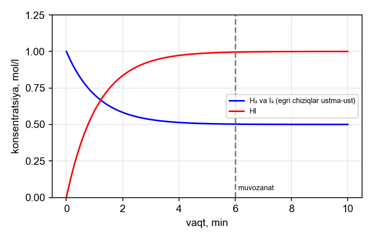
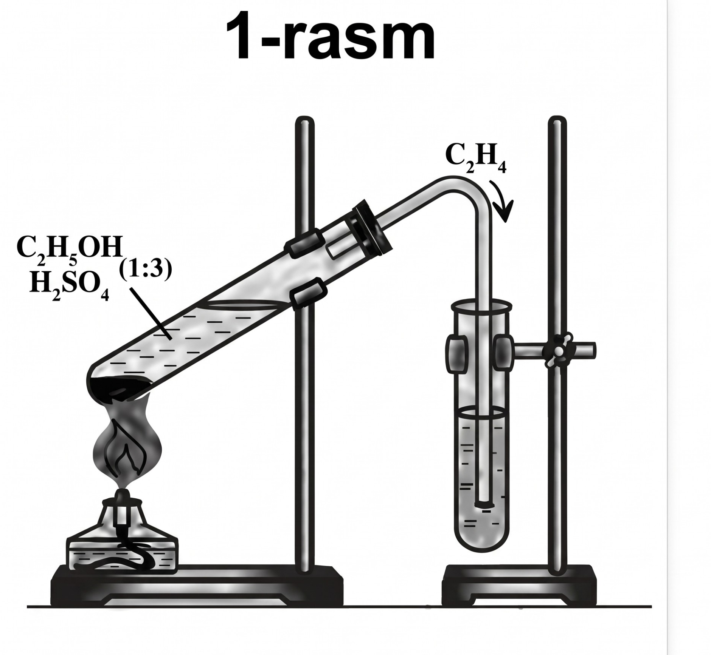

# KIMYO — Milliy sertifikat NAMUNA VARIANT № 1 (1–43)

Tuzilma: rasmiy spetsifikatsiya bo'yicha (1–13 umumiy, 14–19 anorganik, 20–29 organik, 30–32 tahlil, 33–35 moslashtirish, 36–40 qisqa javob, 41–43 yozma). Hamma ma'lumot, reaksiya va atamalar siz bergan darsliklardan olingan (7–11-sinf, Tirkashev, Tashev, Abdusamatov). Atom massalar: H 1, C 12, N 14, O 16, Na 23, Mg 24, Al 27, S 32, Cl 35,5, K 39, Ca 40, Fe 56, Cu 64, Zn 65, Br 80, Ag 108. Faraday: F = 96500 C/mol.

---

## I QISM. YOPIQ TESTLAR (1–32, har biri bitta to'g'ri javob)

### UMUMIY KIMYO (1–13)

**1.** 11,2 g temir mo'l xlor bilan to'liq reaksiyaga kirishib, 32,5 g tuz hosil qildi. Sarflangan xlorning hajmini (l, n.sh.) aniqlang.
A) 4,48  B) 6,72  C) 8,96  D) 3,36

**2.** Tarozining chap pallasida 35 g mis va 28 g kalsiy metallari bor. Misning ma'lum bir qismi va massa bo'yicha 25 % ko'proq kalsiy ajratib olinib, oksidlandi. Qolgan metall bo'laklari tarozining chap pallasiga, hosil bo'lgan oksidlar o'ng pallasiga joylashtirildi va tarozi muvozanatga keldi. Oksidlash uchun olingan mis bo'lagining massasini (g) aniqlang.
A) 10  B) 12  C) 15  D) 8

**3.** Sirka kislota va etanol o'zaro ta'sirlashganda (H2SO4 ishtirokida) hosil bo'lgan murakkab efir molekulasi tarkibidagi uglerod atomlarining sp3 gibrid orbitallari sonini sp2 gibrid orbitallari soniga nisbatini aniqlang.
A) 3  B) 5  C) 4  D) 2,5

**4.** Ionlanish energiyalarini solishtirishda ...E4 > E3 > E2 >> E1 bo'lgan element atomining tashqi qavatlari elektron konfiguratsiyasi qanday bo'ladi?
A) 3s2  B) 3s1  C) 3s2 3p1  D) 3s2 3p2

**5.** 26-tartib raqamli element atomida n = 3 va l = 2 bo'lgan elektronlar nechta va ulardan nechtasi juftlashmagan?
A) 6 va 2  B) 8 va 4  C) 6 va 4  D) 5 va 5

**6.** ²³²₉₀Th radioaktiv parchalanishlar natijasida barqaror ²⁰⁸₈₂Pb ga aylandi. Bunda nechta α- va nechta β⁻-zarra chiqarilgan?
A) 4α va 6β  B) 6α va 4β  C) 6α va 6β  D) 8α va 2β

**7.** Reaksiya tezligining haroratga bog'liqligi jadvalda keltirilgan:

| T, °C | 20 | 30 | 40 |
|---|---|---|---|
| v, mol/(l·s) | 0,5 | 1,5 | 4,5 |

Jadvaldan foydalanib, shu reaksiyaning 60 °C dagi tezligini (mol/(l·s)) aniqlang.
A) 40,5  B) 13,5  C) 121,5  D) 27

**8.** Grafikda H2 + I2 ⇌ 2HI reaksiyada moddalar konsentratsiyalarining vaqt bo'yicha o'zgarishi ko'rsatilgan (H2 va I2 ning boshlang'ich konsentratsiyalari teng).

Grafikdan foydalanib, muvozanat konstantasini (K) aniqlang.
A) 2  B) 8  C) 4  D) 1

**9.** Tuzning eruvchanligi (g/100 g suv) haroratga bog'liq jadvalda berilgan:

| T, °C | 0 | 10 | 20 | 30 | 40 | 50 | 60 |
|---|---|---|---|---|---|---|---|
| S | 13 | 20 | 30 | 45 | 62 | 80 | 102 |

50 °C da tayyorlangan to'yingan eritmaning 180 g i 20 °C gacha sovitilganda necha gramm tuz cho'kmaga tushadi?
A) 30  B) 50  C) 80  D) 20

**10.** pH = 12 bo'lgan NaOH eritmasining 200 ml siga necha ml suv qo'shilsa, eritma pH = 11 ga teng bo'ladi?
A) 1800  B) 1000  C) 2000  D) 900

**11.** N2 + 3H2 ⇌ 2NH3 + Q reaksiyasi doimiy hajmli idishda muvozanatga keltirilgandan so'ng harorat tushirildi. Yangi muvozanat qaror topgunga qadar sistemadagi moddalar konsentratsiyasi qanday o'zgaradi?
A) N2 ortadi, H2 ortadi, NH3 kamayadi
B) N2 kamayadi, H2 kamayadi, NH3 kamayadi
C) N2 ortadi, H2 kamayadi, NH3 ortadi
D) N2 kamayadi, H2 kamayadi, NH3 ortadi

**12.** KMnO4 + HCl → MnCl2 + Cl2 + KCl + H2O reaksiya tenglamasini tenglang. 3 mol KMnO4 to'liq reaksiyaga kirishganda qaytaruvchi vazifasini bajargan HCl miqdori necha mol?
A) 24  B) 30  C) 9  D) 15

**13.** CuSO4 eritmasi inert elektrodlar yordamida 5 A tok kuchi bilan 1930 s elektroliz qilindi. Anodda ajralgan gazning hajmini (l, n.sh.) aniqlang.
A) 0,56  B) 0,28  C) 1,12  D) 2,24

### ANORGANIK KIMYO (14–19)

**14.** Quyidagi jarayonlardan qaysilarida oltingugurt(IV) oksid hosil bo'ladi?
1) FeS2 ning havoda yonishi;
2) Cu ning konsentrlangan H2SO4 bilan qizdirilishi;
3) Zn ning suyultirilgan H2SO4 bilan reaksiyasi;
4) oltingugurtning yonishi
A) 1, 3, 4  B) 1, 2, 4  C) 2, 3, 4  D) 1, 2, 3

**15.** 5,6 l (n.sh.) ammiakdan ketma-ket oksidlash (NO → NO2) va NO2 ni suv hamda kislorod bilan yutish orqali nitrat kislota olindi. Umumiy unum 80 % bo'lsa, hosil bo'lgan kislotadan tayyorlanadigan 63 % li eritmaning massasini (g) aniqlang.
A) 12,5  B) 25  C) 31,5  D) 20

**16.** Mis va temirdan iborat 12 g aralashmaga sovuq konsentrlangan nitrat kislota ta'sir ettirilganda 4,48 l (n.sh.) gaz ajraldi. Reaksiyaga kirishmay qolgan qoldiq suyultirilgan xlorid kislotada eritilganda ajraladigan gazning hajmini (l, n.sh.) aniqlang.
A) 1,12  B) 2,24  C) 3,36  D) 4,48

**17.** 0,1 mol Cu(NO3)2 va 0,2 mol NaNO3 dan iborat aralashma to'liq parchalanguncha qizdirildi (mis nitrat oksidgacha, natriy nitrat nitritgacha parchalanadi). Qattiq qoldiq massasini (g) aniqlang.
A) 17,8  B) 25,6  C) 21,8  D) 8,0

**18.** Alyuminiy va mis aralashmasining 10 g massasi mo'l NaOH eritmasida eritilganda 6,72 l (n.sh.) gaz ajraldi. Aralashmada mis massa ulushi necha foiz?
A) 46  B) 54  C) 27  D) 64

**19.** Natriy va kaliyning teng mol nisbatdagi aralashmasi suv bilan reaksiyaga kirishib, 5,6 l (n.sh.) vodorod hosil qildi. Aralashma massasini (g) aniqlang.
A) 11,5  B) 19,5  C) 15,5  D) 7,75

### ORGANIK KIMYO (20–29)

**20.** CH3–CH(CH3)–CH(C2H5)–CH2–CH3 uglevodorodni sistematik nomenklatura bo'yicha nomlang.
A) 2-metil-3-etilpentan  B) 2,3-dietilbutan  C) 3-etil-2-metilpentan  D) 3-izopropilpentan

**21.** Atsetilen va etilendan iborat 0,4 mol aralashma tarkibida 96 g brom bo'lgan bromli suv bilan to'liq reaksiyaga kirishdi. Dastlabki aralashmaning massasini (g) aniqlang.
A) 11,2  B) 9,6  C) 12  D) 10,8

**22.** Etanal va propanondan iborat 10,2 g aralashma Ag2O ning ammiakli eritmasi (mo'l) bilan qizdirilganda 21,6 g kumush ajraldi. Aralashmadagi propanon massasini (g) aniqlang.
A) 2,9  B) 5,8  C) 4,4  D) 8,7

**23.** Benzol va toluoldan iborat 62 g aralashma kaliy permanganatning sulfat kislotali eritmasi bilan oksidlanganda 30,5 g benzoy kislota hosil bo'ldi. Dastlabki aralashmaning umumiy modda miqdorini (mol) aniqlang.
A) 0,5  B) 0,6  C) 0,9  D) 0,75

**24.** Metanol va etanoldan iborat 7,8 g aralashma natriy bilan to'liq reaksiyaga kirishganda 2,24 l (n.sh.) vodorod ajraldi. Aralashmadagi metanol massasini (g) aniqlang.
A) 3,2  B) 4,6  C) 1,6  D) 6,4

**25.** Metilamin va etilamindan iborat 0,3 mol aralashma kislorodda to'liq yondirilganda 0,4 mol karbonat angidrid hosil bo'ldi. Yonish uchun sarflangan kislorodning hajmini (l, n.sh.) aniqlang.
A) 16,8  B) 14,56  C) 18,48  D) 20,16

**26.** Chumoli va sirka kislotalarning teng mol miqdordagi 10,6 g aralashmasiga Ag2O ning ammiakli eritmasi mo'l miqdorda qo'shilib qizdirildi. Hosil bo'lgan cho'kma massasini (g) aniqlang.
A) 10,8  B) 21,6  C) 43,2  D) 32,4

**27.** Tabiiy kauchukning polimerlanish darajasi 2500 bo'lsa, shu kauchukning 340 g massasida nechta makromolekula bor? (N_A = 6·10²³)
A) 1,2·10²¹  B) 1,2·10²²  C) 2,4·10²¹  D) 6·10²⁰

**28.** Maltoza va saxarozadan iborat 855 g aralashma gidrolizlandi. Hosil bo'lgan moddalar bilan "kumush ko'zgu" reaksiyasi o'tkazilganda 756 g kumush ajraldi (faqat glyukoza ishtirok etadi). Aralashmadagi maltoza massasini (g) aniqlang.
A) 171  B) 513  C) 684  D) 342

**29.** 806 g tripalmitin natriy ishqori bilan to'liq gidrolizlanganda necha gramm sovun hosil bo'ladi?
A) 556  B) 918  C) 834  D) 278

### KIMYOVIY TAHLIL (30–32)

**30.** Rasmda laboratoriyada etilen olish tajribasi tasvirlangan. Ajralgan gaz bromli suvga va KMnO4 eritmasiga yuttirildi hamda yondirildi. Qaysi kuzatuvlar to'g'ri?

1) bromli suv rangsizlanadi;
2) KMnO4 eritmasi rangsizlanadi;
3) gaz havorang alanga bilan yonadi;
4) gaz qurumli, tutaydigan alanga bilan yonadi
A) 1, 2, 4  B) 2, 3, 4  C) 1, 3, 4  D) 1, 2, 3

**31.** Qaysi gazni ham suvni siqib chiqarish, ham havoni siqib chiqarish usulida to'plash mumkin?
A) H2  B) NO2  C) NH3  D) O2

**32.** Aralashmalarni ularni ajratish usullari bilan moslang.
1) suv va etanol aralashmasi;
2) qum va suv aralashmasi;
3) suv va kerosin aralashmasi;
4) osh tuzi eritmasi.
a) distillash;  b) filtrlash;  c) bo'lgich voronka;  d) bug'latish.
A) 1-b, 2-a, 3-c, 4-d
B) 1-a, 2-b, 3-c, 4-d
C) 1-a, 2-b, 3-d, 4-c
D) 1-c, 2-b, 3-a, 4-d

---

## II QISM. MOSLASHTIRISH (33–35)

**33–35.** Topshiriqlarga mos javoblarni A–F variantlaridan tanlang.
400 g 16 % li mis(II)-sulfat eritmasiga temir plastinka tushirildi. Birmuncha vaqt o'tgach plastinka eritmadan chiqarib olindi; uning massasi 1,6 g ga ortgan edi. Eritmada qolgan CuSO4 keyin inert elektrodlar yordamida to'liq elektroliz qilindi (tok kuchi 10 A).

**33.** Plastinka sirtida ajralgan mis massasini (g) aniqlang.
**34.** Plastinka chiqarib olingach, eritmaning massasini (g) aniqlang.
**35.** Eritmada qolgan CuSO4 ni to'liq elektroliz qilish uchun necha sekund kerak?

A) 3860  B) 11,2  C) 12,8  D) 1,6  E) 398,4  F) 7720

---

## III QISM. QISQA JAVOBLI (36–40) — javobni son bilan yozing

**36.** FeCl2 + KMnO4 + HCl → FeCl3 + MnCl2 + KCl + H2O reaksiya tenglamasini eng kichik butun sonlarda tenglang va barcha koeffitsiyentlar yig'indisini aniqlang.

**37.** 25 g mis kuporosi (CuSO4·5H2O) 175 g suvda eritildi. Hosil bo'lgan eritma inert elektrodlar yordamida 5 A tok kuchi bilan 1930 s elektroliz qilindi. Elektroliz tugagach, eritmadagi sulfat kislotaning massa ulushini (%) aniqlang.

**38.** Alyuminiy va alyuminiy oksididan iborat 7,8 g aralashma mo'l xlorid kislotada eritilganda 3,36 l (n.sh.) vodorod ajraldi. Hosil bo'lgan eritmaga mo'l miqdorda ammiak eritmasi qo'shildi, cho'kma ajratilib, to'liq qizdirildi. Qoldiq massasini (g) aniqlang.

**39.** 0,2 mol noma'lum alkinni to'liq yoqish uchun 17,92 l (n.sh.) kislorod sarflandi. Shu alkin Kucherov reaksiyasi bo'yicha gidratlanganda (unum 50 %) hosil bo'ladigan moddaning massasini (g) aniqlang.

**40.** To'yingan monokarbon kislotaning natriyli tuzi mo'l NaOH bilan qizdirilganda 2,24 l (n.sh.) gaz va 10,6 g Na2CO3 hosil bo'ldi. Hosil bo'lgan gazning vodorodga nisbatan zichligi 22 ga teng. Dastlabki karbon kislotaning molyar massasini (g/mol) aniqlang.

---

## IV QISM. YOZMA ISH (41–43) — to'liq yechim ko'rsatiladi

### 41-topshiriq (umumiy kimyo; 4 band, 25 ball)
75 g pirit rudasi (tarkibida 80 % FeS2) havoda to'liq yondirildi. Hosil bo'lgan oltingugurt(IV) oksidning hammasi hajmi 2 l bo'lgan idishga 0,8 mol kislorod bilan kiritildi va katalizator ishtirokida qizdirildi. SO2 ning 60 % i reaksiyaga kirishganda sistema muvozanat holatiga keldi: 2SO2 + O2 ⇌ 2SO3. Hosil bo'lgan SO3 ning hammasi 352 g suvda eritildi.
1) Ruda yonganda hosil bo'lgan SO2 ning hajmini (l, n.sh.) va qattiq qoldiq (Fe2O3) massasini (g) hisoblang.
2) Muvozanat konstantasini (K) hisoblang.
3) Hosil bo'lgan sulfat kislota eritmasining massa ulushini (%) aniqlang.
4) Shu eritmani to'liq neytrallash uchun zichligi 1,25 g/ml bo'lgan 20 % li NaOH eritmasidan necha ml kerak?

### 42-topshiriq (organik kimyo; 7 band, 25 ball; hisob-kitob yo'q)
Reaksiya tenglamalarini tugallang va tenglang. Hosil bo'lgan organik moddalarning tuzilish formulalarini yozing va ularni nomlang.
1) CH3COONa + NaOH —t→
2) CH3–CH=CH2 + HBr →
3) n CH2=CH–CH=CH2 → (1,4-birikish)
4) C6H5–CH3 + KMnO4 + H2SO4 →
5) CH3–CHO + Ag2O —NH3, t→
6) C6H5OH + Br2 (mo'l, bromli suv) →
7) H2N–CH2–COOH + HCl →

### 43-topshiriq (kimyoviy tahlil; 4 band, 25 ball)
Laboratoriyada 1–4-raqamli probirkalarda tartibsiz holda glyukoza, kraxmal kleysteri, tuxum oqsili va glitserin eritmalari bor. Ularni aniqlash uchun quyidagi tajribalar o'tkazildi:
a) 1-probirkaga yodning spirtdagi eritmasidan qo'shildi — eritma ko'k rangga bo'yaldi.
b) 2-probirkaga ishqor eritmasi va bir necha tomchi mis(II)-sulfat qo'shilganda eritma qizil-binafsha rangga bo'yaldi; boshqa porsiyasiga konsentrlangan HNO3 qo'shib qizdirilganda sariq rang paydo bo'ldi.
c) 3- va 4-probirkalarga yangi cho'ktirilgan Cu(OH)2 qo'shilganda ikkalasida ham cho'kma erib, ko'k eritma hosil bo'ldi. 3-probirka qizdirilganda avval sariq, so'ng qizil cho'kma tushdi, 4-probirkada esa o'zgarish bo'lmadi.
1) Kuzatilgan reaksiyalardan "kumush ko'zgu"ga o'xshash glyukozaning Cu(OH)2 bilan reaksiya tenglamasini yozing. 18 g glyukoza mo'l Cu(OH)2 bilan qizdirilganda hosil bo'lgan qizil cho'kmaning massasini (g) hisoblang.
2) 1–4-probirkalardagi moddalarni aniqlang (probirka raqami bilan moslab yozing).
3) a), b) va c) bo'yicha kuzatilgan rang o'zgarishlarining sababini tushuntiring: qaysi funksional guruh yoki bog' bilan bog'liq?
4) Tajribada probirkani qizdirish va konsentrlangan HNO3 bilan ishlashda qanday xavfsizlik qoidalariga rioya qilish kerak? Kamida uchta qoidani yozing.

---
---

# JAVOBLAR VA YECHIMLAR

## Javoblar kaliti
| 1 | 2 | 3 | 4 | 5 | 6 | 7 | 8 | 9 | 10 | 11 | 12 | 13 | 14 | 15 | 16 |
|---|---|---|---|---|---|---|---|---|----|----|----|----|----|----|----|
| B | B | C | B | C | B | A | C | B | A | D | D | A | B | D | B |

| 17 | 18 | 19 | 20 | 21 | 22 | 23 | 24 | 25 | 26 | 27 | 28 | 29 | 30 | 31 | 32 |
|----|----|----|----|----|----|----|----|----|----|----|----|----|----|----|----|
| C | A | C | C | D | B | D | A | C | B | A | D | C | D | D | B |

33 → **C** (12,8); 34 → **E** (398,4); 35 → **A** (3860).
36 → **25**; 37 → **2,5**; 38 → **10,2**; 39 → **5,8**; 40 → **88**.

Variantda bitta rasmli (30) va bitta grafikli (8) savol bor; jadvalli savollar — 7 va 9. Qiyinlik: ● oson, ●● o'rta, ●●● qiyin. Manba — siz bergan darslik bo'limi.

## 1–32 qisqa yechimlar
| № | Mavzu | Qiyin | Yechim | Manba |
|---|---|---|---|---|
| 1 | tarkib, Fe + Cl2 → FeCl3 | ●● | m(Cl2) = 32,5 − 11,2 = 21,3 g = 0,3 mol (n(Fe) = 0,2, FeCl3) → 6,72 l | 7–8-sinf; Tashev (Fe) |
| 2 | mol, massa balansi (tarozi) | ●●● | x g Cu, 1,25x g Ca oksidlandi: 2Cu + O2 → 2CuO (1,25x g); 2Ca + O2 → 2CaO (1,25x · 1,4 = 1,75x g); chap pallada (35 − x) + (28 − 1,25x), o'ngda 3x: 63 − 2,25x = 3x → x = 12 | 8-sinf; Tirkashev (stexiometriya) |
| 3 | gibridlanish | ●●● | CH3COOH + C2H5OH → CH3COOC2H5: 3 ta sp³ uglerod → 12 ta sp³ orbital; C=O dagi 1 ta sp² uglerod → 3 ta sp² orbital; 12/3 = 4 | 10-sinf §17 (gibridlanish) |
| 4 | ionlanish energiyasi | ●●● | E2 >> E1: bir valent elektronli element (I A guruh, tashqi qavatda 1 e⁻) → 3s¹ (Na) | 11-sinf 1-bob; Tirkashev I bob |
| 5 | kvant sonlari | ●● | Fe 3d⁶4s²: l=2 da 6 e⁻, 4 tasi juftlashmagan | Tirkashev I bob |
| 6 | yadro reaksiyasi | ●● | (232−208)/4 = 6α; zaryad: 90 − 12 = 78, 82 ga yetish uchun 4β | 11-sinf 1-bob |
| 7 | tezlik — jadval | ●● | jadvaldan γ = 1,5/0,5 = 4,5/1,5 = 3; 20 → 60 °C: 4 qadam, v = 0,5 · 3⁴ = 40,5 | 8-sinf; Tirkashev VI bob |
| 8 | muvozanat — grafik | ●●● | grafikdan: [H2] = [I2] = 0,5; [HI] = 1,0 mol/l; K = 1,0²/(0,5 · 0,5) = 4 | Tirkashev VI bob |
| 9 | eruvchanlik — jadval | ●●● | S(50) = 80, S(20) = 30; 180 g to'yingan eritmada 100 g suv + 80 g tuz; 20 °C da 30 g eriydi → 80 − 30 = 50 g cho'kadi | Tirkashev III bob |
| 10 | dissotsilanish, pH | ●● | pH 12 → [OH⁻] = 10⁻²; pH 11 → 10⁻³: hajm 10 marta ko'p = 2000 ml → 1800 ml suv | 9-sinf (dissotsilanish, pH); Tirkashev IV bob |
| 11 | muvozanat, Le-Shatelye | ●●● | issiqlik chiqaradigan reaksiyada harorat pasaysa muvozanat o'ngga siljiydi: N2 va H2 kamayadi, NH3 ortadi → D | Tirkashev VI bob |
| 12 | OQR | ●●● | 2KMnO4 + 16HCl → 2MnCl2 + 5Cl2 + 2KCl + 8H2O; qaytaruvchi HCl = 10 mol / 2 KMnO4 → 3 mol uchun 15 | 11-sinf 7-bob |
| 13 | elektroliz | ●●● | Q = 5·1930 = 9650 C = 0,1 mol e⁻; anod: 2H2O − 4e⁻ → O2 + 4H⁺ → 0,025 mol = 0,56 l | 11-sinf 8-bob; Tirkashev V bob |
| 14 | oltingugurt, SO2 hosil bo'lishi | ●● | 1) 4FeS2 + 11O2 → 2Fe2O3 + 8SO2; 2) Cu + 2H2SO4(kons) → CuSO4 + SO2 + 2H2O; 4) S + O2 → SO2; Zn + suyult. H2SO4 → H2 (3 emas) | Tashev (H2SO4); 9-sinf |
| 15 | HNO3 sanoatda olinishi | ●●● | NH3 0,25 mol → HNO3 0,25 · 0,8 = 0,2 mol = 12,6 g; 12,6/0,63 = 20 g | Tashev (HNO3 olinishi) |
| 16 | Cu + Fe, passivlanish | ●●● | sovuq kons. HNO3 da Fe passiv; Cu: NO2 0,2 mol → Cu 0,1 mol = 6,4 g; Fe = 12 − 6,4 = 5,6 g = 0,1 mol; Fe + 2HCl → H2 0,1 mol = 2,24 l | 9-sinf; Tashev |
| 17 | nitratlar termik parchalanishi | ●●● | 2Cu(NO3)2 → 2CuO + 4NO2 + O2: CuO 0,1 mol = 8 g; 2NaNO3 → 2NaNO2 + O2: NaNO2 0,2 · 69 = 13,8 g; jami 21,8 g | Tashev (nitratlar) |
| 18 | Al + NaOH | ●● | 2Al → 3H2: Al = 0,2 mol = 5,4 g; Cu = 4,6 g → 46 % | 9-sinf (Al) |
| 19 | IA metallar | ●● | H2 = 0,25 mol; Na va K har biri 0,25 mol (2M + 2H2O → 2MOH + H2): 5,75 + 9,75 = 15,5 g | 9-sinf (ishqoriy metallar) |
| 20 | nomenklatura | ● | 5 C li zanjir, 2-metil, 3-etil; alifbo tartibi: etil → metil | 10-sinf §6 |
| 21 | alkin + alken, Br2 | ●●● | Br2 = 0,6 mol; x + y = 0,4; 2x + y = 0,6 → x = y = 0,2; 0,2 · 26 + 0,2 · 28 = 10,8 g | 10-sinf §13, §15 |
| 22 | aldegid va keton | ●●● | faqat etanal: CH3CHO → 2Ag; Ag 0,2 mol → etanal 0,1 mol = 4,4 g; propanon = 10,2 − 4,4 = 5,8 g | 10-sinf §24–25 |
| 23 | arenlar oksidlanishi | ●●● | faqat toluol → benzoy kislota: 30,5/122 = 0,25 mol (23 g); benzol 39 g = 0,5 mol; jami 0,75 mol | 10-sinf §16 |
| 24 | spirt + Na | ●● | n(H2) = 0,1 → n(spirtlar) = 0,2; 32x + 46(0,2 − x) = 7,8 → x = 0,1 → 3,2 g | 10-sinf §21 |
| 25 | aminlar yonishi | ●●● | x + y = 0,3; x + 2y = 0,4 → x = 0,2 (CH3NH2), y = 0,1 (C2H5NH2); 4CH3NH2 + 9O2 → …: 2,25 mol/mol; 4C2H5NH2 + 15O2 → …: 3,75 mol/mol; 0,45 + 0,375 = 0,825 mol = 18,48 l | 10-sinf §33 |
| 26 | kislotalar | ●●● | HCOOH + Ag2O → 2Ag; 46x + 60x = 10,6 → x = 0,1; Ag 0,2 mol = 21,6 g | 10-sinf §26 |
| 27 | polimer, makromolekula soni | ●●● | M = 68 · 2500 = 170 000; 340/170 000 = 0,002 mol · 6·10²³ = 1,2·10²¹ | 10-sinf §35; Abdusamatov |
| 28 | uglevodlar | ●●● | Ag 7 mol → glyukoza 3,5 mol; n(aralashma) = 855/342 = 2,5; x + y = 2,5; 2x + y = 3,5 → x = 1 mol = 342 g | 10-sinf §31 |
| 29 | yog', sovun | ●●● | tripalmitin M = 806 → 1 mol; (C15H31COO)3C3H5 + 3NaOH → 3C15H31COONa + C3H5(OH)3; 3 · 278 = 834 g | 10-sinf §29; Abdusamatov |
| 30 | laboratoriya: etilen olish — rasm | ●● | etilen (π-bog') Br2 suvini va KMnO4 ni rangsizlantiradi, havorang alanga bilan yonadi; qurumli alanga asetilenga xos | Abdusamatov (alkenlar); 10-sinf lab. № 1 |
| 31 | laboratoriya: gaz yig'ish usullari | ●● | suv siqib chiqarish (suvda erimaydigan: H2, O2, CH4) va havoni siqib chiqarish (havodan og'ir: NO2, O2); ikkala usul: O2 | 7-sinf (kislorod olish va yig'ish); 9-sinf |
| 32 | laboratoriya: ajratish usullari | ●● | suv + etanol — distillash; qum + suv — filtrlash; suv + kerosin — bo'lgich voronka; tuz eritmasi — bug'latish: 1-a, 2-b, 3-c, 4-d | 7-sinf (aralashmalarni ajratish) |

## 33–35
Boshlang'ich: CuSO4 = 400 · 0,16 = 64 g = 0,4 mol. Fe + CuSO4 → FeSO4 + Cu: har 1 mol da plastinka 64 − 56 = 8 g ortadi → 1,6/8 = 0,2 mol reaksiyaga kirishgan.
**33.** Cu = 0,2 · 64 = 12,8 g → **C**.
**34.** Eritma massasi: 400 + 11,2 (Fe) − 12,8 (Cu) = 398,4 g → **E**.
**35.** Qolgan CuSO4 0,2 mol → 0,4 mol e⁻; Q = 0,4 · 96500 = 38 600 C; t = 38 600/10 = 3860 s → **A**.

## 36–40
**36.** 5FeCl2 + KMnO4 + 8HCl → 5FeCl3 + MnCl2 + KCl + 4H2O. Yig'indi 5+1+8+5+1+1+4 = **25**.
**37.** CuSO4·5H2O (M = 250): 25 g → CuSO4 16 g = 0,1 mol; eritma 200 g. Q = 5 · 1930 = 9650 C = 0,1 mol e⁻. Katod: Cu 0,05 mol (3,2 g); anod: O2 0,025 mol (0,8 g). Eritma massasi 200 − 3,2 − 0,8 = 196 g. H2SO4 = 0,05 mol = 4,9 g → 4,9/196 = **2,5 %**.
**38.** 2Al + 6HCl → 2AlCl3 + 3H2; n(H2) = 0,15 → Al 0,1 mol (2,7 g); Al2O3 = 7,8 − 2,7 = 5,1 g = 0,05 mol. Jami AlCl3: 0,1 + 0,1 = 0,2 mol → Al(OH)3 0,2 mol → 2Al(OH)3 → Al2O3 + 3H2O: Al2O3 0,1 mol = **10,2 g**.
**39.** O2 0,8 mol / 0,2 mol alkin = 4 = 1,5n − 0,5 → n = 3 (propin). CH3–C≡CH + H2O (Hg²⁺) → CH3–CO–CH3. Aseton 0,2 · 0,5 · 58 = **5,8 g**.
**40.** RCOONa + NaOH → RH + Na2CO3; n(RH) = n(Na2CO3) = 0,1 mol. M(RH) = 22 · 2 = 44 → C3H8; R = C3H7; kislota C3H7COOH (moy kislota): M = **88 g/mol**.

---

## 41-topshiriq — yechim va baholash (M — usul, A — hisob)
**1-band (M 6 + A 4 = 10 ball).** FeS2: 75 · 0,8 = 60 g = 0,5 mol (M = 120). 4FeS2 + 11O2 → 2Fe2O3 + 8SO2: n(SO2) = 1 mol → **22,4 l**; n(Fe2O3) = 0,25 mol → 0,25 · 160 = **40 g**.
**2-band (M 3 + A 2 = 5 ball).** SO2 reaksiyaga kirgan: 0,6 mol → SO3 0,6 mol; O2 sarfi 0,3 mol. Muvozanatda: SO2 0,4; O2 0,5; SO3 0,6 mol → konsentratsiyalar (V = 2 l): 0,2; 0,25; 0,3 mol/l. K = [SO3]²/([SO2]²·[O2]) = 0,09/(0,04 · 0,25) = **9**.
**3-band (M 3 + A 3 = 6 ball).** SO3 + H2O → H2SO4: 0,6 mol = 58,8 g; eritma 0,6 · 80 + 352 = 400 g → ω = 58,8/400 = **14,7 %**.
**4-band (M 2 + A 2 = 4 ball).** H2SO4 + 2NaOH → Na2SO4 + 2H2O: NaOH 1,2 mol = 48 g; eritma 48/0,2 = 240 g; V = 240/1,25 = **192 ml**.
Jami: M 14 + A 11 = 25 ball.

## 42-topshiriq — yechim va baholash (har band 3–5, jami 25)
1) (4 ball) CH3COONa + NaOH —t→ CH4 + Na2CO3 — metan.
2) (4 ball) CH3–CH=CH2 + HBr → CH3–CHBr–CH3 — 2-brompropan (Markovnikov qoidasi).
3) (3 ball) n CH2=CH–CH=CH2 → (–CH2–CH=CH–CH2–)n — polibutadiyen (butadiyen kauchuk).
4) (5 ball) 5C6H5–CH3 + 6KMnO4 + 9H2SO4 → 5C6H5–COOH + 6MnSO4 + 3K2SO4 + 14H2O — benzoy kislota.
5) (3 ball) CH3–CHO + Ag2O —NH3, t→ CH3–COOH + 2Ag↓ — etan (sirka) kislota.
6) (3 ball) C6H5OH + 3Br2 → C6H2Br3OH↓ + 3HBr — 2,4,6-tribromfenol (oq cho'kma).
7) (3 ball) H2N–CH2–COOH + HCl → [H3N⁺–CH2–COOH]Cl⁻ — glitsinning xlorid kislotali tuzi.
Jami 4+4+3+5+3+3+3 = 25 ball.

## 43-topshiriq — yechim va baholash (kimyoviy tahlil, 4 band)
**2-band javobi (M 4):** 1 — kraxmal kleysteri (yod bilan ko'k rang); 2 — tuxum oqsili (biuret va ksantoprotein reaksiyalari); 3 — glyukoza; 4 — glitserin.
**1-band (M 10 + A 2 = 12 ball).** CH2OH–(CHOH)4–CHO + 2Cu(OH)2 → CH2OH–(CHOH)4–COOH + Cu2O↓ + 2H2O. n(glyukoza) = 18/180 = 0,1 mol → n(Cu2O) = 0,1 mol → m = 0,1 · 144 = **14,4 g**.
**3-band (M 7 ball).** a) kraxmal yod bilan ko'k rang beradi (kraxmalning sifat reaksiyasi). b) oqsil: ishqoriy muhitda CuSO4 bilan qizil-binafsha rang — peptid bog' (–CO–NH–) uchun biuret reaksiyasi; konsentrlangan HNO3 bilan sariq rang — aromatik halqali aminokislota qoldiqlari (ksantoprotein reaksiya). c) glyukoza va glitserin Cu(OH)2 ni eritib, ko'k kompleks hosil qiladi (ko'p atomli spirt guruhlari); faqat glyukozada aldegid guruh bor, shuning uchun qizdirilganda Cu(OH)2 Cu2O (sariq CuOH, so'ng qizil Cu2O) gacha qaytariladi; glitserin aldegid guruhga ega emas.
**4-band (M 2 ball).** Misol qoidalar: probirka qisqichda tik, og'zi o'zingizga va boshqalarga qaratilmagan holda ohista qizdiriladi; konsentrlangan kislotani ehtiyotlik bilan, ko'zoynak va qo'lqopda ishlatish, teriga tushsa ko'p suv bilan yuvish; reaktivlarni tatib ko'rmaslik; ortiqcha reaktivni idishga qaytarmaslik; reaksiyalarni kichik miqdorda o'tkazish.
Baholash: M 10 + 4 + 7 + 2 = 23 ball, A 2 ball → 25 ball (kimyoviy tahlil jadvali: 4 band, M 23–25, A 1–2).

---
## Spetsifikatsiyaga mosligi (mavzular xaritasi)
- **1–13 umumiy kimyo:** 1 stexiometriya (1-mavzu), 2 qonunlar, gaz/Avogadro/ekvivalent (2), 3 bog'lanish va gibridlanish (3, 4-mavzu), 4 izoelektron/elektron konfiguratsiya (3), 5 kvant sonlari (3), 6 yadro reaksiyasi (3), 7 tezlik (5), 8 va 11 muvozanat, Le-Shatelye (6), 9 eruvchanlik, 10 pH va dissotsilanish (8), 12 OQR (9), 13 elektroliz (10); eritmalar (7) 9-savolda va 37 (kuporos eritmasi) da.
- **14–19 anorganik:** 14 oltingugurt, 15 azot (metalmaslar, 5-mavzu), 16 d-metallar va passivlanish, 17 tuzlar (nitratlar), 18 IIIA (Al), 19 IA metallar (3-mavzu).
- **20–29 organik (spetsifikatsiyadagi 10 mavzu — har birdan bittadan):** 20 alkan (1), 21 alken/alkin (2), 22 aldegid/keton (5), 23 aren (3), 24 spirt (4), 25 amin (9), 26 karbon kislota (6), 27 polimer (10), 28 uglevod (8), 29 yog'/sovun (7).
- **30–32 kimyoviy tahlil:** 30 etilen olish tajribasi, 31 gaz yig'ish usullari, 32 aralashmalarni ajratish.
- **33–40 va 41–43:** 33–35 umumiy+anorganik (metall, elektroliz), 36–37 umumiy, 38 anorganik, 39–40 organik, 41 umumiy, 42 organik, 43 kimyoviy tahlil.

## Real variantlar bilan solishtirish natijasi (qisqacha)
- 14–19 da metalmaslar (S, N, C) ko'paytirildi, 20–29 da alkin/diyen, amin va polimer qo'shildi, aldegid va yog' kamaytirildi; 30–32 da organik moddalarni aniqlash savoli qo'shildi.
- 33–35 realga yaqin "metall plastinka + eritma + elektroliz" hikoyasiga almashtirildi.
- 36–40: ko'p bosqichli, yashirin ma'lumotli masalalar; 41: pirit → SO2 → muvozanat → H2SO4 → neytrallash; 42: 7 reaksiyani tugallash, tenglash, nomlash; 43: laboratoriya (kraxmal, oqsil, glyukoza, glitserin) topishmog'i.
