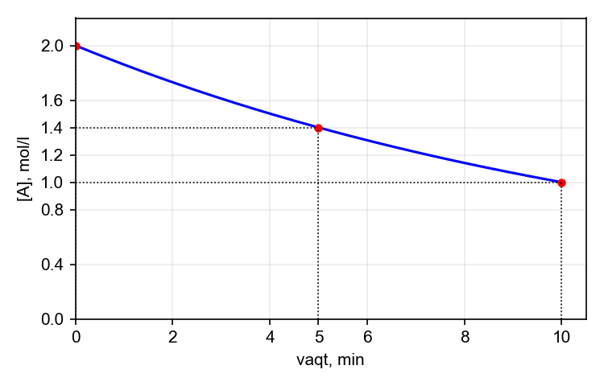
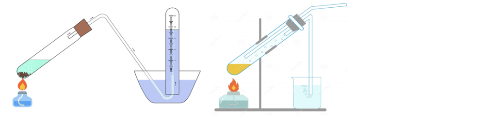

# KIMYO — Milliy sertifikat NAMUNA VARIANT № 2 (1–43)

Tuzilma: rasmiy spetsifikatsiya bo'yicha (1–13 umumiy, 14–19 anorganik, 20–29 organik, 30–32 tahlil, 33–35 moslashtirish, 36–40 qisqa javob, 41–43 yozma). Hamma ma'lumot siz bergan darsliklardan. Atom massalar: H 1, C 12, N 14, O 16, Na 23, Mg 24, Al 27, P 31, S 32, Cl 35,5, K 39, Ca 40, Fe 56, Cu 64, Zn 65, Br 80, Ag 108, I 127. Faraday: F = 96500 C/mol.

---

## I QISM. YOPIQ TESTLAR (1–32, har biri bitta to'g'ri javob)

### UMUMIY KIMYO (1–13)

**1.** Atomida 3 ta energetik pog'ona bo'lgan va tashqi pog'onasida 5 ta elektron bo'lgan elementning yuqori oksidi formulasini ko'rsating.
A) N2O5  B) P2O5  C) P2O3  D) PO2

**2.** X³⁺ ionida 10 ta elektron va 14 ta neytron bor. X atomining nisbiy atom massasini aniqlang.
A) 26  B) 28  C) 24  D) 27

**3.** 0,2 M sirka kislota eritmasida dissotsilanish darajasi 1 % bo'lsa, eritmadagi vodorod ionlari konsentratsiyasini (mol/l) aniqlang.
A) 0,002  B) 0,2  C) 0,0002  D) 0,02

**4.** Zichligi 1,14 g/ml bo'lgan 20 % li H2SO4 eritmasining molyar konsentratsiyasini (mol/l) aniqlang.
A) 4,66  B) 2,33  C) 1,14  D) 2,0

**5.** Jadvalda ikki tuz eritmasi haqida ma'lumot berilgan:

| Eritma | Massasi, g | Massa ulushi, % |
|---|---|---|
| 1 | 200 | 15 |
| 2 | 300 | 25 |

Eritmalar aralashtirilganda hosil bo'lgan eritmaning massa ulushini (%) aniqlang.
A) 21  B) 20  C) 25  D) 22

**6.** 212,5 g 8 % li AgNO3 eritmasiga mis plastinka tushirildi va kumush to'liq ajralib chiqquncha ushlab turildi. Plastinka massasi necha gramm ortadi?
A) 7,6  B) 10,8  C) 15,2  D) 3,8

**7.** Grafikda A moddaning (A → mahsulot) konsentratsiyasi vaqt bo'yicha o'zgarishi ko'rsatilgan.

Reaksiyaning 5-minutdan 10-minutgacha bo'lgan oraliqdagi o'rtacha tezligini mol/(l·min) hisoblang.
A) 0,16  B) 0,8  C) 0,04  D) 0,08

**8.** N2 + 3H2 ⇌ 2NH3 reaksiyada muvozanat qaror topganda [N2] = 0,5 mol/l, [H2] = 1,5 mol/l, [NH3] = 1 mol/l bo'ldi. Vodorodning boshlang'ich konsentratsiyasini (mol/l) aniqlang.
A) 2  B) 4,5  C) 1,5  D) 3

**9.** Tarkibida 3·10²³ ta atom bo'lgan metan (CH4) ning massasini (g) aniqlang. (N_A = 6·10²³)
A) 8  B) 3,2  C) 1,6  D) 0,8

**10.** 27 °C va 2 atm bosimda hajmi 4,92 l bo'lgan gazning massasi 8 g. Gazning molyar massasini (g/mol) aniqlang. (R = 0,082 l·atm/(mol·K))
A) 20  B) 16  C) 40  D) 32

**11.** 5,4 g metall oksidlanganda 10,2 g oksid hosil bo'ldi. Metallning ekvivalent massasini (g/mol) aniqlang.
A) 18  B) 27  C) 9  D) 12

**12.** 2,5 mol CaCO3 tarkibidagi kislorod atomlari sonini toping. (N_A = 6·10²³)
A) 3·10²⁴  B) 1,5·10²⁴  C) 9·10²⁴  D) 4,5·10²⁴

**13.** Tarkibida 20 % SO3 bo'lgan 100 g oleum 400 g suvga qo'shildi. Hosil bo'lgan eritmadagi H2SO4 massa ulushini (%) aniqlang.
A) 20,9  B) 24,5  C) 19,6  D) 22,4

### ANORGANIK KIMYO (14–19)

**14.** 155 g Ca3(PO4)2 ga mo'l H2SO4 ta'sir ettirilganda 80 % unum bilan hosil bo'lgan fosfat kislota massasini (g) aniqlang.
A) 62,7  B) 78,4  C) 98  D) 49

**15.** NaI va NaCl dan iborat 20 g aralashma orqali mo'l xlor o'tkazilganda aralashma massasi 9,15 g ga kamaydi. Aralashmadagi NaI ning massa ulushini (%) aniqlang.
A) 60  B) 50  C) 75  D) 80

**16.** 11,5 g natriy suvda eritildi. Hosil bo'lgan eritmadan 0,3 mol CO2 o'tkazildi. Hosil bo'lgan natriy gidrokarbonat massasini (g) aniqlang.
A) 21,2  B) 8,4  C) 4,2  D) 16,8

**17.** Kalsiy va alyuminiydan iborat 6,7 g aralashma mo'l xlorid kislotada eritilganda 5,6 l (n.sh.) vodorod ajraldi. Aralashmadagi kalsiy massasini (g) aniqlang.
A) 2  B) 4  C) 2,7  D) 5,3

**18.** 9 g Fe(OH)2 havoda to'liq oksidlanib, Fe(OH)3 ga aylandi. Hosil bo'lgan Fe(OH)3 massasini (g) aniqlang.
A) 8  B) 9  C) 12,3  D) 10,7

**19.** 1 l suvda 0,01 mol Ca(HCO3)2 va 0,02 mol CaSO4 erigan. Suv qaynatilgandan keyin qolgan qattiqlikni yo'qotish uchun necha gramm soda (Na2CO3) kerak?
A) 3,18  B) 2,12  C) 4,24  D) 1,06

### ORGANIK KIMYO (20–29)

**20.** 2,2,3-trimetilpentan molekulasida nechta birlamchi uglerod atomi bor?
A) 6  B) 3  C) 4  D) 5

**21.** Propen va propindan iborat 0,3 mol aralashmani to'liq gidrogenlash uchun 0,5 mol vodorod sarflandi. Aralashmadagi propin massasini (g) aniqlang.
A) 12  B) 4  C) 6  D) 8

**22.** 7,8 g benzoldan 80 % unum bilan nitrobenzol olindi. Hosil bo'lgan nitrobenzol massasini (g) aniqlang.
A) 7,87  B) 9,84  C) 6,15  D) 12,3

**23.** 9,4 g fenol mo'l bromli suv bilan reaksiyaga kirishganda hosil bo'lgan cho'kma massasini (g) aniqlang.
A) 49,6  B) 24,6  C) 33,1  D) 16,5

**24.** Etanal yangi cho'ktirilgan Cu(OH)2 bilan qizdirilganda 0,2 mol qizil cho'kma (Cu2O) hosil bo'ldi. Sarflangan etanal massasini (g) aniqlang.
A) 4,4  B) 6,6  C) 8,8  D) 17,6

**25.** 12 g sirka kislota va 9,2 g etanol aralashmasidan 75 % unum bilan etilatsetat olindi. Efir massasini (g) aniqlang.
A) 13,2  B) 11  C) 17,6  D) 8,8

**26.** 17,6 g etilatsetat mo'l NaOH bilan to'liq gidrolizlandi. Hosil bo'lgan natriy atsetat massasini (g) aniqlang.
A) 18,4  B) 8,2  C) 16,4  D) 12,3

**27.** 162 g kraxmal to'liq gidrolizlanib, hosil bo'lgan glyukoza spirtli bijg'itildi. Hosil bo'lgan etanol massasini (g) aniqlang.
A) 46  B) 184  C) 92  D) 180

**28.** 18,6 g anilin mo'l xlorid kislota bilan reaksiyaga kirishganda hosil bo'lgan tuz massasini (g) aniqlang.
A) 25,9  B) 18,6  C) 12,95  D) 23,4

**29.** Polistirolning molyar massasi 52 000 g/mol bo'lsa, uning polimerlanish darajasini aniqlang.
A) 250  B) 2000  C) 500  D) 1000

### KIMYOVIY TAHLIL (30–32)

**30.** Uch probirkada (X, Y, Z) Mg(NO3)2, Zn(NO3)2 va NaNO3 eritmalari bor. Ularga ketma-ket NaOH eritmasi qo'shildi. Kuzatuvlar jadvalda:

| Probirka | oz miqdor NaOH | mo'l miqdor NaOH |
|---|---|---|
| X | oq cho'kma | cho'kma erimaydi |
| Y | oq cho'kma | cho'kma eriydi |
| Z | o'zgarish yo'q | — |

X, Y, Z probirkalardagi moddalarni aniqlang.
A) X – Mg(NO3)2, Y – NaNO3, Z – Zn(NO3)2  B) X – Mg(NO3)2, Y – Zn(NO3)2, Z – NaNO3  C) X – NaNO3, Y – Mg(NO3)2, Z – Zn(NO3)2  D) X – Zn(NO3)2, Y – Mg(NO3)2, Z – NaNO3

**31.** Uch probirkada glyukoza, saxaroza va kraxmal eritmalari bor. Ularni aniqlash uchun qaysi reaktivlardan foydalanish to'g'ri?
A) FeCl3 eritmasi, so'ng Ag2O (NH3)
B) bromli suv, so'ng NaOH
C) faqat yod eritmasi
D) yod eritmasi (kraxmal — ko'k rang), so'ng Cu(OH)2 qizdirilganda (glyukoza — qizil cho'kma, saxaroza — o'zgarmaydi)

**32.** Rasmda gazlarni to'plashning ikki usuli ko'rsatilgan: 1-usul — suvni siqib chiqarish, 2-usul — havoni siqib chiqarish (idish og'zi yuqoriga).

Qaysi gazni rasmdagi ikkala usulda ham to'plab bo'lmaydi?
A) NH3  B) NO2  C) H2  D) O2

---

## II QISM. MOSLASHTIRISH (33–35)

**33–35.** Topshiriqlarga mos javoblarni A–F variantlaridan tanlang.
4 l hajmli idishda 2SO2 + O2 ⇌ 2SO3 reaksiyasi o'tkazildi. Moddalar miqdori jadvalda berilgan:

| Modda | SO2 | O2 | SO3 |
|---|---|---|---|
| Boshlang'ich miqdor, mol | 4 | 3 | 0 |
| Muvozanatdagi miqdor, mol | — | — | 2 |

**33.** Muvozanat holatida SO2 ning molyar konsentratsiyasini (mol/l) aniqlang.
**34.** Muvozanat konstantasini (K) aniqlang.
**35.** SO2 ning necha foizi reaksiyaga kirishgan?

A) 0,5  B) 2  C) 50  D) 25  E) 1  F) 14,3

---

## III QISM. QISQA JAVOBLI (36–40) — javobni son bilan yozing

**36.** K2Cr2O7 + HCl → CrCl3 + Cl2 + KCl + H2O reaksiya tenglamasini eng kichik butun sonlarda tenglang va barcha koeffitsiyentlar yig'indisini aniqlang.

**37.** 400 g 10 % li CuSO4 eritmasi inert elektrodlar yordamida 10 A tok kuchi bilan 3860 s elektroliz qilindi. Elektroliz tugagach, eritmadagi sulfat kislotaning massa ulushini (%) aniqlang (yaxlitlab, o'ndan birgacha yozing).

**38.** Na2CO3 va NaHCO3 dan iborat 19 g aralashma doimiy massaga kelguncha qizdirildi, massa 3,1 g ga kamaydi. Dastlabki aralashmadagi Na2CO3 massasini (g) aniqlang.

**39.** Molyar massasi noma'lum bo'lgan to'yingan bir atomli spirtning 6 g massasi natriy bilan to'liq reaksiyaga kirishganda 1,12 l (n.sh.) vodorod ajraldi. Spirtning molyar massasini (g/mol) aniqlang.

**40.** To'yingan bir atomli aldegidning 11,6 g massasi Ag2O ning ammiakli eritmasi bilan oksidlanganda 43,2 g kumush ajraldi. Aldegidning molyar massasini (g/mol) aniqlang.

---

## IV QISM. YOZMA ISH (41–43) — to'liq yechim ko'rsatiladi

### 41-topshiriq (umumiy kimyo; 5 band, 25 ball)
Hajmi 1 l bo'lgan idishga 0,8 mol SO2 va ma'lum miqdorda O2 solindi hamda katalizator ishtirokida qizdirildi: 2SO2 + O2 ⇌ 2SO3. Muvozanat qaror topganda idishda SO2, O2 va SO3 ning mol nisbati 1 : 1 : 3 bo'ldi.
Hosil bo'lgan SO3 ning hammasi 200 g 49 % li H2SO4 eritmasiga yuttirildi (oleum hosil bo'lmadi, SO3 to'liq suv bilan reaksiyaga kirishdi). Olingan eritmaga mo'l BaCl2 eritmasi qo'shildi.
1) O2 ning boshlang'ich miqdorini (mol) va muvozanat konstantasini (K) hisoblang.
2) SO2 ning necha foizi reaksiyaga kirishgan?
3) SO3 yuttirilgandan keyingi eritmada H2SO4 ning massa ulushini (%) aniqlang.
4) BaCl2 qo'shilganda hosil bo'lgan cho'kma massasini (g) toping.
5) Doimiy haroratda idish hajmi 2 marta kamaytirilsa (v = k·[SO2]²·[O2]), to'g'ri reaksiya tezligi necha marta o'zgaradi?

### 42-topshiriq (organik kimyo; 7 band, 25 ball; hisob-kitob yo'q)
Reaksiya tenglamalarini tugallang va tenglang. Hosil bo'lgan organik moddalarning tuzilish formulalarini yozing va ularni nomlang.
1) CH3–CH2–OH + CuO —t→
2) CH3–CHO + H2 —Ni, t→
3) C6H5–CH3 + Cl2 —yorug'lik→
4) CH3COOH + C2H5OH ⇌ (H2SO4)
5) n CH2=CH2 →
6) C6H5NH2 + HCl →
7) C6H12O6 —spirtli bijg'ish→

### 43-topshiriq (anorganik kimyo; 4 band, 25 ball)
Uch probirkada XCl2, YCl2 va ZCl2 tarkibli metall xloridlarining eritmalari bor. Har bir eritmaga reagentlar ta'sir ettirildi, kuzatuvlar jadvalda ("—" belgisi reaksiya bormasligini bildiradi, bo'sh kataklar bo'yicha ma'lumot berilmagan):

| Reagent | XCl2 | YCl2 | ZCl2 |
|---|---|---|---|
| H2S | qora cho'kma | — | |
| Na2S | qora cho'kma | qora cho'kma | oq cho'kma |
| NaOH | havorang cho'kma | och yashil cho'kma | oq cho'kma |
| Zn plastinka | qizil qoplama | | — |

X, Y, Z — davriy sistemaning to'rtinchi davridagi metallar.
1) Jadvalda kuzatilgan barcha reaksiyalarning molekulyar tenglamalarini yozing. XCl2 eritmasiga tushirilgan Zn plastinkada 0,2 mol X ajralgan bo'lsa, plastinka massasi qanchaga (g) o'zgargan?
2) X, Y, Z metallarni aniqlang va tuzlarning formulalarini yozing. XCl2 tarkibida X ning massa ulushi 47,4 % ekanini hisob bilan tasdiqlang.
3) 12,7 g YCl2 eritmasiga mo'l NaOH qo'shildi, hosil bo'lgan cho'kma havoda to'liq oksidlanguncha qoldirildi. Barcha reaksiya tenglamalarini yozing va oxirgi cho'kma massasini (g) aniqlang.
4) ZCl2 ning 13,6 g massasi mo'l NaOH eritmasi bilan reaksiyaga kirishganda hosil bo'lgan kompleks tuz massasini (g) hisoblang (reaksiya tenglamalarini yozing).

---
---

# JAVOBLAR VA YECHIMLAR

## Javoblar kaliti
| 1 | 2 | 3 | 4 | 5 | 6 | 7 | 8 | 9 | 10 | 11 | 12 | 13 | 14 | 15 | 16 |
|---|---|---|---|---|---|---|---|---|----|----|----|----|----|----|----|
| B | D | A | B | A | A | D | D | C | A | C | D | A | B | C | B |

| 17 | 18 | 19 | 20 | 21 | 22 | 23 | 24 | 25 | 26 | 27 | 28 | 29 | 30 | 31 | 32 |
|----|----|----|----|----|----|----|----|----|----|----|----|----|----|----|----|
| B | D | B | D | D | B | C | C | A | C | C | A | C | B | D | A |

33 → **A** (0,5); 34 → **B** (2); 35 → **C** (50).
36 → **29**; 37 → **5,1**; 38 → **10,6**; 39 → **60**; 40 → **58**.

Variantda bitta rasmli (32) va bitta grafikli (7) savol bor; jadvalli savollar — 5, 30, 33–35, 43.

## 1–32 qisqa yechimlar
| № | Javob | Yechim | Manba |
|---|---|---|---|
| 1 | B | 3 ta pog'ona → 3-davr, tashqi 5 e⁻ → V A guruh: P → yuqori oksidi P2O5 | Tashev; 8-sinf |
| 2 | D | X³⁺: e⁻ = 10 → Z = 13 (Al); A = 13 + 14 = 27 | Tirkashev I bob |
| 3 | A | [H⁺] = α · C = 0,01 · 0,2 = 0,002 mol/l | 9-sinf; Tirkashev IV bob |
| 4 | B | C = 10·ω·ρ/M = 10 · 20 · 1,14 / 98 = 2,33 | 11-sinf 4-bob |
| 5 | A | m(tuz) = 200·0,15 + 300·0,25 = 30 + 75 = 105 g; m(eritma) = 500 g → 21 % | Tirkashev III bob |
| 6 | A | AgNO3 = 17 g = 0,1 mol; Cu + 2AgNO3 → Cu(NO3)2 + 2Ag: Δm = 2·108 − 64 = 152 g (2 mol Ag uchun); 0,1 mol → 7,6 g | Tashev (metallar kuchlanish qatori) |
| 7 | D | grafikdan: 5 min da 1,4, 10 min da 1,0 mol/l; v = (1,4 − 1,0)/5 = 0,08 mol/(l·min) | 8-sinf; Tirkashev VI bob |
| 8 | D | N2 boshlang'ich = 0,5 + 0,5 = 1; H2 sarfi 3 · 0,5 = 1,5 → [H2]₀ = 1,5 + 1,5 = 3 | Tirkashev VI bob |
| 9 | C | n(atom) = 3·10²³/6·10²³ = 0,5 mol; metanda 5 atom → n(CH4) = 0,1 mol → 1,6 g | 7-sinf (mol); 8-sinf |
| 10 | A | n = PV/RT = 2·4,92/(0,082·300) = 0,4 mol; M = 8/0,4 = 20 | 11-sinf (Mendeleyev–Klapeyron) |
| 11 | C | m(O) = 10,2 − 5,4 = 4,8 g; E(Me) = 5,4 · 8/4,8 = 9 (Al) | 8-sinf; 11-sinf (ekvivalentlar qonuni) |
| 12 | D | CaCO3 da 3 ta O: 2,5 · 3 = 7,5 mol; 7,5 · 6·10²³ = 4,5·10²⁴ | 7-sinf (mol, Avogadro) |
| 13 | A | oleum: SO3 20 g, H2SO4 80 g; SO3 + H2O → H2SO4: 20/80 · 98 = 24,5 g; jami 104,5 g / 500 g = 20,9 % | Tirkashev III bob (oleum); Tashev |
| 14 | B | Ca3(PO4)2 (M = 310) 0,5 mol; Ca3(PO4)2 + 3H2SO4 → 3CaSO4 + 2H3PO4: 1 mol H3PO4 = 98 g; 98 · 0,8 = 78,4 | Tashev (fosfor, o'g'itlar) |
| 15 | C | 2NaI + Cl2 → 2NaCl + I2: 1 mol NaI da Δm = 150 − 58,5 = 91,5; 9,15/91,5 = 0,1 mol NaI = 15 g → 75 % | Tashev (galogenlar) |
| 16 | B | Na 0,5 mol → NaOH 0,5 mol; NaOH : CO2 = 5 : 3 → Na2CO3 x, NaHCO3 y: x + y = 0,3; 2x + y = 0,5 → y = 0,1 mol = 8,4 g | 9-sinf (ishqoriy metallar, uglerod) |
| 17 | B | x Ca, y Al: 40x + 27y = 6,7; x + 1,5y = 0,25 → x = 0,1 → 4 g | 9-sinf (Ca, Al) |
| 18 | D | 4Fe(OH)2 + O2 + 2H2O → 4Fe(OH)3; 9 g = 0,1 mol → 0,1 · 107 = 10,7 g | 9-sinf (temir) |
| 19 | B | qaynatishda Ca(HCO3)2 yo'qoladi, doimiy CaSO4 0,02 mol qoladi; CaSO4 + Na2CO3 → CaCO3 + Na2SO4: 0,02 · 106 = 2,12 g | 9-sinf §24 (suv qattiqligi) |
| 20 | D | 5 ta CH3 (C1, 2 ta C2 da, C3 da, C5): 5 birlamchi | 10-sinf §6 |
| 21 | D | x propen, y propin: x + y = 0,3; x + 2y = 0,5 → y = 0,2 mol = 8 g | 10-sinf §13, §15 |
| 22 | B | C6H6 + HNO3 → C6H5NO2 + H2O: 0,1 mol · 0,8 = 0,08 mol · 123 = 9,84 g | 10-sinf §16 |
| 23 | C | C6H5OH + 3Br2 → C6H2Br3OH↓ + 3HBr: 0,1 mol · 331 = 33,1 g | 10-sinf §23 |
| 24 | C | CH3CHO + 2Cu(OH)2 → CH3COOH + Cu2O + 2H2O: etanal 0,2 mol · 44 = 8,8 g | 10-sinf §24 |
| 25 | A | kislota 0,2 mol, spirt 0,2 mol → nazariy 0,2 mol; 0,15 mol · 88 = 13,2 g | 10-sinf §26, §28 |
| 26 | C | CH3COOC2H5 + NaOH → CH3COONa + C2H5OH: 0,2 mol · 82 = 16,4 g | 10-sinf §28 |
| 27 | C | (C6H10O5)n: 1 mol zveno = 162 g → 1 mol glyukoza → 2 mol C2H5OH = 92 g | 10-sinf §31 |
| 28 | A | C6H5NH2 + HCl → C6H5NH3Cl: 0,2 mol · 129,5 = 25,9 g | 10-sinf §33 |
| 29 | C | M(stirol) = 104; n = 52000/104 = 500 | 10-sinf §35 |
| 30 | B | Mg(OH)2 mo'l ishqorda erimaydi (X – Mg(NO3)2); Zn(OH)2 amfoter, eriydi (Y – Zn(NO3)2); Z – NaNO3 | 9-sinf (amfoterlik); lab. ishlari |
| 31 | D | kraxmal yod bilan ko'k; glyukozada aldegid guruh – Cu(OH)2 ni Cu2O gacha qaytaradi; saxaroza qaytarmaydi | 10-sinf §31; lab. |
| 32 | A | NH3 suvda yaxshi eriydi (1-usul bo'lmaydi) va havodan yengil (2-usulda idish teskari kerak) → ikkala usul mos emas; O2 ikkalasiga mos; NO2 faqat 2; H2 faqat 1 | 7-sinf; 9-sinf |

## 33–35
SO2 4 mol, O2 3 mol, SO3 2 mol (muvozanatda) → SO2 sarfi 2 mol → muvozanatda SO2 = 2 mol, O2 = 3 − 1 = 2 mol.
**33.** [SO2] = 2/4 = 0,5 mol/l → **A**.
**34.** [O2] = 0,5; [SO3] = 0,5; K = [SO3]²/([SO2]²·[O2]) = 0,25/(0,25 · 0,5) = 2 → **B**.
**35.** 2/4 · 100 = 50 % → **C**.

## 36–40
**36.** K2Cr2O7 + 14HCl → 2CrCl3 + 3Cl2 + 2KCl + 7H2O. Yig'indi 1+14+2+3+2+7 = **29**.
**37.** CuSO4 = 40 g = 0,25 mol. Q = 10 · 3860 = 38600 C = 0,4 mol e⁻. Katod: Cu 0,2 mol (12,8 g); anod: O2 0,1 mol (3,2 g); H2SO4 0,2 mol = 19,6 g. Eritma 400 − 12,8 − 3,2 = 384 g → 19,6/384 = **5,1 %**.
**38.** 2NaHCO3 → Na2CO3 + H2O + CO2: 168 g tuz → 62 g kamayish; 3,1 g → NaHCO3 8,4 g; Na2CO3 = 19 − 8,4 = **10,6 g**.
**39.** 2ROH + 2Na → 2RONa + H2: n(H2) = 0,05 → n(spirt) = 0,1 mol; M = 6/0,1 = **60 g/mol**.
**40.** RCHO → 2Ag: Ag 0,4 mol → aldegid 0,2 mol; M = 11,6/0,2 = **58 g/mol** (propanal).

---

## 41-topshiriq — yechim va baholash (M — usul, A — hisob)
**1-band (M 6 + A 3 = 9 ball).** Muvozanatda SO2 : O2 : SO3 = 1 : 1 : 3 → SO2 = x, O2 = x, SO3 = 3x. SO2 balansi: x + 3x = 0,8 → x = 0,2 mol. SO3 = 0,6 mol hosil bo'lgan, O2 sarfi 0,3 mol; O2 boshlang'ich = 0,2 + 0,3 = **0,5 mol**. V = 1 l: [SO2] = 0,2; [O2] = 0,2; [SO3] = 0,6 mol/l. K = [SO3]²/([SO2]²·[O2]) = 0,36/(0,04 · 0,2) = **45**.
**2-band (M 2 + A 1 = 3 ball).** SO2 reaksiyaga kirishgan: 0,6/0,8 · 100 = **75 %**.
**3-band (M 3 + A 3 = 6 ball).** SO3 = 0,6 mol = 48 g. 200 g 49 % li eritmada H2SO4 98 g (1 mol), suv 102 g. SO3 + H2O → H2SO4: suv sarfi 0,6 mol = 10,8 g; hosil bo'lgan H2SO4 0,6 mol = 58,8 g. Jami H2SO4 = 98 + 58,8 = 156,8 g; eritma massasi 200 + 48 = 248 g; ω = 156,8/248 = **63,2 %**.
**4-band (M 2 + A 2 = 4 ball).** H2SO4 + BaCl2 → BaSO4↓ + 2HCl. n(H2SO4) = 156,8/98 = 1,6 mol → BaSO4 1,6 mol; m = 1,6 · 233 = **372,8 g**.
**5-band (M 2 + A 1 = 3 ball).** Hajm 2 marta kamayganda konsentratsiyalar 2 marta ortadi: v₂/v₁ = k·(2[SO2])²·(2[O2])/(k·[SO2]²·[O2]) = 2² · 2 = **8 marta ortadi**.
Jami: M 15 + A 10 = 25 ball (5 bandli topshiriq jadvaliga mos).

## 42-topshiriq — yechim va baholash (har band 3–5, jami 25)
1) (4 ball) CH3CH2OH + CuO —t→ CH3CHO + Cu + H2O — etanal.
2) (3 ball) CH3CHO + H2 —Ni, t→ CH3CH2OH — etanol.
3) (4 ball) C6H5CH3 + Cl2 —hν→ C6H5CH2Cl + HCl — benzilxlorid (yon zanjirda almashinish).
4) (4 ball) CH3COOH + C2H5OH ⇌ CH3COOC2H5 + H2O (H2SO4) — etilatsetat.
5) (3 ball) n CH2=CH2 → (–CH2–CH2–)n — polietilen.
6) (3 ball) C6H5NH2 + HCl → [C6H5NH3]Cl — fenilammoniy xlorid.
7) (4 ball) C6H12O6 → 2C2H5OH + 2CO2 — etanol va karbonat angidrid.
Jami 4+3+4+4+3+3+4 = 25 ball.

## 43-topshiriq — yechim va baholash (anorganik, 4 band)
**1-band (M 6 + A 3 = 9 ball).**
CuCl2 + H2S → CuS↓ + 2HCl;  FeCl2 + H2S — reaksiya bormaydi (FeS kuchli kislotada erib ketadi)
CuCl2 + Na2S → CuS↓ + 2NaCl;  FeCl2 + Na2S → FeS↓ + 2NaCl;  ZnCl2 + Na2S → ZnS↓ + 2NaCl
CuCl2 + 2NaOH → Cu(OH)2↓ + 2NaCl;  FeCl2 + 2NaOH → Fe(OH)2↓ + 2NaCl;  ZnCl2 + 2NaOH → Zn(OH)2↓ + 2NaCl
CuCl2 + Zn → ZnCl2 + Cu: 0,2 mol Cu ajraladi, 0,2 mol Zn erib ketadi: Δm = 0,2 · (64 − 65) = −0,2 g (plastinka **0,2 g ga kamayadi**).
**2-band (M 3 + A 2 = 5 ball).** X = Cu (CuCl2: qora CuS, havorang Cu(OH)2, Zn bilan qizil mis); Y = Fe (FeCl2: och yashil Fe(OH)2, qora FeS); Z = Zn (ZnCl2: oq ZnS, oq Zn(OH)2). ω(Cu) = 64/135 = **47,4 %** (M(CuCl2) = 135).
**3-band (M 3 + A 3 = 6 ball).** n(FeCl2) = 12,7/127 = 0,1 mol. FeCl2 + 2NaOH → Fe(OH)2↓ + 2NaCl (och yashil); havoda 4Fe(OH)2 + O2 + 2H2O → 4Fe(OH)3 (qo'ng'ir). Fe(OH)3 0,1 mol, M = 107: **10,7 g**.
**4-band (M 3 + A 2 = 5 ball).** ZnCl2 + 2NaOH → Zn(OH)2↓ + 2NaCl; Zn(OH)2 + 2NaOH → Na2[Zn(OH)4]. n(ZnCl2) = 13,6/136 = 0,1 mol → Na2[Zn(OH)4] 0,1 mol (M = 179) = **17,9 g**.
Jami: M 15 + A 10 = 25 ball.
